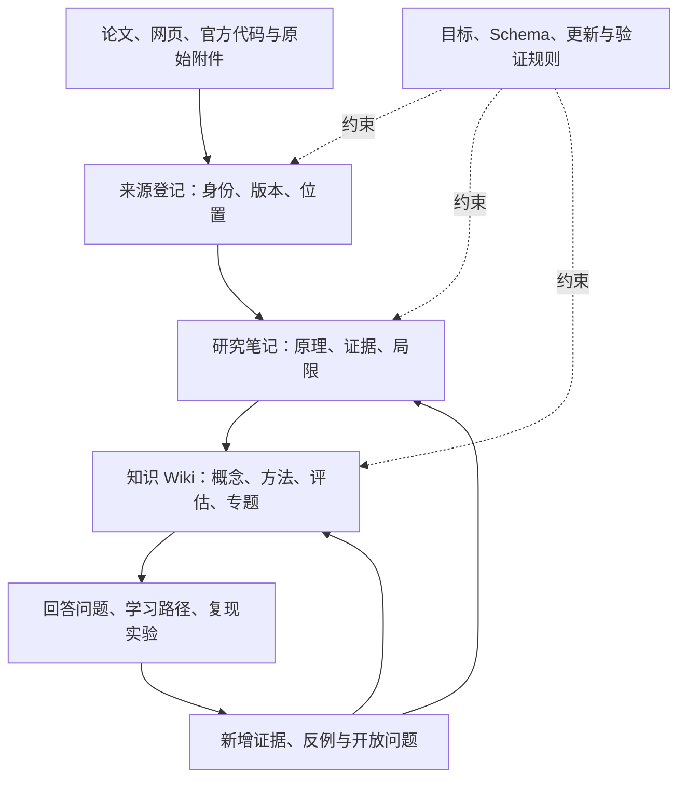

# 推荐系统个人知识库：设计建议

任务：KB-001；检索与设计日期：2026-10-25；状态：设计提案，尚未实施完整目录与工具链。

## 核心建议

将本仓库发展为“有来源、有结构、能持续修正的个人研究 Wiki”。原始资料保证可追溯，研究笔记保留推导和判断，知识页整合跨资料的稳定理解，问题与实验推动下一轮学习。三条领域主线是传统推荐、营销补贴、生成式推荐，共用概念、方法与评估基础。

最重要的增长单位是“一个研究问题得到更可靠的回答”，其次才是论文或页面数量。每次入库都应说明：它改变了哪些已有认识，支持或反驳了什么，还有什么没有解决。深读一篇重要论文可以只改几页；收集许多候选论文可以暂时不生成知识页。

用户已确认以 Codex/Claude Code + Markdown 为主要使用方式，按需搭配 Obsidian。以本地 Markdown + Git + Agent 为核心，Obsidian 用于可选的阅读与浏览，文献管理器作为可选素材管理工具。先把一组真实论文的阅读、整合和回查跑通，再按实际检索瓶颈增加检索能力；文件内容与规则应保持可迁移，阅读界面可替换。

## 资料如何积累成体系

这里的原始资料是“核对作者到底说过什么”的依据；作者报告本身仍可能有错误或适用条件。Wiki 是可以修订的解释与综合层，重要结论必须能沿引用回到原文或真实实验。

## 详细方案

| 文档 | 解决的问题 |
|---|---|
| [参考资料研究](01_参考资料研究.md) | 三份参考分别贡献了什么；哪些设计适用；文档与源码有哪些差别 |
| [知识结构与证据模型](02_知识结构与证据模型.md) | 目录、领域地图、页面分工、来源身份、证据与代码如何连接 |
| [工作流与迭代路线](03_工作流与迭代路线.md) | 资料入库、问答回写、冲突更新、维护节奏与分阶段落地 |
| [来源清单](sources.json) | 固定的 Gist/代码版本、文件哈希与本次实际阅读范围 |
| [任务交接](../../会话/KB-001.md) | 本轮范围、真实验证、交付状态与后续接手入口 |

## 关键取舍

1. **按知识对象存放，按研究问题和领域浏览。** 一份概念只有一个主要页面，三个领域入口链接到它，避免把共用方法复制三遍。
2. **单篇笔记与跨论文知识分工。** 保留现有 `docs/研究/`；新增 Wiki 负责整合，来源登记只管身份与材料定位，不再生成一套内容相同的论文摘要。
3. **明确区分来源贡献与证据支持。** 页头列出参考来源还不够；重要结论在正文注明原文章节、图表、版本及适用条件。
4. **建立有条件的认识。** 避免“某模型最优”式结论，记录它在什么任务、数据、协议和成本约束下解决了什么问题。
5. **让更新影响可以追踪。** 来源升级或被撤回时，定位依赖它的结论和专题，标记待复核；资料文件暂时找不到不等于论文结论被推翻。
6. **把确定性工作交给脚本，把解释交给 Agent，把研究判断留给人。** 索引、重复 ID、链接等适合程序检查；公式含义、因果识别与业务迁移仍需判断。

## 最小落地建议

首轮选一个问题，整理约 5–8 份有代表性的资料，产出来源登记、必要的深读笔记、一份方法比较和少量可复用概念页，再验证若干真实问题能否回查到证据。数量是控制投入的建议，不是验收的硬指标，也不是当前已启动任务。

首轮落地完成的标志是：换一个新会话后，仍能解释方法、定位原文、识别未验证推断，并将一份新资料合并到已有认识中。更详细的阶段验收见 [迭代路线](03_工作流与迭代路线.md)。

## 本轮实际完成范围

已通读 Karpathy 原文和本地 skill 的主要操作规范，阅读 nashsu 的中文 README、模板与核心实现片段，固定源码版本并记录证据。没有安装或运行 nashsu 应用，没有复测其效果数据，也没有对所有 GitHub 实践做完整性排名。

本轮只交付设计与仓库上下文同步。`sources/`、`wiki/`、扩展检查器、自动入库、检索和备份流程均为建议能力，不能据此文档认定它们已经实现。
