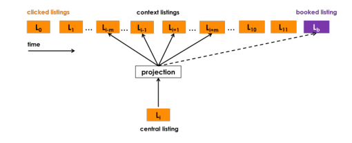
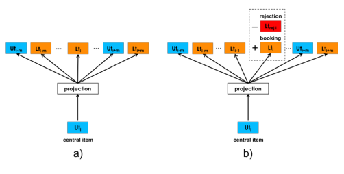
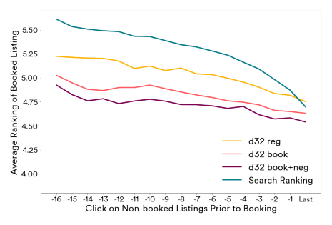
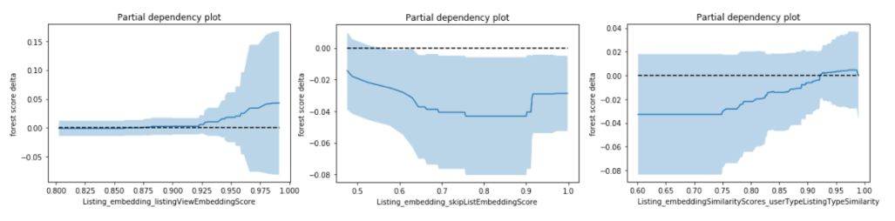

# Airbnb 怎样把会话点击与最终预订接进实时个性化

同城两套房源同时被点击，可能是因为它们都符合用户的当前筛选条件。若训练用全站随机房源作负例，模型只需区分城市就能做好一部分任务。Airbnb 另外在同市场内采样，促使模型学习这个市场内部的房源关系。点击嵌入服务当前行程，用户类型与房源类型嵌入用以建模跨行程的长期偏好。

## 点击窗口中额外读入最终预订

假设用户在同一次巴黎会话先点了 A 单间、B 公寓，随后预订 C 带厨房公寓。相邻点击相隔超过 30 分钟时划入新会话。Skip-gram 以 A 为中心、B 为窗口内上下文。若窗口没覆盖 C，基本目标没有 A→C 的监督。论文仍让中心 A 预测 C，为每个中心加一项 $\log\sigma(v_A^\top v'_C)$。探索会话无预订，继续使用窗口内点击正例。独立的上下文向量 $v'$ 接收正负样本的梯度，$v_A$ 同时学习局部相似性与终点关联。[§3.1、式 (1)–(4)，KDD 2018，PDF 第 3 页](https://doi.org/10.1145/3219819.3219885)。

作者原图 1，Grbovic 与 Cheng，固定 KDD 2018 PDF 第 3 页。窗口中的点击会进出，虚线所示的预订房源始终作为目标。

设全目录随机负例是罗马房源 D，又从 A 同一市场抽到巴黎房源 E。E 的分数进入 $-\log\sigma(-v_A^\top v'_E)$，希望 A 更接近本会话的 B、C，而在同城候选中仍有区分。E 由市场随机抽出，其未点击并未给出用户真实不喜欢的结论。训练完成后，详情页可对种子 A 计算其他房源的余弦相似度。搜索则把候选与点击、跳过、收藏等近期历史集合的相似性传给排序器。[原文 §3.1、式 (5)、§4.3–4.4](https://doi.org/10.1145/3219819.3219885)。

## 历史预订稀疏时把单位改为类型

房源很少被同一人反复预订，甚至同一用户每年只旅行一两次。长期模型按房源属性与价格等生成房源类型，按用户资料和截至当时的预订历史生成用户类型。一次预订是一个用户类型、房源类型的组合。目标结合两类关系。用同一用户附近预订中的房源类型形成房源上下文，并用当时用户类型与所订房源类型配对，使两类向量处在可比较的空间。用户类型会随预订更新。另加入房东拒绝的显式负配对，重点使用拒绝后最终成功预订的序列情形。它把双边市场失败风险带进训练数据。[原文 §3.2、式 (6)–(9)，PDF 第 5–6 页](https://doi.org/10.1145/3219819.3219885)。

作者原图 5，同版 PDF 第 6 页。左半部看同一用户附近的预订与两种类型的配对。右半部看负号标出的拒绝例。线上用用户与候选的类型向量相似度提供长期特征。新房源的短期表示另用邻近同类房源向量初始化，两处冷启动路径作用不同。

## 分别评估详情页推荐与搜索排序

作者原图 6，同版 PDF 第 7 页。固定 32 维，比较原窗口、加预订、再加同市场负样本。横轴是离最终预订还有多少次点击，纵轴为最终预订房源的平均名次。早期点击后的差异能反映向量对初始探索的帮助。

相似房源轮播的线上 A/B 报告 CTR 相对提高 21%，最终预订房源来自轮播的宾客指标增加 4.9%。搜索排序采用独立的排序标签与模型，表 8 在留出数据报告 NDCU +2.27%、预订 DCU +2.58%。论文称搜索线上预订显著增加，未给同样的精确百分比。轮播收益、搜索指标和总体预订量的分母与对象不同。[原文 §4.2–4.4，PDF 第 7–10 页](https://doi.org/10.1145/3219819.3219885)。

作者原图 7，同版 PDF 第 9 页。曲线来自作者的排序模型，表示模型对特征变化的平均响应。它给出了特征方向的解释，不是分别改变这三个用户行为的因果估计。

和 [Item2Vec](../SRC-ITEM2VEC/阅读笔记.md) 的集合全窗口相比，Airbnb 保留顺序，并给预订与同市场负例单独赋予语义。和 [EGES](../SRC-EGES/阅读笔记.md) 相比，这里的路径来自真实会话，每个训练目标可以回查行为窗口或最终结果。见[物品相似性怎样由交互日志学出](../../知识库/问题/物品相似性怎样由交互日志学出.md)。

采用 [KDD 2018 DOI 10.1145/3219819.3219885](https://doi.org/10.1145/3219819.3219885)，阅读正式第 311–320 页的摘要、§1–5、式 (1)–(12) 及图表。PDF 由固定 Git 镜像取得，下载字节与固定 commit 的 Git blob 一致，核对了正文页码和 ACM 权利栏。

中文学习译本 16 页。摘要、正文 §1–5、致谢、12 个编号公式及 7 图 8 表对照正式版重排，图内原字与参考文献保留英文。本地附件为 `.local/papers/SRC-AIRBNB-EMBEDDINGS/translation/Airbnb.中文.pdf`。采用版原文与译文均已认证下载并核对完整 SHA-256。见 [PDF 备份说明](../../文档/工具/中文PDF发布.md)。
