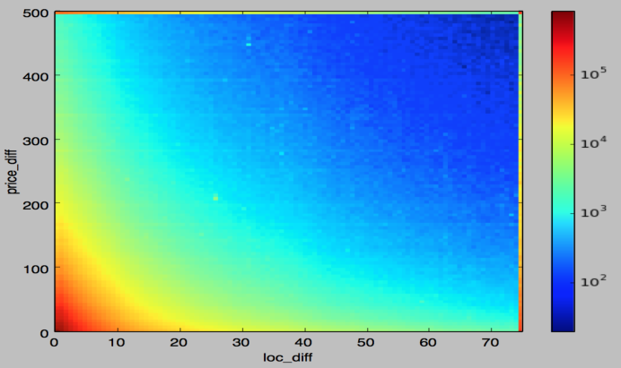
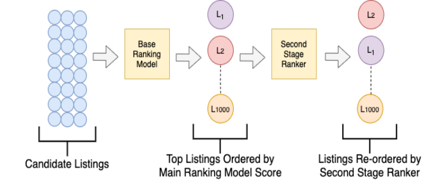
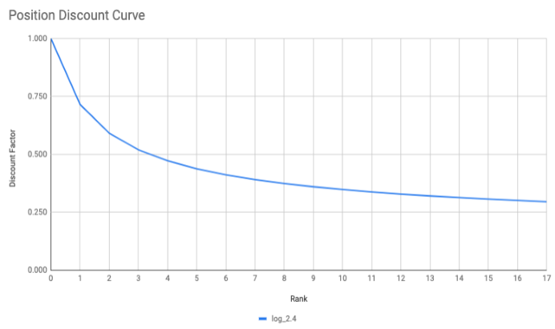
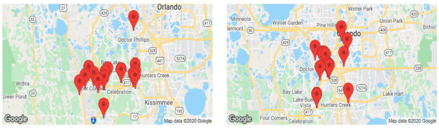
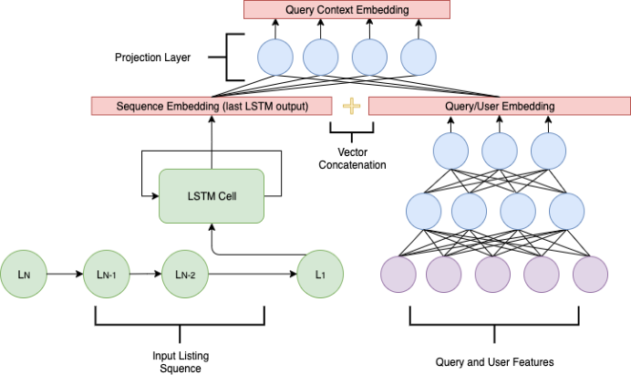
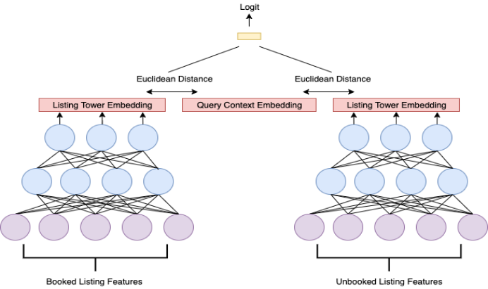
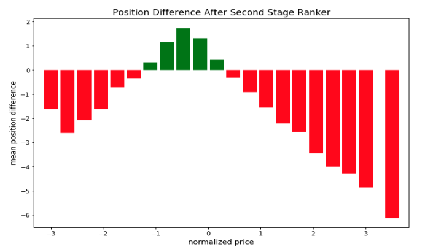

# Airbnb 搜索怎样增加选择，并保留预订相关性

找周末住处时，首屏几套房的位置和价格都近似，某种需求一旦没被命中，靠后的候选再丰富也难以帮上忙。Airbnb 的基础排序器根据同一查询中的已预订与未预订房源对来训练。它对每套房单独打分，因此相似房源可能排得很集中。论文先尝试把位置折扣和房源差异写成规则，再约束首屏属性分布，最后把原排序的候选序列编码成查询上下文。各条路线的线上反馈不同。[arXiv 2004.02621v1 §1，第 1–2 页](https://arxiv.org/pdf/2004.02621v1#page=1)。

Abdool 等，固定 v1 图 1，PDF 第 2 页，作者原图。先看价格差与位置距离的分布，观察接近量级上的集中。此图来自按基础模型排在头部的房源对。

Abdool 等，固定 v1 图 2，PDF 第 2 页，作者原图。先按查询参数检索并由基础 DNN 排序，再将高排名候选交给第二阶段。

## 一个位置的相关性随展示位置衰减

沿用本批的 A、B、C，把它们分别当作河边两处相近的房源和郊外骑行点附近的房源。基础模型分数给出 A、B、C。MMR 在第二位以与 A 的相似度扣 B、C 的分数。Airbnb 的 Mean Listing Relevance（MLR）同时改变了相关性和多样性的计算。设展示位置 $i$ 的房源为 $l_i$，$c(i)$ 为位置折扣，$P_Q(l_i)$ 为给定查询的预订概率，$d(l_i,l_j)$ 为房源间距离，$N$ 为列表长度，论文定义

$$
\operatorname{MLR}(S)=\sum_{i=1}^{N}
\left[(1-\lambda)c(i)P_Q(l_i)+\frac{\lambda}{i}\sum_{j<i}d(l_i,l_j)\right].
$$

折扣只乘相关性项。距离项的印式分母为 $i$，因此第二位只有一项距离，仍除以 2。$\lambda$ 控制多样性权重，与 MMR 中相关性权重的方向相反。设教学预订概率为 0.09、0.087、0.07，$c(1)=1$、$c(2)=0.6$，A 到 B、C 的距离为 0.05 和 0.80。取论文使用的 $\lambda=0.15$。首位没有距离贡献，先放 A。第二位放 B 的增量为 $0.85\times0.6\times0.087+0.15\times0.05/2=0.04812$，放 C 为 $0.0957$，所以选 C。对同一对子 A、C，互换顺序时距离项相同，但高预订概率落在首位会提高相关性项。[原文 §2.1、§3.1，第 3、5 页](https://arxiv.org/pdf/2004.02621v1#page=3)。

Abdool 等，固定 v1 图 3，PDF 第 3 页，作者原图。横轴是展示位置，纵轴为折扣。它来自经验 CTR，文中没有给出用随机换位剥离相关性影响的协议。房源距离由价格、经纬度、容量、浴室数和房型等属性表示，连续量按本次查询检索集合归一化。

## 把首屏区域份额拉向历史需求

若只有两个展示位，目标分布设市区和郊外各 50%，A、B 给出经验分布 $(1,0)$，A、C 给出 $(0.5,0.5)$。位置方案用 $H(P,Q)=2^{-1/2}\lVert\sqrt P-\sqrt Q\rVert_2$ 度量差异，第一次选择的距离约 0.541，第二次为零。其中 $P$ 是基于区域历史互动的目标，$Q$ 是前部结果的经验桶份额。历史互动按查询汇总到 KD-Tree 区域，样本不足的区域会合并。价格目标是围绕给定查询的预期价格设离散分桶和正态形状。二者分别表达位置需求与可供比较的价格分布。[原文 §2.3，第 3–4 页](https://arxiv.org/pdf/2004.02621v1#page=4)。

位置重排用模拟退火交换列表内外的房源。损失是 $1-\mathrm{NDCG}_F$ 加上加权目标距离，其中相关性按基础模型 $F$ 度量。联合损失路线要把目标分布学进模型，硬排序的桶频率在分数小幅变化时保持不动。作者改用加权二元交叉熵，桶不足时把该桶房源的目标设为 1，过量时设为 0，误差较大的桶给更大权重。若当前示例 A、B 都在市区，市区桶的目标为 0，B 的 logit 梯度会将 B 往下推。无房源的桶无法凭该桶标签直接获得梯度，候选必须已有相应供给。表 1 中的代码是简化示例，引用了未在函数中定义的 `filtered_buckets`，不能直接视作可运行实现。[原文 §3.2–3.3、表 1，第 4–5 页](https://arxiv.org/pdf/2004.02621v1#page=5)。

Abdool 等，固定 v1 图 9，PDF 第 7 页，作者原图。左为重排前、右为重排后，图只显示一个查询例。

## 把候选序列作为全页共享上下文

仍以 A、B、C 为输入，实际模型先保留基础排序的前 $T$ 项（约 1000），取前 $N$ 项按顺序送进 LSTM，用末状态 $h_N$ 汇总候选上下文。此处假设三条都进入序列。$h_N$ 与查询和用户塔输出拼接、投影，得到固定查询向量 $u$；每个候选房源的塔给出向量 $e_i$。在前 $K$ 个基础候选中，按与 $u$ 的欧氏距离重排。展示前各候选已取得分数，实际输出第一个位置后无需再次运行 LSTM。图 7 从初始排序读到上下文向量，图 8 再用它和各房源嵌入计算距离。[原文 §3.6、图 7–8，第 6–7 页](https://arxiv.org/pdf/2004.02621v1#page=6)。

Abdool 等，固定 v1 图 7–8，PDF 第 6–7 页，作者原图。注意两图中共享的查询上下文向量只依赖输入候选序列与查询侧特征。

训练时如果 A 已展示且被预订，B 已展示但未预订，C 只在候选里尚未显示，A 和 B 可以形成成对损失，C 可以进入 $h_N$。用负距离作为打分记号，若 $\|u-e_A\|=0.8$、$\|u-e_B\|=0.4$，则 A 对 B 的距离派生分差为 $-0.4$，正标签的交叉熵约 0.913，梯度让 A 的相对分数升高，并经共享查询向量影响 LSTM。C 不承担一个未预订负例的角色。$N$ 大会扩大日志与训练数据。$K$ 大可能使重排应用范围偏离训练时可观察标签。相邻方案的输入范围和输出依赖见[列表顺序与前缀依赖怎样建模](../../知识库/问题/列表顺序与前缀依赖怎样建模.md)。

## 指标改善后仍要看用户是否更容易预订

| 第二阶段方法 | 离线 MLR / NDCG 相对变化 | 作者报告的线上表现 |
| --- | --- | --- |
| MLR 贪心 | +2.45% / −0.96% | 中性或略负，价格筛选使用和房源浏览增多 |
| 位置目标分布 | +1.04% / −0.13% | 新用户预订 +1%，中国预订 +3.6% |
| 联合损失 | +1.89% / +0.03% | 整体偏中性，极端价格曝光增多，新房客预订下降 |
| 查询上下文嵌入 | +1.97% / +1.26% | 线上 NDCG +1.2%，总预订 +0.44%，新房客预订 +0.61% |

离线表的共同基线是默认 DNN，位置多样性和价格多样性另用目标分布距离衡量。表 4 中查询上下文嵌入的价格多样性改善是 1.16%，联合损失为 1.81%，而两者的线上预订走势不同。文中没有给出统一的 A/B 流量、周期和区间，因此逐方案结合其对照阅读。[原文 §4、表 3–4，第 7–8 页](https://arxiv.org/pdf/2004.02621v1#page=7)。

Abdool 等，固定 v1 图 10，PDF 第 8 页，作者原图。横轴是相对前 $N$ 条房源的归一化价格，纵轴是平均名次变化。作者解释为模型会下调极端价格，且对高价下调更强。该图描述重排后位置的变化，用户意愿和因果作用仍需其他证据。

[列表相关性与多样性权衡](../../知识库/问题/列表相关性与多样性权衡.md)比较 MMR、DPP、MLR 与目标分布的目标与位置依赖。

## 原文与译文

采用 arXiv 2004.02621v1，正文 §1–6、10 图 4 表及脚注。六页中文译文按采用版 LaTeX 的双栏排版生成，覆盖摘要、正文、图表说明及代码注释，参考文献、代码语句及图内文字保留英文。会议记录为 KDD 2020，DOI 10.1145/3394486.3403345。 [固定原文](https://arxiv.org/pdf/2004.02621v1) · [私有备份下载说明](../../文档/工具/中文PDF发布.md)。
