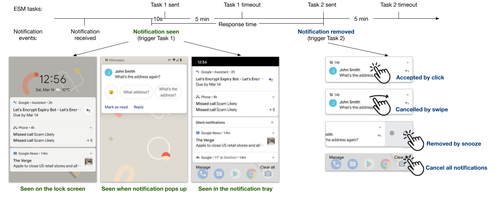
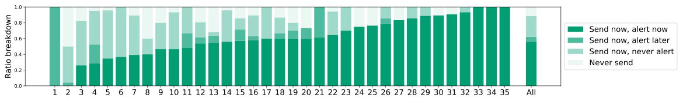
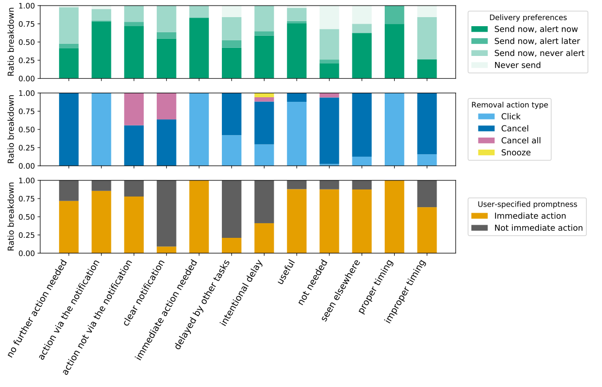
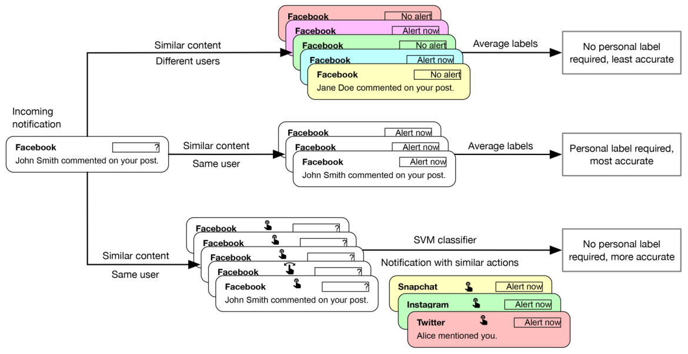
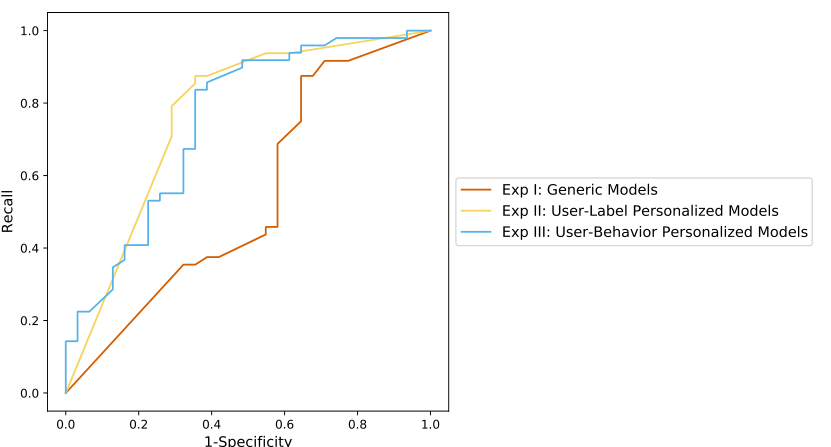

# Alert Now or Never：从用户历史推断哪些通知值得立即提醒

通知送到手机后，可以留在通知栏，也可以发声或振动打断用户。若系统只看用户有没有点开，会把「已经看完内容所以划掉」和「不想收到所以划掉」归为同一种信号。这篇 Google 与 CMU 的 Android 研究先询问用户希望怎样送达，再检验能否用该用户过去处理相似通知的动作预测「现在要不要响」。[采用版 §1、§4–5](https://doi.org/10.1145/3478868)

## 问卷分别记录通知怎么处理和用户希望怎么送达

假设小林收到一条「包裹已放到门口」的通知。研究应用记录送达，若抽中任务 1，就在约十秒后询问小林希望「现在送达并提醒」「现在送达、稍后提醒」「现在送达、永不提醒」还是「永不送达」。前三项都保留现在送达。用户可以查看通知历史，再补一句理由。任务 2 在通知移除后追问用户为什么这样处理，例如是否看到正文便划掉。两项问卷均在五分钟后失效，作者用这一限制减少回忆误差。图 1 的上下两次抽样对应两个问题，实际动作和主观标签可以分别获得。[采用版 §2.2、图 1–2](https://doi.org/10.1145/3478868)

作者图 1，Tianshi Li 等，ACM 出版版第 4 页。沿时间线先看通知到达和任务 1，再看移除动作及任务 2。问卷选择是对这条已观察通知的反事实偏好。

40 人提供被动日志，35 人至少回答过体验采样。前五天用于训练及归纳主题，后两天用于测试，测试仅覆盖 20 人。任务 1 的 525 条训练标签中，立即提醒占 56%，立即静默送达占 26%，永不送达占 12%，立即送达后延迟提醒占 6.3%。图 4 按立即提醒的占比给个人排序，最左和最右用户差异很大，样本量也不均等。464 条可分析解释中，91.6% 提到内容，15.3% 提到情境，同一回答可进入多个类别。问卷在时间窗口内收集开放式解释，这些比例衡量用户提及什么，不能用来量化内容和时机干预的因果效应。[采用版 §2.3–2.4、§3、图 3–5](https://doi.org/10.1145/3478868)

作者图 4，采用版第 10 页。比较每根柱子的颜色比例，最后一柱为汇总。延迟提醒和静默送达是不同选项。

## 划走和点开都需要结合这条通知的用途

小林看见「包裹已放到门口」便划走，可能因为门口信息已读取。另一位用户划走同样的通知，可能因为已经取到包裹。点击也可能只是为了清掉提醒。作者把任务 2 的解释按原因编码，再与任务 1 标签对照。图 6 自上而下分别统计送达选择、应用类别和移除动作。同一列可同时包含多种偏好。§4.2 的单条动作和响应时间分析使研究转向聚合历史，避免把当前动作直接当作偏好标签。[采用版 §4.1–4.2、图 6](https://doi.org/10.1145/3478868)

作者图 6，采用版第 15 页。先固定一个解释类别，再跨三层看其偏好、应用及动作构成。

## 从相似通知的历史动作到提醒分数

下一条快递通知到达时，通用基线按同一应用搜其他人的历史问卷标签，以其中立即提醒的比例打分。有用户历史标签时，个性化标签模型优先用小林本人的同应用问卷，缺失时回到其他人。两种模型依赖带问卷标签的历史。

行为模型用范围更大的被动日志，在同一用户、同一应用的过去通知中匹配联系人或内容模板。作者为大多数应用拼接标题和正文，即时通信应用只用标题。移除停用词后，按最长公共子序列匹配，保留达到最大匹配的先前通知。小林的新通知是「包裹已放到门口」，假设命中三条差一个运单号的历史提醒，其中两条划走、一条点开。每条动作编码成七维独热向量，求平均后对应两维为 $2/3$ 与 $1/3$。再聚合各条通知经 $\ln(1+t)$ 变换的归一化响应时间，就得到八维输入。这组比例是教学算例。当前通知尚未被处理，其动作和响应时长不进入输入。[采用版 §5.1–5.3、图 7](https://doi.org/10.1145/3478868)

作者图 7，采用版第 18 页。从左到右看新通知、历史匹配、分数。第三行的动作来自历史相似通知。

对小林预测的支持向量回归器用其他用户的样本训练。每个训练样本从相似历史通知计算同样的特征，监督来自任务 1 的二分类标签。立即送达并提醒归为正类，其他三项合为负类。推理时取小林自己的历史特征向量，经回归得到分数，超过阈值才建议立即提醒。论文评估了不同阈值，没有给出生产阈值或负类内部如何选择静默、延迟和丢弃。更完整的决策接口及和队列策略的比较见[通知发送或等待](../../知识库/问题/通知候选到达后怎样决定发送或等待.md#通知到达后还要决定是否立即打扰)。[采用版 §5.3–5.4](https://doi.org/10.1145/3478868)

## 比较只覆盖三种方法都能打分的通知

后两天的 102 条测试通知，通用、标签个性化和行为个性化各覆盖 79、92 和 96 条。统一在通用模型能覆盖的 79 条上比较，三者 ROC AUC 分别为 0.539、0.766、0.749。行为模型仅用动作是 0.737，仅用时间是 0.594。摘要的 42% 和 39% 来自相对 0.539 的 AUC 增幅。图 8 图注把 0.749 写成仅用动作，正文 §5.4 与表 4 均将 0.749 归于动作和时间合用。读 ROC 曲线时，横轴是假阳性率，纵轴是真阳性率。[采用版 §5.4、表 4、图 8](https://doi.org/10.1145/3478868)

作者图 8，采用版第 21 页。曲线反映阈值变化时对立即提醒偏好的区分。未覆盖通知、用户退出问卷与同一人的重复回答都会影响外推。研究没有随机分派通知处理策略，因而没有测量策略对活跃、打扰或长期回访的影响。用户是否能改变和撤销提醒设置见作者图 9 的设计原型。[采用版 §6](https://doi.org/10.1145/3478868)

采用 2022 年 11 月 ACM TOCHI 29(5) 第 39 篇出版版，核对摘要、§1–8、九图四表及附录范围，未运行实现。中文 PDF 据采用原文重排，翻译摘要、正文、图表说明与脚注，保留图内英文、英文附录和书目。原文及中文 PDF 的访问方式见 [PDF 维护说明](../../文档/工具/中文PDF发布.md)。[ACM 原文](https://doi.org/10.1145/3478868)
