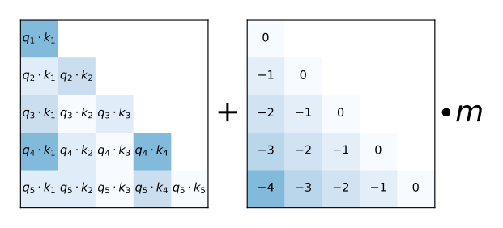
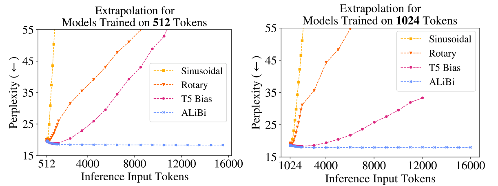
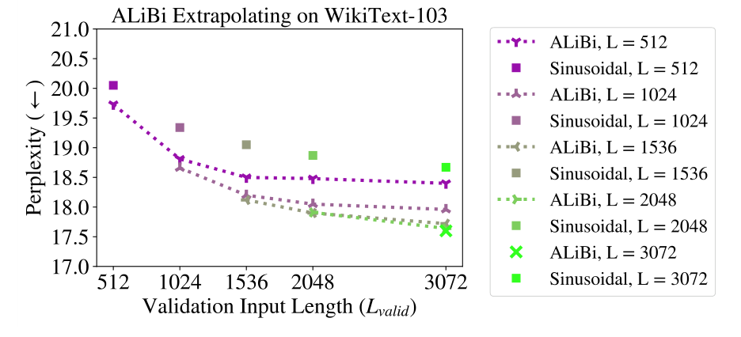
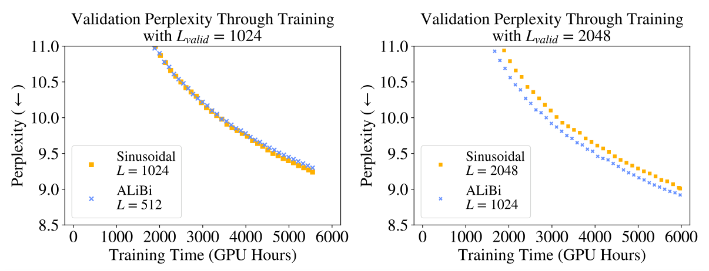
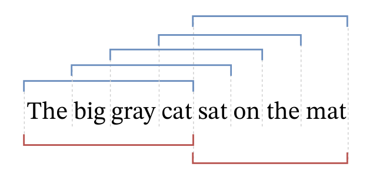
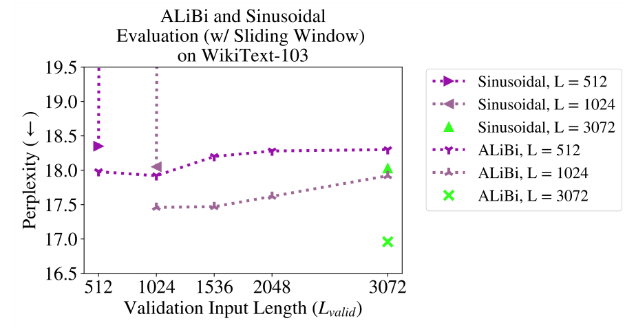

# ALiBi：用固定距离偏置把短序列训练接到长输入

当语言模型在长 512 的子序列上训练，推理时给它 1024 个词元，至少要问两件事。模型能否计算这些位置？增加上下文后，预测质量是否保持？正弦向量可以按公式计算到任意位置，但 Press 等人在 WikiText-103 的受控对照中观察到，正弦基线超出训练范围后困惑度很快回升。ALiBi 省掉输入中的位置向量，将一个逐头固定的距离惩罚直接放进因果注意力的分数。[固定版 §1–3](https://arxiv.org/pdf/2108.12409v1#page=1)

## 在每个查询的位置，把距离写进分数

作者图 3，Ofir Press、Noah A. Smith、Mike Lewis，固定原文第 5 页。左侧按照键位置递增排列的内容点积只保留下三角，右侧是在相同位置排列的距离项。对一行从左至右，最早键收到最大负偏置，当前键偏置为零。正文把偏置从近到远写成 $m[0,-1,\ldots]$，与图对照时也要按从近到远排列键。

以短句 “the big gray cat sat” 为例。假设用 cat 行预测下一个 Token，模型读取当前 cat 和前三个位置。用教学用的内容分数 $[1.2,0.8,0.6,0.5]$（从 the 到 cat），斜率为 $m=0.5$ 时，加入 $[-1.5,-1,-0.5,0]$ 以后得到 $[-0.3,-0.2,0.1,0.5]$，Softmax 权重约为 $[0.172,0.190,0.256,0.382]$；未来的 sat 被遮罩。较浅的头如 $m=1/16$ 只扣 $[3/16,2/16,1/16,0]$，最早键仍有最高分。距离项带来近因偏好，内容分数仍可让远键胜出。通用式和其他位置方法的接口见 [Transformer 位置编码](../../知识库/概念/Transformer位置编码.md#alibi把相对距离直接加到分数)。

每个头用自己的概率对历史值向量求和，拼接后送入输出投影、残差与后续子层。以实际下一个 Token sat 的词表交叉熵训练时，梯度经 Softmax 进入内容打分和投影权重，逐头斜率固定。论文的 8 头斜率从 $1/2$ 到 $1/2^8$，16 头的比例更密。推理追加一个 Token 时，可以重新计算该行的距离项而复用历史 K/V；原机制没有给 K 施加随位置变化的旋转，也没有在输入端加位置向量。KV 可复用仍取决于历史层状态与可见范围是否保持一致。作者把距离偏置并入遮罩，朴素存储可从 $L^2$ 个遮罩元素增至 $H L^2$，所测同训练长度的速度接近正弦实现。[固定版 §3，第 5–6 页](https://arxiv.org/pdf/2108.12409v1#page=5)

## 隔开训练长度、测试长度与训练成本

作者图 1，固定版第 2 页。两个面板分别固定 WikiText-103 训练长度为 512 和 1024。横轴才是验证长度，纵轴为非重叠评估困惑度。正弦基线只在训练长度附近短暂改善。旋转位置和 T5 偏置可改善至更长输入，曲线随后回升，某些 T5 设置还遇到显存上限。比较仅适用于作者用相同语言模型骨干及所述实现的协议。§2.4 把 28.5k WPS 写作正弦 1024 的速度，但附录表 1 给出正弦 512 为 28.5k、1024 为 26.0k，T5 512 为 14.4k。按表值，短训 T5 在该实现里仍较慢。

作者图 4，固定版第 7 页。图中正弦基线的点均按训练长度等于验证长度取值。在 3072 的同长比较中，正弦基线为 $18.67\pm0.24$，ALiBi 为 17.60。若把 ALiBi 改为以 512 训练，在其训练长度内评估是 19.73，扩到 3072 后为 18.40，仍较 3072 训练的正弦基线低。这个对照同时改变位置方法和训练长度，用来讨论资源与质量，不用于隔离位置方法的独立效应。Toronto BookCorpus 复用 WikiText-103 上选好的斜率，观察到相近方向。[§4.1–4.2 与附录表 5、8](https://arxiv.org/pdf/2108.12409v1#page=7)

作者图 7，固定版第 9 页。右侧为 13 亿参数模型在 CC100+RoBERTa 语料上的 2048 长度验证。附录表 11 以同训练时间比较，短训 ALiBi 用 1024 长度、26.2 GB、50,000 更新得到 8.92，长训正弦用 2048、29.3 GB、44,200 更新得到 9.01。作者另按训练曲线取五点，报告达到指定困惑度平均快 11%。附录表 12 是等 50,000 更新协议，长训正弦 2048 的 8.83 与前一行的 9.01 对应不同训练量；同为 1024 训练与验证，ALiBi 9.16、正弦 9.15。训练省显存主要来自更短的子序列，不能把 11% 用作在线解码延迟推断。[表 11–12，第 22–23 页](https://arxiv.org/pdf/2108.12409v1#page=22)

## 更长的段减少了短上下文预测

作者图 9，固定版第 11 页。以窗口 4 对句子做不重叠评估时，第二段从 cat 后重新开始，在段首预测时看不到前段。用步长 1 滑窗评估首窗以后的 Token，每次只计末端新增位置，因而每次预测能看到较长历史。原实验重新编码窗口，成本远高于独立切段。

作者图 10，固定版第 12 页。用滑窗减少边界损失后，训练长度 512 的 ALiBi 将验证窗口从 512 增到 1024，困惑度只从 17.98 降到 17.92，窗口 3072 为 18.30。作者把非重叠评估的大部分收益归因于早期词元问题缓解。该观察说明获得更平稳的长输入困惑度与成功利用训练长度之外的特定事实是不同的评估目标。若关注后一项，需要额外控制目标 Token 到证据的距离、比较相同可见窗口，并用具体任务的结果检验。[§5.1–5.2、图 9–10](https://arxiv.org/pdf/2108.12409v1#page=11) · [附录表 14，第 23 页](https://arxiv.org/pdf/2108.12409v1#page=23)

采用 arXiv 2108.12409v1。核对摘要、§1–7、关键图与附录实测值。正文、图注、脚注和致谢在 LaTeX 副本中译出，附录、图内英文和参考文献保留。沿作者单栏版面用 XeLaTeX 编译，20 页已逐页目视。未运行作者实现。[固定原文](https://arxiv.org/pdf/2108.12409v1) · [中文 PDF 访问说明](../../文档/工具/中文PDF发布.md)
