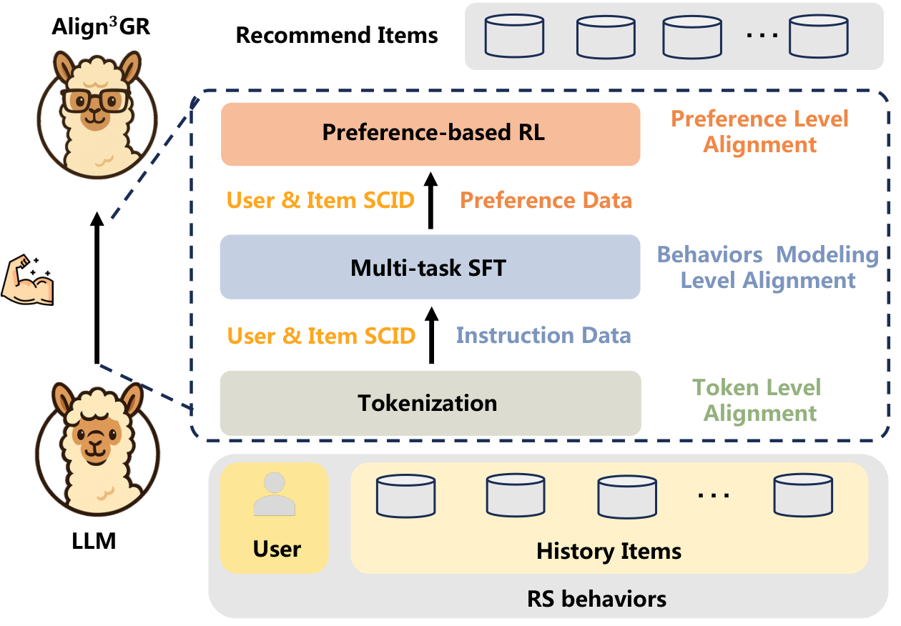
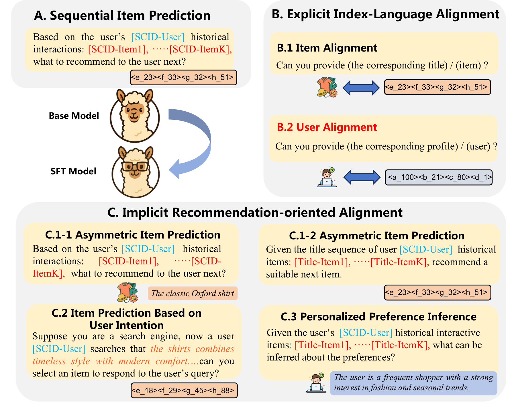
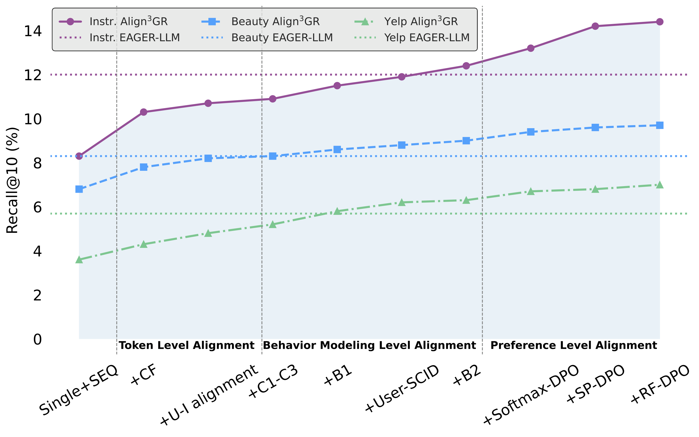

# Align3GR：用双侧语义协同码连接行为任务和偏好训练

物品语义码可以告诉 LLM 某件物品是什么，却可能掩盖用户的稳定协同偏好。Align3GR 为用户和物品分别分配语义协同码（SCID）。先用交互正负样本对齐量化前表示，再让生成器在行为任务中读取用户码，最后用逐渐变难的偏好对调整生成分布。Instruments、Beauty 和 Yelp 是独立列出的评估数据集。这组实验支持学习双侧表示和生成对齐，未专门隔离同一人跨域历史或零重合迁移。[原文框架与数据协议，第 2、5 页](https://arxiv.org/pdf/2511.11255v1#page=2)

*图 1 · 模型依次学习用户和物品 SCID、行为任务、偏好监督。 Wencai Ye 等，Align3GR arXiv 2511.11255v1 第 1 页，采用版 LaTeX 附图。*

## 先让互动的用户和物品在向量层相遇

*图 2 · 分别展示三阶段总图、双侧编码量化及逐渐加难的偏好训练。 Wencai Ye 等，Align3GR arXiv 2511.11255v1 第 2 页，采用版 LaTeX 附图。*

以买过滤纸并浏览手磨的用户为例。语义编码器从画像提取内容信息，协同编码器使用行为模式，两种输出拼接后经融合网络形成用户向量 $u$。物品也有文本和协同向量，融合得到 $v$。一个真实交互物品作为正样本 $v^+$，其他物品从批内取负。

$$
-\log\frac{\exp(u^\top v^+)}{\exp(u^\top v^+)+\sum_{j\in\mathcal N_u}\exp(u^\top v_j)}.
$$

先只用这项学习融合表示，待 AUC 稳定后再用较小权重保留交互损失，并加入用户和物品各自的 RQ-VAE 重建及量化损失。部署中各侧独立算自己的 SCID，因此交互对齐提供监督，两侧仍可独立编码。[原文图 2 与式 (1)–(2)，第 2–4 页](https://arxiv.org/pdf/2511.11255v1#page=2)

## 从用户码监督到偏好对

*图 3 · 行为任务输入包含用户码，额外的双向任务把码和画像文本关联起来。 Wencai Ye 等，Align3GR arXiv 2511.11255v1 第 4 页，采用版 LaTeX 附图。*

把用户和物品码加入模型词表，下一个手磨的 SCID 可作为序列预测的输出。用户码也进入其他行为任务，另外训练画像文本到用户码、用户码到画像文本两个方向，使生成器同时能处理码和描述。原论文的消融改变的不止码的离散性。要回答同一份画像和协同证据用短码还是用连续表示更有效，还需相同信息量的连续条件对照。[原文图 3、表 3–4，第 4、7 页](https://arxiv.org/pdf/2511.11255v1#page=4)

偏好阶段从同一上下文出发，将真实下一物品或正反馈物品作为较优答案。SP-DPO 用模型自己生成的物品作较差答案，并按它与真实码的前缀重合从少到多分阶段。RF-DPO 在业务场景中用明确不喜欢和曝光未点击等信号，分别构造较容易和较难的负例。公开评论数据的偏好分档则使用模型情感分数。每个训练阶段结束后，新模型成为下一阶段的参考模型。这些信号测量的行为和来源不同，比较收益时应保留数据协议。[原文偏好对齐与式 (3)，第 4–5 页](https://arxiv.org/pdf/2511.11255v1#page=4)

形式上，若 $x$ 为这个用户码和历史，$s(y)=\beta\log[\pi_\theta(y\mid x)/\pi_{\rm ref}(y\mid x)]$，则这一条样本的损失为 $-\log\sigma(s(y^+)-\log\sum_{y\in Y^-}\exp s(y))$。把真实下一物品设为手磨，完全不同码的负例可以是运动手套。困难阶段改用与手磨共享较多前缀的候选，例如另一款磨豆器，监督开始区分更细的兴趣。部署反馈中的「中性」可能是不点击，公开评论中的「中性」由情感模型给出，两类信号来自不同观测过程。[偏好对齐问题](../../知识库/问题/生成式推荐怎样从似然训练走向偏好对齐.md#由码前缀相似度或反馈强度改变偏好任务难度)

## 离线、线上检索与全量部署

*图 4 · 图中比较逐步改变 Token 和监督目标后的 Recall@10。 Wencai Ye 等，Align3GR arXiv 2511.11255v1 第 6 页，采用版 LaTeX 附图。*

在 Instruments 上，作者报告对 EAGER-LLM 的 Recall@10 和 NDCG@10 相对提升分别为 17.8% 和 20.2%。同时报告广告平台进行了多周 A/B，并将 1.432% 的收入提升写在全量部署语境下。表 2 的线上 Recall@100 为 0.242，双塔基线为 0.218。图 4 的早期配置仍可能低于各域 EAGER-LLM 虚线，原文“各阶段领先”的概括需限定在实际越过基线之后。逐阶段训练的作用应以分阶段消融为证据，平台整体指标不能反推某一项码本或偏好损失单独贡献。[原文表 1–2、线上实验，第 6–7 页](https://arxiv.org/pdf/2511.11255v1#page=6)

表 4 对 Instruments 逐项加入行为任务。仅增加用户 SCID 后，Recall@10 为 0.1417，加入画像与 SCID 双向对齐后为 0.1442。表 5 的自博弈静态与渐进配置，Recall@10 分别为 0.1356 和 0.1396；RF-DPO 两种配置为 0.1414 和 0.1442，均在渐进 SP-DPO 的基础上训练。这个序列给出组件增量，尚不能单独确定离散化及参考策略更新的贡献。[原文表 4–5，第 7 页](https://arxiv.org/pdf/2511.11255v1#page=7)

## 采用版与译文

采用 Wencai Ye 等的 arXiv:2511.11255v1；AAAI 2026 正式书目为 40(19)，16154–16162。图表、方法引用以采用版物理页为准。8 页中文正文 PDF 已逐页验收。采用版原文与译文均完成私有备份并通过认证下载及完整 SHA-256 校验。[固定原文](https://arxiv.org/pdf/2511.11255v1) · [出版书目](https://doi.org/10.1609/aaai.v40i19.38651)

[中文 PDF 私有访问说明](../../文档/工具/中文PDF发布.md) · [译文范围与许可](../../译文/PDF目录.md)。可编辑工程及本地 PDF 位于 \`.local/papers/SRC-ALIGN3GR/translation/\`，附件不随 Git 分发。
