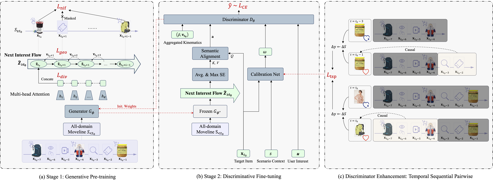
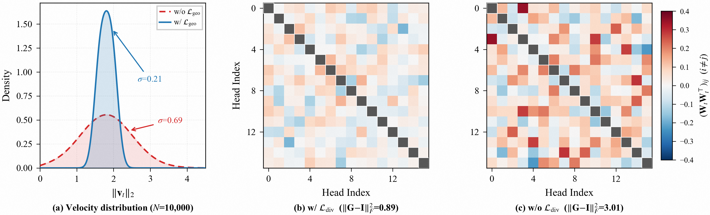

# AMEN：先预测连续兴趣轨迹，再让候选读取未来状态

给一位刚浏览手机、又查看保护壳的用户预测下一次点击，经典CTR模型会从已经发生的行为中寻找与当前候选有关的信息。AMEN额外提出一个问题：能否先用全域行为预训练一个生成器，推演接下来一段时间的连续兴趣状态，再把这些状态作为候选CTR预测的输入？它的生成结果是向量序列，最后仍由判别网络为已知候选打分，不是直接生成可售商品ID。

[固定原文：2510.11317v2](https://arxiv.org/pdf/2510.11317v2)，正式题名为 *Next Interest Flow: A Generative Pre-training Paradigm for Recommender Systems by Modeling All-domain Movelines*，Chen Gao、Zixin Zhao、Lv Shao、Tong Liu，Alibaba Group。AMEN是框架名，NIF是其中的下一兴趣流。中文PDF访问范围见[附件目录](../../译文/PDF目录.md)，经典方法与本篇的共同问题见[候选相关兴趣演化](../../知识库/问题/候选相关兴趣如何随历史演化.md)。

## 从已经发生的历史到尚未发生的状态

沿一个教学场景理解差别。历史是“浏览手机A→浏览手机B→查看保护壳C”，当前待评估候选是充电器D。DIN根据D对历史物品计算相关权重并聚合；DIEN先从历史提取逐步变化的状态，再让D控制第二层GRU的更新。它们利用下一行为监督的方式也不同，不能把所有序列模型统称为只看静态画像，详见[经典过程](../../知识库/问题/候选相关兴趣如何随历史演化.md#先区分候选聚合与候选递推)。

AMEN把这段过去交给生成器，向未来连续推演，例如得到“手机配件方向→充电方向→其他消费方向”的状态向量。引号里的语义只是帮助理解，不代表原模型真的输出了这些词，向量也没有经过人工语义命名。D随后读取与自己相关的预测状态，连同原有历史表示一起估计点击概率。

作者的动机是：只在既定推荐漏斗的曝光样本上学习CTR，可能难以利用全域动线的转移信息；离散物品码还存在量化误差。这说明为什么尝试连续预测，但不能据此推出“所有判别模型只学局部分界”或“连续向量必然保存真实兴趣拓扑”。这些更强的判断需要额外假设和受控证据。[§1–2，PDF第1–3页](https://arxiv.org/pdf/2510.11317v2#page=1)。

*作者原图1，固定v2 PDF第2页，Chen Gao等。直接使用源码中的原图，无科学内容改写。左图自下而上读历史→生成器→连续未来状态与预训练目标；中图将生成器冻结，候选读取预测状态后进入CTR网络；右图展示同一动线中的异标签样本配对。虚线初始化箭头按正文理解为判别基座初始化生成器，不把图概括成两个模型持续互相更新。原图左侧第三个状态误重复标为下一步，与式(1)的顺序索引不一致；原像素保留，下面按正文解释。*

## 自回归生成的是向量，不是物品码

原文将用户兴趣空间记作嵌入在 $\mathbb R^D$ 中的流形 $\mathcal M$。观测 $x_t\in\mathbb R^D$ 是时刻 $t$ 的物品Embedding；取推演起点 $t_0$，历史截止于 $t_0-1$，预测未来 $L$ 个状态。为避免与当前候选混淆，本文把当前候选向量另外记作 $c$；原文在两种语境中都使用 $x_{t_0}$。

Transformer解码器每次接收真实历史和此前自己预测的状态：

$$
\hat z_t=G_\phi(x_1,\ldots,x_{t_0-1},\hat z_{t_0},\ldots,\hat z_{t-1}),\quad
\hat Z=[\hat z_{t_0},\ldots,\hat z_{t_0+L-1}]^\top\in\mathbb R^{L\times D}.
$$

第一步只有历史，第二步增加第一个预测状态，以此类推。它没有先把 $\hat z_t$ 变成离散商品ID再反馈；预测状态也不等于下一件真实商品。训练时未来真实行为 $x_t$ 用于监督，线上不能把尚未发生的 $x_t$ 作为输入。原式明确写以前的生成状态，不应擅自换成未来真值的teacher forcing实现；但训练展开、反传截断、负例构造和Embedding是否冻结没有详细报告。[§2.1.1、式(1)，PDF第3页](https://arxiv.org/pdf/2510.11317v2#page=3)。

这里的Flow指连续兴趣状态随行为位置延伸，不是Flow Matching或normalizing flow。论文没有定义噪声到数据的ODE速度场、密度变量替换或相应训练目标。“连续”首先描述向量取值，时间计算仍按离散行为位置进行。

### 用未来真实行为给预测向量方向

第 $t$ 步用InfoNCE在一个正物品和负集合 $\mathcal N_t$ 中辨认真实未来物品：

$$
p_t(x)=\frac{\exp(\langle\hat z_t,x\rangle/\tau)}{\sum_{x'\in\{x_t\}\cup\mathcal N_t}\exp(\langle\hat z_t,x'\rangle/\tau)},\qquad
L_{\rm nif}=-\sum_{t=t_0}^{t_0+L-1}\log p_t(x_t).
$$

分母是在训练候选集合中做Softmax，不是把整个向量当成点击概率。教学取 $\tau=0.1$，$\hat z=(0.2,0,0,0)$，正物品 $x^+=(1,0,0,0)$，负物品 $x^-=(0,1,0,0)$，温度缩放后的两个logit为2和0。正例概率约0.8808，单步损失约0.1269。对这两个logit的梯度为 $(-0.1192,0.1192)$，推动正例分数相对上升。把候选向量暂视为固定，预测向量收到的梯度是

$$
\frac{\partial\ell_t}{\partial\hat z_t}=\frac{\sum_xp_t(x)x-x_t}{\tau},
$$

本例约 $(-1.1920,1.1920,0,0)$。它继续经过生成器回传到可训练参数；如果Embedding也可训练，会另有相应梯度，原文未报这一配置，不能补写为实际实现。InfoNCE使预测状态有未来行为区分信号，并不直接证明估计了全域联合分布或保留拓扑。[式(2)，PDF第3页](https://arxiv.org/pdf/2510.11317v2#page=3)。

## 两种正则分别限制头的相似性和轨迹弯折

生成器有 $K$ 个注意力头，单头宽度 $D_k=D/K$。作者把每个状态的头输出 $q_k\in\mathbb R^{D_k}$ 归一化后按行放进 $W_t\in\mathbb R^{K\times D_k}$，最小化

$$
L_{\rm div}=\sum_t\|W_tW_t^\top-I_K\|_F^2,\qquad
\rho_t=1-\frac{\|W_tW_t^\top-I_K\|_F^2}{K^2}.
$$

Gram矩阵的对角项是各头自身范数平方，非对角项是头间余弦相似度。平方后相加意味着同向和反向相关都会受罚。若行向量均单位化且 $K\leq D_k$，Hadamard不等式给出 $\det(WW^\top)\leq1$，正交时达到最大体积；这是矩阵命题的条件结论。[命题2.1、式(3)，PDF第3页](https://arxiv.org/pdf/2510.11317v2#page=3)。

教学取 $D=4,K=2$。两个头分别是 $(1,0)$ 与 $(0,1)$ 时，Gram为单位阵，该步正则为0、$\rho=1$；若二者都是 $(1,0)$，两个非对角项均为1，正则为2、$\rho=0.5$。因此 $\rho$ 不是物品点击概率，也不要求总和为1。由正文 $K\leq D_k$ 可推出 $D\geq K^2$，实际 $K=16$ 对应条件 $D\geq256$；论文未公布实际 $D$，不能把这个下界写成模型配置。

各头原本处于不同的学习投影中，数值正交不自动等价于真实心理兴趣相互独立，更不证明这些向量构成真实流形的完整切空间。头退化为零时怎样归一化的数值处理也未报告。

第二种正则对预测状态做二阶差分：

$$
L_{\rm geo}=\|\Delta_2\hat Z\|_F^2,\qquad
(\Delta_2\hat Z)_i=\hat z_{i+1}-2\hat z_i+\hat z_{i-1}.
$$

它惩罚相邻速度的变化。比如教学轨迹 $(1,0,0,0)\to(2,0,0,0)\to(3,0,0,0)$ 的二阶差分为0；把末状态换成 $(4,0,0,0)$，二阶差分变成 $(1,0,0,0)$，平方范数为1。即使轨迹每步都移动很远，只要速度不变，惩罚仍为0，所以平滑不等于速度小。原文还提取首步 $v_{t_0}=\hat z_{t_0}-x_{t_0-1}$，后续 $v_t=\hat z_t-\hat z_{t-1}$，交给下游判别器。[式(4)及相邻说明，PDF第3页](https://arxiv.org/pdf/2510.11317v2#page=3)。

“测地线”是作者命名，实际给出的计算是环境欧氏空间中的二阶差分，未计算度量 $g$ 或协变导数；因而不能把它当成已证明的黎曼测地线学习。命题2.2把自然三次样条称为弯曲能量的唯一最小曲线，却未列插值和边界条件：没有这些约束，任意直线均有零弯曲能量，唯一性不成立。等间隔离散还省略步长缩放；若按行为索引计算，它也不等同于真实不等时间间隔下的物理速度。这里保留正则的可用直觉，同时限制理论外推范围。

*作者原图2，固定v2 PDF第4页，Chen Gao等，直接取源码原图。左图横轴为速度范数，纵轴为密度；有正则时分布更集中。中、右图为有/无多样性正则的Gram矩阵，灰色遮去对角线；它展示头间相关性变化，不是对真实兴趣语义独立性的标注验证。*

阶段1联合训练 $L_{\rm nif}+\alpha L_{\rm div}+\beta L_{\rm geo}$。采用配置 $\tau=0.1,\alpha=0.05,\beta=0.01,L=48,K=16$。生成器用预训练判别基座的权重初始化，但两者逐层对应及不匹配参数怎样处理未给出；不能把“同源初始化”改说成预训练生成器随后整体初始化CTR模型。[式(5)、§3.1，PDF第3–4页](https://arxiv.org/pdf/2510.11317v2#page=3)。

## 冻结兴趣生成器以后，候选怎样得到点击概率

阶段2固定 $G_{\phi^*}$，由它输出 $\hat Z$、每步 $\rho_t$ 和速度。当前候选 $c$ 作为Query，预测轨迹作为Key和Value：

$$
a=\operatorname{Attention}(Q=c,K=\hat Z,V=\hat Z).
$$

这是从“可能往哪些方向变化”中读取与当前候选相关的部分。教学简化为两个预测状态 $z_1=(1,0,0,0),z_2=(0,1,0,0)$，候选为 $c=(1,0,0,0)$；若额外采用不带投影/缩放的点积Softmax注意力，权重约 $(0.7311,0.2689)$，读出同样为 $(0.7311,0.2689,0,0)$。这是说明接口的构造计算；论文式(6)没有完整指定投影、缩放和多头配置，不能把教学实现冒充作者实现。

将读出 $a$、历史用户表示 $u$、平均多样性 $\bar\rho$、首步速度 $v_{t_0}$ 和 $c$ 拼接，送merge MLP得到主logit，再加校准网分数 $\omega$：

$$
\hat y=\sigma(\hat y_{\rm main}+\omega).
$$

例如主logit为0.6、校准分数为0.2，则预测约0.6900。若标签 $y=1$，BCE对总logit的梯度为 $\hat y-y\approx-0.3100$，分别传入主干和校准分支；对 $a$ 的信号继续训练对齐模块，却不会更新已经冻结的生成器参数。这是本篇“生成式预训练→判别式微调”的边界，而非端到端联合回传。[§2.2、式(6)–(7)，PDF第3页](https://arxiv.org/pdf/2510.11317v2#page=3)。

结构上同一历史的预测轨迹不依赖候选，可以供多个候选读取；候选注意力和后续网络仍逐候选计算。论文说生成器与判别器独立运行、额外线上时延1–2ms，但未交代轨迹刷新频率、缓存一致性、生成器大小或全链路计算账本，不能直接推定全部未来状态都在每次在线请求中实时生成。

## 时间成对监督怎样改变校准分数

TSP从同一动线、预测跨度 $L$ 内寻找与当前样本标签相反的另一个样本。若当前未点击、稍后点击，让稍后样本的校准分数更高；反过来则让当前正例更高。定义 $\ell_1=2y_1-1$，训练目标为

$$
L_{\rm tsp}=-\frac1{|\mathcal P|}\sum_{(x_0,x_1)\in\mathcal P}\log\sigma[\ell_1(\omega_1-\omega_0)],\qquad
L_{\rm stage2}=L_{\rm CE}+\lambda L_{\rm tsp},\quad\lambda=0.1.
$$

教学取 $y_0=0,y_1=1,\omega_0=0.2,\omega_1=0.8$。差值0.6对应概率约0.6457、单对损失约0.4375；对 $\omega_1$ 的梯度约 $-0.3543$，对 $\omega_0$ 约 $+0.3543$。梯度下降提高正例分数、降低负例分数，与BCE一起训练校准网。异标签配对的物品、时间窗截断和样本重复权重等细节未展开，不能假设它比较的是“同一个物品在干预前后”。[§2.3、式(8)–(9)，PDF第3页](https://arxiv.org/pdf/2510.11317v2#page=3)。

论文称之为temporal causality，但同动线时间配对仍是观察数据监督。时间先后没有排除曝光选择、用户状态或场景等混杂；原文没有定义干预、处理组/对照组或识别假设。因此可以说它引入时间邻近的异标签排序信号，不能说已识别因果效应。分数分布更可分也不能单独证明因果性。

## 消融支持的是哪些具体增量

作者报告淘宝工业训练集67亿条、1.807亿用户、2190万物品；测试集6亿条、2320万用户、770万物品。原数据段落后面又重复训练用户/物品数，本文按明确前半句列出并保留原稿重复疑点，不猜第二套测试口径。时间切分、泄漏防护、负例采样和超参数选择集未完整交代。[§3.1，PDF第3页](https://arxiv.org/pdf/2510.11317v2#page=3)。

表1的MEDN是SIM变体，额外包含上下文旁路信息。其AUC为0.7621，完整AMEN为0.7708，差0.0087，即0.87个百分点。逐项移除组件后的完整模型差值如下，均为同表计算，不能相加为贡献分解：

| 移除项 | AUC | 完整模型高出的百分点 |
|---|---:|---:|
| NIF | 0.7694 | 0.14 |
| TSP | 0.7683 | 0.25 |
| 语义对齐 | 0.7702 | 0.06 |
| 权重初始化 | 0.7698 | 0.10 |
| 头多样性正则 | 0.7697 | 0.11 |
| 二阶差分正则 | 0.7699 | 0.09 |

DIN为0.7410，P5为0.7565，TIGER为0.7638，但P5/TIGER怎样适配CTR、参数/训练预算及候选协议未完整说明。这张表支持本数据与本评估中的结果，不足以证明“连续生成普遍优于离散物品生成”。无NIF仍达0.7694也说明，大部分相对MEDN的差值不能全部归给连续兴趣流。[表1，PDF第4页](https://arxiv.org/pdf/2510.11317v2#page=4)。

原图2的1万用户探查显示：有/无平滑正则的速度范数标准差分别0.21/0.69；有/无头正则的 $\|G-I\|_F^2$ 为0.89/3.01，后者约为前者3.38倍。它们说明正则确实改变对应统计量，未独立测量“真实轨迹拓扑”“噪声是否有害”或潜在心理状态。

### 线上11.6%的基线是谁

表2把判别增强和生成兴趣流分开列出：

| 比较与场景 | CTCVR | CTR | GMV |
|---|---:|---:|---:|
| Feeds：无NIF vs MEDN | +11.6% | 不显著 | 不显著 |
| Floors：无NIF vs MEDN | +4.2% | +20.6% | +20.1% |
| 完整模型 vs 无NIF | +2.28% | +0.98% | +11.24% |

因此摘要的11.6%主要对应TSP与对齐等判别增强，不能写成NIF的独立收益。表中最后一行没有明确复述同一场景/同一流量口径，即使正文称额外收益，也不据此直接连乘成完整AMEN对MEDN的总收益。“不显著”也不等于变化为零。CTCVR是曝光到点击再转化的联合目标，与点击后的条件CVR不同，参见[ESMM精读](../SRC-ESMM/阅读笔记.md)。[§3.4–3.5、表2，PDF第4–5页](https://arxiv.org/pdf/2510.11317v2#page=4)。

作者称促销期分层A/B、多日多人群持续，但未提供完整窗口、随机化单元、置信区间及分组样本量。离线6亿条样本和 $p\ll0.001$ 的陈述也不代替用户聚类相关性等统计协议。线上数字是作者报告，本文没有独立复现。

效率比较中，A100每天约6万条与12800核CPU集群处理1亿条并非等硬件预算；后者时间窗也没有明确给出，无法据此换算公平吞吐倍率或成本优势。实际选型需同时测生成刷新、缓存、候选读取、CTR主干、延迟分位数及资源费用。

## 放回兴趣建模链路理解AMEN

DIN在真实历史上做候选加权，DIEN让候选改变历史递推，SASRec从因果历史状态预测下一物品；AMEN先推演多个未来连续状态，再让候选读取。它把全域未来行为监督引入一个可独立运行的上游模型，并在阶段2限制生成器的更新。预测未来轨迹和真实未来事件仍须分开：前者服务时可计算，后者只用于训练监督。

对需要保留现有CTR网络的场景，这提供了一种特征增强接口；对需要从全目录直接返回商品的场景，本文还没有给出物品映射、合法库存约束或召回解码方案。与TIGER比较时，应先对齐输出对象和服务职责，再谈量化误差与效果，不能用一张CTR表替代召回协议比较。公共原理与方法异同继续见[兴趣演化问题](../../知识库/问题/候选相关兴趣如何随历史演化.md#先预测未来连续状态再让候选读取)。

阅读范围为固定v2全部6页：正文§1–4、两个命题及证明、9个编号公式、3图2表与参考文献；未运行模型、未核作者实现。正文、图表标题与描述已翻译，数学、作者机构、图内英文和参考文献保留。5页完整正文中文PDF已逐页渲染目视，另保留可编辑译后工程；原文数据重复、样条条件和实验归因在译注及本笔记中说明，译文不擅自改写作者主张。文件位于本地忽略目录 `.local/papers/SRC-AMEN/translation/Next_Interest_Flow_中文.pdf`，不随公开Git分发；原文6页及中文5页均已私有备份，并于2026-11-18真实登录下载核对大小、页数及完整SHA256，访问见附件目录。
