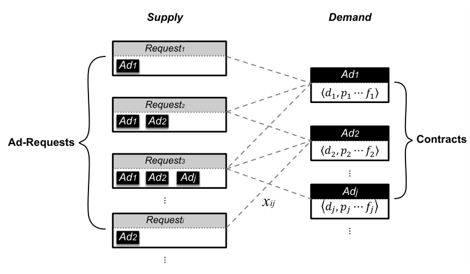
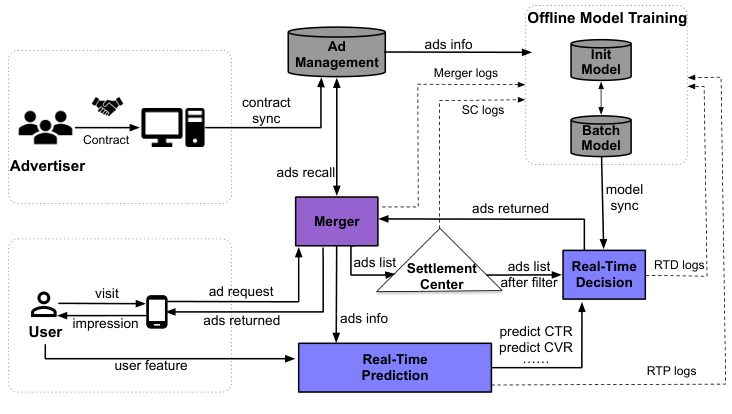
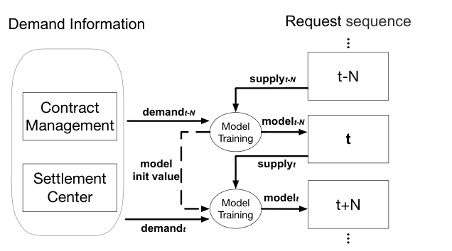
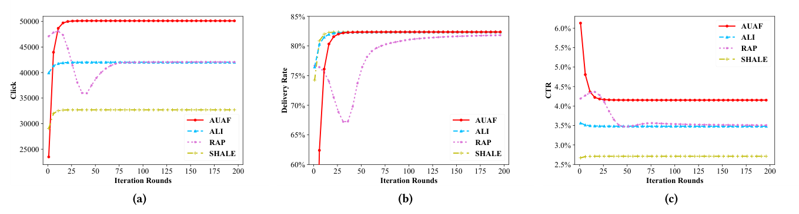
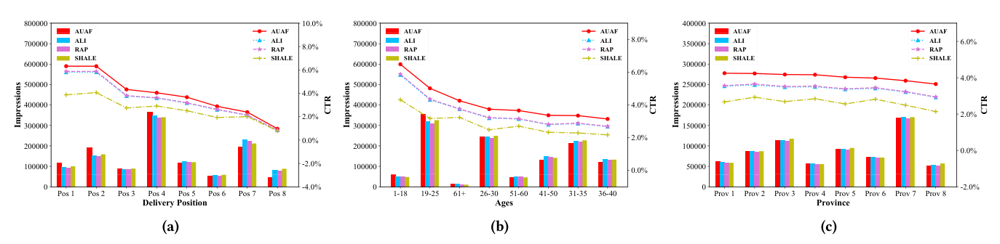
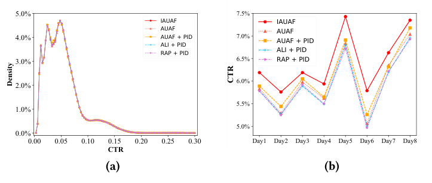

# AUAF：在合同曝光上限下分配请求

WSDM 2022 的 AUAF 处理阿里巴巴保量展示广告的分配问题。平台提前承诺给合同的目标受众交付一定曝光量，每次广告请求却可能同时符合多个合同。AUAF 按整张请求—合同图规划曝光，在每个合同的约定量内争取多交付，并把高点击概率的请求配给合适的广告。它承接上游的预测结果，实验用 CTR 衡量用户兴趣。结论直接回答“保量能否顺带提效”：作者报告线上增量版本 IAUAF 的 CTR 相对提升超过 10%，各组交付率都在 99% 以上。 [原文 §3–5，PDF 第 3–8 页](https://dlnext.acm.org/doi/pdf/10.1145/3488560.3498500#page=3)

## 一次请求为什么值得留给另一个合同

设两个请求各有一次展示机会，合同 A、B 各要一次。请求 1 同时符合 A、B，预估 CTR 分别为 30%、20%。请求 2 只符合 A，预估 CTR 为 10%。这些是教学数据。只看当前请求的最高分会把请求 1 给 A，随后请求 2 无法补给 B。反过来把请求 1 给 B、请求 2 给 A，两次都有效，预期点击数为 0.30。这组数据故意让两种决策的预期点击总数相同，突出交付量和增量可用流量的差异。若忽略 A 的上限，两次都留给 A 能在账面上得到 0.40 次预期点击，但结算端会拦截超发，B 已经错过唯一可用请求。

论文把这种竞争写成二部图。左侧是请求 $i$ 和供给权重 $s_i$，右侧是合同 $j$ 和约定曝光 $d_j$。只有符合定向且能召回广告时才连边，边上放兴趣分 $c_{ij}$ 和决策变量 $x_{ij}$。$\Gamma(i)$ 是请求召回的合同集，$\Gamma(j)$ 是可投合同 $j$ 的请求集。$x_{ij}$ 是该请求分给该合同的比例或概率，$s_ix_{ij}$ 是规划曝光。合同详情还可含频次、触达要求，§4.1 的显式约束只有供给、合同量和非负。 [原文 §1、§3，PDF 第 2–3 页](https://dlnext.acm.org/doi/pdf/10.1145/3488560.3498500#page=3)

作者原图，Cheng 等，ACM WSDM 2022 正式版图 2，出版页 134，PDF 第 3 页。由采用版 PDF 裁出。沿左侧 Request 3 的虚线看，它能为多个合同服务，各条边共享左侧的供给额度。

## 怎样在规划里消除超投

基础模型 [原文公式 (1)–(5)，PDF 第 3 页](https://dlnext.acm.org/doi/pdf/10.1145/3488560.3498500#page=3) 用 $D_j+u_j\ge d_j$ 表达合同需求，其中 $D_j=\sum_{i\in\Gamma(j)}s_ix_{ij}$，$u_j\ge0$ 是欠投量，目标对它收 $p_j u_j$。多投不会降低欠投罚金，但高分边表达的兴趣收益继续增加，可能胜过偏离均匀分配的惩罚。线上结算过滤这些额外曝光时，其他合同失去的请求机会很难原样补回。论文对照的 ALI、RAP 都没有这个合同上限。SHALE 的基础目标考虑均匀性和曝光，论文所用 SHALE 未加入兴趣项，因此其结果也没有超投。

AUAF 令 $\theta_j=d_j/\sum_{i\in\Gamma(j)}s_i$ 为合同在所有合格流量上均摊的基准比例。目标及可行域为

$$
\begin{aligned}
&\min_x \frac12\sum_j\sum_{i\in\Gamma(j)}s_i\frac{V_j}{\theta_j}(x_{ij}-\theta_j)^2\\
&\quad -\sum_j w_jD_j-\sum_j\lambda_j\sum_{i\in\Gamma(j)}s_ix_{ij}c_{ij},\\
&\text{约束}\quad D_j\le d_j,\quad \sum_{j\in\Gamma(i)}x_{ij}\le1,\quad x_{ij}\ge0.
\end{aligned}
$$

$V_j$ 控制单个合同在其适格供给内的均匀程度，$w_j$ 控制填充曝光的价值，$\lambda_j$ 控制兴趣的价值。若 $c_{ij}$ 是 pCTR，第三项加权的是期望点击总量。分母会随决策变化时，最大化点击总量和最大化平均 CTR 是两个不同目标。合同量由 $w_j$ 驱动，供给不足时允许欠投。若业务需要硬下限且存在可行解，须显式加入下限或设计具有明确优先级的欠量目标。 [原文 §4.1，公式 (6)–(9)，PDF 第 4 页](https://dlnext.acm.org/doi/pdf/10.1145/3488560.3498500#page=4)

## 从合同价格算出请求分配概率

给合同曝光上限引入乘子 $\alpha_j$，给请求容量引入乘子 $\beta_i$。把一个正分配量对应的拉格朗日偏导除以 $s_i$ 并令其为零，再按非负条件截断，就得到

$$
x_{ij}=\left[\theta_j\left(1+\frac{w_j+\lambda_jc_{ij}-\alpha_j-\beta_i}{V_j}\right)\right]_+.
$$

$\alpha_j$ 在合同边上共享，反映该合同曝光上限的稀缺程度。对固定合同，当它分到的曝光少于配额时，迭代会降低 $\alpha_j$，让其更容易承接适格请求。对固定请求，先令 $\beta_i=0$ 算总量。如果总量超过 1，则增大 $\beta_i$，直到所有候选的概率之和为 1。候选概率和是单调分段线性的，达到零的候选随即退出求和。每个请求可以独立解这个一维方程。 [原文 §4.2，公式 (10)–(17)，PDF 第 4–5 页](https://dlnext.acm.org/doi/pdf/10.1145/3488560.3498500#page=4)

沿用上面的两个请求，令 $V_j=\lambda_j=1, w_j=10$，则 $\theta_A=0.5,\theta_B=1$，按论文冷启动 $\alpha^0_A=10.3,\alpha^0_B=10.2$。请求 1 在没扣 $\beta$ 时分别有 0.5、1.0，令 $0.5(1-\beta_1)+(1-\beta_1)=1$ 得 $\beta_1=1/3$，实际概率为 $(1/3, 2/3)$。请求 2 只有 A，概率为 0.4，$\beta_2=0$。此时两合同分别分到 $11/15$ 和 $2/3$，服务端将其价格分别下调 $4/15$ 和 $1/3$。下一轮重算后，请求 1 上两条边为 $(14/45, 31/45)$，请求 2 给 A 的概率为 $8/15$。B 在唯一能投的请求上获得更多份额，而 A 可以通过请求 2 补量。

## 怎样并行求解并接到线上

Worker 拉取合同 $\alpha$，在自己的请求分片解 $\beta$、恢复 $x$，再汇总各合同上的 $s_ix_{ij}$。参数服务器合并为 $D_j^t$，按 $\alpha_j^{t+1}=\alpha_j^t-V_j(1-D_j^t/d_j)$ 更新并广播。状态的两个对偶向量长度分别等于合同数与请求数，稀疏边仍要逐轮访问。定理 1 的冷启动取 $w_j+\lambda_j\max_i c_{ij}$，使每条边初始值不超过 $\theta_j$。后续固定旧 $\beta$ 时，合同的总增量最多为 $d_j(\alpha_j^t-\alpha_j^{t+1})/V_j$，恰好是当轮欠量。所有合同价格下调后，新 $\beta_i$ 只会持平或上升，进一步限制总量。这个推导说明为何可以按时间预算提前停止，并保有原问题的供给和合同上限。 [原文 §4.2，算法 1、定理 1，PDF 第 5 页](https://dlnext.acm.org/doi/pdf/10.1145/3488560.3498500#page=5)

原文证明的式 (20) 将固定旧 $\beta$ 的候选增量写成等于欠量。正部截断激活时，两者一般只有上界关系。上段用正部函数的 1-Lipschitz 性重写归纳步骤。另一个实现细节涉及式 (17) 的非负性。按印刷式，在供给长期不足时 $\alpha_j$ 可持续下降并越过零。论文公开脚本的 `update_alpha_j` 显式执行 $\max(0,\cdot)$，`calculate_x_ij` 还把单边概率截到 [0,1] 并套候选掩码。公式的原问题可行性与乘子的 KKT 可行性是两个层次。脚本用 Python 2 风格、NumPy 稠密矩阵演示离线求解，本次静态核对了这些函数。 [作者代码固定提交，AUAF.py 第 246–326 行](https://github.com/cxmlxq/AUAF/blob/2fadedb61c524a6f45eecad85571871db47c6f00/AUAF.py#L246-L326)

作者原图，正式版图 1，出版页 133，PDF 第 2 页。沿请求从左下看，合同召回和结算过滤提供可用候选，实时预测提供分数，实时决策消费这些输入和离线同步的分配参数。图预留了 predict CVR，本文实验使用 CTR。

线上只需同步每个合同的 $\alpha_j$。新请求进来后，用实时召回和兴趣分求本请求的 $\beta_i,x_{ij}$，过滤 $x_{ij}=0$ 的候选，并按概率分配不超过容量的广告。单位置可把剩余概率留给空投或系统的其他合法流量去向，具体生产采样细节原文未展开。增量版本 IAUAF 用旧模型初始化新窗口的离线优化，接入新请求样本和合同需求。PID 则通常按单个合同的进度误差修改门槛。AUAF 通过同一请求的 $\beta_i$ 处理多合同竞争，并在新窗口更新共享价格。定理的冷启动证明针对固定规划图，线上随机曝光、分布漂移和任意热启动仍需要结算过滤、重算和实际交付监测。 [原文 §4.3，PDF 第 5–6 页](https://dlnext.acm.org/doi/pdf/10.1145/3488560.3498500#page=6)

作者原图，正式版图 3，出版页 137，PDF 第 6 页。沿右侧时间轴看，旧的供给、需求先求得用于当前窗口的模型，当前窗口同时收集下一次求解的输入。

## 履约、超投与点击的实际结果

表 2 的小样本有约 12.5 万供给节点、128 个合同和 29.8 万条边。论文给出的 LP 参照为 63.9% 交付率、4.626% CTR，AUAF 为 63.8%、4.467% CTR、零超投。表 3 的大样本每天逾 300 万供给节点、558 合同、逾 1000 万条边。有效交付率是各合同有效曝光汇总除以需求总量，超投曝光亦排除在 CTR 外。 [原文 §5.1–5.2、表 2–3，PDF 第 6–8 页](https://dlnext.acm.org/doi/pdf/10.1145/3488560.3498500#page=8)

| 大样本方法 | 有效交付率 | 超投率 | CTR |
|---|---:|---:|---:|
| SHALE | 82.37% | 0% | 2.71% |
| RAP | 81.75% | 27.97% | 3.49% |
| ALI | 82.36% | 27.59% | 3.48% |
| AUAF | 82.37% | 0% | 4.15% |

按表中四舍五入数值，AUAF 较 ALI 和 RAP 的 CTR 相对提高约 19%，较 SHALE 提高约 53%。作者用合同为配对单位做 t 检验，AUAF 对 ALI 的交付率比较 $p=0.255$，CTR 比较 $p=10^{-75}$。论文对比包含目标和求解流程的差异，无法由主表单独估计硬上限的净贡献。图 4 的初始 AUAF CTR 很高，但交付率低，继续补量后点击总数上升而平均 CTR 下降。

作者原图，正式版图 4，出版页 139，PDF 第 8 页。要同时看图 (a) 点击数、图 (b) 交付率和图 (c) CTR。图 5 按位置、年龄和省份显示分配结果，支持模型将更多曝光给一些高 CTR 切片的描述。 [原文图 4–5，PDF 第 8 页](https://dlnext.acm.org/doi/pdf/10.1145/3488560.3498500#page=8)

作者原图，正式版图 5，出版页 139，PDF 第 8 页。柱是有效曝光量，折线用右轴给出 CTR，横坐标按各切片的 CTR 降序排列。

在线比较含 IAUAF、AUAF、AUAF+PID、ALI+PID 和 RAP+PID。图 6(a) 显示各组请求的预估 CTR 分布接近，图 6(b) 比较真实 CTR。作者报告各组合同交付率都超过 99%，增量 IAUAF 相对提高 CTR 超过 10% 且交付率未降。正文称一周，图横轴标 Day 1 至 Day 8，论文未提供各组精确汇总曝光量或由图反推的精确提升。没有报告 CVR 实验。 [原文 §5.3、图 6，PDF 第 7 页](https://dlnext.acm.org/doi/pdf/10.1145/3488560.3498500#page=7)

作者原图，正式版图 6，出版页 138，PDF 第 7 页。左图核对分组进入实验时的预估兴趣分布，右图看投放后的实际点击率。两图的横轴含义不同。

## 原文与延伸

- [保量曝光怎样分配给多个竞争合同](../../知识库/问题/保量曝光怎样分配给多个竞争合同.md) 汇总可迁移的约束和按转化优化的条件。
- 采用 Xiao Cheng、Chuanren Liu、Liang Dai、Peng Zhang、Zhen Fang、Zhonglin Zu 的 WSDM 2022 正式版，全文 pp. 132–140，采用版来源及哈希见 [来源登记](来源.json)。 [ACM DOI](https://doi.org/10.1145/3488560.3498500)
- 正文中文重排使用同版本 PDF，覆盖摘要、§1–6、算法 1、公式 (1)–(22)、图表标题、脚注与致谢，保留图内英文和英文参考文献。公开全文翻译授权未确认。 [私有 PDF 访问说明](../../文档/工具/中文PDF发布.md)
