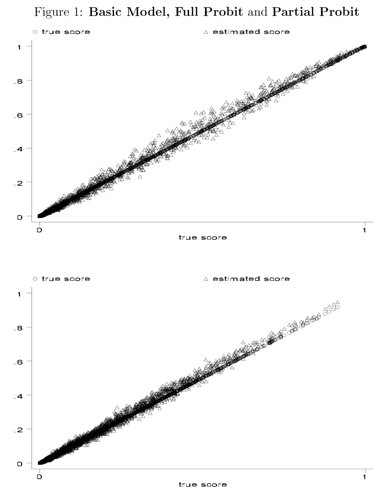
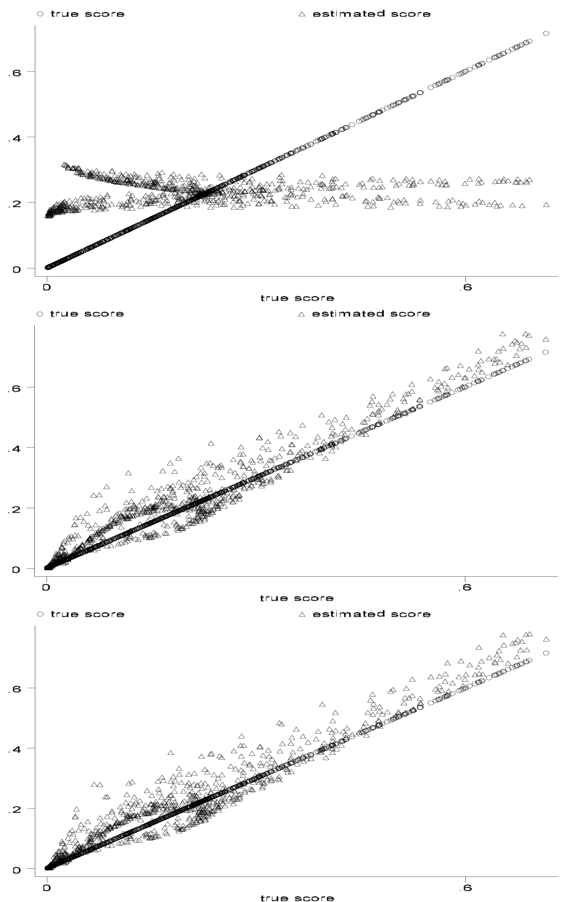

# 倾向模型是为配对服务的：平衡、对照容量与代表性

如果历史策略给高意向商家发券的概率接近 1，就算积累了几百条商家日志，高意向而没收到券的人仍可能很少。一个很会预测发券的模型会清楚显示这种分离。用它做匹配，要么让少数对照支撑许多发券商家，要么找不到近邻后丢弃部分发券商家。Augurzky 和 Schmidt 用模拟比较两种分数构造，观察为匹配压缩变量能否降低这种代价。 [IZA 工作论文 §1](https://www.econstor.eu/bitstream/10419/21122/1/dp271.pdf?download=1#page=5)

## 先诊断哪些变量造成选择，哪些变量影响结果

假设发券规则使用活跃度 $X$，自然订单也依赖它。系统配额字段 $Z$ 进一步影响发券，若给定 $X$ 后它与潜在结果确实无关，就可以在同一活跃度内合并不同配额组。例如活跃度相同的商家在两个配额组的发券率为 95% 和 55%，令配额均匀分布，则合并后发券率为 75%。配额组间增加可配对的选择，同时保留活跃度的调整。给定 $X$ 后若配额还标记了部分商家的自然订单风险，合并就可能留下真实混杂。原文 §2 用交叉划分的单元格说明可以合并的两类情形：共享真实倾向得分的单元，以及在结果方无差异的单元。 [§2 单元格分解](https://www.econstor.eu/bitstream/10419/21122/1/dp271.pdf?download=1#page=7)

作者的完整 Probit 含三类真实生成变量：两项 $X$ 强烈预测处理与结果，两项 $Y$ 主要预测结果，两项 $Z$ 主要预测指派。简化 Probit 仅用 $X$。后两类与另一端的联系由零逐步增大，反映排除条件从精确到近似。作者允许发券效应随画像而变，因此失去极端分数对应的商家可能改变所估人群。 [§3、表 1](https://www.econstor.eu/bitstream/10419/21122/1/dp271.pdf?download=1#page=11)

*作者原图。Augurzky、Schmidt，IZA DP 271，EconStor 文件第 21 页图 1。上、下分别为完整与简化 Probit，横轴是真值，三角点为估计值。每幅以本模型的条件变量定义真值，仅展示一次模拟。*

## 卡尺后的分层要看三件事

先用卡尺 $|\hat e_i-\hat e_j|\le \epsilon$ 去掉差距过大的跨臂组合，再对剩余候选比较 Mahalanobis 距离 $(w_i-w_j)^\top V^{-1}(w_i-w_j)$。$w$ 包含估计得分和该版参与匹配的协变量，$V$ 是混合样本的协方差。论文通过最小费用流构造不重叠的 full matching 层。每层至少有一人来自两臂，结构为一对一、一对多或多对一。与逐条贪心匹配相比，优化可以重新安排此前的配对。保留的发券者按各层人数给层内均值差加权。 [§4、式 (10)](https://www.econstor.eu/bitstream/10419/21122/1/dp271.pdf?download=1#page=17)

1. **层内臂比与方差。** 原文式 (11) 以每个保留的发券者有自己的配对对照为基准，定义 $\kappa^2=\{\sum_s m_s^2/(1-1/n_s)^2\}/(4\sum_s m_s)$。$m_s$ 为第 $s$ 层处理人数，$n_s$ 为总人数。假设三名高意向发券商家与一名无券商家同层，则 $\kappa^2=9/[(3/4)^2\cdot12]=4/3$。这个量衡量分层构成，不能从中判断协变量平衡或删掉了多少高意向商家。 [式 (11)](https://www.econstor.eu/bitstream/10419/21122/1/dp271.pdf?download=1#page=19)
2. **实际协变量平衡。** 模拟对六个字段分别做均值相等的检验，再按生成结果方程的系数加权未拒绝比例。当样本少时，检验可能缺少功效。真实商家数据也没有已知的生成系数。因此可保留按结果重要性看关键字段的思想，并直接报告匹配权重下的标准化均值差、分位数和类别频率。 [式 (12)](https://www.econstor.eu/bitstream/10419/21122/1/dp271.pdf?download=1#page=20) · [历史发券的平衡检查](../../知识库/问题/历史发券日志如何估计补贴增量.md#倾向拟合该保留哪些字段匹配后查什么)
3. **匹配后还代表谁。** 若删除了高分段发券者，整体失衡可能下降，同时样本只代表较易匹配者。论文在替代数据生成模型中见到完整 Probit 的近乎完美综合平衡和约 12% 的倾向代表性偏差并存。应同时读未匹配人数和前后处理组倾向均值偏差。 [§5、表 7](https://www.econstor.eu/bitstream/10419/21122/1/dp271.pdf?download=1#page=28)

## 简化分数怎样变好，又会在哪里失效

在基本模拟里，$X,Y,Z$ 相互独立且为正态。把 $Z$ 和 $Y$ 的处理方贡献信号积分掉后，剩下的噪声仍可为正态，因此只含 $X$ 的边际倾向可以保留 Probit 形式。在选择最强且对照库最小时，完整模型约 57 层，简化模型约 101 层。简化方案在该情形的 RMSE 更低，但当略去变量跨到另一端的影响增强时，作者报告其 ATT 偏差可以到约 40%。匹配在真分值上更容易与备选模型增加遗漏偏差可以同时发生。 [§5、表 4–5](https://www.econstor.eu/bitstream/10419/21122/1/dp271.pdf?download=1#page=22)

替代模拟让 $Z$ 的条件分布随 $X$ 变化。简化模型的错误项不再由独立正态来吸收。如图 2，最低阶模型的估计倾向几乎摊成水平带，加入 $X$ 的交互与平方后更接近对角线。表 7 还比较卡尺内改用纯倾向距离的情形，作者发现少数结果生成交互存在而倾向模型缺交互时偏差和 RMSE 更大。拟合分数的误差、卡尺内选谁和删样本的效应应各自排查。 [§3、§5 与表 7](https://www.econstor.eu/bitstream/10419/21122/1/dp271.pdf?download=1#page=26)

*作者原图。IZA DP 271，EconStor 文件第 26 页图 2。面板从只有低阶项到加入交互、再加入平方。比较估计分值相对于同面板真值的偏移。*

与 Brookhart 的样条调整模拟相比，这篇关注瓶颈在对照容量、分层形状和保留人群。两篇都把指派预测表现与效应估计区别开来。Abadie–Imbens 研究固定数量的放回近邻，在推断中按被复用次数计权，与这里用全局不重叠分层的做法不同。 [Brookhart 选变量](../SRC-BROOKHART-PS-VARIABLES/阅读笔记.md) · [Abadie–Imbens](../SRC-ABADIE-IMBENS-MATCHING/阅读笔记.md)

## 阅读范围

Boris Augurzky 与 Christoph M. Schmidt，*The Propensity Score: A Means to an End*，IZA Discussion Paper No. 271，2001 年 3 月。采用 EconStor 机构存档，核对正文 §1–6、式 (10)–(12)、图 1–2、表 1–7。PDF 中部分字体文字编码不可直接读，按渲染件及 OCR 交叉核查。按清单仅解读，未运行作者模拟。 [机构存档](https://hdl.handle.net/10419/21122) · [SSRN 题录](https://doi.org/10.2139/ssrn.270919)
