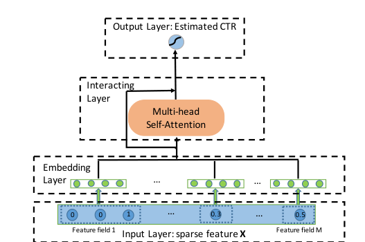
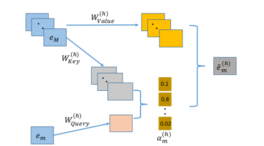

# AutoInt 怎样让一个字段向同次曝光的其他字段取信息

FM 在选定的 Embedding 上为两字段计算内积，DCN 在拼接坐标上用乘法交叉。AutoInt 保留输入的字段轴，在每层让每个字段按当前样本给其他字段分配注意力，然后叠加下一层。位置索引表示字段，点击监督跟着整条曝光。采用 Weiping Song、Chence Shi、Zhiping Xiao、Zhijian Duan、Yewen Xu、Ming Zhang、Jian Tang 的 arXiv 1810.11921v2。

## 从一条曝光得到一组字段向量

例如一次广告曝光含用户分群、广告类目和时段。类目 ID 查向量，数值字段用标量乘可训练向量，多值字段在 §4.3 按有效值取嵌入均值。每个字段得 $e_m\in\mathbb R^d$，同一套每头投影在线性层中复用于所有字段。字段语义由其字段专用 Embedding 保留。把字段向量组织为 $M\times d$，随后在 $M$ 个字段之间互读。[§4.2–4.3，PDF 第 4 页](https://arxiv.org/pdf/1810.11921v2#page=4)。

*Weiping Song 等，本文图 1，采用版 PDF 第 3 页。由采用版裁取图区。*

## 每个字段读取另一组字段组合

在一头内用查询 $Qe_m$ 和键 $Ke_j$ 的内积作为 logit，在源字段 $j$ 上 Softmax，以 $Ve_j$ 加权求和：

$$\alpha_{mj}=\frac{\exp((Qe_m)^\top Ke_j)}{\sum_k\exp((Qe_m)^\top Ke_k)},\qquad h_m=\sum_j\alpha_{mj}Ve_j.$$

取广告类目的三个教学 logit 为 $(0,\log 2,\log 3)$、标量 Value 为 $(3,1,2)$，类目位置读出 $11/6$。改动用户字段同时可改变它的 Value 和该行的权重。各头拼接，再与字段本身经变换的旧值相加，接 ReLU。下一层的类目向量已经携带用户和时段信息，又可作为其他字段的 Value。所谓高阶是信息经多跳组合，Softmax 与 ReLU 使整体一般不是固定次数多项式。原式 (6) 的加权读出使用值投影，式 (5) 没有 Transformer 常见的缩放项。[§4.4、式 (5)–(8)，PDF 第 4–5 页](https://arxiv.org/pdf/1810.11921v2#page=4)。

*Weiping Song 等，本文图 3，采用版 PDF 第 5 页。由采用版裁取图区。*

## 一次训练信号沿哪些路径回传

末层字段表示拼接，经线性读出和 Sigmoid 得预测。一次点击的二元交叉熵会经读出更新字段表示、各头投影与残差；基础 AutoInt 用显式字段交互路径，AutoInt+ 另拼入 DNN 路径。预测时每次曝光重新计算字段间 $M^2$ 个成对分数。每头大致负担 $O(Mdd'+M^2d')$，还需考虑头数、层宽和实际访存；表 3 排除了 Embedding。§4.7 的参数展开少写了三个投影的头数因子，按独立的每头矩阵形状应计 $3Hdd'$。图 4 的耗时以训练 epoch 为单位，未给端到端在线延迟。与矩阵交叉和 CAN 的接口比较见[特征交互问题](../../知识库/问题/稀疏特征的低高阶交互学习.md)。[§4.5–4.7，§5.3](https://arxiv.org/pdf/1810.11921v2#page=5)。

## 结果显示字段注意力的作用与边界

§5.1 将样本随机分为 80/10/10，默认三层交互、两头、输入嵌入宽度 16。表 2 中 Criteo 上 AutoInt、CIN 的 AUC 为 0.8061、0.8009，logloss 0.4455、0.4517。Avazu AUC 反而是 CIN 0.7758 高于 AutoInt 0.7752，AutoInt 的 logloss 较低。表 4 单独比较残差，表 5 比较并联隐式路径。作者还展示注意力热图，可用于检查模型哪条边权重较大。特征值及下游权重也影响最终分数，热图无法单独确定因果贡献。[表 2–5，PDF 第 7–9 页](https://arxiv.org/pdf/1810.11921v2#page=7)。

## 原文与阅读材料

采用[固定 v2 PDF](https://arxiv.org/pdf/1810.11921v2)，10 页，核对正文、致谢与活跃 LaTeX。源码中的 appendix.tex 未编入采用版。中文 PDF 共 8 页，翻译摘要、正文、图表说明、描述性脚注和致谢。参考文献、图内文字与 ACM 权利说明保留原文。作者 LaTeX 双栏工程可继续编辑。原文与译文均已认证下载核验，见[私有备份下载说明](../../文档/工具/中文PDF发布.md)。
