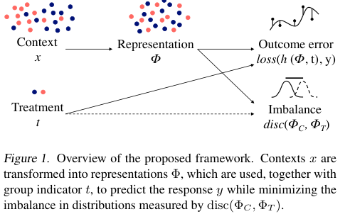

# 反事实预测为什么是跨分布泛化

Fredrik D. Johansson、Uri Shalit、David Sontag 把观察数据上的反事实回归看成领域自适应。同一用户的处理前特征 $x$ 保持不变，模型训练时看到的是旧策略给出的动作 $t$ 和事实结果。要回答换个动作会发生什么，实际查询变成 $(x,1-t)$。旧策略按购买意向定向发券时，这两类输入的联合分布有系统差异。 [原文 §1–2](https://arxiv.org/pdf/1605.03661v1#page=2)

## 翻转动作以后用户没有变

设旧策略对高意向用户发券的概率是 0.8，对低意向用户是 0.2。对高意向用户，事实分布中 $(x,1)$ 是 $(x,0)$ 的四倍。反事实查询把这个比例倒过来，对低意向用户则相反。直接回归 $h(x,t)$ 用旧动作一侧的事实监督，另一侧常落在少见的输入区间。论文式 (1) 的样本内 ITE 将已观测事实结果与预测反事实相减。新用户两个潜在结果均未观察到，需要两次模型读出再相减。 [原文 §2，式 (1)](https://arxiv.org/pdf/1605.03661v1#page=2)

## 事实拟合、邻居代理与表示平衡

作者原图 1，arXiv 1605.03661v1 第 3 页裁取。$x$ 先进入 $\Phi$。$\Phi(x)$ 与 $t$ 进入结果模型，同时按 $t$ 给表征分组以计算失衡。图中主要画出事实拟合及分布两个信号，式 (2) 还有一个反臂最近邻的代理结果项。 [原文图 1、式 (2)](https://arxiv.org/pdf/1605.03661v1#page=3)

训练样本 $(x_i,1,1)$ 对应用户拿券后下单，事实项用 1 监督 $h(\Phi(x_i),1)$。在输入空间预先找最相似的无券用户 $j$。若其没下单，代理项会把 $h(\Phi(x_i),0)$ 朝 0 拉。它依赖真实的无券结果函数对距离足够平滑。表示层由事实损失、代理损失和批内分布差联合约束。算法 1 先学习 $\Phi$，随后在该表示上用事实数据做带正则的拟合。实验的神经网络 BNN 采用端到端联合训练，作者报告最近邻项无实证改善，实际 BNN 省去了该项。 [原文 §3、算法 1 与 §6](https://arxiv.org/pdf/1605.03661v1#page=4)

线性版本令 $\Phi(x)=Wx$，只学习非负且和为 1 的特征权重。若结果函数是 $\beta^\top\Phi(x)+\beta_t t+\beta_0$，动作翻转后差值恒等于 $\beta_t$。BNN-2-2 让指派在两层表征之后与表示拼接，随后过非线性层，从而使差值随 $x$ 变化。较晚的 CFRNet 把这一步改为两个独立结果头，并对绝对的效应估计误差建立上界。 [原文 §3.1–3.3](https://arxiv.org/pdf/1605.03661v1#page=4) · [CFRNet 精读](../SRC-CFRNET/阅读笔记.md)

## 理论和实验各支持哪一步

定理 1 比较分别由事实和反事实训练出的岭回归解在同一分布上的误差。上界同时包含表示分布差、两种结果的共同可拟合度和由平滑性控制的反臂近邻距离。跨臂缺少支持时，原空间的近邻距离项依然大，表示平衡不会消除这个项。式 (8) 同时写出谱范数和一个闭式。对称块矩阵的非零特征根为 $c\pm\sqrt{c^2+\|v\|^2}$，$c=p-1/2$，因此谱范数为 $|c|+\sqrt{c^2+\|v\|^2}$。原稿闭式用的是 $c$，在 $p<1/2$ 时差一个与表征无关的常数。译文保留原式并加注。 [原文定理 1 与式 (8)](https://arxiv.org/pdf/1605.03661v1#page=5)

在采用 NPCI B 设定、747 人且处理为 139 人的 IHDP 半模拟实验中，表 1 报告 BNN-2-2 的根 PEHE 为 $1.6\pm0.1$，无平衡惩罚的 NN-4 为 $1.9\pm0.1$。结构与正则一起变化，另看图 4 按同一 BNN-2-2 变动 $\alpha$ 的曲线。News 的结果由文档主题和设备模拟。两张表均需模拟反事实真值。 [原文表 1–2、图 4](https://arxiv.org/pdf/1605.03661v1#page=7) · [补贴幅度与排序验证](../../知识库/问题/怎样验证补贴增量的排序幅度和策略价值.md)

采用 arXiv 1605.03661v1，精读 §1–7、附录定理证明。正文、摘要、图表标题与描述性脚注在作者 LaTeX 副本上翻译。附录、参考文献与图内标签保留原文。 [固定原文](https://arxiv.org/pdf/1605.03661v1)

中文正文译本共 9 页，本地正式文件为 `.local/papers/SRC-BALANCED-COUNTERFACTUAL/translation/中文.pdf`。原文与译本均可登录私有附件库下载。 [下载说明](../../文档/工具/中文PDF发布.md)
