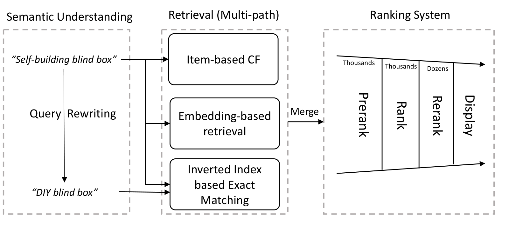
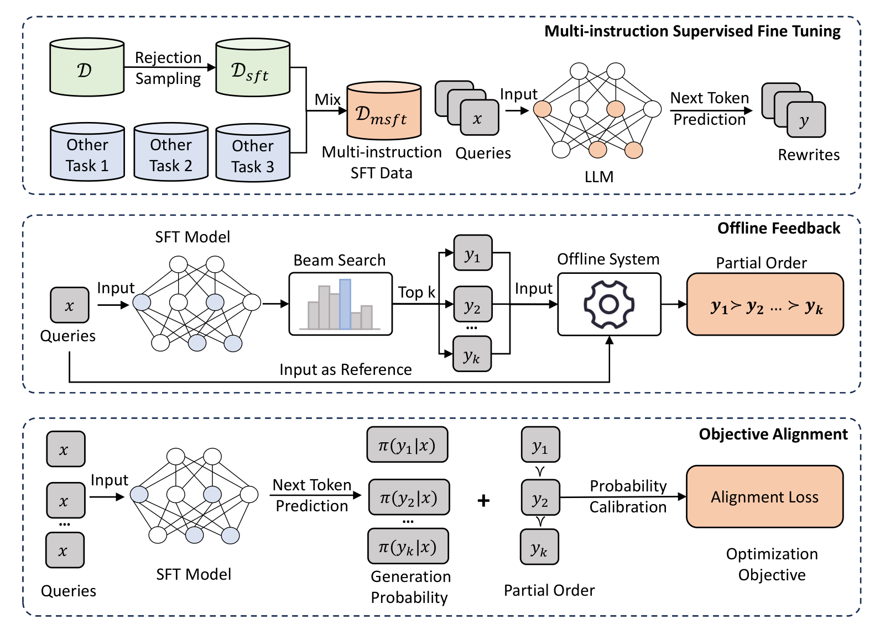

# BEQUE：让长尾改写接受实际召回结果的检验

用户输入“自制盲盒”，商品标题通常写“DIY 盲盒”。倒排索引按词项取候选，若两种叫法没有被词典或历史关联连接，下一阶段排序就看不到漏召商品。旧改写器从已知查询里找相似改写，容易沿用历史热词，长尾说法也可能缺少对应项。BEQUE 用语言模型扩展改写候选，再让同一条倒排召回路径试搜每条改写。线上读提前生成的改写，原查询和改写都参与召回。[原文 §1–3，第 2–6 页](https://arxiv.org/pdf/2311.03758v3#page=2)

*作者原图 1 · 从左向右看改写位于查询理解，评估针对中间倒排索引一支，候选随后进入排序。Wenjun Peng 等，arXiv:2311.03758v3 第 2 页。*

## 先筛历史示范，再给生成模型补监督

旧策略会给每个查询生成一组改写，BEQUE 取头名做标准答案。若“自制盲盒”的历史头名是“DIY 盲盒”，训练前先看它在倒排路返回的商品与原查询的相关性，再看加入它后是否扩展了相关优质商品覆盖。两次拒绝采样都过关才进入改写示范，论文还将最近交互的商品标题作为额外输入。这个标题是训练数据构造中的交互信息，§3.5 只说明了线上按查询查键值映射，未交代离线生成该映射时交互标题如何选择、刷新或缺省。离线划分也未披露标题、统计和索引快照的时间协议。[原文 §3.2、§3.5，第 3–6 页](https://arxiv.org/pdf/2311.03758v3#page=3)

把改写、改写质量判断、商品标题预测和人工写的改写理由按指令混入训练。以改写任务为例，模型读取任务提示、原查询及可用标题，依次预测改写的目标 token。训练时用标准答案的前序 token 作条件，损失只计目标位置，通过输出头更新骨干。推断时没有标准答案，SFT 模型用束搜索探索多个改写。原文方法概览出现“查询纠正”，§3.2 的三类辅助数据、提示表和 §4.1 数据量对应的是质量分类、商品标题预测及思维链。[原文表 1、第 4–5 页及 §4.1 第 6 页](https://arxiv.org/pdf/2311.03758v3#page=5)

*作者原图 2 · 上方由历史数据和辅助任务得到 SFT 模型，中间让束搜索得到的各改写进入离线系统，下方用改写的顺序校准生成概率。Wenjun Peng 等，arXiv:2311.03758v3 第 4 页。*

## 试搜结果怎样给改写排序

给原查询 $x$、候选改写 $y$ 分别查倒排索引，得到 $Z_x,Z_y$。以原查询和商品标题的匹配分 $f(x,z)$ 是否超过阈值来定义相关集合 $G_x$。以下是式 (5)–(7) 的集合计数写法，覆盖、精度和命中分开计算：

$$
\operatorname{rele}={|Z_y\cap G_x|\over |Z_y|},\qquad
\operatorname{incr}={|Z_e\cap(Z_x\cup Z_y)\cap G_x|\over |Z_e\cap Z_x\cap G_x|},\qquad
\operatorname{hitrate}={|E\cap(Z_x\cup Z_y)|\over |E\cap G_x|}.
$$

$Z_e$ 是搜索团队维护的优质商品集，$E$ 是用户在搜索场景外成交的商品集合。设“自制盲盒”只命中 2 件相关优质品。“DIY 盲盒”召回 6 件中有 4 件相关，其中 2 件是新增优质品，则 $rele=4/6$，$incr=(2+2)/2=200\%$。另一个候选只召回 3 件且都高度相关，但优质品与原结果重合，$rele=100\%$，$incr=100\%$。这两种候选取谁取决于优化目标。$incr$ 是相对原召回的比值，200% 表示两倍覆盖。若基准相关优质计数为零，式 (6) 无法直接计算，论文未给出完整处理。在正分母且集合按印式构造时，加入改写不会移去原集合中的商品，故比值至少为 100%。表 5 的 71.7 等较低报告值与这一字面下界不一致，可能涉及不同的截断或汇总，但原文未交代。式 (7) 的分子未显式加原查询相关性门控，而分母加了，无法仅从印式保证不超过 100%。场景外成交也可能来自已召回但未曝光或未下单的商品，属于代理监督。[原文 §3.3，式 (5)–(7)，第 5 页](https://arxiv.org/pdf/2311.03758v3#page=5)

作者从 10,000 条训练查询生成各 5 个候选，离线评分并去异常后留下 45,350 个改写候选。用每条查询的一组候选构造偏序。Bradley–Terry 的两项比较将两个分数做指数归一；列表 PRO 在每个剩余后缀中提高应排首位候选的相对生成分数，反复移去当前首位。式 (9) 用与分差成反比的温度调节比较，式 (10) 保留 SFT 项；§4.4 写明所有对比候选都计算 SFT。原文同时用 $r$ 表述生成分数和供温度计算的奖励差，未完整交代并列或零差处理。能确定的是候选的优先顺序由离线召回评分提供，搜索索引与评估器不需要通过语言模型损失反传。相同的“DIY 盲盒”在不同目录时点可能取得不同离线分数。[原文 §3.4、§4.1、§4.4，第 5–7 页](https://arxiv.org/pdf/2311.03758v3#page=5)

## 预生成的改写怎样接进线上搜索

原文定义待离线改写的中部、长尾查询为原召回结果中相关商品少于 70% 的查询。模型预生成改写并存入线上键值映射。请求“自制盲盒”命中后，原查询和“DIY 盲盒”均分词查倒排，两路并集交后续排序。原文报告离线生成覆盖淘宝主搜 27% PV，未披露查表未命中回退、索引变更后的改写失效、刷新频率或时延分位数。[原文 §3.5，第 6 页](https://arxiv.org/pdf/2311.03758v3#page=6)

[可执行检索请求](../../知识库/问题/复杂查询怎样生成可执行的检索请求.md)进一步比较 BEQUE 如何把试搜放在训练和离线准备阶段，以及 EASP 如何把探针安排到当前复杂请求。

## 长尾改善集中在哪些指标

离线测试取 14,981 个查询，半数按真实查询分布抽样、半数从长尾抽样。表 5 中“头部、中部、长尾”还按原召回相关占比切分，长尾低于 10%。整体中，增量版 BEQUE 的 $incr=198.7$、$hitrate=17.27$，高于所列基线，而 $rele=57.7$ 低于 Qwen SFT 的 61.4。长尾中增量版为 $rele=2.4$、$incr=71.7$、$hitrate=19.62$，对照 BART 为 8.4、27.5、13.59。改写能覆盖更多有效商品，同时召回中相关品比例仍可能更低。作者说 BART 在提升中长尾增量和命中时维持相关性，但长尾里 BART 的 8.4 低于 CLE-QR 的 10.0。多指令表 3 同时替换了拒绝采样及辅助任务，不能分离两者各自的增益。表 4 的对比数从 2 增到 5，$rele$ 由 53.3 到 58.8，$incr$ 由 215.6 到 190.3，$hitrate$ 由 17.66 到 17.21。作者选择 4 个候选作后续比较。[原文表 3–5，第 7–8 页](https://arxiv.org/pdf/2311.03758v3#page=7)

14 天线上 A/B 相对 CLE-QR，实验桶全部请求的 GMV、交易笔数和独立访客 IP 分别增加 0.40%、0.34% 和 0.33%；覆盖改写的请求中分别增加 2.96%、1.36% 和 1.22%。长尾及少召回行另外筛选了已改写请求。少召回行的 18.66% GMV 来自小占比切片，作者告诫该子集波动，不能代替整体实验效果，也不能把桶汇总的提升归因于未命中改写的请求。[原文表 6、§4.5，第 8 页](https://arxiv.org/pdf/2311.03758v3#page=8)

## 采用版与中文 PDF

采用 9 页 arXiv:2311.03758v3，另核实 WWW Companion 2024 第 20–28 页。中文工作译本覆盖摘要、§1–5、致谢、图表标题及描述性脚注，两图的英文和参考文献保留原文。7 页 PDF 已逐页目视，并核对 11 式、6 表、2 图和 46 条参考文献。可编辑译文和 PDF 位于 `.local/papers/SRC-BEQUE/translation/`，原文和中文 PDF 已完成私有备份与认证下载。[固定原文](https://arxiv.org/pdf/2311.03758v3) · [正式书目](https://doi.org/10.1145/3589335.3648298) · [私有 PDF 访问说明](../../文档/工具/中文PDF发布.md)
