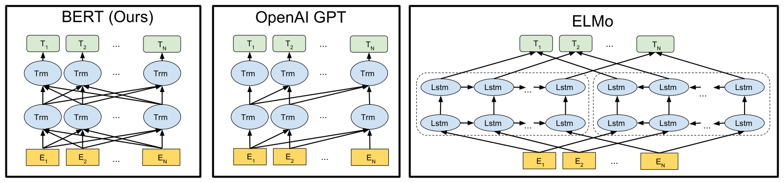
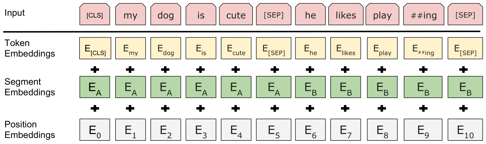
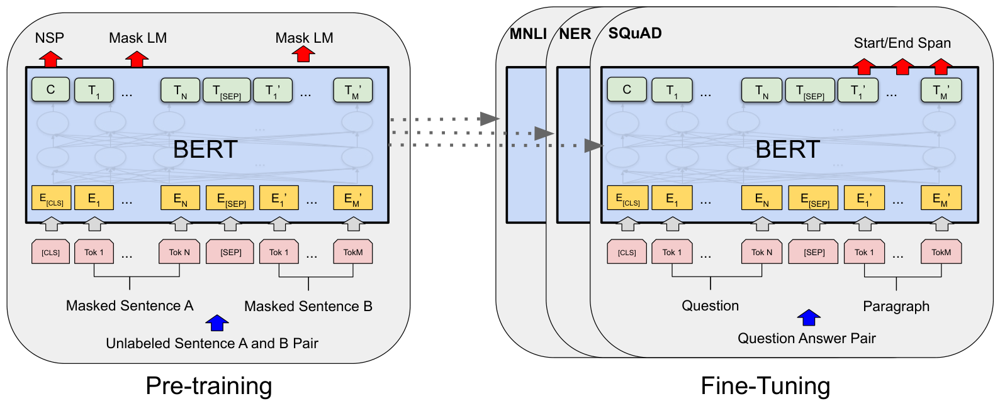
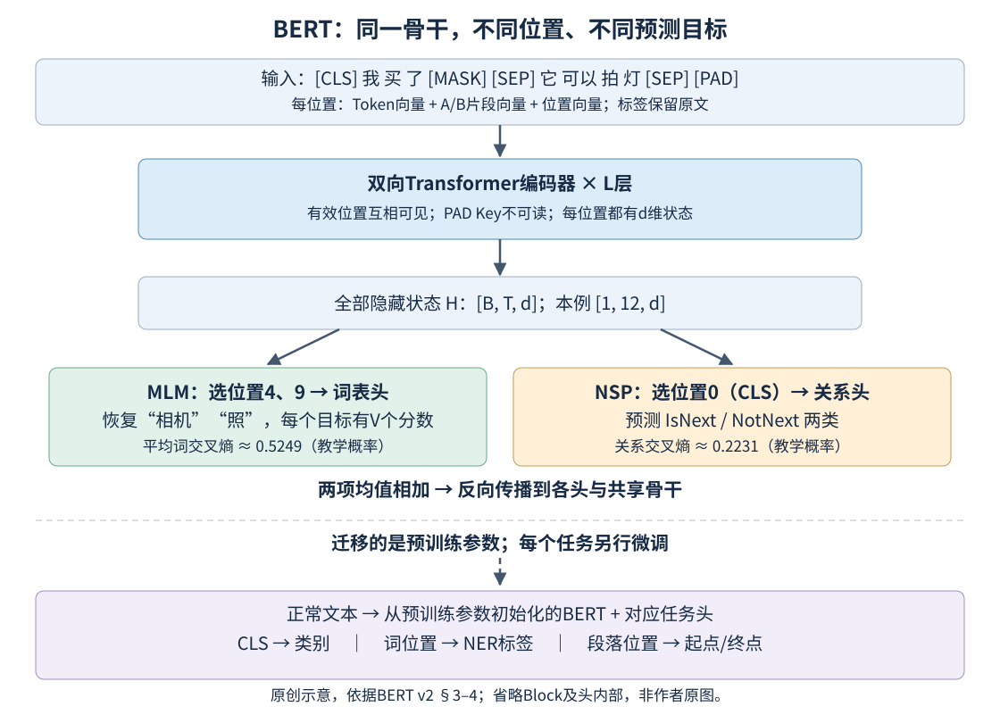
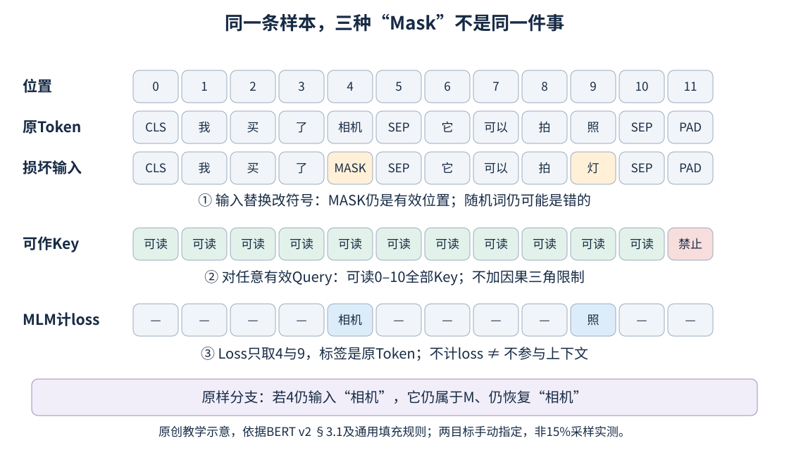
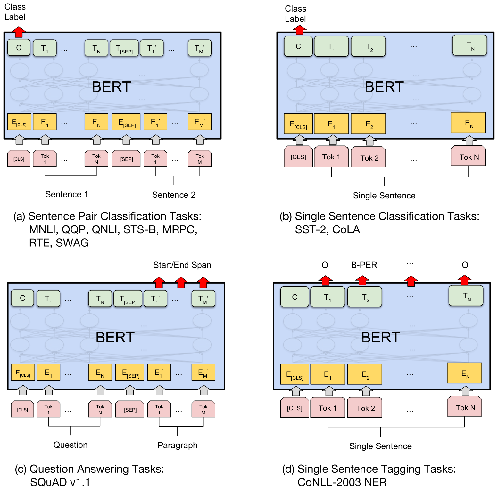

# BERT：用掩码恢复学习每层都融合左右信息的表示

[固定v2原文](https://arxiv.org/abs/1810.04805v2) · [中文PDF与范围](#原文译文与范围) · [私有备份下载说明](../../文档/工具/中文PDF发布.md)

读一句“他把苹果放进了袋子”，理解“苹果”时，右侧的动作与位置也可能有帮助。GPT初代的词位置状态只能读到当前位置及左侧，直接拿它做词级标注或答案片段抽取，就少了一边的线索。BERT保留Transformer编码器的双向读取，先破坏部分输入，再学习恢复原Token；它要得到可迁移的上下文表示，并不是训练一个直接自回归生成回答的模型。

论文为Jacob Devlin、Ming-Wei Chang、Kenton Lee、Kristina Toutanova的 *BERT: Pre-training of Deep Bidirectional Transformers for Language Understanding*，采用arXiv1810.04805v2（2019-05-24，NAACL2019）。下文实验均为作者报告，未运行模型；小样本、概率和两幅图是教学构造。初读按下文顺序，复习可直达[样本](#从一条文本对构造输入和两种标签)、[三种Mask](#输入mask注意力mask和loss-mask各管一件事)、[Loss](#同位置状态怎样得到词概率和损失)、[梯度](#只有两个位置计mlm损失为什么上下文仍会学习)或[微调与使用](#预训练微调与使用分别保留什么)。

## 从GPT的前缀预测走到BERT的双向恢复

作者原图 3（Jacob Devlin 等，1810.04805v2，PDF 第 13 页）。中图 GPT 的当前位置只读前缀。左图双向层可用被选位置两边的信息，须先破坏该位置原输入。右图 ELMo 各方向独立训练，在特征层合并。

先看旧方案究竟在做什么。对序列“我 买 了 相机”，GPT用“我 买 了”预测“相机”，训练时把输入与下一Token标签错开一位。其因果注意力允许每一行读自身及左侧输入，因此输入“了”的状态能预测“相机”，但不能先看到后面的“相机”。一次训练可以并行算多行，不是每行都要等上一行算完；生成时才因未知后续Token而逐步运行。[GPT训练链路](../SRC-GPT1/阅读笔记.md#因果骨干为什么足以完成语言建模)和[错位示例](../../知识库/概念/语言模型的词表预测与交叉熵.md#一个序列怎样提供多个预测目标)展开了这一点。

困难出现在**怎样预训练可同时利用左右文的词表示**：若直接解除因果限制，却继续GPT的下一词目标，后一输入位置就直接放着待预测标签；即使改成同位置预测原词，也能从自身或其他位置绕路复制。只去掉三角mask，不能得到有意义的同位置恢复训练。BERT改变的不止可见性，还包括目标和样本构造：先选位置、损坏这些输入，再让同位置的状态预测损坏前Token。[§3–3.1，PDF第3–4页](https://arxiv.org/pdf/1810.04805v2#page=4)。

| 这一行在干什么 | GPT初代预训练 | BERT的MLM预训练 |
|---|---|---|
| 已知条件 | 自然文本前缀，因果可见 | 经过损坏的当前文本，双向可见 |
| 位置$i$状态的目标 | 下一Token $x_{i+1}$ | 被选中时恢复同位置原Token $x_i$ |
| 哪些位置直接计词预测loss | 有效的下一Token目标位置 | 选中集合$M$，含随机替换与原样分支 |
| 学到的概率接口 | 从左到右分解文本概率 | 给定损坏上下文的恢复概率，非同一联合似然 |

BERT沿用了原始Transformer编码器的多层注意力结构；本文需要讲深的是双向上下文怎样得到预训练信号以及如何迁移任务，不是把Transformer、完形填空或去噪思想都归为本篇首创。ELMo则分别训练左右方向网络，最后拼状态；每个方向内部没有先融合另一方向的证据。BERT让每层都交换两侧信息，下一层再读已经融合的状态。它增加了交互机会，但不是“任意数据和固定预算必胜”的数学证明。[§1–3、附录图3，第1–4、13页](https://arxiv.org/pdf/1810.04805v2#page=13)。

## 从一条文本对构造输入和两种标签

作者原图 2（Jacob Devlin、Ming-Wei Chang、Kenton Lee、Kristina Toutanova，1810.04805v2，PDF 第 5 页）。沿一列从 Token 往下读，Token、句段和位置三项相加，输出仍是一条等宽向量。图中句段 A、B 和位置编号在同一输入中同时存在，分别回答该词来自哪一段和处于哪个槽位。

设语料中相邻两段为A：“我 买 了 相机”，B：“它 可以 拍 照”。为便于跟踪，下面把中文词当示意Token，**不是实际WordPiece分词结果**。CLS、SEP、MASK、PAD分别简写带方括号的特殊符号。原始输入加上边界标记与一个填充位后为：

| 零基位置$i$ | 原Token $x_i$ | 输入 $\tilde x_i$ | 片段 | MLM标签 |
|---|---|---|---|---|
| 0 | CLS | CLS | A | — |
| 1 | 我 | 我 | A | — |
| 2 | 买 | 买 | A | — |
| 3 | 了 | 了 | A | — |
| 4 | 相机 | MASK | A | 相机 |
| 5 | SEP | SEP | A | — |
| 6 | 它 | 它 | B | — |
| 7 | 可以 | 可以 | B | — |
| 8 | 拍 | 拍 | B | — |
| 9 | 照 | 灯 | B | 照 |
| 10 | SEP | SEP | B | — |
| 11 | PAD | PAD | 不使用 | — |

这里人为指定$M=\{4,9\}$展示两种损坏，并非声称这个短例恰好按15%采样：位置4换为MASK，位置9随机换成“灯”。标签仍保存**原Token**“相机”“照”，不能拿损坏后的“灯”当正确答案。NSP标签是IsNext，因为B真实接在A之后；若B从语料随机抽取，则标签为NotNext。两种任务的监督都可由原始语料构造，不需要人工逐词标注“应填什么”，但并不等于训练时没有标签。[§3.1和附录A.1，第4、13页](https://arxiv.org/pdf/1810.04805v2#page=13)。

WordPiece会把文本切为词表子词，一个自然词可能对应多个位置。实际MLM随机选择15%的WordPiece位置，词表约30000；不是15%的完整自然词。在**选中的位置内部**，80%换MASK、10%换随机Token、10%原样保留，换算全体约为12%、1.5%、1.5%。三个分母必须分清。若本例位置4抽到原样分支，输入仍是“相机”，这一位置依旧计loss；因此不能说所有监督位置都彻底隐藏答案。[§3.1，第4页](https://arxiv.org/pdf/1810.04805v2#page=4)。

为什么不全部换MASK？作者希望减轻预训练有MASK、微调没有MASK的输入差异；原样分支让状态也围绕真实观察词学习。随机替换让模型不能把所有可见词都当可靠真值；模型也没有额外收到完整的“这里被选中”标记。这是设计解释，是否有收益要看后文掩码消融，不能仅凭直觉宣布80/10/10在每个任务都最好。

## Token怎样变成每位置的隐藏状态

作者原图 1（Jacob Devlin 等，1810.04805v2，PDF 第 3 页）。左图以两个被遮位置的状态预测词元，并从开头特殊位置读 NSP。右图将同一骨干用于句对分类与问答等任务，各任务改变顶部读出和监督。

每个有效位置查三张表再相加：

$$h_i^{(0)}=E_{\rm token}[\tilde x_i]+E_{\rm segment}[s_i]+E_{\rm position}[i].$$

三项都是$d$维向量，不是拼成$3d$维：Token表告诉模型“这里是什么符号”，Segment表区分片段A/B，Position表区分顺序。同一片段所有位置共享同一类型向量，但Token与位置仍不同。位置4取的是MASK的Token向量，原来的“相机”保存在标签侧，不偷偷加回输入。CLS是专用序列读出位置，SEP标记边界；所谓“句子”可是一段连续文本，不一定是一个语言学句子。[§3、图2，第3–5页](https://arxiv.org/pdf/1810.04805v2#page=5)。

图从上往下读：先看到所有位置的状态，再分为“选位置4/9恢复词”和“选位置0判断文本对”两条读出；下半部表示另一次下游微调，不能将箭头读成把两种预训练预测结果喂给分类任务。这是依据§3–4的原创机制示意，省略Block内部和输出头实现细节，不是作者图1的截图。作者整体训练/迁移图可核对[图1，第3页](https://arxiv.org/pdf/1810.04805v2#page=3)。

隐藏状态就是**该位置经上下文计算后得到的向量**。设batch大小$B$、填充长度$T$、宽度$d$，骨干输出$H^{(L)}\in\mathbb R^{B\times T\times d}$；本例为$[1,12,d]$。每个位置都有一行，不是整句最终只剩一个向量；MLM、NSP或下游头再决定取哪几行。论文记最终CLS状态为$C$，其他位置状态为$T_i$，这里用$h_i$统一指它们，注意张量长度$T$与原文向量符号$T_i$不是同一量。

一层自注意力让位置$i$用自身状态生成Query，与各位置的Key算相关分数，再将Value加权混合。位置4由此能读取左边“买”与右边“拍”，后续层继续加工；前馈网络逐位置变换，残差相加和归一化连接子层。它并非先把词序列压成一个向量再解开。完整Q/K/V计算与多头详解在[自注意力机制](../../知识库/问题/序列怎样用自注意力建立上下文.md#从相似度到可学习的信息读取)，本篇关注这条通路如何接到恢复目标。

BASE为12层、768维、12头、110M参数，LARGE为24层、1024维、16头、340M；前馈宽度均为$d$的四倍。层数是重复加工次数，宽度是每行状态的特征维数，头数是在层内分组计算注意力，不是12个独立完整模型。[§3，第3–4页](https://arxiv.org/pdf/1810.04805v2#page=3)。

## 输入MASK、注意力Mask和Loss Mask各管一件事

图中位置4虽然输入为MASK，但仍是有效Key，其他位置可以读它的状态；被禁止读取的是PAD Key。位置9换成“灯”也仍然可见。当前有效输入在各层双向互通，Segment A/B与SEP不会自动把两段Attention隔断；因此位置4也能用B中的“拍”。这里的可见性是计算许可，不保证模型最终一定使用每条线索。图对照的是§3.1的输入替换与监督；padding可见性作为批处理解释，非论文新增消融。

对本例有效Query，允许读取$j=0\ldots10$的Key，禁止$j=11$的PAD Key，不加$j\le i$的因果条件。**Loss位置掩码**则只选4与9：它决定哪些预测项进入MLM损失，并不限制Attention。换MASK、禁止连边、忽略loss这三种操作不能互相替代。PAD Query也可能产生非零状态，只是此例不读出它、不让有效位置读取它。[通用Mask与填充解释](../../知识库/概念/Attention遮罩与填充.md#bert恢复目标中的三种mask)。

双向不会自动等于信息泄漏：下游整段文本在预测时本来都已知，可以双向编码。泄漏要看待预测信息是否不该出现在输入里。MLM用损坏输入定义恢复任务；“10%原样位置可以看到原词”是其明示混合训练策略，不应为了讲顺而掩盖。也不能说它学到了只依赖所有其他真实词的严格留一条件概率，因为别的目标位置可能同时被破坏。

## 同位置状态怎样得到词概率和损失

MLM头把一个$d$维状态变成词表上$V$个实数分数（logits，尚未归一化），再沿词表Softmax变成总和为1的概率，取原Token对应的那一项。抽象写为

$$z_i=g_\phi(h_i)\in\mathbb R^V,\qquad p_i(v)=\frac{e^{z_{iv}}}{\sum_{u=1}^{V}e^{z_{iu}}}.$$

$g_\phi$表示词预测输出头；这里不把简单线性层冒充官方完整实现，因为原文§3.1只在此层面描述“最终状态进入词表Softmax”，本轮未读官方代码。重要的是接口和位置：$h_4$恢复$x_4=$“相机”，$h_9$恢复$x_9=$“照”；不是$h_3$预测$x_4$的GPT错位目标。可以先选出目标行再算词表分数，也可以算全位置再选loss；目标定义不要求必须分配$[B,T,V]$的全部logits。[§3.1，第4页](https://arxiv.org/pdf/1810.04805v2#page=4)。

先写未归约的恢复代价，再说明平均方式：

$$\ell_i=-\log p_i(x_i),\qquad
L_{\rm MLM,sum}=\sum_{i\in M}\ell_i,\qquad
L_{\rm MLM,mean}=\frac1{|M|}\sum_{i\in M}\ell_i.$$

这里$x_i$取损坏前的词表ID，$M$只含选中位置；多样本时在相应有效目标集合上平均。原文附录A.2说总训练loss是平均MLM项与平均NSP项之和，所以不能把求和与平均在不同目标间的尺度混用。它不是整条文本的自回归联合似然。

回到样本，假设模型在完整词表上给真值概率$p_4(\text{相机})=0.7$、$p_9(\text{照})=0.5$，其余概率分给其他词。仅为教学给定这些数，并非模型实测。自然对数下：

$$\ell_4=-\ln0.7\approx0.3567,\quad\ell_9=-\ln0.5\approx0.6931,\quad
L_{\rm MLM,mean}\approx0.5249.$$

未选中位置可以参与上下文，但不会在本次MLM里另算恢复loss。“随机换成灯”不改变位置9的标签；“保持相机不变”也不将它从$M$移除。把这两点放回表中，才能知道究竟在优化什么。通用logits、稳定交叉熵与完整推导见[状态到词表](../../知识库/概念/语言模型的词表预测与交叉熵.md#隐藏状态怎样映射到词表)及[损失归约](../../知识库/概念/语言模型的词表预测与交叉熵.md#多位置损失怎样归约)。

## NSP与边界标记一起训练文本对表示

词恢复监督作用于选中Token，NSP再从$C=h_0$读出整对文本是否相邻。它是二分类，输出轴是两个关系类别，和MLM约3万词的输出轴不同。设$r=\operatorname{softmax}(g_\psi(C))$，文本对标签$y\in\{\mathrm{IsNext},\mathrm{NotNext}\}$，则单样本$L_{\rm NSP}=-\log r_y$。这里$g_\psi$同样是抽象关系头，不声称核对了官方pooler实现。[§3.1，第4页](https://arxiv.org/pdf/1810.04805v2#page=4)。

本例标签为IsNext，若预测其概率为0.8，则$L_{\rm NSP}\approx0.2231$；一个样本的本次合成目标为$L_{\rm MLM,mean}+L_{\rm NSP}\approx0.7481$。实际batch分别取两项均值再相加。50%正例、50%随机负例的构造是语料级策略；随机负例也可能包含主题差异，所以97%–98%的NSP准确率不等于证明通用语义推理。[§3.1脚注5，附录A.2，第4、13页](https://arxiv.org/pdf/1810.04805v2#page=13)。

CLS位于序列开头仍能读取右侧全部有效输入，因为这里没有因果限制；它不是简单把所有词平均，而是该位置经过多层计算后产生的状态。NSP只提供特定二分类监督，原文脚注6提醒未经微调的$C$不是现成有意义的句向量：不能直接把CLS余弦相似度当已验证的检索方案。其与GPT末尾Extract的区别见[序列读出](../../知识库/概念/Token表示怎样汇聚成序列表示.md#gpt的extract与bert的cls)。

## 只有两个位置计MLM损失为什么上下文仍会学习

对无标签平滑的Softmax交叉熵，单目标的logit梯度是预测概率减one-hot真值；one-hot就是正确词那一维为1、其余维为0的标签向量。这里按两个目标平均，所以

$$\frac{\partial L_{\rm MLM}}{\partial z_{iv}}=\frac12\big(p_i(v)-\mathbf1[v=x_i]\big),\qquad i\in\{4,9\}.$$

本例正确类梯度分别为$(0.7-1)/2=-0.15$与$(0.5-1)/2=-0.25$；负梯度方向推动正确类分数增大。其他词的直接梯度为其概率的一半；优化器如何更新实际共享参数还取决于计算图与其他样本，不能当作每个logit独立可调。

MLM信号从词表头回到$h_4,h_9$，再沿Attention中的上下文读取、前馈、残差等路径回到更低层和输入表示。当$h_4$读取“买”“拍”等位置时，这些上下文的较低层状态与共享参数也可能收到梯度。没在某个顶层行直接计MLM loss，不等于那种Token或位置不训练。NSP则从$h_0$再提供一路信号；骨干参数的两路梯度相加，而不是先分别训练两个互不相干的BERT。

以上是由目标和可微计算图得到的解释，不是本轮运行反传实验。完整$p-y$、LM头矩阵梯度与Q/K/V链式法则放在[公共梯度详解](../../知识库/概念/语言模型的词表预测与交叉熵.md#梯度怎样穿过lm头和共享embedding)，本篇保留的是与位置4/9和CLS直接相关的路径。

## 预训练微调与使用分别保留什么

作者原图 4（Jacob Devlin 等，1810.04805v2，PDF 第 15 页）。上排读出句对与单句分类，下排分别标出答案起止位置和逐词标签。先观察红色预测标记出现在哪些位置，再回到相应输出头。

预训练先用MLM+NSP学骨干；每个下游任务再从同一套预训练参数初始化，接该任务输出，以标签端到端微调全部参数。最后使用的是**该任务微调后的模型**，不是把预训练的两个答案当作任务特征，也不是一个最终检查点同时完成所有任务。[§3–3.2，第3–5页](https://arxiv.org/pdf/1810.04805v2#page=5)。

| 阶段/任务 | 实际输入和读取位置 | 目标与输出 |
|---|---|---|
| 预训练MLM | 损坏文本，读选中位置 | 原Token；只在$M$计词表CE |
| 预训练NSP | 同一损坏文本对，读CLS | 是否真实相邻；二类CE |
| 句子/句对分类微调及使用 | 正常文本/文本对，读CLS | 任务类别；用分类头，不靠填词结果 |
| NER微调及使用 | 正常文本，读每个词首子词状态 | 实体标签；不是词表词 |
| 抽取问答微调及使用 | 正常问题+段落，读位置状态 | 起点和终点；不是逐Token生成答案 |

正常下游使用不会按MLM策略随机损坏15%的输入；“使用BERT”也可能指单独做完形填空，但那是另一个MLM接口。本篇实验主线是理解任务微调，没有规定把BERT按GPT逐步续写，也不把填词概率直接称为整句生成概率。训练时有loss和更新，部署预测时只算对应输出而不提供真值标签。

分类可记为$\operatorname{softmax}(CW^\top)$，$C$为$d$维状态、$W$为$K\times d$类别权重；$K$是下游类别数，不是词表大小。原文分类loss简写为$\log(\operatorname{softmax}(CW^\top))$，未显式写真值类别选择和负号，最小化交叉熵应补这两步。NER用每词首个子词表示分类，不额外加CRF。[§4.1与§5.3，第6、9页](https://arxiv.org/pdf/1810.04805v2#page=9)。

抽取问答给位置$i$的状态$T_i$接起点/终点向量$S,E$：

$$p_{\rm start}(i)=\frac{e^{S\cdot T_i}}{\sum_j e^{S\cdot T_j}},\qquad
p_{\rm end}(j)=\frac{e^{E\cdot T_j}}{\sum_k e^{E\cdot T_k}}.$$

Softmax现在沿**输入位置**，不是词表；训练把真起点、终点的负对数概率相加，预测在合法段落跨度$i\le j$中选$S\cdot T_i+E\cdot T_j$最大者。例如问题“买了什么”，段落“我 买 了 相机”中答案就是同一个位置的“相机”，无需模型重新生成这个词。SQuAD2.0用CLS表示空答案，在开发集选阈值，比较最佳非空与空答案得分。SWAG另为四个候选各构造输入，对四个CLS得分做Softmax，归一化轴又换成候选。[§4.2–4.4，第6–7页](https://arxiv.org/pdf/1810.04805v2#page=7)。

下文附录C.2的掩码消融三元组按“MASK / 原样 / 随机”的表列顺序读，例如80/20/0表示没有随机替换；不要与前文按文字介绍分支的次序混用。

## 数据与预算也参与了对GPT的差异

预训练使用BooksCorpus8亿词和英文维基百科25亿词，后者删除列表、表格和标题，保留连续文档。附录A.2报告batch256序列、100万步、Adam学习率$10^{-4}$、10000步warmup再线性衰减、weight decay0.01、Dropout0.1、GELU。为控制长序列注意力成本，90%步使用长度128，最后10%用512学习长位置。[附录A.2，第13页](https://arxiv.org/pdf/1810.04805v2#page=13)。

因此“256×512=约128k Token/batch”是原文完整长度配置的概括，不能据此推断全部100万步都用512并精确重算总Token。BASE用4个Cloud TPU（16芯片），LARGE用16个（64芯片），各预训练4天；这不包括下游学习率、随机重启搜索的完整总成本。

BERT和GPT的区别还包括语料规模、边界/片段表示何时学习、batch和调参。附录A.4对GPT微调学习率写$5\times10^{-5}$，与GPT原文“大多数任务$6.25\times10^{-5}$”不一致，不能把其比较描述当成GPT原始配置。跨论文主表不能单独归因于双向性；BERT内部消融才更接近控制数据和微调流程。[附录A.4，第14页](https://arxiv.org/pdf/1810.04805v2#page=14)；[GPT §4.1，第5页](https://cdn.openai.com/research-covers/language-unsupervised/language_understanding_paper.pdf#page=5)。

## 主表成绩要带上评估口径

| 实验 | 代表性报告 | 必须保留的条件 |
|---|---|---|
| GLUE官方分 | LARGE80.5，GPT72.8 | 差7.7分，任务分别微调，开发集选超参数 |
| 表1平均 | BASE79.6，LARGE82.1，GPT75.1 | 排除WNLI，非官方GLUE分；STS-B是Spearman，不能直接混用GPT原表Pearson |
| MNLI测试m/mm | LARGE86.7/85.9 | 两类测试分别报告，不是同一个准确率 |
| SQuAD1.1测试F1 | LARGE单模型+TriviaQA91.8；七模型集成+TriviaQA93.2 | 93.2不是普通单模型结果；先做额外TriviaQA微调 |
| SQuAD2.0测试EM/F1 | LARGE单模型80.0/83.1 | 无TriviaQA，空答案阈值由开发集选择 |
| SWAG测试准确率 | LARGE86.3，GPT78.0 | 四候选续写选择，非开放生成 |

依据[表1–4，第6–7页](https://arxiv.org/pdf/1810.04805v2#page=6)。GLUE使用batch32、3epoch，开发集选择学习率；LARGE小任务做随机重启后挑最佳。论文称BASE/LARGE“平均准确率”提升4.5/7.0，实际对应表1对GPT75.1的混合指标分差，不能解释成各项准确率的同单位平均，更不能用于推断线上推荐收益。

## 控制消融支持什么，尚不能推出什么

表5固定BASE数据和训练框架，去NSP后QNLI由88.4降至84.9，SQuAD1.1 F1由88.5降至87.9；该协议支持NSP有帮助。再将“无NSP”的MLM双向模型改为LTR无NSP，MRPC准确率86.5降至77.5，SQuAD F1 87.9降至77.8。顶层补随机BiLSTM后SQuAD回到84.9，仍低于双向预训练。这支持任务所需右侧上下文及双向预训练有用，但LTR对照同时改变预训练目标、可见范围及每步预测密度，不是只切一个注意力开关的单因素证明。[§5.1、表5，第8页](https://arxiv.org/pdf/1810.04805v2#page=8)。

表6随规模增大，所列MNLI/MRPC/SST-2开发准确率改善，同时MLM困惑度降低；正文称“四个数据集”，实际只有三列下游数据和一列困惑度。表6为五次微调重启均值，不同于主表开发集选最佳，也没有证明任意规模下单调或预算等价。MLM困惑度是掩码条件预测度量，不等于自回归模型对整文本的同一似然。[§5.2、表6，第8–9页](https://arxiv.org/pdf/1810.04805v2#page=9)。

NER特征路线冻结BERT，将末四层拼接后送两层768维BiLSTM，开发F1为96.1，BASE全量微调96.4，差0.3；不能将它写成测试差，因为特征行没有给测试分。LARGE测试92.8仍低于表中CSE93.1，“有竞争力”比“所有任务最优”更准确。[§5.3、表7，第9页](https://arxiv.org/pdf/1810.04805v2#page=9)。

附录C.2掩码消融中，80/10/10的MNLI微调84.2，而80/20/0为84.4，100% MASK为84.3；三种对应的NER冻结特征F1分别为94.9、94.7、94.0。混合策略并非每项最佳，纯MASK对冻结特征的损害更明显。附录C.1还显示较长预训练有收益，初期30k/50k步LTR略高，100k后MLM更高，不能把“几乎立即超过”当成所有步数都胜出。[附录C、图5/表8，第16页](https://arxiv.org/pdf/1810.04805v2#page=16)。原文口径问题登记[REV-031](../../维护/审核台.md)。

## 双向表示怎样接回推荐

当整个输入是预测时已经发生的历史，双向编码这段历史不等于读取未来；若训练目标是中间某次行为，读取其后行为则改变了任务条件。把BERT接到推荐，需要同时设计被遮物品、训练窗口与测试时追加位置，不能只把SASRec因果遮罩删除而保留原下一物品监督。下一步BERT4Rec应在[下一物品预测问题](../../知识库/问题/从历史顺序预测下一物品.md)中与SASRec比较。

[预训练迁移问题](../../知识库/问题/预训练怎样迁移到不同任务.md)已合并GPT因果语言建模、BERT双向掩码恢复及P5条件生成的差别：编码器/解码器决定信息路径，预训练目标决定学习信号，下游输出头决定实际任务。三者不能凭“都用Transformer”互换。

## 原文、译文与范围

[固定v2原文](https://arxiv.org/abs/1810.04805v2) · [PDF](https://arxiv.org/pdf/1810.04805v2)。阅读16页中的正文§1–6、表1–7、图1–2及附录A–C的训练、任务与消融说明；参考文献核对身份，未独立阅读全部所引文献或官方代码。

本地附件不随Git分发：中文PDF`.local/papers/SRC-BERT/translation/BERT - Pre-training of Deep Bidirectional Transformers for Language Understanding.pdf`，译后工程`.local/papers/SRC-BERT/translation/translated-sources/main.tex`。正文叙述、摘要、图表说明与描述性脚注已译；附录、参考文献和图内部英文保留，注释/未出版的eat段落不算正文。早期本地XeLaTeX产物存在中文显示问题，现用LuaLaTeX重新编译；最终17页已逐页渲染目视，表格宽度与分组标题修复后复查受影响页，未见缺字、裁切或重叠；结果表数字、引用与标签核对保留，日志无缺字、溢出和未定义引用。不公开未核实再分发许可的全文译文，当前Agent自查，未做模型复现。

2026-10-27修复中文不可见：旧版中文字体缺少ToUnicode映射，依赖Adobe-GB1外部映射，在当前Poppler渲染中报字体加载失败；此前的排版验收未覆盖此问题。改用LuaLaTeX重新编译并嵌入Unicode映射，17页全部重新渲染目视，正文中文可正确提取，渲染日志无字体加载错误，编译无缺字、溢出或未解析引用。修正版附件为`.local/papers/SRC-BERT/translation/中文修正版-BERT.pdf`；原文件名也已替换，译后工程注明LuaLaTeX，旧文件及诊断留在本地qa目录。
