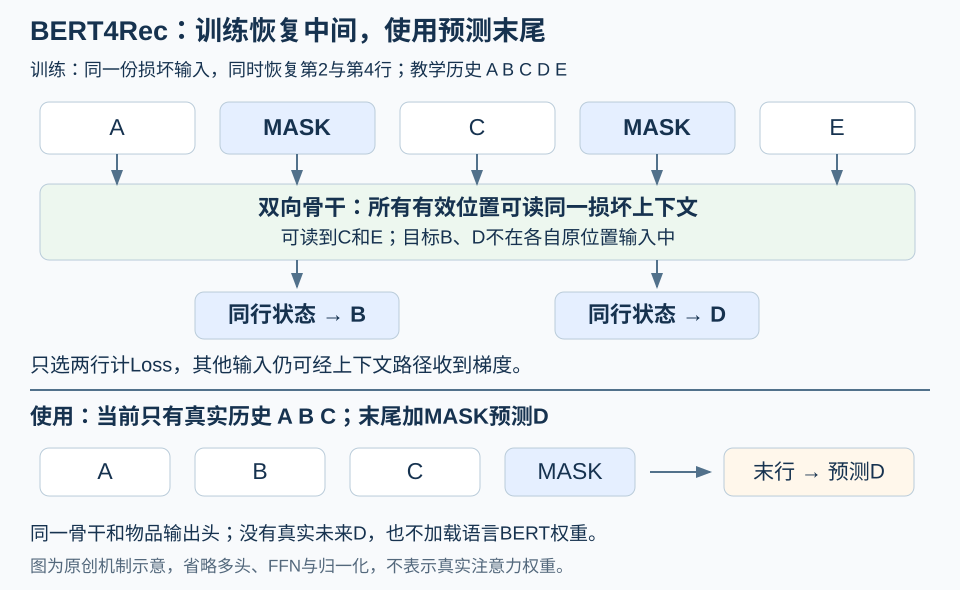

# BERT4Rec：用双向历史恢复物品，再在末尾预测下一步

假设历史是相机、镜头、相机包。恢复被遮住的“镜头”时，两侧都能提供线索；真正推荐下一物品时，只有已经发生的三次行为。BERT4Rec用前一种任务学习历史表示，再在历史末尾放一个MASK，用其状态完成后一种任务。它借用BERT的双向编码与Cloze训练思想，但物品ID表示和整个模型都在推荐数据上从零训练，并不加载语言BERT参数。

Fei Sun等的 *BERT4Rec: Sequential Recommendation with Bidirectional Encoder Representations from Transformer*，采用1904.06690v2（2019-08-21，CIKM2019）。以下实验均为作者报告，未运行复现。

## 从SASRec的同一历史出发，为什么不能直接去掉遮罩

继续使用教学序列 $S=[A,B,C,D,E]$：相机、镜头、相机包、三脚架、存储卡。名称只是读者记忆ID的助记，不是模型输入的文本或作者数据。SASRec输入ABCD，在A行预测B、B行预测C、C行预测D、D行预测E，各行只能看自己的前缀。若只让A行双向读ABCD，它会直接读到输入中的B，早期行的下一项监督泄漏了。

只把A行直接连向B的边删掉还不充分：多层网络可能从另一个可读取位置的上下文状态间接拿到B。SASRec的因果连接之所以有效，是每层都保持前缀边界。BERT4Rec想让历史内部双向交流，因而同时改变**输入损坏方式和预测位置**：把目标位置的原ID从当前输入中移走，要求在同位置恢复它，而非保留全部ID后做错位下一项预测。[§3.6与图1，第3–5页](https://arxiv.org/pdf/1904.06690v2#page=4)。

还可对每个前缀单独运行双向模型再预测下一项，论文承认这是一种办法，但它不能像一次因果前向那样同时取得所有前缀条件，训练代价更大。本篇选择Cloze（遮住部分输入再填空）的恢复任务，代价是随后必须处理“训练填中间、使用猜末尾”的差异，而不是声称双向模型不能预测未来。

复习时可直达[两个MASK实例](#一个损坏序列怎样产生两个不同的预测)、[损失与反传](#只在mask计损失为什么上下文物品也会训练)、[末尾预测](#末尾mask把恢复接口接到下一物品任务)、[条件与证据](#消融说明恢复有益但没有隔离所有差异)。

## 双向编码改变历史内部的信息流

物品$v_i$与位置$i$查表相加：$h_i^0=E_{v_i}+P_i$。可学习位置表最大长度$N$，超过时保留最近窗口；没有显式用户向量、绝对时间间隔或商品内容输入。与[SASRec](../SRC-SASREC/阅读笔记.md)相同，物品序列是输入，但这里每层各位置可读整个当前输入，而非只读此前位置。[§3.1–3.4，原PDF第3–4页](https://arxiv.org/pdf/1904.06690v2#page=4)。

每头注意力为$\operatorname{softmax}(QK^\top/\sqrt{d/h})V$，$h$为头数、$d$为总隐藏宽度；多头拼接后投影。FFN为$\operatorname{GELU}(xW_1+b_1)W_2+b_2$，中间宽度$4d$。采用$\operatorname{LN}(x+\operatorname{Dropout}(g(x)))$的Post-LN，与SASRec原文的输入归一化形式不同；因此不能只称为“给SASRec去掉因果遮罩”。[式(1)–(6)，第4页](https://arxiv.org/pdf/1904.06690v2#page=4)。

这里的query Q是当前行提出的读取查询，key K与它匹配，value V是被加权读出的内容；Softmax沿可见物品位置归一化，尚未输出推荐概率。FFN逐行变换特征，GELU可写成 $x\Phi(x)$，$\Phi$是标准正态分布函数，是平滑非线性门；LayerNorm则按单行的$d$个特征归一化。它们分别改变跨位置混合、同位置特征和数值尺度，不能统称成一个“注意力层”。

双向性指历史内部可交换信息，不等于模型无视顺序：可学习位置仍告诉网络哪些行为先后发生。作者用“行为并非总有严格次序”作动机，并未证明任意重排历史都应该得到相同预测。

## 同时遮住若干物品，不能把目标藏在邻居表示里

为改变上面的监督条件，BERT4Rec先把所选位置集合$M$替换为MASK，得到$\tilde S$，只在这些位置恢复原ID：

$$\mathcal L=-\frac1{|M|}\sum_{i\in M}\log p_\theta(v_i\mid\tilde S),$$
$$p_\theta(\cdot\mid\tilde S,i)=\operatorname{softmax}\!\left(\operatorname{GELU}(h_i^LW^P+b^P)E^\top+b^O\right).$$

这是式(7)–(8)按位置集合重写；$h_i^L$来自同一损坏序列，其他被遮位置的真实物品也不可读取。输出在全部物品上Softmax，输入输出共享物品表$E$，并有投影与物品偏置；它不是SASRec原论文一个正例、一个负例的采样BCE。[§3.5–3.6，第4–5页](https://arxiv.org/pdf/1904.06690v2#page=5)。

例如A、B、C、D、E变成A、MASK、C、MASK、E，两个MASK分别恢复B和D。可用右侧的C、E帮助恢复B，但这项训练信号描述的是“窗口内恢复”，不是当年B发生之前就已知C、E。遮罩不阻止相同物品ID在其他可见位置重复出现；它删除的是所选事件位置，不能保证所有目标语义都被完全移除。

长度$n$选$k$个位置有$\binom nk$种损坏模式，作者据此解释可在多个epoch获得更多样本。这是组合模式数量，不代表独立用户数量增加，也不代表训练会遍历全部组合。

## 一个损坏序列怎样产生两个不同的预测

选位置集合 $M=\{2,4\}$，将 $[A,B,C,D,E]$ 变成 $\tilde S=[A,MASK,C,MASK,E]$。下面的位置从1开始，特意与集合一致；训练输入只构造一次，两个预测共享这一份损坏上下文，不在预测B时偷偷恢复D的输入。

| 行 | 损坏输入 | 同行要恢复什么 | 是否计本次直接Loss |
|---|---|---|---|
| 1 | A | 无 | 否 |
| 2 | MASK | B | 是 |
| 3 | C | 无 | 否 |
| 4 | MASK | D | 是 |
| 5 | E | 无 | 否 |

各行初始表示为 $E_{\tilde s_i}+P_i$。两个MASK查到同一个特殊符号向量，但 $P_2$ 与 $P_4$不同，因此它们不必产生相同query或最终状态。每层可在全部有效输入位置之间交换信息：第2行能读右边的C和E，也能读另一个MASK的状态；读不到第4位置原始D，因为D没有出现在当前输入那里。若相同ID恰好出现在别的可见行为中，仍可能成为线索；“移走目标事件”不等于彻底删除一切相关语义。

图上半部两个蓝色框同时恢复B和D，箭头表示可读损坏上下文，不是两个预测先后互喂真实标签；下半部是另一种输入，只有真实历史ABC，再添加MASK预测D。训练上半部允许右侧E已存在，是窗口内恢复任务；下半部请求时E还未发生，自然不能出现。图省略模型内部多头、残差与FFN。

设单条序列无填充、宽度为$d$，骨干输出 $H^L\in\mathbb R^{5\times d}$。选第2和第4行得到 $H_M\in\mathbb R^{2\times d}$；令

$$
G=\operatorname{GELU}(H_MW^P+b^P),\quad
Z=GE^\top+b^O,\quad P=\operatorname{softmax}_{物品}(Z).
$$

$W^P\in\mathbb R^{d\times d}$，$b^P\in\mathbb R^d$；$E\in\mathbb R^{|\mathcal V|\times d}$是实际候选物品表，$b^O$给每个输出物品一个偏置；广播后 $Z,P\in\mathbb R^{2\times|\mathcal V|}$。特殊MASK作为输入的表示不意味着它是推荐目录中的候选商品。这里省略批量轴；原文式(7)没有另写输出头LayerNorm，不能因语言BERT常用它就擅自补入。[§3.4–3.6、式(7)–(8)，第4–5页](https://arxiv.org/pdf/1904.06690v2#page=4)。

例如只为算数构造一个五物品目录A–E，两行softmax概率分别为

$$
P_2=[0.1,0.6,0.1,0.1,0.1],\qquad
P_4=[0.1,0.2,0.2,0.4,0.1].
$$

它们每行各和为1；第2行取B的0.6，第4行取D的0.4，平均损失为 $\mathcal L=-\tfrac12(\log0.6+\log0.4)\approx0.7136$。两个MASK彼此不竞争概率，竞争发生在各自一行的整个候选目录。现实目录有数万物品，五类只是明确标注的教学输出，不是假装其余类别不存在的论文实验。

## 只在MASK计损失，为什么上下文物品也会训练

本次Loss直接读取 $H^L_2,H^L_4$，未遮位置的最终输出行没有单独恢复目标。对选中行logit，$\partial\mathcal L/\partial Z_{i,v}=(P_i(v)-\mathbf1[v=y_i])/2$。第2行B的梯度为 $-0.2$，第4行D为 $-0.3$；若直接在logit坐标下降，会提高真值分数、降低其余分数；实际更新共享参数时，各行和输入/输出路径耦合，不能保证一步后每个真值logit都上升。

再沿图往回看：预测B的状态读取了A、C、E等上下文位置的较低层表示，故Loss可经V以及权重的Q/K分支回到这些输入。**未直接计Loss不等于这些物品向量不训练。** 另外，输入与输出表共享，所有输出物品可通过全目录Softmax分母收到输出侧梯度，B、D虽在当前输入被移除，仍能作为真值输出更新。MASK向量与位置表也在可导路径上。完整Softmax导数见[通用详解](../../知识库/概念/语言模型的词表预测与交叉熵.md)，这里是式(7)–(8)在本例的实例化，未运行真实模型。

这个任务没有强制给注意力指定“看哪里”的标签；权重是为了恢复物品而学习的中间量。某位置有梯度路径，不证明训练后它一定被用于某次推荐，更不能把一张平均热图当作因果归因。

## 末尾MASK把恢复接口接到下一物品任务

测试输入为$[v_1,\ldots,v_t,\mathrm{MASK}]$，读取最后MASK状态预测下一物品。历史位置可双向交流，它们读到的仍是当前已发生行为；末尾没有真实未来物品。训练还额外构造只遮末物品的样本，以缩小中间恢复与末尾预测的差距。原文没有给出该类样本精确混合比例，未读官方代码补证。[§3.6，第5页](https://arxiv.org/pdf/1904.06690v2#page=5)。

与[BERT](../SRC-BERT/阅读笔记.md)相比，BERT4Rec去掉NSP和片段Embedding，并分别在推荐数据集端到端训练。本文描述随机物品替为MASK，没有规定BERT的15%选位与80/10/10策略，因此不能自动移植这些比例。[§3.7，第5页](https://arxiv.org/pdf/1904.06690v2#page=5)。

### 同一个模型使用时到底留下什么

假设当前可见历史只有ABC，要预测D：在窗口里为末尾MASK留一个位置，编码 $[A,B,C,MASK]$，只取第4行走同一输出头。若窗口上限为$N$，拼接后超长就截断最早历史，使总输入仍能落在$N$个位置内；具体padding/截断与服务过滤实现未在此补造。历史A、B、C可以互相双向读取，甚至读取MASK的上一层状态，但其中没有D的真值，所以不存在从真实未来读回答案。

训练、验证与推荐使用的是同一个推荐模型：物品/位置表、双向骨干和输出头都要保留。这里没有语言BERT预训练再接NSP/分类微调的两个模型阶段，也没有 `[CLS]` 池化；推荐请求直接使用新增MASK的状态。输出可按logit排序，因为同一行softmax保持顺序，但全目录归一化训练和推理候选截取仍是不同操作。

从训练样本ABCD只遮末项得到ABC、MASK，标签D，与上述请求对齐；原文另加入这种样本，但没有给出混合比例，不能把“像fine-tuning”误写为确定的一套独立预训练/微调日程。随着真实D到来，下一请求变ABCD、MASK再预测E。[§3.6–3.7，第5页](https://arxiv.org/pdf/1904.06690v2#page=5)。

## 四个基准采用按热度抽取的101物品候选

评分或评论存在转为隐式交互，按用户时间排序，保留至少五次反馈的用户。表1处理后Beauty为40226用户、54542物品、平均8.8次行为；Steam为281428用户、13044物品、平均12.4次；ML-1m为6040/3416/163.5，ML-20m为138493/26744/144.4。与SASRec原论文的Beauty、Steam统计不同，不能认为是同一预处理产物。[§4.1、表1，第5–6页](https://arxiv.org/pdf/1904.06690v2#page=6)。

每用户最后一次测试、倒数第二次验证，其余训练；不是统一日历时间切分。测试真值与100个未交互物品排序，负例按热度采样，不是全物品评估，也不是SASRec原文所述随机负例的同一采样说明。单真值时HR@k=Recall@k，NDCG按真值位置折损，MRR取倒数排名。作者特意指出POP低分与热度负例有关。[§4.2–4.4，第6页](https://arxiv.org/pdf/1904.06690v2#page=6)。

| 数据 | SASRec HR@10 / NDCG@10 | BERT4Rec HR@10 / NDCG@10 |
|---|---|---|
| Beauty | 0.2653 / 0.1633 | 0.3025 / 0.1862 |
| Steam | 0.3783 / 0.2147 | 0.4013 / 0.2261 |
| ML-1m | 0.6629 / 0.4368 | 0.6970 / 0.4818 |
| ML-20m | 0.7136 / 0.4665 | 0.7473 / 0.5340 |

这是BERT4Rec表2内作者重新运行的同协议比较，不能与SASRec原表数字混合排名。作者报告相对各指标最强基线平均提升HR@10 7.24%、NDCG@10 11.03%、MRR 11.46%，其中ML-1m的HR@10最强基线是Caser 0.6692；相对提升不是百分点。表题称$p<0.01$显著，但未在正文交代检验方式、随机种子及重复次数。[表2，第7页](https://arxiv.org/pdf/1904.06690v2#page=7)。

训练在单GTX1080Ti、batch256上从零进行，Adam学习率$10^{-4}$、线性衰减、weight decay0.01、梯度范数阈值5。隐藏维度搜索16–256，默认两层，长数据窗口200，短数据50；验证集选MASK比例Beauty0.6、Steam0.4、MovieLens0.2。§4.3同时写“头数2”与“每头32维”，在$d=256$时不相容；图2又显示头4，因此应分别记录配置口径，不伪造统一复现实验参数。[§4.3，第6页](https://arxiv.org/pdf/1904.06690v2#page=6)。

## 消融说明恢复有益，但没有隔离所有差异

表3固定$d=256$，Beauty的NDCG@10依次为SASRec0.1633、单MASK0.1769、多MASK0.1862；ML-1m为0.4368、0.4696、0.4818。单MASK也有改善，支持双向恢复路线可用；多MASK还有增益。但SASRec与BERT4Rec的归一化位置、激活、输出层及损失也不同，单MASK并未把这些都控制住，不能把全部分差解释为纯双向注意力因果效应。[表3，第7页](https://arxiv.org/pdf/1904.06690v2#page=7)。

图4在$d=64$考察遮罩比例，长序列偏好较小比例；增大遮罩既增加监督位置，也减少可用上下文。原图横轴误写Dimensionality，实际是$\rho$。原文用平均长度计算98与5个目标仅是近似说明，不等于逐用户取整后的真实平均。[§4.6、图4，第8–9页](https://arxiv.org/pdf/1904.06690v2#page=8)。

表5默认$d=64$的NDCG@10为0.1832/0.2241/0.4759/0.4513，与表2调参最优值不同。去位置后两种MovieLens降至0.2155/0.2867：在无位置且双向对称的网络里，同一输入多个MASK难以得到不同位置身份，恢复目标变得冲突。这个机制比笼统说“有无顺序”更具体。三四层在大数据更好，但Beauty四层低于三层；Beauty单头0.1853也高于默认双头0.1832，不支持头越多越好。[§4.8、表5，第9页](https://arxiv.org/pdf/1904.06690v2#page=9)。

平均注意力热图展示不同层和头的关注模式，不能证明某次推荐的因果解释，也不能仅靠图就断言双向是任意推荐任务的必要条件。[图2，第7页](https://arxiv.org/pdf/1904.06690v2#page=7)。

## 并行化不消除长历史与全物品输出成本

注意力项为$O(N^2d)$，加投影/FFN需$O(Nd^2)$；$k$个被遮位置的全物品输出还需约$O(k|\mathcal V|d)$。推理只用末位置打分，直接扫描物品仍需$O(|\mathcal V|d)$。双向历史新增行为后可改变此前位置各层状态，不能无条件沿用因果模型的逐Token KV缓存；这是结构分析，本篇没有验证线上缓存或ANN服务。[§3、§4.7，第4–5、9页](https://arxiv.org/pdf/1904.06690v2#page=9)。

表4在$d=64$报告训练吞吐：ML-1m窗口200为2918样本/秒，400为1213，NDCG@10从0.4759降至0.4715；Beauty窗口20为3256样本/秒、NDCG0.1875，50为1441、0.1832。它体现窗口的成本与噪声权衡，不是线上QPS或相同预算收敛对照。

可复用比较见[下一物品问题](../../知识库/问题/从历史顺序预测下一物品.md)。先学[自注意力结构](../../知识库/问题/序列怎样用自注意力建立上下文.md)，再比较SASRec与本文的监督位置、可见范围和输出目标，最后才讨论何时采用双向历史。

## 原文、译文与范围

[固定v2全文](https://arxiv.org/pdf/1904.06690v2) · [arXiv](https://arxiv.org/abs/1904.06690v2)。实际阅读11页，正文§1–5、式1–8、表1–5、图1–4；参考文献核对身份，未阅读官方实现或运行模型。原文已有两处缺文献号、头配置口径及图4轴名问题见[审核台REV-032](../../维护/审核台.md)。

本地附件不随Git分发：中文PDF`.local/papers/SRC-BERT4REC/translation/BERT4Rec - Sequential Recommendation with Bidirectional Encoder Representations from Transformer.pdf`，译后工程`.local/papers/SRC-BERT4REC/translation/translated-sources/BERT4Rec.tex`。正文、摘要、图表说明和描述性脚注已译；参考文献保留英文，原始热图内部英文保留。译后工程对原文缺文献号明确标注、保留原始数据；以LuaLaTeX单栏重排，替换有中文显示问题的早期XeLaTeX产物，最终16页全部渲染目视，无缺字、裁切或重叠；原始显示公式保持、结果表数字核对（单MASK标签由数字1译为“单”），原文两处缺文献号改为明确说明而未补造参考文献；日志无溢出/缺字/未解析引用，保留样式字体回退警告。未核实全文翻译再分发许可，译文仅存本地；当前Agent自查。

2026-10-27修复中文不可见：旧版中文字体缺少ToUnicode映射，依赖Adobe-GB1外部映射，在当前Poppler渲染中报字体加载失败；此前的排版验收未覆盖此问题。改用LuaLaTeX重新编译并嵌入Unicode映射，16页全部重新渲染目视，正文中文可正确提取，渲染日志无字体加载错误，编译无缺字、溢出或未解析引用。修正版附件为`.local/papers/SRC-BERT4REC/translation/中文修正版-BERT4Rec.pdf`；原文件名也已替换，译后工程注明LuaLaTeX，旧文件及诊断留在本地qa目录。

2026-11-15重读：按固定原文补齐同一损坏序列的双向恢复、两行输出与梯度、末尾MASK推荐，新增构造算例和机制图；沿用既有译文与PDF，未重新翻译、核对新增实现或运行模型。
