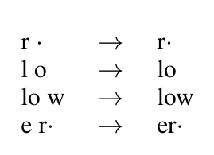
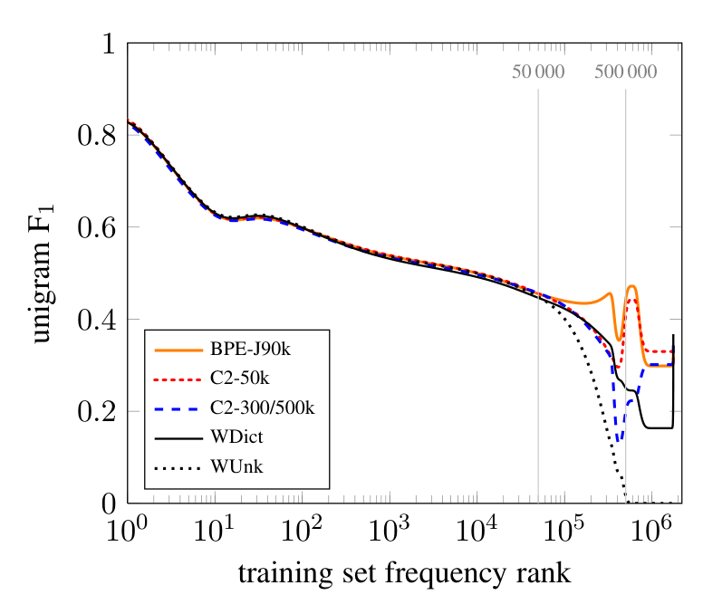
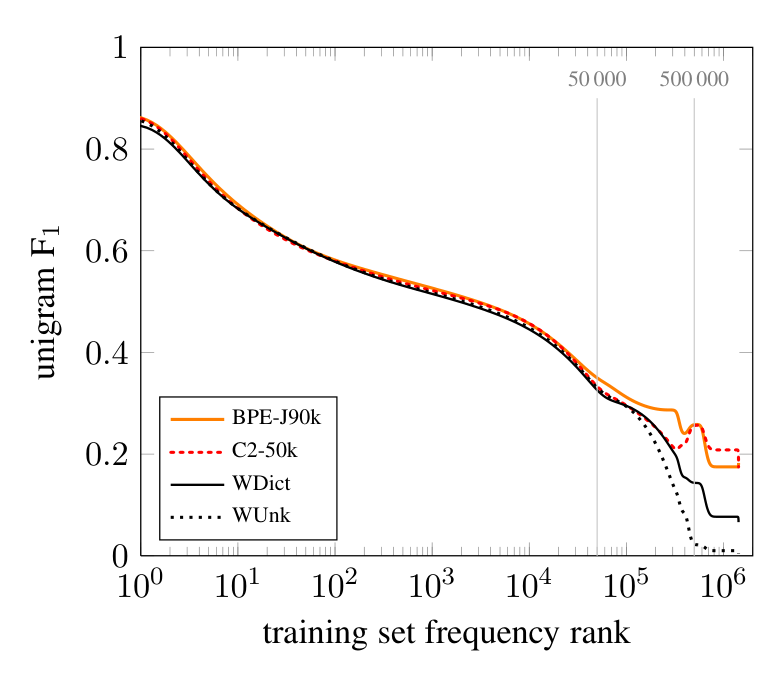

# BPE 用有限子词表翻译没见过的词

词级神经翻译把每种词当作一个类别。新词如果不在表里，只能用 UNK，或者由后备词典替换。复制英文人名到德文有时可行，换成俄文就常要做转写。纯字符模型能组合任意已知字符，却会把输入和输出显著拉长。本文在两者之间学习一套高频字符片段，保留罕见词的组成信息，让翻译模型能够输出词表中没有以完整形式出现的词。

## 训练时数相邻对，编码时按已定顺序合并

沿用论文的 lower。从字符 l、o、w、e、r 和词尾符号开始。训练先按词频统计相邻符号对，每轮选最频繁的一个，将全部出现替换为新符号。不同词里的同一对累加计数，词边界之间的对不计。如果某轮先合并 l 和 o，下一轮看到的符号对里就会出现 lo 和 w。学出的规则带顺序，测试句子只应用规则。给未见的 lower 使用图 1 的合并顺序后，得到 low 与 er·。解码器可以逐个输出已知子词，再按词尾标记拼回 lower。

作者原图 1（Rico Sennrich、Barry Haddow、Alexandra Birch，1508.07909v5，PDF 第 4 页）。逐行看 r 与词尾合并、l 与 o 合并，再看 lo 成为下一轮的输入。它与同页算法 1 都用来解释学习规则，算法中的演示字典和图注所列字典不同。论文使用字符级初始单元，算法名称沿用了压缩算法，现代字节级初始词表是另一种配置。

把类似的规则应用到 Hello world. 时，原论文流程先经 Moses 处理，再在词内学习和应用子词操作。分词训练是文本统计，翻译模型训练才有源—目标句对监督。分词输出进入双向 GRU 编码器，解码器在每步用上一个目标子词和对齐上下文预测下一个子词，最后恢复词边界。子词允许组合未见词，但取决于初始字符集以及子词是否进入实际模型词表。联合 BPE 若产生只在源端见过的片段，目标侧也可能缺项。降低未知词的目标和缩短序列有时要权衡，[SentencePiece](../SRC-SENTENCEPIECE/阅读笔记.md)还把规范化、空白保留和 ID 映射纳入同一个模型文件。

## 两侧切分是否一致会影响转写

独立 BPE 允许两种语言分别优化片段大小，联合 BPE 则让共享字符串更容易获得相同边界。英俄实验先用 ISO-9 把俄语转成拉丁字符学习联合规则，再把规则转回西里尔字母。论文表 5 比较 Mirzayeva 和 rakfisk 的转写。后一个例子中，独立 BPE 误插、漏掉字符，作者追溯到训练数据中边界错开导致模型学到错误的片段对应。联合 BPE 的切分更一致，但并不保证任意新词转写正确。联合学习切分规则、统一 ID 和进一步[共享嵌入](../SRC-WEIGHT-TYING/阅读笔记.md)是三个分别配置的步骤。

## 从词频曲线看谁受益

作者原图 2（固定 PDF 第 8 页）。横轴为训练集词频排名，对数刻度越往右越低频。约 5 万与 50 万处对应短名单边界。C2-3/500k 在这两条边界之间仍保留低频完整词，表现下降。C2-50k 更早切成子词，曲线更稳定。最右端的 OOV 桶和连续词频桶应分别读，英译德词典基线可复制不少人名。

作者原图 3（固定 PDF 第 8 页）。英俄文字不同，直接复制人名常失效。表 3 的联合 BPE 与 WDict 集成相比，OOV unigram F1 由 6.6 升到 18.3，总体 BLEU 由 22.8 升到 24.1。英译德表 2 的低频 F1 由 36.8 升到 41.8，OOV F1 却由 36.8 降到 33.6。该实验按 newstest2015，8 模型集成，低频切片排除训练频率前 5 万，OOV 指训练未见。BLEU 提升也依语言对和切分方式而变，英译德最高 25.3 来自字符 bigram 加短名单，并非联合 BPE 的 24.7。

德语训练语料约 1 亿词元。表 1 中字符切分后为 5.5 亿，独立 BPE 后约 1.12 亿。这个量级展示切得怎样影响序列长度。同一表列出独立 BPE 的 63k 词型/0 个未知子词，联合版的 82k/32 个未知子词。从这一结论迁移到其他语言或推荐物品词表时，需分别检查字符覆盖、词表实际使用情况和序列成本。

## 原文与中文 PDF

[固定原文 arXiv:1508.07909v5](https://arxiv.org/pdf/1508.07909v5)｜[词表学习与共享机制](../../知识库/概念/词表嵌入与权重共享.md)｜[私有备份下载说明](../../文档/工具/中文PDF发布.md)。

核对全文 §1–6、算法 1、图 1–3、表 1–5。译后工程沿用作者双栏源码，保留公式、示例代码、多语原始例句、参考文献与原图曲线。未复现实验。

采用版 arXiv 1508.07909v5 标注 CC BY 4.0。作者为 Rico Sennrich、Barry Haddow 和 Alexandra Birch。中文译本及裁取的作者图均来自同一采用版。[固定版本许可](https://arxiv.org/abs/1508.07909v5) · [CC BY 4.0](https://creativecommons.org/licenses/by/4.0/)
