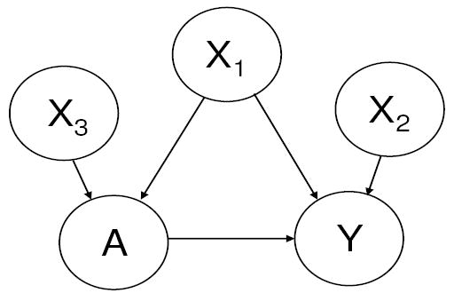
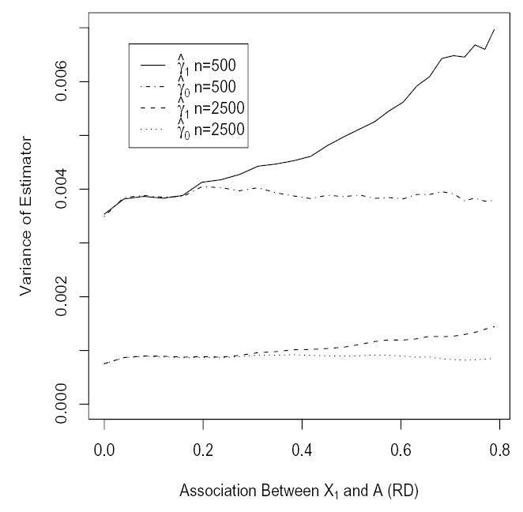
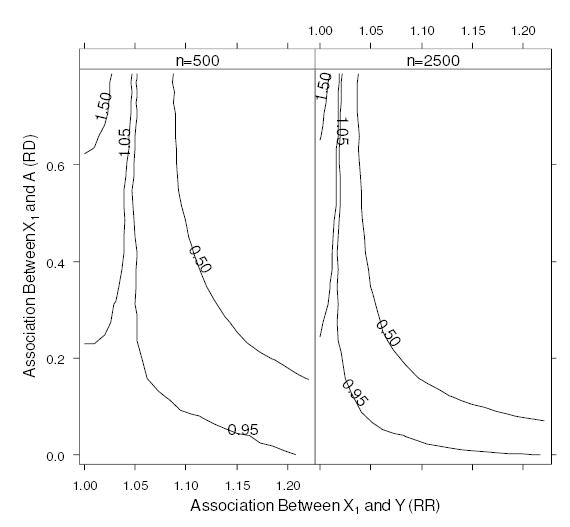

# 倾向得分该纳入哪些变量

同一个发券模型可以作为历史策略的预测器，也可以为处理效应估计构造可比人群。假设券按活跃度分配，活跃度同时决定自然下单。营销系统还按手机号随机尾数增加部分人的发券机会，尾数只影响指派。上月消费额在活跃度之外能预测下单，但旧策略没使用它。Brookhart 等用这样的三类变量拆开一个问题：什么样的变量能降低效应估计的偏差或方差？

## 三类字段怎样影响同一次比较

把活跃度、消费额和随机尾数分别记成 $X_1,X_2,X_3$，发券记成 $A$，观察窗订单数记成 $Y$。活跃度形成 $A\leftarrow X_1\to Y$ 的后门。省略它时，高活跃人群在两臂占比的差异可以直接混入效果。给定足够的处理前调整集，真倾向得分 $e(X)=P(A=1\mid X)$ 在同一分值内平衡这些已测字段；这条理论结论与有限样本里按估计分值做近似调整是两件事。 [倾向得分分层和匹配](../SRC-ROSENBAUM-RUBIN-PS/阅读笔记.md) · [历史发券](../../知识库/问题/历史发券日志如何估计补贴增量.md#倾向匹配怎样把很多变量压成一项)

*作者原图。Brookhart 等，PMC 作者稿图 1，原图直接保存。沿每条箭头查字段进入指派、结果或两端的位置。* [原图](https://pmc.ncbi.nlm.nih.gov/articles/PMC1513192/#F1)

如果在一个样本中，处理组和对照组的历史消费偶然相差 30 元，而每多 10 元历史消费对应 0.02 单基础响应，那么这个偶然失衡带来 0.06 单的组内结果差。另一次抽样可能反向波动。将这个处理前的结果预测变量纳入拟合，可以减少这种样本间波动。图 1 中的 $X_2$ 体现的就是这类预后变量。

加入随机尾数的作用不同。假定在同一个活跃度和消费额层，尾数使发券率分别为 0.2 和 0.8。只在估计倾向相近的人之间比较时，尾数现在能把原来都可用的人分得更开，却没有解释潜在订单。用逆倾向权重看，稀少一臂的单条权重达到 $1/0.2=5$，而合并尾数后平衡抽样下两臂均为 2。这个构造例说明精度损失的来源，论文的实证采用样条或五分位分层，未测试这组 IPW 数值。业务里还要检查字段是否也代理其他结果风险，避免仅凭低相关性把它判作纯指派变量。

## 从估计倾向到对数率比

第一组模拟独立抽取三个标准正态变量，以 probit 模型生成二元处理，以 Poisson 分布生成计数结果。作者对三变量的七个非空子集逐一拟合 probit。随后用估计倾向分数的三处四分位数作样条内节点，拟合 $E[Y\mid A,\hat e]=\exp\{\lambda+\sum_k\psi_kB_k(\hat e)+\gamma A\}$，其中 $B_k$ 是样条基函数，$\gamma$ 是要估计的对数率比。另一做法按估计倾向的五分位数切层后比较。真值 $\gamma=0.5$，每个样本量各重复抽样 1,000 次。偏差取估计值减真值的平均，MSE 取平方误差的平均，近似分解成方差加偏差平方。 [作者稿 Methods](https://pmc.ncbi.nlm.nih.gov/articles/PMC1513192/#S1)

以 $n=500$ 的样条结果为例，表 1 的 MSE 栏以 $10\times\mathrm{MSE}$ 报告。仅含活跃度、加入消费额、再加入尾数，依次是 0.32、0.22、0.31，平均处理预测 C 统计量依次是 0.67、0.67、0.82。更好的处理区分对应末一步，最低误差出现在中间。表 1 中 $n=2500$ 的对应 MSE 比例为 0.66、0.49、0.70（共同乘 $10^2$）。作者稿 Results 正文写预后变量使方差降低超过 40%，表 1 所列 0.32→0.22 与 0.66→0.49 分别约为 31% 和 26%，此处按表中数值比较。五分位分层仍有层内残余混杂。 [表 1](https://pmc.ncbi.nlm.nih.gov/articles/PMC1513192/#T1) · [表 2](https://pmc.ncbi.nlm.nih.gov/articles/PMC1513192/#T2)

## 处理预测很强而预后很弱的共同原因

第二组模拟只保留一个共同原因，分别改变它对指派和结果的影响。作者用 $P(A=1\mid X_1=1)-P(A=1\mid X_1=-1)$ 表达指派强度，按结果相对率表达预后强度。比较调整和粗估两个估计量时，调掉这项既会压低遗漏偏差，也可能提高方差。在小样本、强指派且弱预后的区域，图 3 中调整后的 MSE 比粗估高出 5% 以上。$n$ 增大时抽样方差缩小，遗漏真实共同原因产生的偏差通常仍在，因此这组有限样本结果不能直接变成删掉共同原因的规则。实际业务先根据指派时序和结果机制界定调整集，再观察所估人群的平衡、重叠及区间。 [作者稿 Discussion](https://pmc.ncbi.nlm.nih.gov/articles/PMC1513192/#S10)

*作者原图。Brookhart 等，PMC 作者稿图 2，原图直接保存。横轴是指派概率差，比较同一面板里调整与粗估的纵轴方差。* [原图](https://pmc.ncbi.nlm.nih.gov/articles/PMC1513192/#F2)

*作者原图。Brookhart 等，PMC 作者稿图 3，原图直接保存。先在每个面板定位 0.95 和 1.05 两条等高线，再比较 500 和 2,500 样本下它们所夹的区域。* [原图](https://pmc.ncbi.nlm.nih.gov/articles/PMC1513192/#F3)

## 阅读范围

M. Alan Brookhart、Sebastian Schneeweiss、Kenneth J. Rothman、Robert J. Glynn、Jerry Avorn、Til Stürmer，*Variable Selection for Propensity Score Models*，*American Journal of Epidemiology*，2006，163(12)，1149–1156。采用 PubMed Central 作者接受稿的正文、图 1–3、表 1–3。按清单仅解读，未运行作者模拟。 [全文](https://pmc.ncbi.nlm.nih.gov/articles/PMC1513192/) · [正式题录](https://doi.org/10.1093/aje/kwj149)
