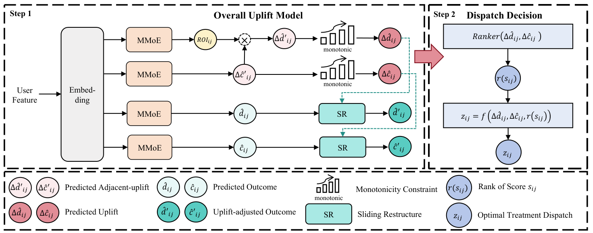
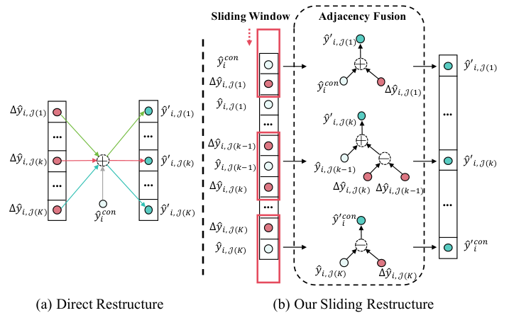
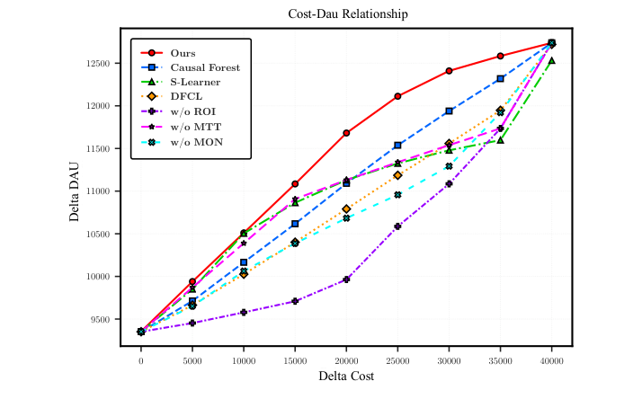

# BUOPLR 怎样把推送时间、样式和预算一起分配

一名用户早上容易点击通知，晚上收到消息后却更可能多打开一次应用。带图片的强样式可能提高响应，也会增加按点击付费的成本。平台还要同时遵守厂商的个人样式配额、总通知量和金额预算。先决定每个人发几条，再挑时间、最后选样式，会提前固定后续步骤能够选择的空间。快手 BUOPLR 将“时间 × 样式”作为一个组合动作，先预估它对 DAU 与成本的增量，再通过剪枝和低维拉格朗日优化分配通知。

论文发表于 ICML 2026，采用 PMLR 306 的正式 16 页 PDF。PMOS 是作者部署平台的名称，展开为 **Push Multi-dimensional Online System**，BUOPLR 是本文方法名。本文的 DAU 与成本模型、求解器和线上比较均来自作者报告。 [正式书目](https://proceedings.mlr.press/v306/xu26ag.html) · [采用原文](https://raw.githubusercontent.com/mlresearch/v306/main/assets/xu26ag/xu26ag.pdf) · [中文译本位置与范围](#原文与中文译本) · [私有附件下载说明](../../文档/工具/中文PDF发布.md)

## 同一名用户有哪些可选动作

设用户为 $i$，一天有 $H$ 个时槽、$K$ 种通知样式。组合 $j=(h,k)$ 同时规定发送时间和样式，$z_{i,h,k}=1$ 表示实际发送。模型接收通知前可用的用户信息，估计

$$
\Delta d_{i,h,k}=\mathbb E[D_i(h,k)-D_i(\varnothing)\mid X_i],\qquad
\Delta c_{i,h,k}=\mathbb E[C_i(h,k)-C_i(\varnothing)\mid X_i].
$$

$D$ 是结果窗口内是否活跃，$C$ 是点击带来的支付成本。作者令每次点击 CPC 相同，将成本归一为 0/1，因此预测成本可按发生支付点击的概率理解。业务预算若以金额给定，还要用相同 CPC 单位换算。对照为不通知，成本基线为零。 [§2，PDF第2页](https://raw.githubusercontent.com/mlresearch/v306/main/assets/xu26ag/xu26ag.pdf#page=2)

下面用同一用户的两个时槽、两种样式贯穿后续计算。所有数值都是本库为讲解构造的条件均值，基线活跃概率设为 0.10，成本基线设为 0。

| 组合动作 | 预测活跃概率 | DAU 增量 $\Delta d$ | 归一成本增量 $\Delta c$ |
|---|---:|---:|---:|
| 早上、弱样式 | 0.11 | 0.01 | 0.03 |
| 早上、强样式 | 0.12 | 0.02 | 0.05 |
| 晚上、弱样式 | 0.13 | 0.03 | 0.04 |
| 晚上、强样式 | 0.15 | 0.05 | 0.07 |

预测对象可以同时覆盖这四个动作，一条训练记录只有实际分到的那个动作及结果。真实通知数据来自 2025 年 7 月前两周的 RCT，40 个组合为 20 个时槽乘 2 种样式，每组报告 350 万样本，每名用户每天接受一种处理。最后一天测试，前面的日期训练，输入取此前 30 天行为。论文未完整列出对照组样本量、各用户重复出现及样本筛选规则。 [§4.1，PDF第7页](https://raw.githubusercontent.com/mlresearch/v306/main/assets/xu26ag/xu26ag.pdf#page=7)

从这个 RCT 估计单次通知效应，需要按指派动作保留共同对照并固定结果窗。上线优化允许同一天选多个时槽，其目标会把这些单次效应相加。用户同一天的“是否活跃”只有一个结果，多次通知之间可能替代或互相影响。作者在局限部分明确采用时间效应独立假设，尚未给出从每日单次 RCT 到任意多次日程的联合潜在结果识别。 [局限，PDF第9页](https://raw.githubusercontent.com/mlresearch/v306/main/assets/xu26ag/xu26ag.pdf#page=9)

## 模型先共享时间表示，再约束样式关系

作者图1，采用正式 PDF 第4页，裁剪坐标为左上原点的 $(54,65,544,258)$ 点，以3倍分辨率转PNG，保留全部模块、箭头和图例。Jiajing Xu 等，ICML 2026。左侧四条路径分别产生 DAU 相关增量、成本增量及两类直接结果，青色 SR 模块用于训练重构，右侧蓝色路径执行排序、剪枝与分配。图中的所有输出可以被计算出来，事实标签只监督实际指派路径。

作者使用约 700 个过去 30 天统计特征，类别特征映射为5维向量，拼接后做 LayerNorm 和全连接 ReLU，形成128维共享用户表示。对每个“结果 × 样式”建立单独 MMoE，共 $2K$ 个模块。每个模块为各时槽产生表示，门控由用户表示决定，从共享专家中组合该任务需要的信息。附录写每模块有14个专家，每个专家两层宽度为 $[128,64]$，读出头为 $[64,32]$。 [§3.2.1及附录C.4，PDF第5、14–15页](https://raw.githubusercontent.com/mlresearch/v306/main/assets/xu26ag/xu26ag.pdf#page=5) · [MMoE专家与门控的公共解释](../SRC-MMOE/阅读笔记.md)

同一用户在两个时槽的反应可不同，由各时槽任务表示刻画。样式维度则带有明确先验，同一时槽的强样式增量至少与弱样式一样大。模型先预测非负的相邻样式增量，再累计为相对不通知的增量。以上述晚上动作为例，可将弱样式 DAU 增量写为0.03、强相对弱的额外增量写为0.02，累加后强样式为0.05。成本从0.04增加到0.07，对应相邻成本增量0.03。这个例子说明累加怎样实施单调约束，具体非负激活函数在正文没有给出。

DAU 与成本通过乘法联系。正文把 $\mathrm{ROI}_{i,j}$ 定义为 $\Delta d_{i,j}/\Delta c_{i,j}$，同时预测 ROI 和成本分量，再由二者乘积构造 DAU 分量。晚上弱样式的总体比值为 $0.03/0.04=0.75$。图1将乘法放在相邻增量、累计之前，对强相对弱的额外贡献，相邻比值为 $0.02/0.03$。这两个比值对应不同层级。正文的组合级 ROI 定义和图中的相邻级读出需要在实现中明确映射。原文也未解释零成本增量、负增量及比值范围的完整处理。附录统一提到二元预测头 sigmoid，不能据此补出所有 ROI 与增量头的激活实现。 [§3.2.1和图1，PDF第4–5页](https://raw.githubusercontent.com/mlresearch/v306/main/assets/xu26ag/xu26ag.pdf#page=4)

样式单调性的证据来自作者把 RCT 人群随机分成20组，在每组比较样式的平均效应。该观察支持这些分组中的平均趋势。生产中若某类用户反感富样式，任意个体或任意特征子群的效应仍可能违反顺序。合成数据又主动按该先验生成，因此合成消融考察的是先验与生成机制相符的条件。 [附录C.1–C.2，PDF第13–14页](https://raw.githubusercontent.com/mlresearch/v306/main/assets/xu26ag/xu26ag.pdf#page=13)

## 一条事实标签怎样训练相邻样式

分别拟合处理与对照结果再相减时，两边约0.1量级的预测误差可能遮住0.01量级的效应。BUOPLR直接输出增量，同时保留直接结果头，再把预测增量和相邻结果组合成一个可以接受事实标签监督的重构值。

作者图2，正式PDF第6页，裁剪坐标 $(54,65,293,218)$ 点，3倍转PNG。左边每个样式的重构都读取共同对照，右边将结果和增量交错排列，以宽度3、步长2的窗口构造相邻关系，末端再反推对照。图内的省略号是任意 $K$ 的说明，实际通知实验只有两种样式。

固定用户和时槽，用 $\hat y_k$ 表示直接结果，用 $\Delta\hat y_k$ 表示相对不通知的增量。$y$ 可以取 DAU 或归一成本。式（16）的重构为

$$
\hat y'_1=\hat y^{\rm con}+\Delta\hat y_1,\qquad
\hat y'_k=\hat y_{k-1}+\Delta\hat y_k-\Delta\hat y_{k-1}\quad(k>1),\qquad
\hat y'^{\rm con}=\hat y_K-\Delta\hat y_K.
$$

晚上强样式的重构用晚上弱样式的直接活跃概率，加上两种增量之差，得到 $0.13+0.05-0.03=0.15$。若该用户实际分到晚上强样式并活跃，真实标签 $d=1$，重构 MSE 为 $(1-0.15)^2=0.7225$，直接结果 BCE 为 $-\log(0.15)$。对应成本标签若为 $c=1$，成本重构为 $0.04+0.07-0.04=0.07$。所有计算均为教学数值。 [§3.2.2，式15–19，PDF第6页](https://raw.githubusercontent.com/mlresearch/v306/main/assets/xu26ag/xu26ag.pdf#page=6)

若把两档增量暂时当作独立输出，强样式事实损失沿 $\hat y_1+\Delta\hat y_2-\Delta\hat y_1$ 同时传到弱样式直接结果和两档增量，对 $(\hat y_1,\Delta\hat y_2,\Delta\hat y_1)$ 的局部偏导依次为 $1,1,-1$。实际架构又用累计相邻增量参数化，令 $\Delta\hat y_1=a_1$、$\Delta\hat y_2=a_1+a_2$，重构可化为 $\hat y_1+a_2$，$a_1$ 在此路径抵消。学习信号接通了相邻结果头、增量差分和共享骨干，具体底层参数的梯度还取决于累计结构。这样的共享并未产生未分配动作的真实标签。

整体损失给 DAU 与成本各一项直接 BCE 和一项重构 MSE，共四项，附录权重均为1。对照样本通过末端结果减去末端增量接受监督。训练批大小1024，Adam学习率 $10^{-5}$。原文将多处理公式写为 $\mathcal J(k)$，实际还须固定时槽，并按事实处理位置取损失。重构结果的范围约束、事实遮罩的具体实现和损失归约细节未完整披露。 [式16–19及附录C.4，PDF第6、15页](https://raw.githubusercontent.com/mlresearch/v306/main/assets/xu26ag/xu26ag.pdf#page=6)

## 用影子价格把预算写进每个候选的得分

分配器最大化所有已选组合的预测 DAU 增量，同时满足金额预算 $C$、总发送量 $Q$、每名用户每种样式的日配额 $q_{i,k}$，以及每时槽最多一种样式。记 $j$ 为 $(h,k)$ 的简写，原问题的关键约束为

$$
\sum_{i,j}z_{i,j}\Delta c_{i,j}\le C,\quad
\sum_{i,j}z_{i,j}\le Q,\quad
\sum_hz_{i,h,k}\le q_{i,k},\quad
\sum_kz_{i,h,k}\le1,\qquad z_{i,j}\in\{0,1\}.
$$

传统松弛给每条用户样式配额一个 $\gamma_{i,k}$，另给预算和总量各一个乘子 $\lambda,\mu$。固定乘子后，每个组合的调整效用是 $\Delta d-\lambda\Delta c-\mu-\gamma_{i,k}$。$\lambda$ 可以理解为多用一单位成本的机会价格，$\mu$ 对应多占一条通知额度的价格。乘子通过总消耗与预算的差异更新，但大量 $\gamma$ 增加维护与迭代负担。 [§3.1，式1–7，PDF第2–3页](https://raw.githubusercontent.com/mlresearch/v306/main/assets/xu26ag/xu26ag.pdf#page=2)

BUOPLR先令 $g_{i,j}=\Delta\hat d_{i,j}-\lambda\Delta\hat c_{i,j}$，再给候选打分

$$
s_{i,j}=\beta g_{i,j}+(1-\beta)\left[g_{i,j}-\max_{j'\in\mathcal J(h(j)),\,k(j')\ne k(j)}g_{i,j'}\right].
$$

第一项保留该动作自身的调整收益，后一项衡量它相对于同槽其他样式的优势。对每个用户、每种样式，按这个得分跨时槽排序，只保留前 $q_{i,k}$ 个。随后一个用户的某种样式最多只剩配额允许的那么多候选，选择这些候选的任意子集都满足该配额。每槽互斥仍在原始可行域中处理，剩下只有 $\lambda,\mu$ 两个全局乘子。 [式8–14，PDF第3–5页](https://raw.githubusercontent.com/mlresearch/v306/main/assets/xu26ag/xu26ag.pdf#page=3)

继续用四动作例子，令 $\lambda=0.5$、$\mu=0.01$、$\beta=0.5$、两种样式配额各为1。早上两种样式的 $g$ 都为 $-0.005$，晚上弱、强分别为0.01和0.015。早上两者的 $s$ 均为 $-0.0025$，晚上弱为0.0025、强为0.01。因此各样式都只保留晚上。晚上的两个调整效用 $g-\mu$ 为0和0.005，选择强样式。若一个时槽的最大调整效用小于零，可行域允许该槽全部 $z=0$，应保留这个不发送动作。

附录算法在每轮根据当前 $\lambda$ 重新算分、排名、剪枝，再重新分配和更新乘子。作者报告100–200轮、复杂度 $O(T'NKH\log H)$，并结合并行与小数据迭代达到小时级。通知条数和成本仍要全局汇总，常数个乘子解决的是对偶维度。正式论文未给出明确硬件、端到端耗时分布和相同资源下的求解器对照。 [附录D算法1，PDF第16页](https://raw.githubusercontent.com/mlresearch/v306/main/assets/xu26ag/xu26ag.pdf#page=16)

## 剪枝能保证什么，最优性还差哪一步

保留每用户每样式的前 $q_{i,k}$ 个候选，能够通过集合大小保证个人配额。剪枝同时缩小可行域，最优组合可能被删除。用上面同一张表即可检验。

令全局预算宽松、每用户总量允许2条、两样式配额各1，取论文允许的 $\beta=1$。此时 $\lambda=0$，得分等于DAU增量。弱样式选晚上0.03，强样式也选晚上0.05，两种早上候选均被剪掉。时槽互斥后最多得到0.05。原问题可以选早上弱样式0.01和晚上强样式0.05，总增量0.06，成本0.10，满足全部约束。每个用户复制同样条件，原问题为 $0.06N$，缩减问题为 $0.05N$，相对差距恒为 $1/6$。这是本库穷举核验的教学反例，保持同槽强样式DAU和成本均不低于弱样式。

附录B正确给出 $p_n^*\le p_o^*\le L_o^*$ 的集合包含与弱对偶关系。随后把 Shapley–Folkman 控制的有限耦合约束下非凸对偶间隙，进一步用于断言被剪最优分配数 $|J_{\rm out}|=O(1)$，中间缺少对任意得分剪枝损失的证明。上例在 $K=2,\beta=1$ 下使剪枝损失随 $N$ 线性增长。论文的 $O(1/N)$ 相对剪枝损失主张需要收窄假设或补证。该问题不改变个人配额可行性的集合论结论。 [附录B，PDF第11–13页](https://raw.githubusercontent.com/mlresearch/v306/main/assets/xu26ag/xu26ag.pdf#page=11)

实现层面还需补全三处条件。式（6）、式（13）和算法第22–23行没有显式写出非正效用时不发。式（13）的 $I$ 未定义为硬屏障，普通0/1惩罚不足以确保被剪候选不可选。附录给出非负乘子投影，却没有给出最后一轮原始解违反全局预算时的恢复、最优可行迭代保存或可行性证明。个人配额通过剪枝满足，平台预算与总发送量仍需逐项验证。 [§3.1与算法1](https://raw.githubusercontent.com/mlresearch/v306/main/assets/xu26ag/xu26ag.pdf#page=3)

## 实验怎样支持模型与系统主张

| 评估条件 | BUOPLR | 同表最佳非BUOPLR结果 | 能检验的内容 |
|---|---:|---:|---|
| 合成AUUC / QINI | 0.0888 / 0.1064 | DFCL 0.0584 / 0.0687 | 在内置样式单调与时间结构的数据上排序 |
| CRITEO AUUC / QINI | 0.0057 / 0.1753 | Causal Forest 0.0054 / 0.1668 | 二元干预的价值与成本关系及辅助监督 |
| 通知AUUC / QINI | 0.0089 / 0.0081 | Causal Forest及DFCL 0.0057 / 0.0052 | 同一时间切分下真实组合通知数据的排序 |
| CRITEO AUCC | 0.8030 | DFCL 0.7859 | 成本与价值排序，DFCL点值来自其论文 |

对同一排序的前缀 $k$，令 $R_T,R_C$ 为处理与对照的累计结果，$N_T,N_C$ 为对应样本数。附录C.3将Uplift曲线定义为 $(R_T/N_T-R_C/N_C)(N_T+N_C)$，Qini曲线为 $R_T-R_C N_T/N_C$，AUUC与QINI分别对相应曲线积分。两者考察排序前缀中的平均增量或增量人数，AUCC进一步考察成本与结果的分配关系。前缀内按人数比缩放对照可以调整两组数量差异，给定特征的非均匀倾向仍需相应识别和加权条件。原稿将Qini推广到非均匀倾向时未写这些条件。多组合指标怎样跨处理汇总也未完整说明。 [附录C.3与表5，PDF第14–15页](https://raw.githubusercontent.com/mlresearch/v306/main/assets/xu26ag/xu26ag.pdf#page=14)

表1–2为作者报告。CRITEO为1390万条二元RCT样本，90%随机训练、10%测试，以访问为成本、转化为价值。访问只是这个基准的代理成本，无法直接等同于通知CPC或券核销支出。表2的 +23.7% 比较对象是 S-Learner 的0.6490，相对 DFCL 为约2.18%。正文“通知和合成提升60%–80%”未给统一比较口径，按各列最佳非BUOPLR基线计算，合成两项为约52.1%与54.9%，通知两项约56.1%与55.8%。 [§4.1–4.3、表1–2，PDF第7–8页](https://raw.githubusercontent.com/mlresearch/v306/main/assets/xu26ag/xu26ag.pdf#page=7)

作者图3，正式PDF第8页，裁剪坐标 $(306,67,544,215)$ 点，3倍转PNG。横轴为增量成本，纵轴为增量DAU，曲线来自带完整反事实的合成分配评估。它比较整体方法与消融，图中没有单独报告“保持预测固定、只切换求解器”的控制结果。

合成消融中，完整AUCC为0.6479，去ROI、去直接监督、去单调模块分别为0.4853、0.4984、0.5517，支持这些组合设计在当前生成机制中的作用。CRITEO没有样式维度，附录只消融ROI与辅助监督，AUUC从0.0057分别降至0.0051、0.0050。两组结果的作用范围应随数据任务分别理解。合成生成公式没有完整说明三类响应“概率”的归一化和参数取值，也未给公开代码，尚不能凭附录直接复现全部表值。 [表3及附录C.2、C.6，PDF第8、14–15页](https://raw.githubusercontent.com/mlresearch/v306/main/assets/xu26ag/xu26ag.pdf#page=8)

线上相对TimeWheel报告 DAU +0.504%、CTR +3.936%、观看时长 +0.095%、次日留存 +0.22%。引言对DAU给出 $p<0.01$，其余指标未逐项给显著性，A/B持续时间、流量分配与置信区间也未完整披露。TimeWheel本身依次优化量、时间和样式，时间部分引用TIM，配额与样式部分使用因果森林、聚类和线性规划。线上数字验证整套系统替换后的对照结果，不能由此单独归因于某个重构模块或最优性保证。 [§4.2、表4、贡献段，PDF第2、7–9页](https://raw.githubusercontent.com/mlresearch/v306/main/assets/xu26ag/xu26ag.pdf#page=8)

## 与已有营销和Push论文怎样接起来

[TIM](../SRC-TIM/阅读笔记.md)从全天CTR向量出发，把已经给定的日配额分到时槽。BUOPLR把不发送、时间、样式放进增量收益与全局成本约束，提供了联合预规划的具体论文实例。二者在目标、约束和执行方式上的逐项比较归入[配额与发送时机问题](../../知识库/问题/给定配额怎样安排通知发送时机.md#时间与样式怎样在全局预算下一起选择)。Instagram Fair Notification则在候选实际到达时，以类型出价和用户历史价格门槛分配容量，使用的决策状态与BUOPLR预先枚举全天动作不同。

[OFA](../SRC-OFA/阅读笔记.md)用同一用户的曲线系数共享有序券档响应，BUOPLR用相邻样式增量、结果重构和ROI关系共享不同头的监督。两者都引入结构先验，序关系的含义和样本覆盖仍需由具体干预核对。[POUL](../SRC-POUL/阅读笔记.md)的正交化控制辅助回归误差，BUOPLR的重构建立预测头间的代数联系。方法与样本路径的比较归入[组合营销策略问题](../../知识库/问题/组合营销策略如何共享结构并估计因果增量.md#时间与样式组合怎样共享相邻结果监督)。

对于[月初选择本月优惠发送日](../../知识库/总览/优惠信息Push触达场景.md)，可借鉴“候选时间与处理类型一起估计增量，再受约束分配”的接口。要迁移到优惠金额、日期和增量用款，需重新定义处理及结果窗，在月初可用信息下采集覆盖候选日的随机对照，并核对跨日相互作用、券有效期和金额成本。本文提供日内通知DAU的作者证据，业务迁移仍需实际验证。

## 原文与中文译本

- 采用ICML 2026正式16页PDF，正文§1–5、局限与影响声明，核对附录A–D、正文19个编号公式、7张表、3张图和算法1。参考文献核对本文依赖的书目与已有比较入口，未逐篇核实。本库截至2026-11-25未取得作者实现、未训练模型或复现其业务实验。原件哈希与版本见[来源卡](来源.json)。
- 官方书目只列PDF和OpenReview，arXiv题名检索未命中，未取得作者LaTeX。正文在正式PDF基础上由当前模型翻译，保存中文Markdown与可编辑XeLaTeX重排工程，正文公式和表数保留。图内英文、参考文献与附录A–D保留原文，原稿的公式和近似保证缺口保留并加译注。
- 正式中文PDF位于本地附件 `.local/papers/SRC-BUOPLR/translation/BUOPLR_中文.pdf`，译后主文件位于同目录的 `translated-sources/main.tex`，中文Markdown位于同目录的 `BUOPLR_中文译文.md`。这些本地附件不随公开Git分发，访问规则见[私有PDF维护](../../文档/工具/中文PDF发布.md)。正式译本共18页，其中前10页为中文正文与说明，末8页保留英文书目和附录。18页均已逐页渲染目视，19个编号公式、正文四表、三图与中文提取核对完成。原文第10–16页与译本保留页的提取文字一致，PDF嵌入存在坐标变换，未声称逐像素一致。

原文与18页中文PDF已按私有维护规则备份，两份均核对远端digest并完成实际登录下载、PDF类型、大小及完整SHA-256核验，核验临时副本已自动清理。正式Markdown译文保留本地，未将逐篇公开翻译许可记为已确认。
