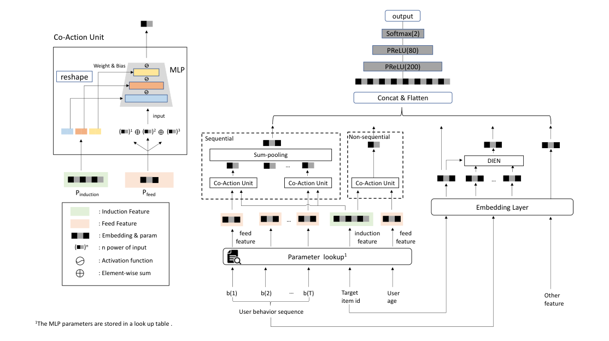
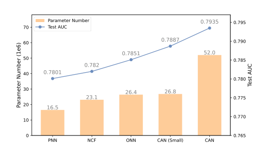

# CAN 怎样让候选特征提供一张小网络的参数

把“候选类目×历史类目”作为新 ID 可以为两两组合记忆参数，但宽表膨胀，对稀少组合尤其难训练。CAN 将选中的交叉拆成两套查表：一侧决定一个微型 MLP 的参数，另一侧提供输入。同一个候选 ID 可将其微型网络复用于许多历史输入。本文采用 Weijie Bian、Kailun Wu、Lejian Ren 等人的 arXiv 2011.05625v3。

## 一个候选怎样看两条历史

*Weijie Bian 等，本文图 3，采用版 PDF 第 4 页。由采用版裁取图区。*

以图 3 的目标侧为诱导侧，候选鞋类的 $P_{\rm induction}$ 被拆成每层权重矩阵和偏置。历史浏览侧为馈入侧，查 $P_{\rm feed}$ 作为微型 MLP 的初值。取一层教学网络 $h=\tanh(wu+b)$，鞋类提供 $(w,b)=(2,0)$，两条历史分别提供 $u=0.5,-0.5$，得到约 $0.762,-0.762$。同一个鞋类网络作用于两条历史，所得序列级交叉可按原文逐元素相加；改成另一个候选类目就查另一个参数向量。一般形式将各层输出拼接。普通用户、物品表示另一路查表，连同交叉向量进入 CTR 主网络。每次曝光的点击交叉熵更新两条查表和预测头。推理可以缓存参数向量，但交叉计算取决于当前两端输入。[§4.1–4.2、式 (2)–(9)、图 3，PDF 第 4 页](https://arxiv.org/pdf/2011.05625v3#page=4)。

§4.2 有一句把 user ID 对应 $P_{\rm induction}$、item 对应 $P_{\rm feed}$，与 §4.1 中 $U_{\rm feed},M_{\rm induction}$ 以及图 3 说明反向。采用图 3 的字段方向帮助阅读，微型网络公式确定两种角色，不能凭相冲突的句子确定所有实际部署特征对的方向。

## 多阶与组合独立怎样改变共享范围

多阶增强向微型 MLP 馈入 $u,u^{\odot 2},u^{\odot 3}$ 等路径，再聚合不同阶读出。对教学输入 $0.5,-0.5$，平方项均为 $0.25$，立方项符号相反，说明网络可分别使用强度与方向。组合独立允许按搭配的字段组查不同参数，避免同一特征面向不同搭档时凡事复用一张表。与笛卡尔按两端 ID 的组合存参相比，单字段对下 lookup 规模从 $O(N_aN_bD)$ 改为 $O(N_aD'+N_bD)$。多个字段对、序列长度、阶数和微网络层宽仍会放大计算。[§3、§4.3–4.4、图 2、4](https://arxiv.org/pdf/2011.05625v3#page=5)。

## 离线质量与线上负担需看各自的对照

表 2 中 Amazon Books 的 DNN、DNN+Cartesian、DNN+CAN AUC 为 0.7640、0.7891、0.7935，相对 DNN 的参数倍率为 1.0、17.0、3.3。Taobao 和 Avazu 表中 Cartesian 的 AUC 略高于单加 CAN，两种同时启用时三个数据集都是表内最高值。表 5 的 Amazon Books 两层 0.7935，高于一层 0.7889，也高于三层 0.7913。工业在线表 6 报告两个广告场景 CTR 与 RPM 的相对提升，§6 的删减组合、优化小矩阵 kernel、融合算子是该服务路径的工程结果。模型越复杂未必越容易训练和部署。[§5–6、表 2–6](https://arxiv.org/pdf/2011.05625v3#page=7)。

*Weijie Bian 等，本文图 5，采用版 PDF 第 7 页。由采用版裁取图区。*

与 [DCNv2](../SRC-DCNV2/阅读笔记.md) 的跨坐标矩阵、[AutoInt](../SRC-AUTOINT/阅读笔记.md) 的字段读取相比，CAN 的条件来自一侧 ID 查出的整组小网络参数。参见[统一比较](../../知识库/问题/稀疏特征的低高阶交互学习.md)。

## 原文与阅读材料

采用[固定 v3 PDF](https://arxiv.org/pdf/2011.05625v3)，9 页，核对正文、图表和 LaTeX。中文正文 PDF 待交付。
