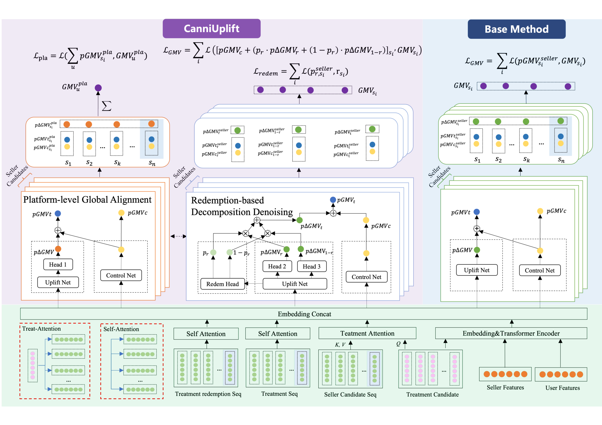
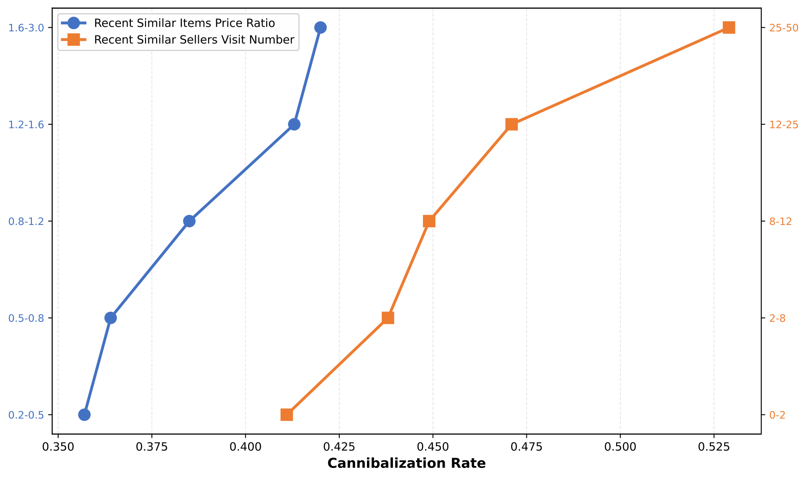
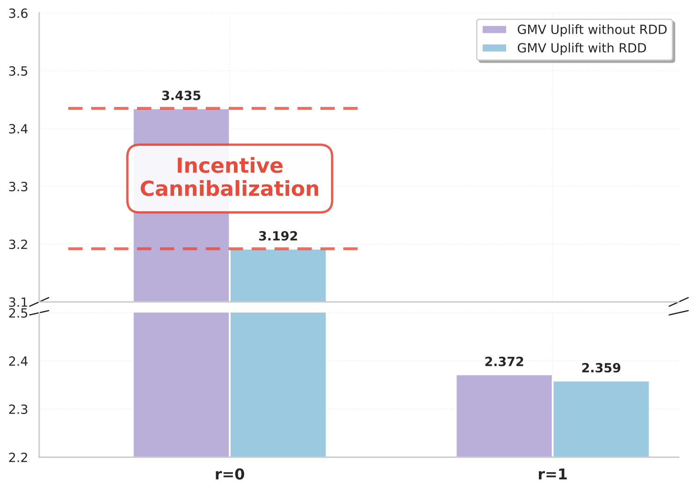

# CanniUplift 怎样估计一张店铺券的平台净增量

店铺券把原本会花 90 元的用户引到花 30 元的替代店，受券店多了 30 元，平台却少了 60 元。若用户领到券却用另一张券完成订单，这笔交易也未必应归给新券。CanniUplift 在同一套用户与候选交互表示上，分别用平台总 GMV 监督消化跨店替代，用核销标签和两条结果路径处理归因噪声。使用淘宝与天猫团队的 arXiv 2607.05242v1，对应 KDD 2026。 [采用版原文](https://arxiv.org/pdf/2607.05242v1) · [出版 DOI](https://doi.org/10.1145/3770855.3818334)

## 单店的两臂差少算了哪些结果

图 1 来自 He 等的采用版源码，原文第 2 页，完整转为 PNG。先看上半图两条消费路径。店 A 原本卖出 90 美元商品，给店 B 的券把购买转到 30 美元替代商品。单店从 0 到 30 的增量为正，用户在平台的总 GMV 从 90 降到 30。再看下半图，用户的钱包里已有其他券，实际是否使用指派券只能提供路径信息。当该券未核销时，仍可能有购买。 [原文图 1](https://arxiv.org/pdf/2607.05242v1#page=2)

一条样本固定在发券前，$u$ 表示用户，$s_j$ 表示候选店铺，$t_j$ 表示该店是否指派某张券，$r_j$ 表示指派券后来是否核销，$y_s$ 是结果窗口内用户在店 $s$ 的 GMV。设其他券策略保持固定，给店 B 发券的净效果由两部分组成。

$$
\Delta_{\mathrm{平台}}(u,B)
=\mathbb E[y_B(1)-y_B(0)\mid X_u]
+\sum_{s\ne B}\mathbb E[y_s(1)-y_s(0)\mid X_u].
$$

这里每一项的 1 和 0 都指店 B 这一个动作。原文式 (5) 写作按 $t_j$ 条件化的期望差。要把观察组间差解释成干预效应，需在指定背景投放规则下有随机指派或其他可辩护的识别条件。把统计单位定成用户与店铺对时，同一用户有竞争的多个店是干扰来源。把结果改成用户的平台总 GMV 可以把这部分替代计入目标，仍须考虑其他用户的动作所造成的预算或库存干扰。 [原文 §2.3–2.5、式 (3)–(5)](https://arxiv.org/pdf/2607.05242v1#page=3)

## 同一个用户怎样为不同的券出分

图 2 来自 He 等的采用版源码，原文第 4 页，完整转为 PNG。从底部依次看多源序列、候选到序列的注意力、三个训练分支。右侧绿色是商家双头基线，中间紫色的结果头由核销概率加权，左侧蓝色按用户名下候选聚合后监督平台 GMV。 [原文图 2](https://arxiv.org/pdf/2607.05242v1#page=4)

假设这位用户最近看过店 A 的 90 元商品和店 B 的替代品，也有领券和未核销的历史。模型将曝光、点击、购买、历史激励曝光、领取、核销等序列编码成 $H_u$。本次店 B 与 5 元券的属性拼接成 $E_c$，作为查询，$H_u$ 作键和值。这样同一用户面对店 A 的券和店 B 的券时，可以得到两个不同的 $z_{u,c}=\operatorname{Attn}(q(E_c),K(H_u),V(H_u))$。模型把店铺、面额、门槛、时效等动作定义和历史行为的交互送给各结果头。历史核销可作输入，当前券的实际核销在决策时还未知。 [原文 §3.1、式 (6)–(7)](https://arxiv.org/pdf/2607.05242v1#page=4)

局部双头只用该店实际 GMV 监督，推理以该店的两臂差估计局部增量。在 90 元换 30 元的例子里，局部模型可能优先发店 B 的券。PGA 对每个候选店输出一个平台视角的可加项 $g_{u,s}$，在同一用户和同一窗口求和，用平台实际 GMV $G_u$ 监督：

$$
\mathcal L_{\rm pla}=\sum_u \mathcal L_{\rm Tw}\left(G_u,\sum_{s\in \mathcal S_u}g_{u,s}\right).
$$

在训练样本中，若预测全体候选的和过高，求和残差会给同组候选产生方向一致的修正信号。候选输入、共享参数和商家监督共同约束模型如何分摊这项差。总量监督给出了总和约束。对两家店将预测分别改为 $g_A+a$ 与 $g_B-a$，总和仍相同，所以平台总量拟合本身无法唯一恢复各店的边际因果贡献。特别要核对候选集合和全量 GMV 的覆盖口径，避免学习用入选店铺的预测抵补未入选店铺的支出。 [原文 §3.3、式 (8)–(9)、(14)](https://arxiv.org/pdf/2607.05242v1#page=5)

附录 C 的线上近似保留同一候选和背景，只将目标店的处理标记分别设为 1 和 0，让平台头出两次分，再用差值排序、取前 K。线上每个目标只对该候选打两次分，不必重跑所有其他店的潜在结果。训练时总量监督尝试把跨店替代压进这个分数。若一次要给多个高度替代店同时发券，边际分数可能随投放组合变化，应分别核对联合策略和单点近似。 [原文附录 C、式 (31)–(33)](https://arxiv.org/pdf/2607.05242v1#page=12)

## 核销标签怎样参与训练和上线

店 B 的券即使指派成功，用户也可能用原有的平台券完成订单。RDD 允许这类样本与实际使用店 B 券的样本走不同路径。对同一个 $z_{u,c}$，核销头输出概率 $p_r$，对照头输出无券基线 $g_0$，两个处理路径分别输出附加量 $d_1,d_0$。用于处理组监督的商家预测是：

$$
\widehat g_1=g_0+p_r d_1+(1-p_r)d_0.
$$

例如，某位用户有 30% 的核销概率，无券基线为 20 元，核销及未核销路径相对基线分别预估 12 元和 2 元。处理组商家预测为 $20+0.3\times12+0.7\times2=25$ 元，模型给出的商家增量为 5 元。训练用实际商家 GMV 给混合预测计算 Tweedie 损失，用实际核销标签计算核销交叉熵。平台分支再用平台 GMV 计算自己的损失。于是同一张券可以同时有商家侧预测和平台边际近似，部署排序取决于目标口径。 [原文 §3.4–3.5、式 (10)–(16)](https://arxiv.org/pdf/2607.05242v1#page=5)

核销是处理后的行为。显式建模两条路径有助于预测，但 $d_1$、$d_0$ 只是构成混合预测的分量，实际核销组与未核销组的比较受自选择影响。上例的 5 元是模型的商家层混合差值，已持其他券、可替代商品及自然购买的贡献仍需通过符合目标估计量的策略对照来判断。 [原文 §2.4、§3.4](https://arxiv.org/pdf/2607.05242v1#page=3)

## 哪些实验支持平台对齐与核销分解

工业数据消融表 2 的用户层 wAUUC，EUEN 基线为 0.794，PGA 为 0.826，单加核销辅助监督为 0.803，RDD 为 0.818，两模块联合为 0.849。用户层 wQINI 对应为 0.319、0.337、0.326、0.332 和 0.348。+Redem 与 RDD 用同类核销标签，区别是标签是否接入主结果预测的混合路径。合成数据只模拟商家蚕食，用于检查 PGA。工业指标先按券额分箱，再按样本量加权，结果可用于同实验协议的相对比较。 [原文 §4.1–4.5、表 1–2](https://arxiv.org/pdf/2607.05242v1#page=7)

图 3 来自 He 等的采用版源码，原文第 8 页，完整转为 PNG。横轴为预测蚕食率 $(p_{\rm seller}-p_{\rm platform})/p_{\rm seller}$。两条曲线分轴表示早先浏览价格与当前价格之比和近十天访问过的同类商家数。它们与预测蚕食率同向变化，作者没有逐人真值，且商家增量接近零时比率会放大。 [原文 §4.6、图 3](https://arxiv.org/pdf/2607.05242v1#page=8)

图 4 来自同一采用版源码，原文第 8 页，完整转为 PNG。未核销但转化人群中，无 RDD 与有 RDD 的预测均值为 3.435 和 3.192，前者较后者高约 7.6%。这是模型预测移动的证据。实际未核销者的反事实增量无法直接从图中得到。 [原文 §4.7、图 4](https://arxiv.org/pdf/2607.05242v1#page=8)

2025 年 10 月 5–12 日线上对照报告，相对生产基线，营销成本 −2.45%、平台增量 GMV +4.08%、ROI +6.69%。论文的 ROI 为增量 GMV 除以营销成本，与毛利回报的分子不同。模型未覆盖提前消费导致的跨期蚕食，同一评估窗需要结合实际决策目标设定。 [原文 §4.8、表 3 与 §7](https://arxiv.org/pdf/2607.05242v1#page=8)

## 原文与中文译本

- 阅读覆盖采用版 12 页、正文 §1–7 和附录 A–C。实验结果为作者报告。截至 2026-11-25，本仓库未运行原模型。 [原文 PDF](https://arxiv.org/pdf/2607.05242v1) · [来源及哈希](来源.json) · [跨店替代的补贴问题页](../../知识库/问题/跨店替代时怎样估计补贴的平台净增量.md)
- 中文译本为 17 页，涵盖摘要、正文、正文图表标题与表头、描述性脚注，保留公式、表值、原图内文字、书目和附录原文。采用单栏排版，保留 CC BY 4.0 署名和声明。正式译本为 `.local/papers/SRC-CANNIUPLIFT/translation/CanniUplift_中文.pdf`，可编辑主文件位于同目录 `translated-sources/main.tex`。 [私有备份下载说明](../../文档/工具/中文PDF发布.md)
