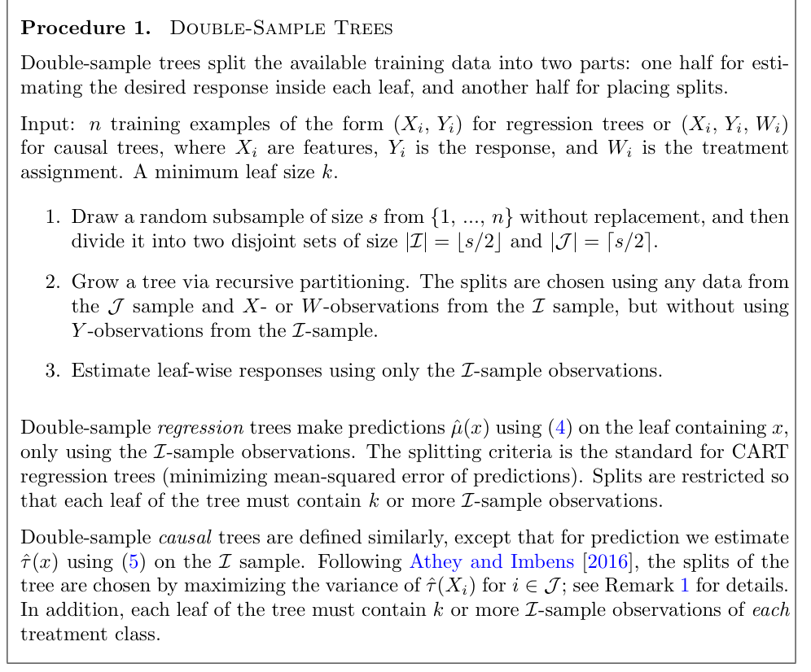
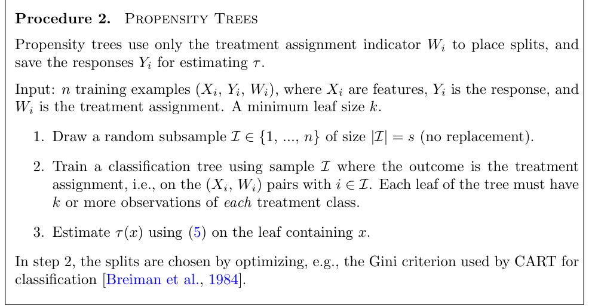
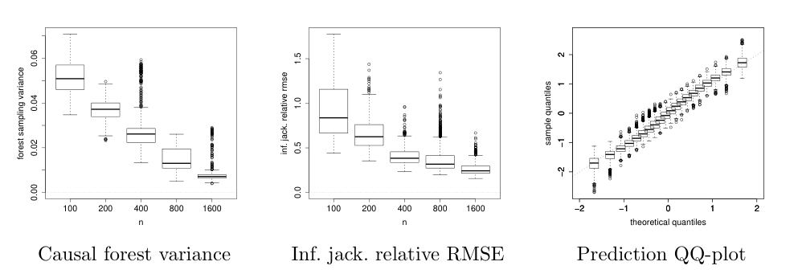
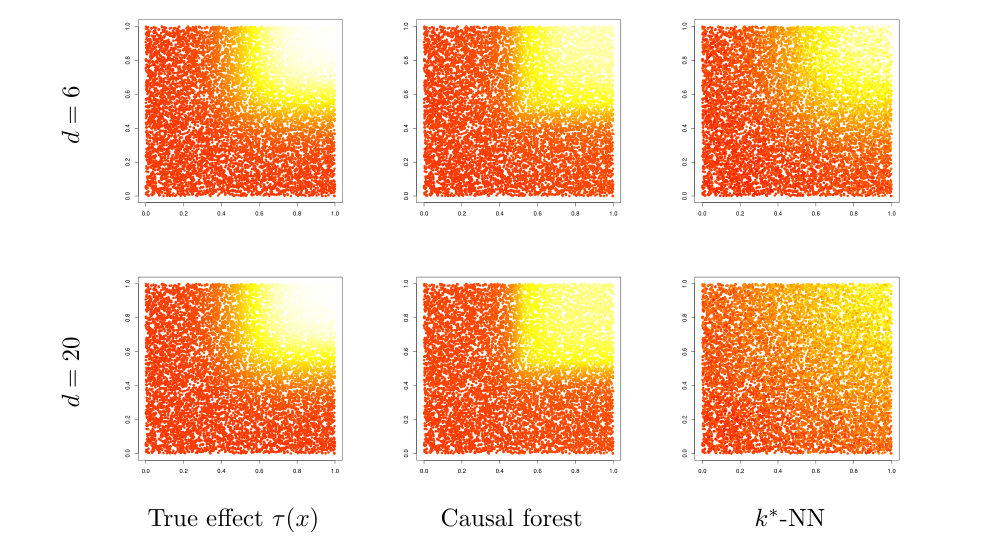
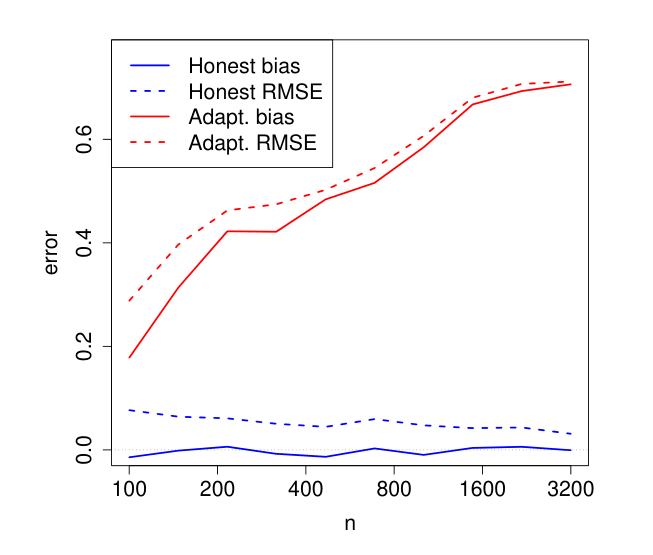

# 因果森林怎样为给定用户估计发券效应

一位近期活跃但消费不高的用户，周边其他用户对一张固定面额券的反应能提供多大参考？欧氏距离近邻要先决定每个画像字段的尺度，再在两臂分别找最近的样本。如果消费价位与访问频次共同决定券效应，随机噪声维度却占了多数，选出的“最近”用户也可能沿关键方向相差很大。Wager 与 Athey 的因果森林让许多棵树分别决定哪些训练记录与待预测点 $x$ 同叶，先估计每棵树内的两臂差，再对树平均。论文还给出了在正则条件下为固定 $x$ 推断条件平均处理效应的方法。 [原文 §2、式 (4)–(8)](https://arxiv.org/pdf/1510.04342v4#page=5)

## 双样本树怎样决定谁与目标用户同叶

训练输入是指派前画像 $X_i$、历史发券指示 $W_i$ 及同一观察窗的事实结果 $Y_i$。在第 $b$ 棵树上，无放回抽出 $s$ 条记录，随机分成结构样本 $\mathcal J_b$ 和估计样本 $\mathcal I_b$。遍历候选切点时，用结构样本在候选子叶里计算两臂差，以该差在结构样本上的方差作为切分依据。切分也可利用估计样本的 $X_i,W_i$ 检查两臂人数，估计样本的 $Y_i$ 留到分裂之后。每次子抽样重新划分角色，一条记录可在一棵树贡献切点，在另一棵树贡献叶内均值。 [原文 §2.4、程序 1](https://arxiv.org/pdf/1510.04342v4#page=9)

对给定用户 $x$，用树的切点找到叶 $L_b(x)$。设 $\mathcal I_{bw}(x)=\{i\in\mathcal I_b:X_i\in L_b(x),W_i=w\}$，则树与森林的输出是
$$
\hat\tau_b(x)=\frac{\sum_{i\in\mathcal I_{b1}(x)}Y_i}{|\mathcal I_{b1}(x)|}
-\frac{\sum_{i\in\mathcal I_{b0}(x)}Y_i}{|\mathcal I_{b0}(x)|},
\qquad
\hat\tau(x)=\frac1B\sum_{b=1}^{B}\hat\tau_b(x).
$$

例如，示意中的树 A 在用户落入的叶里得到发券 4 单／10 人、无券 3 单／10 人，局部增量为 10 个百分点。树 B 改用另一个切点，得到发券 3 单／6 人、无券 4 单／10 人，局部增量也为 10 个百分点。两树平均仍为 10 个百分点。如果先把树的两臂计数合并，会得到 $7/16-7/20=8.75$ 个百分点，因为在每一臂里，大叶与小叶分得了不同的权重。在原方法中，单条记录在某树的权重取决于它是否是估计样本、是否与 $x$ 同叶，以及在该叶的同臂样本数。 [原文 §2.2、§4，式 (5)、(24)](https://arxiv.org/pdf/1510.04342v4#page=6)

Causal Tree 的 CT-H 是一棵为解释效应异质性而剪枝的树，切分目标扣除估计噪声，推断对象是选定叶的平均效应。这里的双样本树生长得较深，说明 1 的分裂准则用叶效应差的离散程度，未采用 CT-H 的额外小叶方差惩罚。森林把小叶当作局部邻域，对它们的预测做集成。点目标是 $\tau(x)=E[Y(1)-Y(0)\mid X=x]$，相应的识别与局部逼近依赖无混杂、重叠性及条件响应的光滑性。 [原文 §2.2、§2.4 说明 1](https://arxiv.org/pdf/1510.04342v4#page=8) · [CT-H 的方差惩罚](../SRC-CAUSAL-TREE/阅读笔记.md#分裂时怎样同时计效应差与小叶噪声)

## 为什么有时按历史发券规则分裂

如果旧规则几乎只由活跃度决定，而高活跃用户本来就更容易下单，即便真实券效应为零，混在宽叶里的两臂也可能差很多。论文的另一种诚实基学习器是倾向树。它在随机子样本上将 $W_i$ 作为 CART 分类标签，用 $X_i$ 切出指派倾向更接近的区域，要求叶中两臂均有样本。冻结叶后才用 $Y_i$ 计算两臂差。这里学习倾向结构是为了决定邻域，式 (5) 未把一个全局估计的倾向概率放进每条记录的分母。 [原文 §2.4、程序 2](https://arxiv.org/pdf/1510.04342v4#page=10)

光滑性使足够小的叶内两臂条件响应可以近似局部常数，但有限样本的粗叶仍有臂构成偏差，极端倾向区域也可能缺少可比较样本。固定处理倾向的随机实验若效应沿画像明显变化，应从双样本树的响应切分寻找信号。论文模拟由作者按数据生成场景在两种树之间人工选择。按估计倾向匹配和按相似叶找近邻都要求关键共同原因已测，缺失支持时同样无法从日志中识别该点效应。 [原文 §4–5](https://arxiv.org/pdf/1510.04342v4#page=18) · [发券日志的匹配条件](../../知识库/问题/历史发券日志如何估计补贴增量.md#倾向匹配怎样把很多变量压成一项)

## 区间估计为什么要看同一记录跨树的影响

同一训练记录可以进入多棵树，树预测相互相关，直接拿树间标准差除以 $\sqrt B$ 估的是给定训练集时抽树的蒙特卡洛误差。论文要度量的是换一整份训练数据时，森林估计 $\hat\tau(x)$ 会波动多少。记 $N_{ib}^*$ 为第 $b$ 棵树是否抽中记录 $i$（双样本树的两个子集都计入）。对每条记录，在树之间计算它的入样指示和单树效应预测的协方差，再平方求和。无穷小刀切方差估计为
$$
\widehat V_{\mathrm{IJ}}(x)=\frac{n(n-1)}{(n-s)^2}
\sum_{i=1}^{n}\operatorname{Cov}_b(\hat\tau_b(x),N^*_{ib})^2.
$$

若某条记录进入时预测总会偏高，或总会偏低，平方项都大。前面的比例校正无放回抽样。理论要求树数足以忽略蒙特卡洛变异，且树诚实、分裂正则、各特征有切分机会、算法对样本顺序对称。随 $n$ 增长，$s$ 既要足够大，使邻域小到平滑偏差低于标准误，又要保持 $s/n$ 足够小，使重叠子样本集成中的高阶效应可忽略。Hájek 投影把变化近似成各训练记录一阶影响之和，这使中心极限定理与刀切方差对应到同一随机量。按定理 11，对预先给定的 $x$ 可用 $\hat\tau(x)\pm1.96\sqrt{\widehat V_{\mathrm{IJ}}(x)}$ 构造名义 95% 的逐点区间。把人按预估增量排序后再选头部、给多点同时做区间、或估整条策略的实际价值，都涉及不同的选择与推断目标。 [原文式 (8)](https://arxiv.org/pdf/1510.04342v4#page=7) · [原文 §3.3、§4 定理 11](https://arxiv.org/pdf/1510.04342v4#page=19) · [随机留出如何校准分数](../../知识库/问题/怎样验证补贴增量的排序幅度和策略价值.md#预测的百分点是否兑现)

原图 1 用第一组模拟的倾向树分析方差。左、中面板都用 1,000 个随机测试点、50 份训练集，分别显示森林方差和刀切估计的相对均方根误差。右面板用 20 份训练集，在 $n=800,d=20$ 对各 $x$ 的预测减去其重复抽样均值并标准化之后画 QQ 图。即使右图接近直线，也只检查形状，无法据此确认抽样均值已对准 $\tau(x)$。 [原文 §5.2、图 1](https://arxiv.org/pdf/1510.04342v4#page=22)

## 误差降低时，为什么区间仍可能漏掉真值

原图 2 左、中、右依次为真效应、因果森林估计和最优调参近邻估计，上、下行对应 $d=6,20$。颜色浅表示效应较高。信号只由前两维生成。即使森林保留了大致的上升方向，右上角的效应峰仍会被邻域平均削平。第三组模拟在 $n=10,000$、$d=8$ 时，表 3 中因果森林的 MSE 为 0.03，100-NN 为 0.26；名义 95% 区间的实际覆盖分别为 0.73 和 0.45。表 3 数据与图 2 单次示例的维数及近邻调参方式不同。第一组模拟的倾向树在 $d=2$ 的覆盖为 0.95，凭这一结果不能推断效应峰值场景的覆盖。 [原文 §5，表 1–3、图 2](https://arxiv.org/pdf/1510.04342v4#page=23)

附录 B 的图 3 单独研究边界 $x=0$。作者在真实效应恒为 0.1 的设置下展示，使用同一响应找切点和估叶的小叶自适应森林会持续受异常点影响。它与诚实森林在同一生成设置下比较，说明样本分工解决的是分裂筛选引入的偏差。正文图 2 中诚实森林仍有平滑带来的偏差，二者发生在不同步骤。 [原文附录 B、图 3](https://arxiv.org/pdf/1510.04342v4#page=31)

## 原文与中文译本

采用 Stefan Wager 和 Susan Athey 的 arXiv 1510.04342v4（2017 年 7 月 11 日稿）。阅读摘要、§1–6、两段建树程序、表 1–3、图 1–2，并回查附录 B 和正态性证明。36 页译本覆盖摘要、正文、图表说明、程序、描述性脚注及致谢，公式、图内英文、参考文献和附录保留。译本为 `.local/papers/SRC-CAUSAL-FOREST/translation/随机森林估计异质处理效应_中文.pdf`，可编辑主文件为 `translated-sources/rf_inference.tex`。原文 PNN 集合的严格上界、因果树正则性和定理 11 的基学习器称谓按印式保留并附译注。未重跑模拟。 [采用版](https://arxiv.org/pdf/1510.04342v4) · [来源与原件哈希](来源.json) · [私有备份下载说明](../../文档/工具/中文PDF发布.md)
