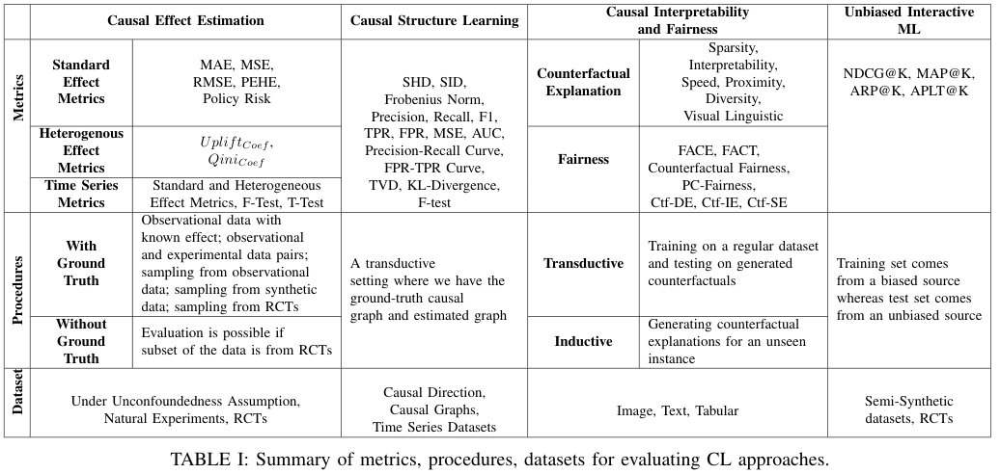

# 因果学习的评估要跟着目标量走

营销模型可以把高增量人群排在前面、估准增加多少订单、或在固定预算下选出取得较高净收益的策略。Lu Cheng 等人的 *Evaluation Methods and Measures for Causal Learning Algorithms* 将评估按因果效应估计、结构学习、可解释与公平、交互学习组织。补贴场景直接用到 §3 的效应估计部分，其中最大的约束是验证集能观察到什么。 [固定版表 I 与 §3](https://arxiv.org/pdf/2202.02896v1#page=3)

作者原表 I，arXiv 2202.02896v1 第 3 页裁取。读第一列时按行向下看：上方是数值指标，中间是有真值或无真值的评估流程，下方是数据条件。结构图的 SHD 与发券效应误差使用不同信息。 [原文表 I](https://arxiv.org/pdf/2202.02896v1#page=3)

## 先判断能否检验效应幅度

令 $\tau(X)=E[Y(1)-Y(0)\mid X]$，$\hat\tau(X)$ 是模型估计。已知真实 CATE 的基准可以算 $\epsilon_{\rm PEHE}=n^{-1}\sum_i(\hat\tau(X_i)-\tau(X_i))^2$。综述式 (6) 将目标写成 $y_{1i}-y_{0i}$。复现时要看数据给的是模拟的两臂条件均值，还是带个体噪声的两次潜在结果，分数含义会随真值口径改变。其他论文常报告平方根 $\sqrt{\epsilon_{\rm PEHE}}$。ATE 误差先汇总 $\tau$ 和 $\hat\tau$ 再比较，组间高估和低估会抵消。比如两组真值 0.10、0.02，模型给 0.06、0.06，若两组等大，则 ATE 误差为零，PEHE 为 0.0016，根 PEHE 为 0.04。 [原文式 (4)–(6)](https://arxiv.org/pdf/2202.02896v1#page=3)

真实随机留出只有每人一项事实结果。冻结评分规则后可在分数桶内比较两臂均值，测群体效应校准，给出区间和样本量。在给定 $X$ 的随机概率已知但会变时，可用 $TY/e(X)-(1-T)Y/(1-e(X))$ 的桶内平均估计。对模型预测乘以 2，排序和所有按排序前缀的曲线都一样，幅度校准会变。 [综述 §3.A–B](https://arxiv.org/pdf/2202.02896v1#page=4) · [排序与 Qini 精读](../SRC-QINI-MEASURES/阅读笔记.md)

## 策略价值怎样从随机留出估计

一条冻结的二元发券策略 $\pi(X)$ 在全体人中选择发或不发。对等概率随机实验，把 $\pi=1,T=1$ 子集的平均结果乘 $P(\pi=1)$，再加上 $\pi=0,T=0$ 的平均结果乘 $P(\pi=0)$，得到目标策略价值 $V(\pi)$。综述式 (7) 在结果缩放至 $[0,1]$ 时以 $1-V(\pi)$ 表达风险。若观测动作概率因层而异，在同一目标分布下可用平均 $\mathbf 1\{T=\pi(X)\}Y/P(T=\pi(X)\mid X)$。如果执行规则用 5% 的预算截点，就在冻结后的这个截点验证订单、净收益和花费。整条 Qini 曲线的面积使用多个覆盖点，无法单独回答该截点的价值。 [原文式 (7)–(10)](https://arxiv.org/pdf/2202.02896v1#page=3)

例如用一半高、一半低分的实验来验策略，只发高分组。若高分有券下单率 0.25、无券 0.15，低分无券下单率 0.20，则策略结果为 $0.5\times0.25+0.5\times0.20=0.225$。相对全不发 $0.175$ 增加 0.05 单/用户。每张券如果每次指派预期成本 1.2 元，成本为 0.6 元/用户。将增加的订单乘单笔贡献、再扣成本，便得到用于比较预算方案的量。 [营销评估与决策问题](../../知识库/问题/怎样验证补贴增量的排序幅度和策略价值.md)

采用 arXiv 2202.02896v1（2022-02-07），精读表 I、§3 单期效应与流程，查 §3 的时序、网络和 §8 的评估局限。 [固定版全文](https://arxiv.org/pdf/2202.02896v1)
