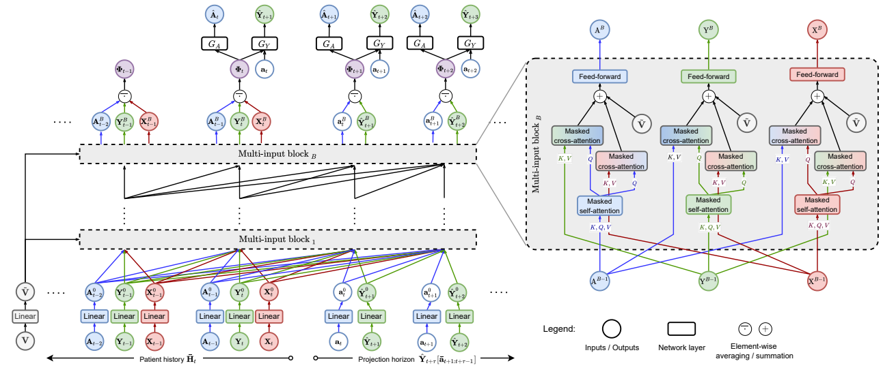
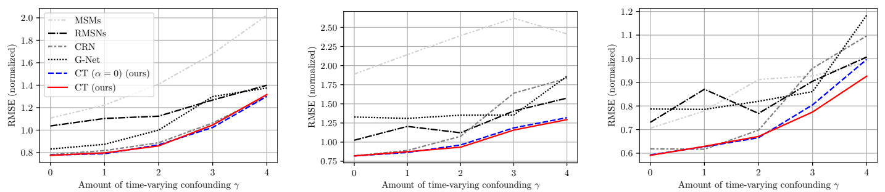

# Causal Transformer 怎样用三路历史估计未来结局

给同一位患者比较“现在开始治疗”和“推迟一次再治疗”，需要先固定已经发生的病程，再替换未来计划。CRN 用 LSTM 逐步压缩历史，首步结果由编码器预测，余下结果由解码器递推。这样做时，较早的治疗和症状如果都重要，后续预测必须从递归状态中保留并取回这两类线索。Causal Transformer（CT）让三类历史可以按位置直接互相查询，再用事实结果监督与反事实域混淆损失（CDC）共同学习历史表示。[多期发券与时变混杂](../../知识库/问题/多期发券怎样从时变混杂日志估计增量.md)给出识别条件及与逐期倾向加权的比较。 [原文 §1、§3–4](https://proceedings.mlr.press/v162/melnychuk22a/melnychuk22a.pdf#page=2)

## 三路注意力看到哪些输入

*作者原图。Melnychuk 等，正式版 PDF 第 2 页图 1。沿蓝、红、绿三条输入线读到紫色表示，再看当前计划动作怎样单独进入结局头。右侧展开一个多输入块。*

设今天是第 $t$ 天，历史里有前几天发券动作 $A_{<t}$、截至发券前的活跃等时变协变量 $X_{\le t}$、已经可见的订单结果 $Y_{\le t}$，以及注册渠道等静态属性 $V$。CT 分别把过去动作、时变协变量和结果嵌入三条序列。每个多输入块先在各路做自注意力，再由一路的 query 分别对另外两路的 key 和 value 做交叉注意力。于是今天的活跃可以查询较早的券和订单，相关状态不必只通过昨天的隐藏向量传递。块内还注入静态表示，并使用残差、归一化和逐位置前馈层。自注意力和交叉注意力都屏蔽未来位置，动作流额外滞后一步。模型在训练时也不能用今天的动作来构成用于判别今天动作的历史表示。最后对三路同位置表示取均值、线性投影并经 ELU 得到 $z_t$。 [原文 §4.1、式 (2)–(10) 与图 1](https://proceedings.mlr.press/v162/melnychuk22a/melnychuk22a.pdf#page=4) · [附录 C 式 (25)–(39)](https://proceedings.mlr.press/v162/melnychuk22a/melnychuk22a.pdf#page=15)

若今天事实发券 $A_t=1$，首期订单数 $Y_{t+1}=3$，结果头用 $G_Y(z_t,1)$ 与 3 算平方误差。推理时，同一个 $z_t$ 可以先试计划 $(1,0)$，把首步输出 $\hat Y_{t+1}^{(1,0)}$ 回填结果流、把今天的计划动作 1 追加进动作流。明天的活跃还未观测，预测段仅汇聚动作和结果两路，在下一步给结局头输入 0。另一条计划 $(0,1)$ 要单独递推，因为首步动作和结果回填都改变了。两条末期结果相减就是该起点的计划对比。如果需要比较“明天视活跃决定是否发券”，还需要行动规则所依赖的未来活跃及其分布。作者训练用已观测结果做 teacher forcing，多步评估时改用预测结果，首步误差会随回填影响后续。 [原文 §4.1、§4.5 与式 (10)](https://proceedings.mlr.press/v162/melnychuk22a/melnychuk22a.pdf#page=5)

## CDC 如何改变表示收到的梯度

训练的动作分类头 $G_A(z_t)$ 用事实动作标签优化普通交叉熵。更新历史网络时，CRN 反转这条分类梯度，CT 则固定动作头，使用均匀软标签 $u_j=1/K$，最小化 $-\sum_j u_j\log G_{A,j}(z_t)$，同时降低事实结果误差。二分类例子里，若分类头给发券概率 0.8，均匀目标损失是 $-\tfrac12(\log0.8+\log0.2)\approx0.916$，大于概率 0.5 时的 $0.693$。把这次事实发券的预测概率压到接近 0 也会使均匀目标损失变大。两组参数迭代更新，并给各组参数维护指数滑动平均。 [原文 §4.3，式 (15)–(20)](https://proceedings.mlr.press/v162/melnychuk22a/melnychuk22a.pdf#page=6) · [附录 E 算法 1](https://proceedings.mlr.press/v162/melnychuk22a/melnychuk22a.pdf#page=17)

固定表示后，若 $p_j(z)$ 是第 $j$ 种事实动作下的表示密度、$\pi_j$ 是该动作的样本比例，理想分类器输出 $\pi_jp_j(z)/m(z)$，其中 $m(z)=\sum_j\pi_jp_j(z)$。代回 CDC，得到由均匀权重平均的 $D_{\mathrm{KL}}(m\Vert p_j)$ 加一个由类别先验决定的常数。理论平衡发生在各 $p_j$ 相同时，此时分类器输出先验 $\pi_j$。因此在发券、未发券比例相差较大时，概率离 0.5 有多远还取决于样本比例。模型的训练结果还受损失权重、有限样本及优化影响。表示即使跨动作平衡，也需保留影响结果的历史信息，并在行为日志上检查所比较的计划有支持。 [原文 §4.4、附录 F 式 (43)–(53)](https://proceedings.mlr.press/v162/melnychuk22a/melnychuk22a.pdf#page=18) · [识别假设](https://proceedings.mlr.press/v162/melnychuk22a/melnychuk22a.pdf#page=13)

## 哪些实验能核对反事实

*作者原图。Melnychuk 等，正式版 PDF 第 6 页图 2。从左到右为一步预测、在六步内移动单次治疗、六步随机治疗轨迹。横轴改变模拟中的时变混杂强度。*

全合成肿瘤模拟中，模型只用日志式的事实分配训练，在留出起点上用模拟器生成计划的反事实结局。把 CRN 的梯度反转换成 CDC 训练流程后，在混杂强度 $\gamma=4$ 的表 4 中，归一化 RMSE 在前两步从 1.30、1.12 升至 1.33、1.18，从第三步起下降，第六步由 1.10 降至 0.93。这个改动同时伴随论文的 CDC 训练配置，包括 EMA。表 3 提供另一条证据：在 $\gamma=4,\tau=6$ 时，完整 CT 的归一化 RMSE 为 0.93，去掉交叉注意力增加 0.10，固定其他超参关闭平衡增加 0.07。实验数值按各表自身的模拟协议解释。 [原文 §5.1、§5.4，表 3–4](https://proceedings.mlr.press/v162/melnychuk22a/melnychuk22a.pdf#page=8)

半合成实验用 MIMIC-III 协变量与模拟结局，可以评估模拟器给出的反事实。表 1 随机轨迹十步的 RMSE，CT、关闭平衡的 CT 与 CRN 分别为 0.59、0.61 和 0.78。真实 MIMIC-III 实验预测舒张压，五步的事实路径 RMSE 分别为 CT 10.14、CRN 10.40 mmHg。后一个数字衡量已发生治疗路径的预测，对同一患者换计划后的结局仍需要额外证据。 [表 1](https://proceedings.mlr.press/v162/melnychuk22a/melnychuk22a.pdf#page=6) · [表 2 与 §5.2–5.3](https://proceedings.mlr.press/v162/melnychuk22a/melnychuk22a.pdf#page=8) · [附录 K](https://proceedings.mlr.press/v162/melnychuk22a/melnychuk22a.pdf#page=32) · [附录 L](https://proceedings.mlr.press/v162/melnychuk22a/melnychuk22a.pdf#page=34)

采用 ICML 2022 正式版 37 页。阅读摘要、§1–6 并复核附录 A、C、E–F、I–L。未运行模型。35 页中文 PDF 基于作者 LaTeX，译摘要、正文、正文图表和说明性脚注，保留公式、图内文字、署名、参考文献和附录。 [固定原文](https://proceedings.mlr.press/v162/melnychuk22a/melnychuk22a.pdf) · [中文 PDF 访问说明](../../译文/PDF目录.md)
