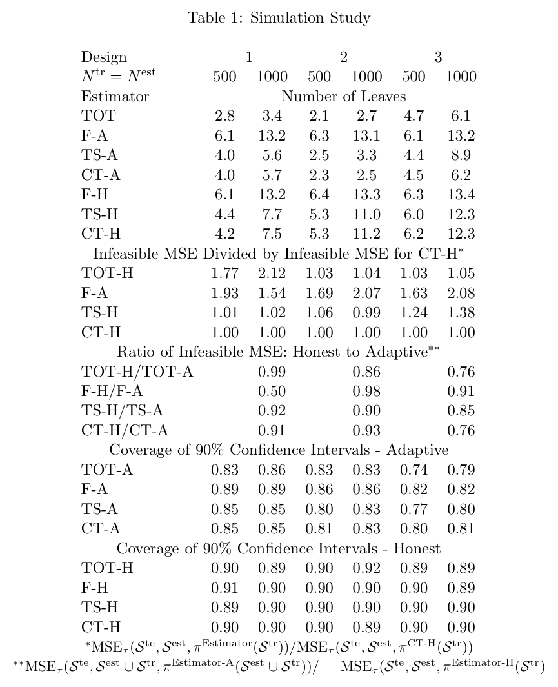

# 因果树怎样找出发券效果不同的人群

普通回归树找最能解释下单率差异的切点，例如把高活跃和低活跃的人分开。两群下单率可以相差很大，但发券带来的提升恰好一样。Athey 与 Imbens 的 Causal Tree 同时改变切分准则和叶估计所用的数据。先用每个候选叶的两臂差找效应异质性，把小叶的估计噪声放进准则，再用独立样本计算选中各叶的效应和区间。 [原文 §1–3](https://arxiv.org/pdf/1504.01132v3#page=3)

## 为什么挑完切点还要换一批样本

假设一次随机发券实验收集处理前画像、指派动作 $W$ 与是否下单 $Y$。共同的因果目标是同一人群发券与不发券的增量。搜索切点时，可以尝试近 7 日访问次数、高价商品浏览比例等很多变量。即使各画像的真实增量都是 4 个百分点，也可能碰巧发现一个切点，令两叶的样本增量估计为 0 与 8 个百分点。切点之所以入选，部分原因是两边的噪声碰巧朝相反方向。继续用同一批记录计算叶差和区间，会保留这次极端筛选。

诚实树用 $S^{\mathrm{tr}}$ 建树并在其内部交叉验证剪枝，随后冻结切点。把完全独立的 $S^{\mathrm{est}}$ 按同一规则路由，在每个叶内分别平均发券和无券结果，计算 $\hat\tau_\ell=\bar Y_{1,\ell}-\bar Y_{0,\ell}$。给定训练样本，区间目标是固定叶 $\ell$ 的 $\mathbb E[Y(1)-Y(0)\mid X\in\ell]$。随机分配、两臂均有足够样本时，可以用估计样本的 $s^2_{1,\ell}/n_{1,\ell}+s^2_{0,\ell}/n_{0,\ell}$ 估方差，再按实验设计做推断。单叶区间的名义覆盖不能当作所有叶的联合覆盖。从估计样本中再挑效果最大的叶，也会重新引入筛选。 [原文 §2.1、§5](https://arxiv.org/pdf/1504.01132v3#page=5) · [推断段](https://arxiv.org/pdf/1504.01132v3#page=14)

## 分裂时怎样同时计效应差与小叶噪声

如果所有人的 $\tau_i$ 可观测，候选树 $\Pi$ 可以直接比较测试集上 $(\tau_i-\hat\tau_\Pi(X_i))^2$ 的平均值。但每人只发生一臂，不能把预测减去不存在的标签。展开平方并扣去与树无关的 $\tau_i^2$ 后，交叉项只需要叶内真效应的平均值，可以由独立样本中的两臂差来估。若叶效应在给定分区下无偏，这个期望目标也可写成最大化
$$
\mathbb E_X[\tau_\Pi(X)^2]
-\mathbb E_X[\operatorname{Var}_{S^{\mathrm{est}}}(\hat\tau_\Pi(X))].
$$

第一项描述分区可保留的效应信号。训练样本的估计平方含训练噪声，自身就需要减去一份估计方差。第二项还需扣掉最终在估计集内重算两臂均值的噪声。令两份样本量都为 $N$，随机实验每臂的比例约为 $p,1-p$，按叶占比汇总后，两份方差惩罚合在一起，得到可按候选分区比较的分数
$$
\widehat Q_H(\Pi)
=\sum_{\ell\in\Pi}\frac{n_\ell}{N}\hat\tau_\ell^2
-\frac{2}{N}\sum_{\ell\in\Pi}
  \left(\frac{s^2_{1,\ell}}{p}+\frac{s^2_{0,\ell}}{1-p}\right).
$$
$n_\ell,\hat\tau_\ell,s_{w,\ell}^2$ 都由建树样本计算。第一项按人群份额加权；第二项中，估计方差反比于叶样本量，与叶份额相乘后抵消了叶大小。方案对照时应比较新旧分区的**分数差**。原文在几个位置将负 EMSE 和该最大化估计量的符号混用，这里从平方误差展开确定方向。 [原文 §2.4、§3.2](https://arxiv.org/pdf/1504.01132v3#page=10)

沿用前面的 0、8 与父叶 4 个百分点。假定各子叶各 200 条，建树样本共 400 条，两臂概率均为一半。若父叶和每个子叶的两臂方差在教学算例中都取 $0.16$，效应信号改变量为 $(0^2+0.08^2)/2-0.04^2=0.0016$，新增一个叶的惩罚为 $(2/400)(0.16/0.5+0.16/0.5)=0.0032$，所以这一切分分数下降。反过来，若切分按只影响自然下单的变量进行，两叶效应相同，但子叶内结果波动充分变小，整体方差惩罚仍可能下降。它因而也关注改善估计精度的变量。

用训练数据反复比较候选会让高分偶然出现，所以 CT-H 仍在建树折外评价候选树的复杂度。它给固定分区在验证折上重新计算上式，模拟最终将用另一批样本估计的情形。附录报告 F、CT、TS 的训练叶要求两臂各至少 25 条，使用五折以降低验证叶空臂风险。TOT 的实验设置是每叶至少 50 条、十折，两臂人数不单独限制。 [原文 §2.5、§3.2 和在线附录](https://arxiv.org/pdf/1504.01132v3#page=20)

## 同一分区上，各方法在优化什么

- **结果拟合树 F** 在叶内拟合各臂均值，按事实结果的残差选择切点。它会奖励让两臂共同变准的切点，即使效应差恒定。
- **变换结果树 TOT** 用 $Y^*=Y(W-p)/[p(1-p)]$ 作为回归目标。若指派概率恒定，固定 $X$ 取期望便是两臂均值之差。原文 §4.2 印成 $(Y-W)/[p(1-p)]$，与此恒等式不符。变换结果树的叶均值还依赖实际臂比例，除臂比例正合概率或响应存在特殊抵消外，与分别计算两臂均值再相减会有差异。
- **平方 t 统计量树 TS** 关注左右叶的效应差相对估计噪声有多大。两叶真实效应相同但估计更精准时，CT-H 可以奖励切分。
- **CTS** 在每个子叶选最佳档，再比较切分前后的策略收入。两叶都应发同一档时，效应幅度可以明显不同，允许重新选档的策略价值增益仍可为零。 [原文 §4](https://arxiv.org/pdf/1504.01132v3#page=11) · [CTS 的选档目标](../SRC-CTS/阅读笔记.md#什么时候值得把人群切开)

真实历史日志里，即使诚实分样，叶内用户也未必因旧策略而可比。作者在 §7 建议给定处理前信息满足无混杂性时用倾向权重，可在各叶的两臂分别重归一化。若某一臂对部分画像几乎没有覆盖，权重调整仍依赖该画像能遇到两臂以及稳定的倾向估计。 [原文 §7](https://arxiv.org/pdf/1504.01132v3#page=16) · [历史发券的可交换性与支持](../../知识库/问题/历史发券日志如何估计补贴增量.md#在哪一群人哪个时刻比较发与不发)

## 模拟中的覆盖率与点估计代价

采用版没有算法图。表 1 为 Athey 与 Imbens 作者原表，裁自第 19 页。三套生成设计有 2、10、20 个特征，二元处理概率均为 0.5，测试用 6,000 条。读表先看最后两块。名义 90% 区间下，CT-A 实际覆盖在 0.80–0.85，CT-H 为 0.89–0.90，证据对应随机模拟中的叶效应覆盖。第三块对照相同的总样本量，CT-A 用 1,000 条兼做建树与估计，CT-H 用 500 条建树及 500 条估计。表头、行名写成 H/A，脚注和正文的公式方向却是 A/H，表 A1 的均值方向也与 A/H 相符。按脚注方向，三种设计的 CT 比值为 0.91、0.93、0.76，诚实版对应更大误差；这些是逐次比值的平均，不能用表 A1 的均值之比精确复算。第二块的 F-A 标签与诚实方法比较的正文叙述不一致，引用时保留原标签。 [模拟正文](https://arxiv.org/pdf/1504.01132v3#page=14) · [表 1](https://arxiv.org/pdf/1504.01132v3#page=19) · [表 A1](https://arxiv.org/pdf/1504.01132v3#page=22)

## 原文和中文译本

采用 Susan Athey 与 Guido W. Imbens 的 arXiv 1504.01132v3（2015 年 12 月稿），对应 2016 年 PNAS 论文。阅读摘要、引言、§1–9、表 1、在线附录与表 A1。中文译本覆盖摘要、引言、正文、描述性脚注与主表文字，公式保留，附录及参考文献保留原文。正式文件为 `.local/papers/SRC-CAUSAL-TREE/translation/异质因果效应的递归分区_中文.pdf`，译后主文件为 `translated-sources/paper.tex`。未重跑模型。 [策略评估中的诚实分桶](../../知识库/问题/怎样验证补贴增量的排序幅度和策略价值.md#预测的百分点是否兑现) · [采用版](https://arxiv.org/pdf/1504.01132v3) · [来源与原件哈希](来源.json) · [私有备份下载说明](../../文档/工具/中文PDF发布.md)
