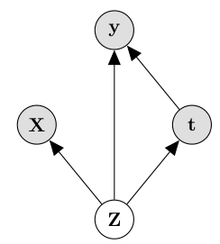
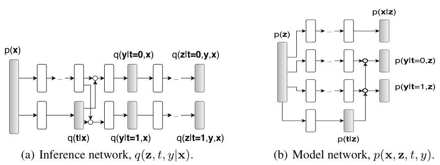
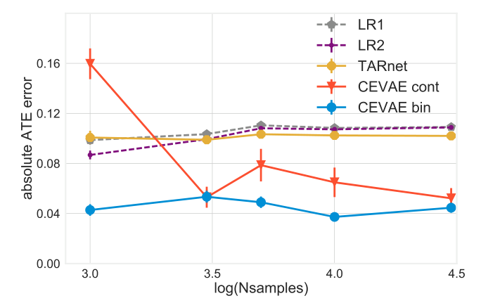
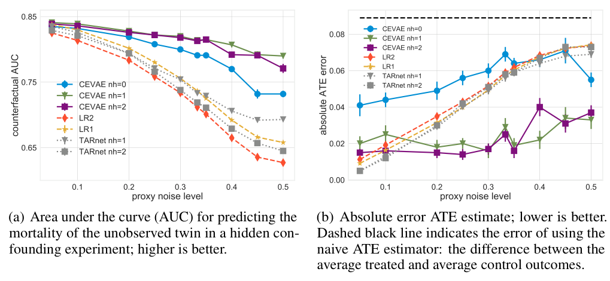

# CEVAE 怎样用含噪代理估计处理效应

旧策略更愿给高购买意愿的用户发券。购买意愿本身看不到，只记录了浏览次数、近期访问间隔等代理。直接在同一浏览次数内比较有券与无券，高购买意愿的人仍可能在发券组占得更多。CEVAE 用一个潜变量同时解释代理、处理指派与结果，再在潜变量层做后门调整。能否从观测数据恢复这套潜在结构，是使用这项调整的前提。 [原文 §1–2](https://arxiv.org/pdf/1705.08821v2#page=2)

## 为什么调整代理变量仍会留下混杂

图 1 为 Louizos 等作者原图，裁自 arXiv 1705.08821v2 第 2 页。沿 $T\leftarrow Z\rightarrow Y$ 看发券和结果如何受同一隐藏因素影响，再看 $Z\rightarrow X$ 给出的含噪观测。只固定 $X$ 时，路径中的 $Z$ 仍未被阻断。 [原文图 1](https://arxiv.org/pdf/1705.08821v2#page=2)

用同一类浏览频次的用户来演算。假设在这个画像 $x$ 下，$75\%$ 是高意愿用户，$25\%$ 是低意愿用户。高意愿组旧策略发券概率为 $0.8$，低意愿组为 $0.2$。因此，在固定 $x$ 的发券样本里，高意愿者占 $0.6/(0.6+0.05)\approx92.3\%$；无券样本里占 $0.15/(0.15+0.2)\approx42.9\%$。即使两组券的真实增量都是 5 个百分点，只要两组自然购买率不同，直接相减就混入了该组成差。

在图 1 的结构下，令 $m_t(z)=\mathbb E[Y\mid T=t,Z=z]$。定理 1 给出
$$
\tau(x)=\int \big[m_1(z)-m_0(z)\big]p(z\mid x)\,dz.
$$
固定画像后，给所有同类用户指派券和全不指派券，两次都对相同的 $p(z\mid x)$ 积分。上例如果高、低意愿组无券率是 $0.40$、$0.10$，有券率是 $0.45$、$0.15$，按共同组成计算就是 $0.375-0.325=0.05$，而观测两臂率之差约为 $0.427-0.229=0.198$。这里把 $Z$ 的分布和响应给定以便演算。真实日志中，需要额外论证它们可以从观测联合分布恢复，并且两臂在所需的潜在分层有支持。 [定理 1 与式 (1)](https://arxiv.org/pdf/1705.08821v2#page=3)

附录 A 另给二值示例。对代理 $X$ 调整可同时偏移两个臂的干预均值，在作者的对称构造中两个偏移会在取差时抵消，改变对称性后可留下效应偏差。附录首项推导有一个中间行写成 $p(z\mid t=1)$，按图 1 应保留左侧的干预条件，再用 $p(z\mid do(t=1))=p(z)$。正文式 (1) 使用后者所表达的调整逻辑。 [附录 A](https://arxiv.org/pdf/1705.08821v2#page=11) · [后门调整](../../知识库/问题/历史发券日志如何估计补贴增量.md#因果图决定先分哪些组)

## 一条事实记录怎样训练推断端和生成端

图 2 为作者原图，裁自采用版第 4 页。右图先抽 $Z$，灰色块为从分布取样，圆形门按处理选结果路径。左图从 $X$ 出发，补上处理与结果后再给出潜状态分布。 [原文图 2](https://arxiv.org/pdf/1705.08821v2#page=4)

沿用历史发券例。训练记录 $(x_i,1,1)$ 对应一位在观察窗内下单的领券资格用户，$1$ 表示指派，结果 $1$ 表示下单。推断端读取事实 $(x_i,t_i,y_i)$，返回潜变量各维均值和方差，在相应臂的近似后验 $q_\phi(z\mid x_i,t_i,y_i)$ 中采样。生成端则从该潜样本反推代理字段、历史发券概率和所给臂的下单概率。其联合分解是
$$
p_\theta(z,x,t,y)=p(z)p_\theta(x\mid z)p_\theta(t\mid z)p_\theta(y\mid t,z).
$$

重构对数概率包含三份事实监督。$\log p_\theta(x_i\mid z)$ 检查能否重构代理，$\log p_\theta(t_i\mid z)$ 检查能否解释旧动作，$\log p_\theta(y_i\mid t_i,z)$ 只监督选中的结果头。再扣除 $\mathrm{KL}(q_\phi(z\mid x_i,t_i,y_i)\Vert p(z))$，构成式 (6) 的证据下界。式 (10) 还加 $\log q_\phi(t_i\mid x_i)$ 和 $\log q_\phi(y_i\mid x_i,t_i)$，让两套预测分布在没有事实 $t,y$ 的新用户上能提供推断入口。原式 (5) 的头下标和 $t$ 的乘项相反，可将 $g_2,g_3$ 视作两个由 $t$ 路由的头，实施时须固定路由。 [原文 §3、式 (2)–(10)](https://arxiv.org/pdf/1705.08821v2#page=4) · [VAE 的证据下界](../SRC-VAE/阅读笔记.md#一个下界怎样同时监督像素和潜空间)

新用户只有 $x$，按 $q(t\mid x)$ 抽一个辅助处理，再按 $q(y\mid x,t)$ 抽一个辅助结果，最后从 $q(z\mid x,t,y)$ 抽潜状态。这一链条用来逼近 $q(z\mid x)$，其中抽到的 $t$ 服从历史分配近似。做因果预测时另行把实际要比较的处理固定为 $0$ 和 $1$，两次都读相同的潜状态分布，经生成端的两个头算响应。作者用 100 个潜样本求均值。若在每个干预臂分别用固定 $t$ 推断 $Z$，会改用两个不同的潜在人群，偏离式 (1)。 [原文 §4 预测实现](https://arxiv.org/pdf/1705.08821v2#page=5)

## 噪声实验与常用基准检验了什么

图 3 为作者原图，裁自采用版第 7 页。样本量从 1,000 增至 30,000。真实潜因素是二元，高斯代理按它改变位置与方差。二元 CEVAE 与生成模型更接近，小样本时 ATE 误差较低。五维连续版在最小样本时比直接用代理的基线误差更大，样本增加后改善。横轴为样本量的十进对数。处理增量可在这一实验中直接同生成真值比较。 [原文 §4.2、式 (11) 和图 3](https://arxiv.org/pdf/1705.08821v2#page=7)

图 4 为作者原图，裁自采用版第 8 页。作者用 11,984 对同性别、两人出生均低于 2 kg 的双胞胎构造基准，以依据妊娠周数等变量选择保留较重或较轻的记录制造观察偏差。妊娠周数的三份独热编码独立翻转。左图评估隐藏的另一个双胞胎死亡预测 AUC，右图评估 ATE 绝对误差。直接代理为随机位时，其他字段仍可能含妊娠信息。高噪声下 CEVAE 的优势要结合这种生成和选择机制理解。 [原文 §4.3、图 4](https://arxiv.org/pdf/1705.08821v2#page=8)

IHDP 表 1 中，1,000 个模拟结果实现的样本外根 PEHE 为 CEVAE $2.6\pm0.1$、BNN $2.1\pm0.1$、CFRW $0.76\pm0.0$，误差越小越好。Jobs 表 2 中，10 次切分的样本外 ATT 绝对误差为 CEVAE $0.03\pm0.01$、CF $0.07\pm0.03$，前者样本外策略风险则为 $0.26$，高于 CF 的 $0.20$。估计平均幅度更准与选人策略价值更高是两项检验。原文报告这些实验结果，本笔记没有运行模型。 [原文 §4.1、表 1–2](https://arxiv.org/pdf/1705.08821v2#page=6)

CEVAE 用生成结构假设处理代理误差。TARNet 和 CFR 直接从观测协变量学习结果，后者还约束两臂表示。MIM-DRCFR 则用分配、事实结果和互信息损失让同一份观测特征形成分工。这里的生成似然、结果拟合和编码分工属于不同训练信号。只看到良好代理重构时，还要判断代理是否足以区分与指派及结果共同有关的潜在状态。 [历史发券比较](../../知识库/问题/历史发券日志如何估计补贴增量.md#只有共同原因的代理时怎样调整) · [MIM-DRCFR 的三路训练](../SRC-MIM-DRCFR/阅读笔记.md)

## 原文和中文译本

采用 Christos Louizos、Uri Shalit、Joris Mooij、David Sontag、Richard Zemel、Max Welling 的 arXiv 1705.08821v2，对应 NeurIPS 2017。阅读摘要、正文 §1–5、定理 1、式 (1)–(11)、四图、两表和附录 A。中文译本 11 页，摘要、正文、图表说明和描述性脚注已译，图内文字、参考文献和附录保留原文。正式文件为 `.local/papers/SRC-CEVAE/translation/利用深度潜变量模型推断因果效应_中文.pdf`，译后主文件为 `translated-sources/vcei.tex`。 [采用版](https://arxiv.org/pdf/1705.08821v2) · [来源与原件哈希](来源.json) · [私有备份下载说明](../../文档/工具/中文PDF发布.md)
