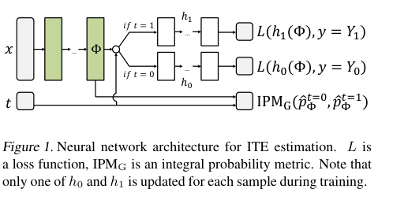

# CFRNet 怎样用事实拟合和分布距离约束反事实误差

旧策略若更常给高意向用户发券，无券数据较难回答他们自然会买多少。Shalit、Johansson 与 Sontag 用共享编码器 $\Phi$、两个处理臂结果头和积分概率度量（IPM）做反事实回归。相对于早期用一个预测器接收 $[\Phi(x),t]$ 的方案，处理指派直接决定事实样本进入哪个结果头，理论也改为约束两头之差与真实条件效应之间的误差。 [原文 §1–2](https://arxiv.org/pdf/1606.03976v5#page=1) · [2016 年方法](../SRC-BALANCED-COUNTERFACTUAL/阅读笔记.md)

## 一条发券样本更新哪个头

作者原图 1，arXiv 1606.03976v5 第 2 页。沿绿色模块得到 $\Phi(x)$。发券时事实标签只监督 $h_1$，未发券只监督 $h_0$。底部路径按 $t$ 将同一批表征分组计算 $\mathrm{IPM}$，梯度回到共享编码器。 [原文图 1](https://arxiv.org/pdf/1606.03976v5#page=2)

例如某批次中 20% 的样本拿券。处理样本权重 $1/(2u)=2.5$，对照权重 $1/[2(1-u)]=0.625$。按批量平均，两臂事实损失期望各占一半。这一步按总体臂数加权。组内倾向因人而异时，仍有单独的表征约束。假设对某个用户读出 $h_1=0.32,h_0=0.25$，推理时输出 $0.07$，即预测多 7 个百分点。该解释依赖指派一致性、已测混杂足够与支持重叠。两头使用相同输入特征，只有在训练时用 $t$ 路由事实标签。 [原文 §4、式 (5) 与算法 1](https://arxiv.org/pdf/1606.03976v5#page=5)

## 误差界为何同时保留事实损失

令两头的条件均值误差为 $e_1(x),e_0(x)$，效应平方误差至多是 $2(e_1^2+e_0^2)$。在总体 $p(x)$ 上取期望，合并可见的事实误差及把各样本动作翻转后的反事实误差，再扣去真实结果的不可约方差项。反事实误差需要在另一臂的特征分布上计算，Lemma 1 用 IPM 对这部分跨臂迁移定界。IPM 比较两组对同一类函数的期望最大差。Wasserstein 用 1-Lipschitz 函数类，MMD 用再生核 Hilbert 空间的单位球。 [原文 §3，Lemma 1 与 Theorem 1](https://arxiv.org/pdf/1606.03976v5#page=4)

定理要求单射、二次可微的表征及条件损失满足相应函数类约束。实际训练使用非线性共享表示，以 $\alpha$ 吸收难求的 $B_\Phi$，并约束表示尺度。仅将所有向量缩到常数会让经验距离小，却可能抹去意向和效应异质性。TARNet 保留相同的共享双头和事实拟合，将平衡系数设为零。实际批次要使两臂均有样本才能估两组距离。 [原文 §3.2、§4](https://arxiv.org/pdf/1606.03976v5#page=5)

## IHDP 与 Jobs 对应不同的验证任务

IHDP 使用 747 人的半模拟基准、NPCI 包的 A 设定、无噪声条件效应真值。DragonNet §4 脚注 4 将这个设定对应到 Hill（2011）的 B 设定。1000 次结果上的 63/27/10 切分中，样本外根 PEHE 从 TARNet 的 0.95 降到 CFR MMD 的 0.78、CFR Wass 的 0.76。Jobs 将随机及观测人群合并训练，只用随机子样本验证。表 1 的零阈值样本外策略风险三者均约为 0.21。组间平衡对某个半模拟效应协议的收益和实际随机子集的策略评价需要各自报告。 [原文 §5、表 1 和图 2–3](https://arxiv.org/pdf/1606.03976v5#page=7) · [DragonNet 脚注 4](https://arxiv.org/pdf/1906.02120v2#page=7) · [结果回归与表征比较](../../知识库/问题/历史发券日志如何估计补贴增量.md)

采用 arXiv 1606.03976v5，回查 PMLR 70 的正式条目。正文、摘要、图表标题与描述性脚注在作者 LaTeX 副本上翻译。附录、参考文献与图内文字保留原文。 [PMLR 正式条目](https://proceedings.mlr.press/v70/shalit17a.html)

中文正文译本共 17 页，本地正式文件为 `.local/papers/SRC-CFRNET/translation/中文.pdf`。原文与译本均可登录私有附件库下载。 [下载说明](../../文档/工具/中文PDF发布.md)
