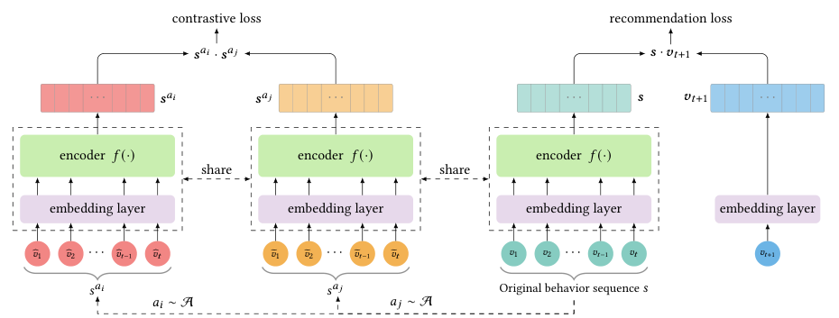
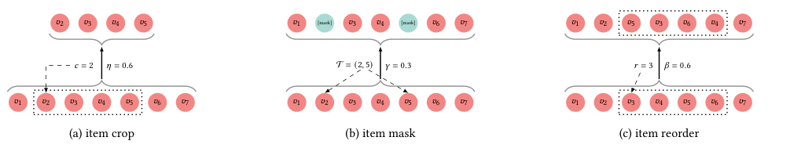
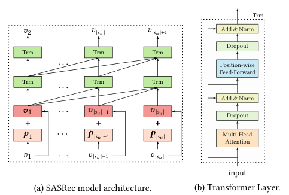
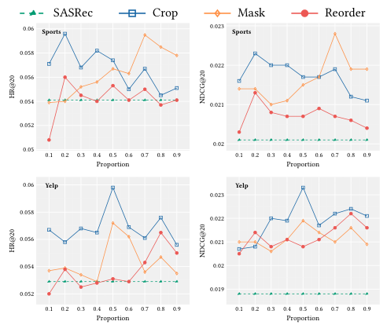

# CL4SRec：下一物品监督之外，让同一历史的两个视图相认

[原文版本与中文 PDF 位置](#原文与阅读范围) · [私有备份下载说明](../../文档/工具/中文PDF发布.md#登录下载)

[SASRec](../SRC-SASREC/阅读笔记.md) 用到当前为止的物品序列表示用户，用下一个真实物品纠正打分。短历史提供的监督少，序列状态也可能过度依赖某个位置或物品。CL4SRec 对训练前缀做两次扰动，让同一条历史的两份视图相近，同时保留原始序列的下一物品损失。v2 将两项损失联合优化。[§3、图 1](https://arxiv.org/pdf/2010.14395v2#page=3)

Xie 等作者原图 1，arXiv 2010.14395v2，PDF 第 3 页。中线左侧两条增强路径进入对比损失，右侧原序列和下一物品进入主损失。

## 先确定前缀，再确定哪些事件可改动

用 $u$ 的历史 $[耳机,耳机套,零食]$ 预测降噪耳机。原始分支顺序读取三个物品，降噪耳机留给标签。教学对比视图可选裁剪为 $[耳机,耳机套]$，另一份遮蔽为 $[耳机,[mask],零食]$。Crop 截连续跨度，长度 $\lfloor\eta|s|\rfloor$。Mask 保留序列长度，将指定物品位置换为专用符号。Reorder 只打乱所选连续区间内的顺序。对比的正对来自同一历史身份。被遮蔽物品没有单独作为恢复目标，裁剪视图也不把截下的尾项当新点击标签。若三条历史中唯一显示近期意图的是零食，裁掉它与原序列强行对齐有丢失意图的风险。[§3.3、式 (3)–(5)](https://arxiv.org/pdf/2010.14395v2#page=4)

Xie 等作者原图 2，arXiv 2010.14395v2，PDF 第 4 页。依次观察长度、位置占位符和局部次序各自发生的变化。

## 对比监督和下一物品监督更新同一个编码器

每一路把物品嵌入加位置嵌入，进入从位置 $t$ 只看不晚于 $t$ 的 SASRec 模块。对比目标读取两个变换序列各自末位置的 $d$ 维向量，采用点积相似度。批内 $N$ 条历史共 $2N$ 个视图，任一锚点排除自己，正确列是配对视图，其余 $2(N-1)$ 个视图是负列。论文式 (2) 给出一个锚点方向。交换两视图时，锚点和分母也随之交换。令批大小为 2，教学分数为 1.2、0.4、0.2，则正列概率约 $0.55$，单方向损失约 0.596。即使第二条历史来自相似兴趣，也仍可能被当作负列。作者采用末状态直接对比，移除了额外投影层。[§3.2–3.4、式 (1)–(2)、(6)–(13)](https://arxiv.org/pdf/2010.14395v2#page=4)

原始前缀路径仍以状态 $s_{u,t}$ 经过候选物品内积，做真实下一物品与随机负物品的 sampled softmax。原始序列各位置可有各自下一物品标签。训练目标为 $\mathcal L_{\mathrm{main}}+\lambda\mathcal L_{\mathrm{cl}}$，两个目标均更新编码器及其活动嵌入。线上给出可见历史即可读末状态并为候选打分，无需额外制作对比视图。[§3.5、式 (14)–(15)](https://arxiv.org/pdf/2010.14395v2#page=6)

Xie 等作者原图 3，arXiv 2010.14395v2，PDF 第 5 页。左侧是位置状态和前缀连接，右侧展开单个 Transformer 层。

## 哪一种扰动有效要看序列里剩下什么

论文使用 Beauty、Sports、Yelp 和 ML-1M，按用户顺序留后两次分别验证和测试，采用全物品排序的 HR 和 NDCG。Beauty 表 2 的 HR@20 从 SASRec 0.1007 到 CL4SRec 0.1056，增幅 4.87%。表 3 的 Sports 截取实验由 0.0541 到将增强数据用于监督的 SASRecaug 0.0546，再到联合对比 0.0596，支持对比目标有额外贡献。表 2 与表 3 的调参和组合条件不同。图 4 比较增强强度，过强的裁剪易使短序列只余少量事件。图 5 固定其他设置，改变辅助损失权重，过大时下一物品指标下降。图 6 用平均余弦展示表示分布变化，不能将它解释为已经排除了假负例。[§4、表 2–3、图 4–6](https://arxiv.org/pdf/2010.14395v2#page=8)

Xie 等作者原图 4，arXiv 2010.14395v2，PDF 第 8 页。横轴的比例含义随增强方法而变，虚线是 SASRec。

[同一历史的视图与物品视图比较](../../知识库/问题/推荐自监督怎样构造有效视图.md)

## 原文与阅读范围

采用 arXiv 2010.14395v2，阅读 §1–5、公式、主表与增强消融。v1 标题为 Contrastive Pre-training for Sequential Recommendation，采用预训练叙述，本条目使用明确给出联合目标的 v2。[固定版本](https://arxiv.org/abs/2010.14395v2)

中文 PDF（14 页）依据采用版 PDF 和作者 LaTeX单栏重排，覆盖摘要、§1–5、式 (1)–(15)、脚注及图表说明。图内文字、原表部分英文及参考文献保留，部分叙述合并表述。

本地文件 `.local/papers/SRC-CL4SREC/translation/SRC-CL4SREC.中文.pdf`，可编辑工程主文件 `.local/papers/SRC-CL4SREC/translation/translated-sources/main.tex`。[许可与范围盘点](../../译文/PDF目录.md) · [私有备份下载说明](../../文档/工具/中文PDF发布.md#登录下载)
