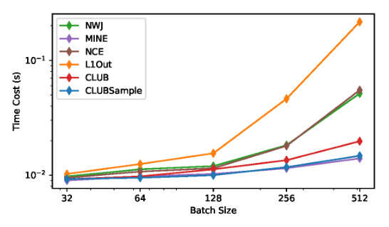
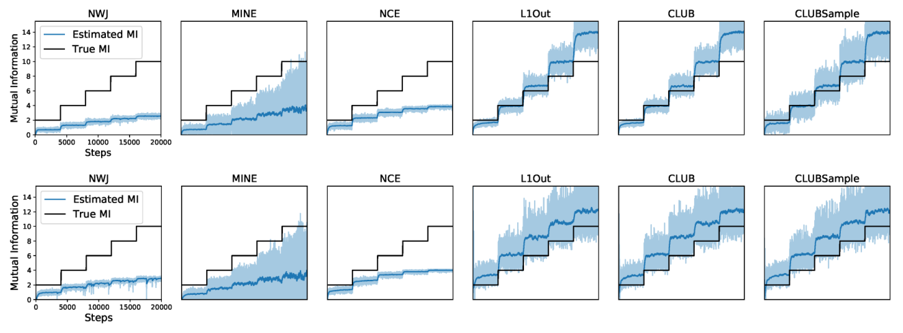
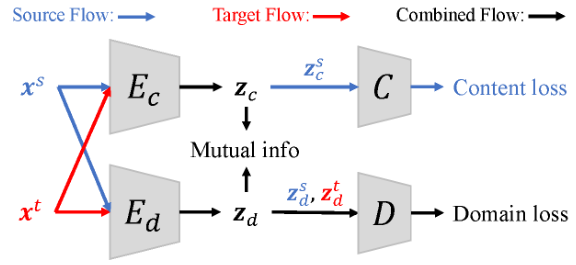

# CLUB 怎样用错配样本压低表征之间的互信息

希望模型从发券前的同一份用户特征中学出两路表征。一条 $U$ 为旧发券策略提供分配信号，一条 $V$ 表示影响发券和购买的因素。即使两路都完成各自监督，编码器也可能把同一份活跃度信号送给两边。CLUB 用一项可微的对比损失衡量这种统计依赖，让编码器比较真实配对与错配，并降低二者之间可区分的信息。论文研究互信息估计与最小化，营销中的三路表征是其后续用法。 [CLUB §1–3](https://proceedings.mlr.press/v119/cheng20b/cheng20b.pdf#page=1) · [MIM-DRCFR 的三路训练](../SRC-MIM-DRCFR/阅读笔记.md#一条发券样本怎样给三路网络提供信号)

## 为什么对比真实配对和打乱配对

互信息是联合分布 $P=p(u,v)$ 与两边独立重组后的分布 $R=p(u)p(v)$ 的 KL 散度。若已知 $p(vmid u)$，则 $I(U;V)=mathbb E_Plog p(Vmid U)-mathbb E_{p(v)}log p(V)$。第一项只读取同一位用户的 $(u_i,v_i)$。第二项需要在所有可能的 $U$ 上混合 $p(vmid U)$ 得到边缘分布，再取对数。

VUB 用一个密度 $r(v)$ 近似这条边缘分布，误差由 $mathrm{KL}(p(v)Vert r(v))$ 决定。Leave-one-out 用同批其他输入平均条件概率来近似边缘密度，再取对数。CLUB 改变取对数的位置。固定一位用户的 $u_i$，分别给它配本人的 $v_i$ 和别人的 $v_j$，直接对条件对数概率求差，再跨用户取平均。正、负两项都使用同一条件密度。 [CLUB §2、式 (6)–(7) 与 §3.1、式 (10)–(13)](https://proceedings.mlr.press/v119/cheng20b/cheng20b.pdf#page=3)

$$
I_{mathrm{CLUB}}(U;V)=mathbb E_{P}log p(Vmid U)-mathbb E_{R}log p(Vmid U).
$$

它比真实互信息多出 $mathbb E_{p(v)}[logmathbb E_{p(u)}p(vmid U)-mathbb E_{p(u)}log p(vmid U)]$。对数函数凹，根据 Jensen 不等式，括号内非负。在相关期望有限时，等号要求 $p(vmid u)$ 几乎处处与 $u$ 无关，也就是两路独立。一个便于手算的例子是把两路简化为各取 $0$ 或 $1$ 的状态，$P(U=1)=	frac12$，真实配对有 $P(V=Umid U)=0.8$。真实配对的平均对数概率为 $0.8log 0.8+0.2log 0.2$。错配两种状态各半，为 $0.5log 0.8+0.5log 0.2$。CLUB 是 $0.3log 4approx0.416$ nat，真实互信息约 $0.193$ nat。两路状态完全独立时，两种配对来自同一分布，二者都归零。 [定理 3.1 与式 (11)](https://proceedings.mlr.press/v119/cheng20b/cheng20b.pdf#page=3)

## 条件概率由网络估计时，上界还剩什么

多数表征只给出成对样本。vCLUB 让 $q_	heta(vmid u)$ 学习真实配对的条件密度，再在两种配对上用它代替真实 $p(vmid u)$。记 $Q=p(u)q_	heta(vmid u)$，代入 KL 定义可以直接得到

$$
I_{mathrm{vCLUB}}-I(U;V)=mathrm{KL}(RVert Q)-mathrm{KL}(PVert Q).
$$

只有右侧非负时，vCLUB 才给出上界。用真实配对拟合条件密度，恰好会减小 $mathrm{KL}(PVert Q)$，但优化阶段通常无法知道两项散度孰大。若相反的顺序成立，而 $mathrm{KL}(PVert Q)leepsilon$，真值与近似的差小于 $epsilon$。即使两路有关，一个忽略 $U$ 的条件网络也会给真实配对和错配打出相同的分数，得到零。看到零时还需检查条件网络能否拟合。 [定理 3.2、式 (16) 与推论 3.3](https://proceedings.mlr.press/v119/cheng20b/cheng20b.pdf#page=4)

按算法 1 训练时，先从当前编码器取 $N$ 份用户配对，用真实的 $(u_i,v_i)$ 提高 $log q_	heta(v_imid u_i)$，更新条件网络。然后固定它的参数，让损失梯度穿过条件分数回到编码器，缩小同用户和错配的对数密度差。如果两步都把条件网络朝减小差值更新，它可以靠忽略 $U$ 缩小目标。分配和购买等主任务要同时监督编码器，否则常量表征也能使两路独立。$q_	heta$ 是训练期的计分器，部署时从编码器和业务结果头读取预测。 [CLUB 算法 1](https://proceedings.mlr.press/v119/cheng20b/cheng20b.pdf#page=4) · [MIM-DRCFR §2.3](https://arxiv.org/pdf/2206.01022v1#page=3)

精确枚举同批的 $i,j$ 需要 $N^2$ 个评分。算法 1 为每个 $u_i$ 从这 $N$ 个 $v$ 中均匀抽一个，计算一次差，条件于固定批次其期望等于论文的全配对式 (15)，共 $O(N)$ 次。还需区分批内与总体的无偏性。式 (13)、(15) 把 $i=j$ 也纳入第二项。独立同分布的随机批次上，这些项令总体期望等于目标的 $(N-1)/N$ 倍。若固定条件密度并希望对总体无偏，可以只枚举或均匀抽取 $j
e i$，使第二项的每个样本来自乘积分布。这是由原式得到的有限样本校正。 [式 (13)、(15) 与负采样算法](https://proceedings.mlr.press/v119/cheng20b/cheng20b.pdf#page=4)

图 3 为 Cheng 等作者原图，来自 PMLR 119 正式 PDF 第 7 页，裁出完整图区域。横纵坐标均为对数尺度，与全配对 CLUB 对照阅读，其中 CLUB-S 每行只抽一个错配。 [原文图 3](https://proceedings.mlr.press/v119/cheng20b/cheng20b.pdf#page=7)

## 作者怎样分别检验估计质量和训练效果

图 1 为 Cheng 等作者原图，来自正式 PDF 第 5 页，裁取两行完整子图。上排用 20 维联合高斯，下排对 $Y$ 作可逆三次变换，真实互信息相同。每批 64，对每档真实互信息采样 4,000 次。图的横轴是训练步，阶梯线是已知真值。§4.1 的图 2 分开报告偏差、方差和均方误差。作者在这些设置下报告 vCLUB 与 vL1Out 的估计常在真值线上方，抽样版波动较大。这些实验验证了特定条件网络与模拟分布的表现。 [§4.1 与图 1–2](https://proceedings.mlr.press/v119/cheng20b/cheng20b.pdf#page=5)

图 4 为 Cheng 等作者原图，来自正式 PDF 第 8 页。编码器分为内容与领域两路，互信息损失作用于表征之间，领域与类别任务另给学习信号。表 1 在置换不变的 MNIST 信息瓶颈任务中报告 vCLUB 负采样误分类率 1.06%，DVB(VUB) 为 1.13%。表 2 的无监督领域适配比较中，抽样 CLUB 在 SVHN 到 MNIST 的目标域准确率为 90.6%，DANN 为 71.1%，MCD 为 92.6%。数字分别对应压缩和跨域分类，两项都没有检验补贴效应的识别。 [§4.3–4.4、表 1–2 与图 4](https://proceedings.mlr.press/v119/cheng20b/cheng20b.pdf#page=7)

MIM-DRCFR 把 vCLUB 加到三对表示上，再与事实结果、处理分配和跨臂分布约束一起训练。CLUB 的证明针对两路编码值的统计依赖。三对两两独立也可能保留共同依赖，例如独立均匀二元变量 $U,V$ 与第三路 $Umathbin{mathrm{XOR}}V$。在发券问题里，所有实际影响指派和结果的变量是否被有效调整，仍取决于因果假设、数据覆盖和表征是否保留足够的信号。 [历史发券的表征比较](../../知识库/问题/历史发券日志如何估计补贴增量.md#应该让两组在哪些特征上可比) · [MIM-DRCFR §2.3](https://arxiv.org/pdf/2206.01022v1#page=3)

## 原文与阅读范围

采用 Pengyu Cheng、Weituo Hao、Shuyang Dai、Jiachang Liu、Zhe Gan 和 Lawrence Carin 的 ICML 2020 正式版，PMLR 119，1779–1788 页。阅读覆盖正文 §1–5，重点为定理 3.1–3.2、推论 3.3、算法 1、图 1–4 与表 1–2。本项按阅读清单仅精读，未运行作者模型。 [正式全文](https://proceedings.mlr.press/v119/cheng20b/cheng20b.pdf) · [来源与原件哈希](来源.json)
