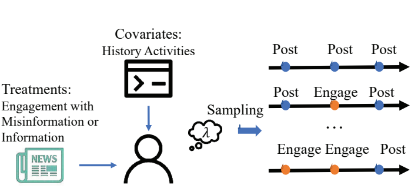
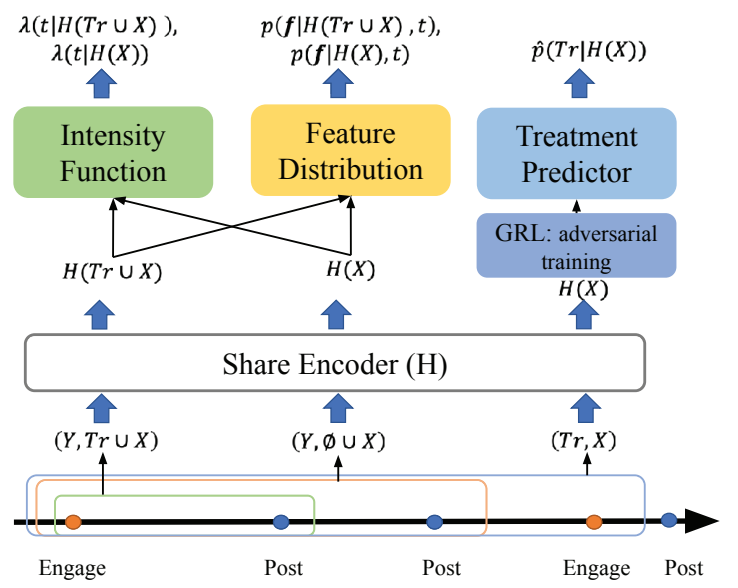
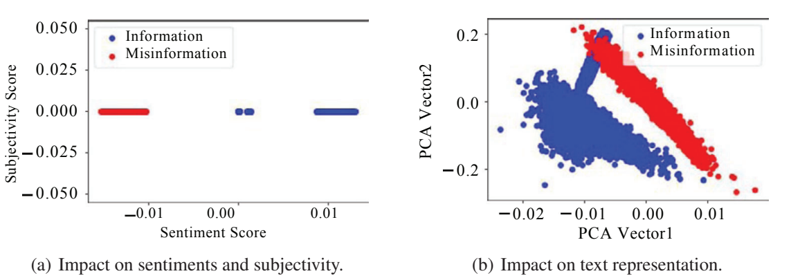

# CNTPP 怎样比较一次互动后的事件流

用户在 10:03 转发一条帖子。要比较转发与未转发的结果，得先固定 10:03 之前的发帖和互动，再看未来 24 小时的原创帖会有多少、什么时间出现、内容怎样变。像 [Causal Transformer](../SRC-CAUSAL-TRANSFORMER/阅读笔记.md) 这样按时间格预测结局，可以给出每期的数值，但需要提前决定分箱和对应标签。CNTPP 保留原始时间戳，把一次互动作为处理，把未来原创帖的时间和连续特征建模为带标记时间点过程。 [论文集版 §2–3](https://www.proceedings.com/content/068/068431-0773open.pdf#page=3)

*作者原图。Zhang、Cao 与 Liu，论文集版 PDF 第 4 页图 1。左侧是待干预互动，上方是已发生的历史，右侧是可能的未来事件路径。*

## 先定义结果要回答发多少还是发什么

把 10:03 前的历史记作 $X$，待比较的互动记作 $Tr$。论文用 $\lambda_a(t)$ 表示分支 $a$ 下在时刻 $t$ 的时间强度，$p_a(f\mid t)$ 表示此时有事件时其特征 $f$ 的条件分布，$m_a(t)=\mathbb E_a[f\mid t]$。对未来窗 $W$，比较事件量可用 $\mu_a=\int_W\lambda_a(t)\,dt$，比较事件特征总量可用 $\phi_a=\int_W\lambda_a(t)m_a(t)\,dt$。论文的 ITE 取两分支 $\phi_a/\mu_a$ 之差。比值按期望事件量加权，要求 $\mu_a>0$，与逐条未来轨迹先求平均再取期望的口径不同。一般的历史依赖点过程若以随事件更新的强度表示，还要对未来路径取条件期望，才能用于这里的窗口积分。 [原文式 (1)、(4)–(13)](https://www.proceedings.com/content/068/068431-0773open.pdf#page=4)

举个计算例子。将未来窗分成两段。假设转发分支的期望发帖量分别为 2、1，对应平均情绪为 0.2、0.8，那么 $\phi_1=1.2$、$\mu_1=3$、比值为 0.4。未转发分支假设两段量各为 1，情绪分别为 0.2、0.8，比值为 0.5。对这条历史，模型口径下的平均情绪效应是 $-0.1$，发帖量效应却是 $+1$。式 (8) 对发生过目标互动的用户求平均，业务沿用时应按已处理人群解释。 [原文 §3.2–3.3](https://www.proceedings.com/content/068/068431-0773open.pdf#page=5)

## 两类事实样本怎样学出两个分支

*作者原图。Zhang、Cao 与 Liu，论文集版 PDF 第 6 页图 2。下方时间线提供两类结果样本和另外一类处理样本。左侧绿色头建模发帖时间，黄色头建模帖文标记，右侧蓝色头用处理前历史预测互动。*

若 10:03 互动后的下一个事件是 10:20 原创帖，就用 $H(X\cup Tr)$ 为 10:20 的事实时间和特征提供表示。如果另一个样本中连续两条都是原创帖，便用首帖在内的历史 $H(X)$ 预测后帖，学习两次发帖之间无其他互动的情形。结果似然包含观测时点的 $\log\lambda$、推迟到该时点的生存项 $-\int\lambda$ 和标记对数密度。时间头学习累计强度并对时间求导，标记头输出高斯混合的权重、中心和尺度，因此时点条件均值可直接算为 $\sum_j w_j u_j$。推理把同一历史分别送入有处理与无处理分支，对两个头的输出做窗口积分。若严格采用标准高斯密度实现式 (15)，尺度变换需要 $\sigma_j^{-d}$ 的归一化因子。 [原文 §4.1、式 (14)–(17)](https://www.proceedings.com/content/068/068431-0773open.pdf#page=6)

蓝色处理头只看互动前历史，以真实互动的时间和标记为监督。它最大化互动似然，梯度反转让共享编码器从处理目标接收相反方向，发帖似然仍正常训练。对固定编码，理想处理预测器拟合真实条件分布。作者附录讨论对抗博弈平衡时该条件分布的性质，论证使用了能交换历史表示的通用编码器假设。从观察日志解释删除一次互动的因果效应，还依赖历史覆盖关键混杂变量、有可比的互动与未互动样本，以及明确的窗口与干预语义。把一次互动从序列移除所定义的比较，不能直接给出取消平台曝光的效果。 [原文 §4.2、式 (18)–(20)](https://www.proceedings.com/content/068/068431-0773open.pdf#page=7) · [作者版附录 A](https://arxiv.org/pdf/2210.07518v1)

## 用合成真值检查效应，用真实日志观察模式

作者模拟 15,000 位用户和 120 条新闻，用两个依赖隐状态的 Hawkes 过程生成互动和发帖，并在互动后更新状态。表 1 中 CNTPP 的特征效应方向准确率为 88.0%，采样版 CNTPP-VAE 为 87.8%。对应解码器时间 7.12 和 29.34 ms。表 2 的 LinCor 最高是 CNTPP 的 0.310，MatDis 最低则是采样版 VAE 的 0.76，CNTPP 为 0.77。两项指标对不同的状态恢复性质评分。 [原文 §5.1、表 1–2](https://www.proceedings.com/content/068/068431-0773open.pdf#page=8)

*作者原图。Zhang、Cao 与 Liu，论文集版 PDF 第 9 页图 3。左图对比估计的情绪与主观性效应，右图以 PCA 投影估计的文本特征效应。颜色是转发帖文的类别。*

真实 Twitter 实验的结果是模型对转发后发帖情绪和文本特征的估计。表 3 的距离和与图 3 的分组差异测量估计特征在数据中的结构，缺少同一用户未转发时的对应真值。这里的结果也没有直接观测用户信念、接种行为或营销收益。迁移到发券时，连续事件强度、窗口量与标记均值的区别见[不规则转化事件的窗口增量](../../知识库/问题/不规则转化事件怎样估计补贴的窗口增量.md)。 [原文 §5.2–6](https://www.proceedings.com/content/068/068431-0773open.pdf#page=9)

采用 NeurIPS 2022 论文集 13 页版，定向复核作者版附录 A–B。11 页中文 PDF 翻译摘要、正文 §1–8、图表题注和脚注，保留公式、作者署名、图内文字与参考文献。Checklist 与附录参看作者版。未运行模型。 [论文集原文](https://www.proceedings.com/content/068/068431-0773open.pdf) · [作者版](https://arxiv.org/pdf/2210.07518v1) · [中文 PDF 访问说明](../../译文/PDF目录.md)
