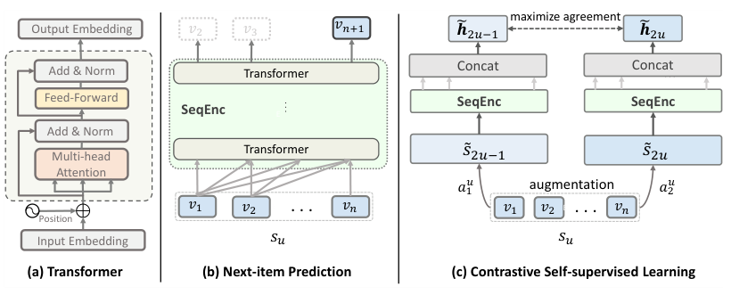
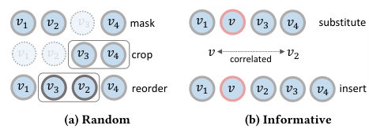
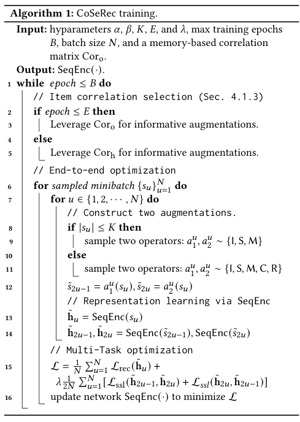
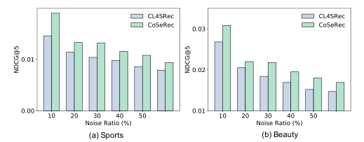

# CoSeRec：短历史怎样增添一个相关物品线索

[原文版本与中文 PDF 位置](#原文与阅读范围) · [私有备份下载说明](../../文档/工具/中文PDF发布.md#登录下载)

将 $[耳机,耳机套,零食]$ 裁出一项后，模型可能只能看到零食，失去耳机兴趣。CL4SRec 的同源配对仍会把它和含耳机的视图拉近。CoSeRec 保留同源对比目标，将部分扰动改成查协同近邻的替换、插入，并按原序列长短选择算子。这样做依赖一条可验证的假设：查到的近邻对当前预测意图仍有信息。[§3–4，第 3–5 页](https://arxiv.org/pdf/2108.06479v1#page=3)

Liu 等作者原图 1，arXiv 2108.06479v1，PDF 第 4 页。中间读取末位置预测下一物品，右边拼接各位置用于对比。

## 按历史长度选择怎样扰动

若训练集中耳机与另一款耳机最相关，替换视图可为 $[另一款耳机,耳机套,零食]$，插入则为 $[另一款耳机,耳机,耳机套,零食]$。替换保持长度，插入在原物品前增加相关项。两者分别采 $\lceil\alpha n\rceil$ 和 $\lceil\beta n\rceil$ 个位置。若 $n\le K$，两次增强从插入、替换和遮蔽中取。较长历史还允许裁剪与重排。规则保留遮蔽，因此很短的历史仍要看遮蔽比例与剩余可见事件。原文的相关近邻可能反映互补关系，例如充电线与手机，插入或替换成立的条件也会不同。[§4.1、算法 1，第 3–5 页](https://arxiv.org/pdf/2108.06479v1#page=3)

Liu 等作者原图 2，arXiv 2108.06479v1，PDF 第 4 页。左为三种随机操作，右为有相关性信息的替换和插入。

## 从共用户到混合近邻

令 $\mathcal N(i)$ 为交互过物品 $i$ 的训练用户，$\mathcal N(u)$ 为用户交互物品集合。记忆相似度为
$$
C_o(i,j)=\frac{\sum_{u\in\mathcal N(i)\cap\mathcal N(j)}1/\log(1+|\mathcal N(u)|)}
 {\sqrt{|\mathcal N(i)||\mathcal N(j)|}}.
$$
若耳机与另一款耳机各有两个用户，唯一共同用户有三件交互物品，分数约 $1/(2\log 4)=0.361$。活跃用户同时跨许多品类，其一次共现权重较低。嵌入分支另算 $C_e(i,j)=e_i^\top e_j$。前 $E$ 个 epoch 只读记忆近邻，随后取归一化后的两种分数逐对最大值。教学中若候选 B 的两分为 $0.7,0.3$，候选 C 为 $0.1,0.9$，混合选 C。这个最大值可补充统计共现稀少但模型表示靠近的关系，也会放大任一路的误配。[§4.1.3–4.1.4，第 4–5 页](https://arxiv.org/pdf/2108.06479v1#page=4)

## 两条增强视图训练共享编码器

原来三条历史仍预测下一条真实交互降噪耳机，从当前位置的因果序列状态与正负物品向量计算监督损失。另一边用同一个 Transformer 分别编码两条增强历史。作者对比头拼接各位置的状态，按固定长度加以表示，区别于 CL4SRec 读取末位置。$N$ 条历史生成 $2N$ 个视图，用点积对每个锚点分别比较正配对和同批其他视图。联合目标使两路梯度都流入物品嵌入和序列编码器。增强物品用于生成对比输入，实际监督目标仍来自原始交互。推理时对真实可见历史编码，读取末位置与候选物品打分。[§3.2，第 3 页](https://arxiv.org/pdf/2108.06479v1#page=3) · [§4.2–4.3，第 5 页](https://arxiv.org/pdf/2108.06479v1#page=5)

Liu 等作者原算法 1，arXiv 2108.06479v1，PDF 第 5 页。先按轮次切换相关性来源，再按每条序列的长度选择算子。

构造近邻应限制在训练期可见数据，且在依时间回放时固定统计截止点。否则验证、测试交互可能先通过共现图进入增强视图，再影响序列预测。嵌入近邻也只从训练状态计算。对只有单条记录、相关表中没有可靠近邻的物品，增强价值取决于实际覆盖和回退规则。[自监督视图的时间边界](../../知识库/问题/推荐自监督怎样构造有效视图.md)

## 同协议重跑基线比跨论文抄表更可比

作者在 Beauty、Sports、Yelp 中评估下一物品的 HR 与 NDCG。表中 Beauty HR@20 为 SASRec 0.0901、CL4SRec 0.0974、CoSeRec 0.1041。以同篇 CL4SRec 比较约 +6.88%，区别于 CL4SRec 原文 Beauty 表的 0.1056。论文用合成噪声和按历史长度切片观察鲁棒性，证据覆盖所定义的扰动与数据，缺少线上试验。短历史和按物品频次切片回答不同问题，前者按用户可见事件数分组。[§5.2–5.5，第 6–9 页](https://arxiv.org/pdf/2108.06479v1#page=6)

Liu 等作者原图 7，arXiv 2108.06479v1，PDF 第 8 页。相同测试注噪比例下对照两方法，查看数据稀疏及噪声条件。

表 4 把 Sports 两阶段的 HR@5 和 NDCG@5 分别列为 0.0242、0.0388。同一批单真值样本上，NDCG@5 的每次命中贡献不大于 HR@5，因而该行不能按同一聚合口径理解。原文列出的搜索网格也未包含表 3 中的全部换相轮数。保留表值，暂不据此判断两阶段与联合训练的统一优劣。[§5.1.4、表 3–4，第 6、9 页](https://arxiv.org/pdf/2108.06479v1#page=9)

[CL4SRec 精读](../SRC-CL4SREC/阅读笔记.md) · [统一问题比较](../../知识库/问题/推荐自监督怎样构造有效视图.md)

## 原文与阅读范围

采用 arXiv 2108.06479v1，研读正文 §1–6、训练算法、主表与鲁棒性分析。[固定版本](https://arxiv.org/abs/2108.06479v1)

中文 PDF（15 页）依据采用版 PDF 和作者 LaTeX单栏重排，覆盖摘要、§1–6、式 (1)–(15)、算法及图表说明。图内文字、原表部分英文及参考文献保留，部分叙述合并表述。

本地文件 `.local/papers/SRC-COSEREC/translation/SRC-COSEREC.中文.pdf`，可编辑工程主文件 `.local/papers/SRC-COSEREC/translation/translated-sources/main.tex`。[许可与范围盘点](../../译文/PDF目录.md) · [私有备份下载说明](../../文档/工具/中文PDF发布.md#登录下载)
