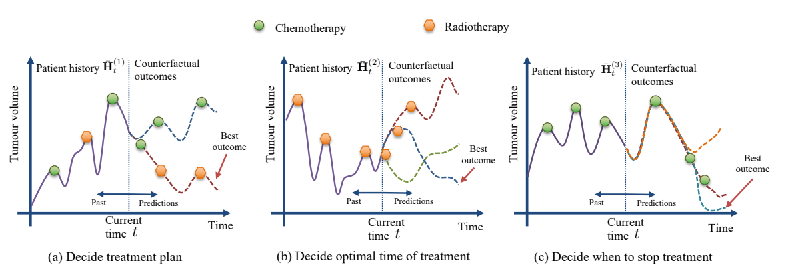
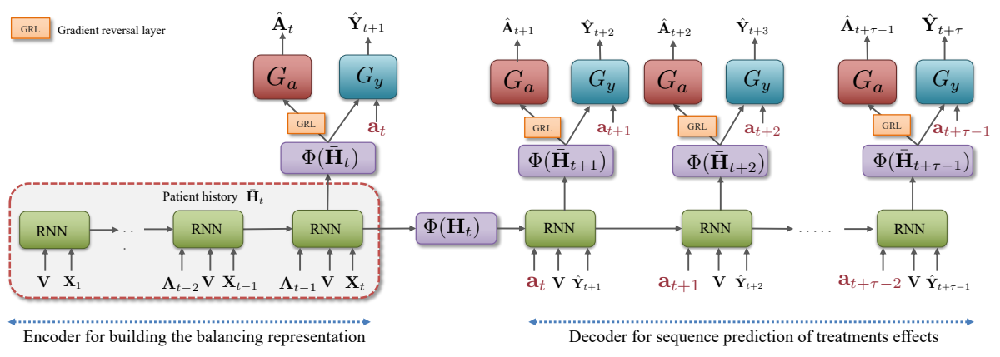
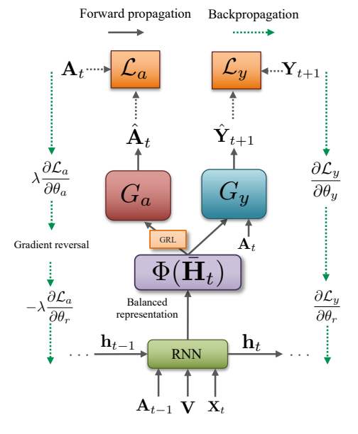
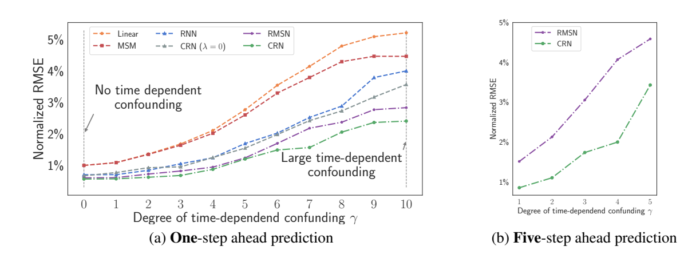
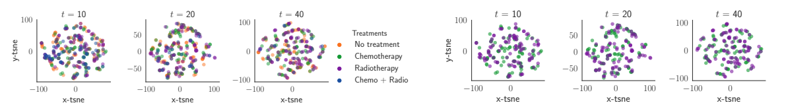

# CRN 怎样沿着一条计划预测反事实结局

同一位患者已经接受过治疗，今天要从几个未来计划中选择一个。过去的治疗改过当前状态，医生又会参考当前状态决定今天用哪种治疗，所以历史日志中的动作与结果很难直接比较。R-MSN 用实际动作的概率比给事实序列的结果损失加权。若有几期动作在相应状态下都不常见，连乘的权重会把误差集中到少量样本。CRN 保留循环编码器和解码器，把校正作用移到共享状态：在每期用结果头保留预测信息，用反向的治疗分类梯度降低状态对当期动作的判别能力。问题的识别条件、权重为什么连乘及两个方案的边界见[多期发券与时变混杂](../../知识库/问题/多期发券怎样从时变混杂日志估计增量.md)。 [ICLR 2020 正文 §1–4](https://arxiv.org/pdf/2002.04083v1#page=2)

*作者原图。Bica 等，固定版 PDF 第 2 页图 1。三个小图分别比较治疗方案、开始时机和停止时机。虚线从当前时刻开始，是计划下的预测路径。*

## 事实样本怎样把信息传给两个头

考虑一个两天发券的例子。今天的历史 $H_t$ 包含昨日前的行动、截至今天可见的活动，以及静态用户特征。日志记录今天发券 $A_t=1$，下一时点结果 $Y_{t+1}=3$。把昨天动作、静态特征和今天动作前状态送进 LSTM，用其输出经过带 ELU 的全连接层得到 $z_t=\Phi(H_t)$。治疗头只看 $z_t$，试着认出今天的事实动作。结果头看 $z_t$ 与今天的选定动作 $a_t$，图 3 明确将 $A_t$ 接到了该头。正文式 (3) 简写 $G_y(\Phi;\theta_y)$ 时省略了这一路输入，沿图 2–3 读计算才能看见动作怎样改变结局。给这一行假设治疗头输出发券概率 0.8、结果头输出 2，治疗交叉熵是 $-\log(0.8)\approx0.223$，结果平方误差为 $(3-2)^2=1$。只计算事实标签，训练数据没有这位用户在今天不发券时的真实结局。 [正文 §4–5，图 2–3、式 (2)–(5)](https://arxiv.org/pdf/2002.04083v1#page=5)

*作者原图。Bica 等，固定版 PDF 第 5 页图 2。先看左侧最后一个编码步，再顺着中间的平衡表示进入右侧。每个时点的红色分类头接梯度反转层，蓝色结果头另接该时点的拟议动作。*

治疗头本身照常降低分类交叉熵。如果两种动作在表示空间中很好分，治疗头就会学到利用这种差异。反转层在反向传播时将这一路传向共享表示的梯度乘以 $-\lambda$。因此表示参数收到 $\nabla L_y-\lambda\nabla L_a$，结果头参数只收到 $\nabla L_y$，而治疗头参数只收到普通的 $\nabla L_a$。上例在 $\lambda=0.5$ 时，表示优化对应的两个损失项之差约为 $0.888$，这个数只用来说明梯度方向，治疗头不会因为总目标有减号而故意猜错。训练时逐期重复这一步。 [正文 §5 与附录 E 算法 1](https://arxiv.org/pdf/2002.04083v1#page=18)

*作者原图。Bica 等，固定版 PDF 第 6 页图 3。实线表示前向，虚线表示梯度。比较分类头内部的梯度方向与传入 LSTM 之前的负号。*

## 同一个起点怎样比较两条路径

先训练编码器一步预测，然后用其输出构造解码器训练样本。接着上面的事实例子，若明天没发券，解码器会看到事实的下一时点结果 3 与今天发券这一步，并以明天不发券为结果头的当前动作来预测后一个结果。预测与事实再计算损失，各期治疗头也继续参与训练。到了推理，同一个 $z_t$ 可以分别试 $(1,0)$ 与 $(0,1)$。编码器结果头必须按不同的首步动作分别给出 $\hat Y_{t+1}$。各自的预测值会同各自的首步动作一起回填解码器，以得到两条不同的 $\hat Y_{t+2}$。所以越长的计划越会受前面预测误差影响。若未来行动由当时真实可见的状态决定，评价对象还要包含决策规则和其诱导的状态分布。 [正文 §4、图 2 与附录 E](https://arxiv.org/pdf/2002.04083v1#page=5)

## 平衡证明了什么

定理 1 先按治疗组各取一期历史分布，将同等权重的各组 log 概率相加。固定表示后，最优分类器给动作 $j$ 分配的概率是 $p_j(z)/\sum_kp_k(z)$，其中 $p_j$ 是该动作下表示的密度。代回目标得到一个常数加上 $K$ 倍的多分布 Jensen–Shannon 散度。散度为零时各条件表示分布相同。这个结论针对理想分类器、全局最优和按组期望的目标。日志按样本求均值时，类别比例不均匀会改变最优的无信息预测，不能用是否接近 $1/K$ 单独判断平衡。 [定理 1，附录 D 式 (10)–(18)](https://arxiv.org/pdf/2002.04083v1#page=17)

分布平衡本身还需要与对结果有用的信息一起检验。构造一个一步反例，$X$ 等概率为 0 或 1，两个潜在结果都等于 $X$。对 $X=0$ 的人以 0.2 概率发券，对 $X=1$ 的人以 0.8 概率发券。映射成常量后，两臂的表示分布完全相同。但结果头若仍用动作分组拟合事实标签，会得到发券臂 0.8、未发券臂 0.2，差 0.6，真实增量为零。这个例子说明，既需要原历史上的一致性、正值性与序贯可交换性，也需要检查学到的表示能否支持相关的反事实预测。较强的平衡压力可能丢掉预后信息，结果损失与模型验证承担了防止这种退化的作用。 [正文 §3、§5，附录 B、D](https://arxiv.org/pdf/2002.04083v1#page=14)

## 用同一批反事实检验选时机

*作者原图。Bica 等，固定版 PDF 第 8 页图 4。两图比较不同时变混杂强度下的单位归一化 RMSE。左图含关闭对抗目标的 CRN，右图比较 CRN 与 RMSN。*

作者在模拟中让最近 15 天平均肿瘤直径影响化疗和放疗分配，以 $\gamma_c,\gamma_r$ 调节影响。对每个预测起点固定历史，在 $\tau$ 步里把一次化疗或放疗分别放到各个时点，形成 $2\tau$ 个计划。模拟器生成各计划的终点肿瘤体积，用来评估是否选对治疗类型，再评价治疗时机。表 1 在 $\gamma_c=0,\gamma_r=5,\tau=5$ 的条件下，CRN、RMSN、MSM 的归一化误差分别为 2.03%、2.71%、3.63%，相应时机准确率为 66.9%、31.3%、29.5%。归一化分母为最大模拟肿瘤体积 1150 cm³。只用日志的真实 MIMIC III 实验没有同一患者的其他计划结局，表 10 只能检验事实预测误差。 [正文 §6、表 1 与附录 L–M](https://arxiv.org/pdf/2002.04083v1#page=9)

*作者原图。Bica 等，固定版 PDF 第 8 页图 5。在模拟强度 $\gamma=5$ 时比较三个时间点，左侧含四类治疗，右侧仅绘化疗和放疗。颜色在二维投影上混合是定性线索，不能取代对真实分布、预测误差或动作重叠的检查。*

采用作者上传的 ICLR 2020 固定版 arXiv:2002.04083v1（28 页）。阅读正文并复核附录 B–E、L–M，未在本仓库运行模型。29 页中文 PDF 从作者 LaTeX 副本编译，翻译摘要、§1–7、正文图表题注、说明性脚注与致谢，参考文献、附录、图内文字及署名保留原文。 [固定原文](https://arxiv.org/pdf/2002.04083v1) · [中文 PDF 访问说明](../../译文/PDF目录.md)
