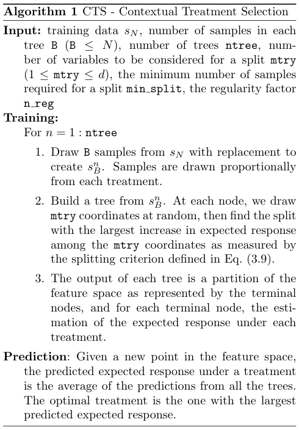
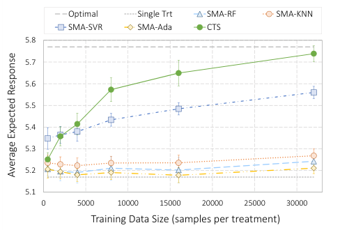
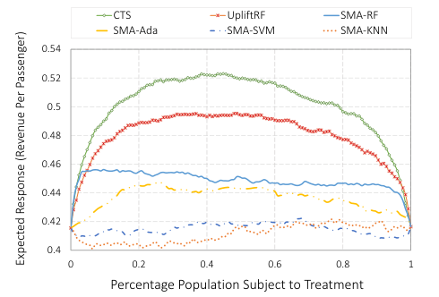
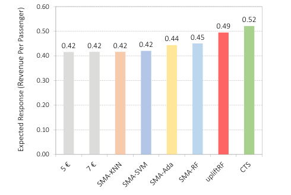
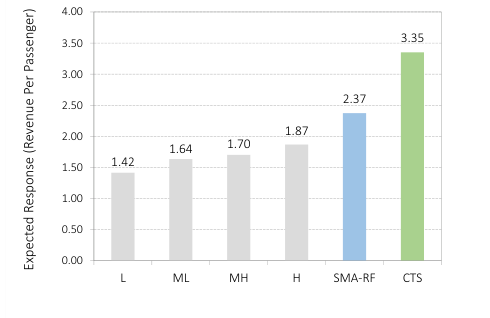
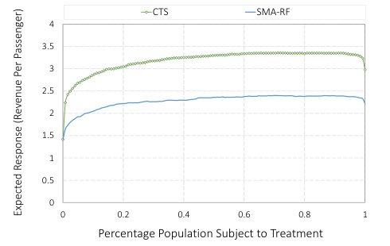

# CTS 怎样按最优选档的收益分裂树

两档价格在人群中的平均收入可能相同，但低价对一类旅客更有吸引力，高价对另一类旅客反而收入更高。分臂训练会先拟合每档响应，最终用预测最大的档。若共同的基础购买率比价格差异更易拟合，预测的误差可能已经很小，选档却仍然经常出错。情境处理选择（CTS）把可选档位放入同一棵树，用分裂前后可实现的收入差筛选切点，再用独立随机日志估计整条策略的收入。 [原文 §1–2](https://arxiv.org/pdf/1705.08492v1#page=2)

## 什么时候值得把人群切开

设有默认档、低档、高档三个动作，用户只记录指派前的画像 $x$、所获动作 $t$ 和实际响应 $y$。左右两群各占一半，预计收入分别为 $(4,6,3)$ 与 $(7,5,8)$。不切时，统一用默认、低档或高档，三项平均均为 $5.5$。切开后给左群低档、右群高档，收入为 $(6+8)/2=7$，分裂增益 $1.5$。如果第二群只是在所有档都比第一群高 10，但最佳档相同，整体响应变化很大，切开也无法提高最优策略值。

令 $\phi$ 为父节点覆盖的人群，$\phi_l,\phi_r$ 为两子节点。$\hat y_t(\phi')$ 是节点 $\phi'$ 内处理 $t$ 的响应估计，$\hat p(\phi'\mid\phi)$ 用子节点样本占比估计。候选切分的分数是

$$
\widehat{\Delta\mu}
=\hat p(\phi_l\mid\phi)\max_t\hat y_t(\phi_l)
+\hat p(\phi_r\mid\phi)\max_t\hat y_t(\phi_r)
-\max_t\hat y_t(\phi).
$$

每个节点单独在各档间取最大，再按子节点人群占比汇总。常规回归树比较切分后事实标签拟合，因果树可以比较两群处理效应的差异，CTS 则问多一个切点能增加多少最优选档的响应。例如两群都有正增量且最优档相同，幅度差异可能对效应校准有用，按真实均值计算的选档增益却为零。 [原文 §3.1、式 (3.5)–(3.9)](https://arxiv.org/pdf/1705.08492v1#page=4)

算法 1 为 Zhao、Fang、Simchi-Levi 作者原图，裁自采用版第 5 页。根节点用每档的事实均值初始化。孩子节点中某档样本数达不到 `min_split`，该档值就沿用父节点，足够时则把父节点值当作 `n_reg` 条伪观测加入。若上例左群低档有 12 条、样本均值 6，父节点低档值 5.5，`n_reg=3`，则估计为 $(12\times6+3\times5.5)/15=5.9$。右群高档若低于门槛，则只能暂用父节点高档值。同一训练样本一方面参与估各臂响应，另一方面通过这些估计影响切点选择。森林对每棵树按处理比例有放回抽样，每个节点只考察随机部分特征。预测先按树路由到叶，分别对各档均值做跨树平均，再取最大档。 [原文 §3.2–3.3 和算法 1](https://arxiv.org/pdf/1705.08492v1#page=5)

## 随机日志怎样重放一条定价规则

固定策略 $h(x)$，记录的指派概率为 $p_t>0$。只在动作和策略匹配时取事实响应除以该动作概率，未匹配的记录记零，最后始终除以全部 $N$ 条。左群若被候选策略选低档，历史实验的低档流量为 $0.2$，一条低档收入 6 的匹配记录贡献 30，其他动作贡献 0。同类用户中有约五分之一匹配，期望贡献仍是低档下的均值。这一步在每个 $x$ 上恢复期望，之后再平均目标人群。 [原文 §2.2、引理 2.1 与定理 2.1](https://arxiv.org/pdf/1705.08492v1#page=3)

$$
\widehat V(h)=\frac{1}{N}\sum_{i=1}^N \frac{\mathbf 1\{T_i=h(X_i)\}Y_i}{p_{T_i}}.
$$

原文用 $\mathbb E[Y\mid T=h(X)]$ 表示部署价值。当实验概率不等，日志中的匹配者会过度代表策略偏好的高概率档，直接取匹配子集的平均会改变人群比重。论文的加权计算对应 $\mathbb E[Y(h(X))]$。若实验按画像分层随机，应代入实际分层概率 $p_t(X)$，并在独立评估数据上检验已固定的策略。历史策略所给动作缺支持的分群，父节点平滑可以出预测，无法提供当地该臂的随机证据。 [多档策略价值与随机评估](../../知识库/问题/怎样验证补贴增量的排序幅度和策略价值.md)

## 覆盖多少人与每人选哪个档是两件事

图 1 为作者原图，裁自采用版第 6 页。连续响应由 50 维共享基础项、只依赖动作对应坐标的效应项与高斯噪声相加。固定任何单臂的期望为 5.18，最优策略为 5.79。各训练规模共用十份随机生成数据，误差棒为相应 95% 误差范围。每档 2,000 条后，CTS 曲线在本生成条件下领先分臂对照。 [原文 §4.1、图 1](https://arxiv.org/pdf/1705.08492v1#page=6)

图 2–3 为作者原图，裁自采用版第 7 页。曲线按预测处理相对默认档的增量排序，改变覆盖门槛，每个门槛都重估整个人群的收入。优先登机试验以 5 欧元和 7 欧元为两档，每档训练 225,000 条、测试 75,000 条。图 3 报告固定价格均为 0.42 欧元，CTS 为 0.52 欧元，upliftRF 为 0.49 欧元。图 2 的满覆盖端回落到约 0.42，图 3 对全体应用预测最优处理却报 0.52。两者可能对应强制使用非对照档与允许模型留在默认档两种政策，原文没有明确给出可核对的端点定义；各数字按原图口径引用。 [原文 §4.2、图 2–3](https://arxiv.org/pdf/1705.08492v1#page=7)

图 4–5 为作者原图，裁自采用版第 8 页。四档共 765,216 条，按 50%/30%/20% 训练、验证和测试。不同航线和交易可对应不同金额，按连续响应建模。图 4 的最佳固定档 H 为 1.87 美元，SMA-RF 为 2.37 美元，CTS 为 3.35 美元。纵轴是预期人均收入。迁移到营销补贴时，若要从收入换成净增价值，需定义各档的核销成本、利润口径和预算约束。CTS 的逐人最大值适用于论文的无总预算耦合目标。第 7 批 LBCF 则先估各档效应，再用共同影子价格调整各档选择，并额外检查可行性。论文数值为作者报告，此处未重跑模型。 [原文 §4.3、图 4–5](https://arxiv.org/pdf/1705.08492v1#page=8) · [LBCF 与预算分配](../SRC-LBCF/阅读笔记.md)

## 原文和中文译本

采用 Yan Zhao、Xiao Fang、David Simchi-Levi 的 arXiv 1705.08492v1，对应 SDM 2017。阅读摘要、§1–5、五图、算法 1 和调参附录。中文译本翻译摘要、正文、图注、算法说明及描述性脚注，图内文字、参考文献与调参附录保留原文。正式文件为 `.local/papers/SRC-CTS/translation/多处理与通用响应类型的增量建模_中文.pdf`，译后主文件是 `translated-sources/paper.tex`。 [采用版](https://arxiv.org/pdf/1705.08492v1) · [来源与原件哈希](来源.json) · [私有备份下载说明](../../文档/工具/中文PDF发布.md)

来源卡中的源码包是下载后未修改文件的本地重新打包。
