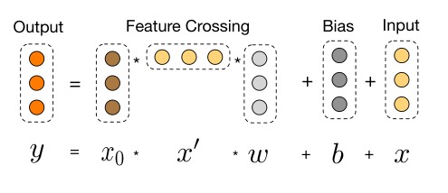
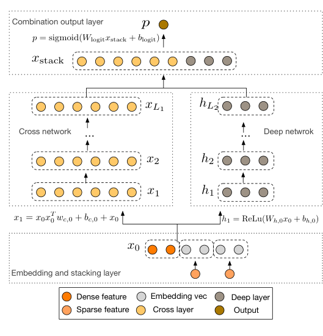
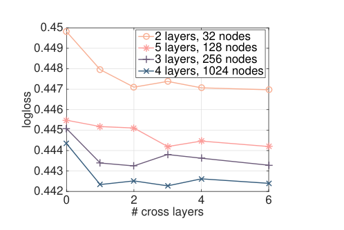

# DCN v1 怎样用一次点积扩展整条交叉向量

广告曝光中的类目、用户行为与时段会共同改变点击概率。显式独立记忆每种字段组合需要为组合分配参数，纯 MLP 则通过非线性间接拟合乘法。DCN 在 Embedding 后增加一条每层都乘回原输入的路径，用线性大小的权重生成含不同次数的交叉，再用并行深网补充其他非线性。这里采用 Ruoxi Wang、Bin Fu、Gang Fu、Mingliang Wang 的 arXiv 1708.05123v1。

## 从字段拼接到下一层

假设广告类目嵌入和时段数值合成教学向量 $x_0=(2,3)^\top$。第 $l$ 层用 $w_l^\top x_l$ 把当前状态收成标量，把标量乘回每个原始坐标，最后加偏置和旧向量：

$$x_{l+1}=x_0(w_l^\top x_l)+b_l+x_l.$$

若首层 $w_0=(1,0)^\top$、$b_0=0$，读出 2，得到 $x_1=(6,9)^\top$。若第二层取 $w_1=(0,1)^\top$，读出 9，得到 $(24,36)^\top$。对符号输入，每个这样的乘法可把已有的单项式次数提高一阶，残差使已有低阶项仍可进入结果。结合律允许先做点积，因而无需构造 $x_0x_l^\top$。不计嵌入和深塔，一层维护 $2d$ 个参数，前向为 $O(d)$。[§2.1–2.2，式 (2)–(3)，PDF 第 2–3 页](https://arxiv.org/pdf/1708.05123v1#page=2)。

*Ruoxi Wang 等，本文图 2，采用版 PDF 第 3 页。由采用版裁取图区。*

## 共同的乘数怎样约束交叉

零偏置时，$x_L=x_0\prod_{l=0}^{L-1}(1+w_l^\top x_0)$。线性读出后再乘最后一个线性形式。展开可以出现最高 $L+1$ 阶的单项式，系数由同一组向量共同产生。例如无偏置一层后以 $(1,1)$ 读出，二次项为 $(x_a+x_b)(w_ax_a+w_bx_b)$。平方项和混合项系数满足 $c_{ab}=c_{aa}+c_{bb}$，不能独立指定。作者的系数“不同”应结合定理中的乘积展开理解。[§3.1、附录 A，PDF 第 3–4、7 页](https://arxiv.org/pdf/1708.05123v1#page=3)。

[DCNv2](../SRC-DCNV2/阅读笔记.md) 为每个坐标分配一行矩阵，使不同坐标有不同乘数。将矩阵各行设为同一个向量能对上 v1 的乘法项。v1 的独立偏置直接加到残差，v2 的偏置仍乘 $x_0$，因此该对应要在零偏置或单独处理偏置时使用。[DCNv2 式 (1)](https://arxiv.org/pdf/2008.13535v2#page=3)。

## 两条路径在一次曝光的点击损失汇合

*Ruoxi Wang 等，本文图 1，采用版 PDF 第 2 页。由采用版裁取图区。*

同一个 $x_0$ 也输入 ReLU 深塔。把交叉向量与深塔末层向量拼接，先线性读出再做 Sigmoid，得到曝光点击概率。点击标签用 logloss 通过读出层同时更新两条路径和共享 Embedding，线上按同一前向打分。逐广告的用户与广告字段共同进入 $x_0$，故每条广告会改变交叉结果。完整比较见[稀疏特征交互](../../知识库/问题/稀疏特征的低高阶交互学习.md)。[§2.3–2.4，式 (4)–(6)](https://arxiv.org/pdf/1708.05123v1#page=3)。

## Criteo 把表达差异与容量放在同一个试验里

Criteo Display Ads 的表 1 报告最优测试 logloss 为 DCN 0.4419、DNN 0.4428、Deep Crossing 0.4425。作者另在各模型最优超参下重复 10 次，DCN 均值 0.4422，DNN 均值 0.4430。表 3 对比近似参数预算，5 万参数时分别为 0.4465 与 0.4480。图 3 比较不同深网设置下再加交叉层的验证损失，收益随设置变化。这里的模型规模与 logloss 是本篇模型和数据设置的结果，不能代作实际线上时延、收入或其他论文数据上的排序。[§4，表 1–4、图 3，PDF 第 5–6 页](https://arxiv.org/pdf/1708.05123v1#page=5)。

*Ruoxi Wang 等，本文图 3，采用版 PDF 第 6 页。由采用版裁取图区。*

## 原文与阅读材料

采用[固定 v1 PDF](https://arxiv.org/pdf/1708.05123v1)，7 页正文、图表、附录证明与上游 LaTeX 已核对，参考文献用于定位。中文 PDF 共 6 页，翻译摘要、正文、图表说明和描述性脚注。参考文献、图内文字与附录保留原文。作者 LaTeX 双栏工程可继续编辑。原文与译文均已认证下载核验，见[私有备份下载说明](../../文档/工具/中文PDF发布.md)。
