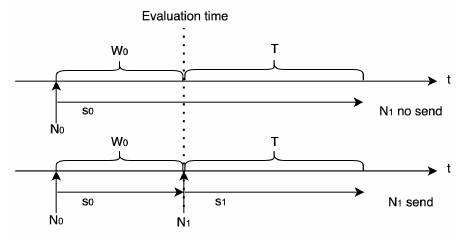
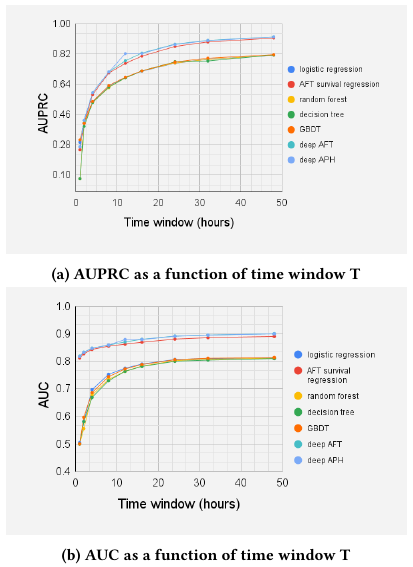

# DeepPvisit：从当前时刻比较发送与等待的访问概率

通知候选到达时，即使系统选择等待，用户也可能自己打开应用。若模型只预测“发出后 4 小时内开不开”，它会把本来自然回访的用户也打高分。DeepPvisit 沿用 LinkedIn 的通知状态转换模型，把现在发送和继续等待写成两条访问时间曲线，再用同一个未来窗口比较两条概率。它还把“观察在下次通知时结束”作为右删失，保留我们确实观察到的未访问时间。[ACM 出版版，WWW 2023 Companion，973–977 页](https://dl.acm.org/doi/epdf/10.1145/3543873.3587666)。

## 等过的时间怎样进入下一次访问概率

设上午 9 点用户收到通知 $N_0$。到了中午 12 点还没访问，系统要决定发不发 $N_1$。取观察窗口 $T=4$ 小时，旧状态 $s_0$ 已经过了 $W_0=3$ 小时。如果发 $N_1$，状态转为 $s_1$，新时钟从中午起算，未来四小时的访问概率为 $F_1(4)$。如果继续等待，旧时钟没有清零，而且我们知道旧状态下访问时间 $U_0$ 已经超过 3 小时。用 $F_j$ 和 $S_j=1-F_j$ 分别表示状态 $j$ 下的分布函数和生存函数，有

$$
p_{\mathrm{wait}}(T)=\Pr(U_0\le W_0+T\mid U_0>W_0)
=1-\frac{S_0(W_0+T)}{S_0(W_0)},\qquad
\Delta F=F_1(T)-p_{\mathrm{wait}}(T).
$$

这里省写了两条曲线共同依赖的特征 $z$。以虚构数值为例，如果 $S_0(3)=0.80$、$S_0(7)=0.64$，等待的未来访问概率是 0.20。如果发送对应的 $F_1(4)=0.28$，则模型给出的差是 0.08。直接用 $F_0(4)$ 会把旧状态的头四小时与中午以后的四小时错位。论文的时间从通知状态进入时起算，$W_0$ 在应用例子中对应距上次 badge 更新的时间。[出版页 974，§3.1 式 (1)–(3)，另见 975 页 §3.4](https://dl.acm.org/doi/epdf/10.1145/3543873.3587666)。

Guangyu Yang 等，正式版图 1，出版页 974（PDF 第 2 页）。由原 PDF 裁出。图上方的等待路径保留 $N_0$ 开始的旧时钟，下方在虚线处发送 $N_1$ 并开始 $s_1$。两条括号都从同一个评估时刻向后取 $T$。

## 下一条通知抢先到达时，标签还剩下什么

沿用这位用户。如果中午发送 $N_1$ 后到 14 点系统又发送 $N_2$，用户此前没有打开应用，只能确认在 $s_1$ 下观察到了两小时未访问。将这行硬标为“此后四小时不访问”会把缺失观察当成已知结果。如果他在 13 点打开应用，且期间未再收到通知，则观测到一小时的访问时间。在连续时间似然中，已观察到访问的记录贡献密度 $f(u)$，右删失的记录贡献 $S(u)$；$u$ 是事件或删失时长。这允许共享一条曲线来读不同的决策窗。标准似然的解释依赖给定特征后能恰当地处理删失机制。如果后续推送取决于未观测的访问信号，右删失建模仍留下估计偏差的问题。[出版页 975，§3.1 式 (4)](https://dl.acm.org/doi/epdf/10.1145/3543873.3587666)。

传统 Weibull AFT/PH 以共用形状和较受限的协变量形式拟合访问时间。采用论文的形状 $k>0$ 和率参数 $\lambda>0$，生存函数为 $S(u)=\exp(-\lambda u^k)$，瞬时访问率为 $h(u)=\lambda k u^{k-1}$。$k$ 大于、等于、小于 1 时，瞬时率分别随时间上升、保持不变、下降。DeepPvisit 用神经网络根据用户与状态特征拟合参数的对数，带来用户级形状和非线性关系。画像、badge 和访问历史经过 MLP 后产生参数，在发送与等待对应的状态上各读曲线，再套入上面的概率差。经典回归可处理相关协变量，论文的直接变化是放宽线性参数函数和固定形状。公式 (6) 的正文将 $P(U>u)$ 叫作累计函数，式子本身写的是生存函数。[出版页 975–976，§3.2–3.3、§4.2](https://dl.acm.org/doi/epdf/10.1145/3543873.3587666)。

## 预测曲线怎样参与实际决策

这项工作把近窗访问概率差作为预计 session 收益，连同 in-app 点击、push 点击概率以及访问、发送量、WAU 等反馈，可进入多目标策略的状态或奖励。概率差来自线上旧决策日志拟合的两种状态曲线。把差解释为同类用户实际发送相对不发的因果增量，还需发送动作覆盖、状态足以控制选择偏差等识别条件。与 [TIM](../SRC-TIM/阅读笔记.md) 给定日配额后分时相比，DeepPvisit 的读出随当前候选和距上次更新时长改变。它提供决策效用，外层策略负责频控、跨候选比较与发送动作。[出版页 975，§3.4](https://dl.acm.org/doi/epdf/10.1145/3543873.3587666)。

Guangyu Yang 等，正式版图 2，出版页 976（PDF 第 4 页）。由原 PDF 裁出。上图是 AUPRC，下图是 AUC。短窗口内正例稀少时，先检查正例识别对应的 AUPRC，再看 AUC 的增幅。作者报告，当 $T\ge 12$ 小时时生存模型相比二分类基线 AUPRC 改善超过 10%，深度版本相对 AFT 生存回归约有 1%–2% AUPRC 提升。与基线比较的标签构造和窗口有差异，不能直接视为对发送效应的离线评估。[出版页 976，§4.2](https://dl.acm.org/doi/epdf/10.1145/3543873.3587666)。

线上一周 A/B 在原决策模型中替换 AFT 效用分数，其他效用模型与决策模型保持一致。作者报告通知卡片数 −1.94%、badge 变化 −2.53%、通知日去重 CTR +1.86%、Macrosessions −0.13%（$p=0.47$）、WAU −0.1%（$p=0.33$）。后两项不显著，现有证据不足以判定等效。前三项未附显著性细节。这个实验比较的是效用分数替换后的整套决策表现，对 [月初优惠选日](../../知识库/总览/优惠信息Push触达场景.md)，能借鉴的是访问时间分布和决策窗的配合，金融结果与日期策略增量仍需针对业务重新估计。[出版页 977，§4.3](https://dl.acm.org/doi/epdf/10.1145/3543873.3587666)。

[发送或等待的问题比较](../../知识库/问题/通知候选到达后怎样决定发送或等待.md)对照所需状态、监督与线上验证条件。

## 阅读范围

采用从 ACM 下载的五页正式版，通读摘要、§1–5、两张图、八个编号公式和线上指标表，核对参考文献表。未执行作者代码或复现实验。未取得作者 LaTeX，依据正式 PDF 重排为 8 页中文译本，保留八式、两图、完整线上表及 20 条参考文献。译本逐页渲染目视，中文可正常提取。本地 PDF 为 `.local/papers/SRC-DEEPPVISIT/translation/DeepPvisit-WWW2023-zh.pdf`，可编辑主文件为 `.local/papers/SRC-DEEPPVISIT/translation/translated-sources/main.tex`。

中文 PDF 与采用版原文的[私有备份下载说明](../../文档/工具/中文PDF发布.md#登录下载)。
