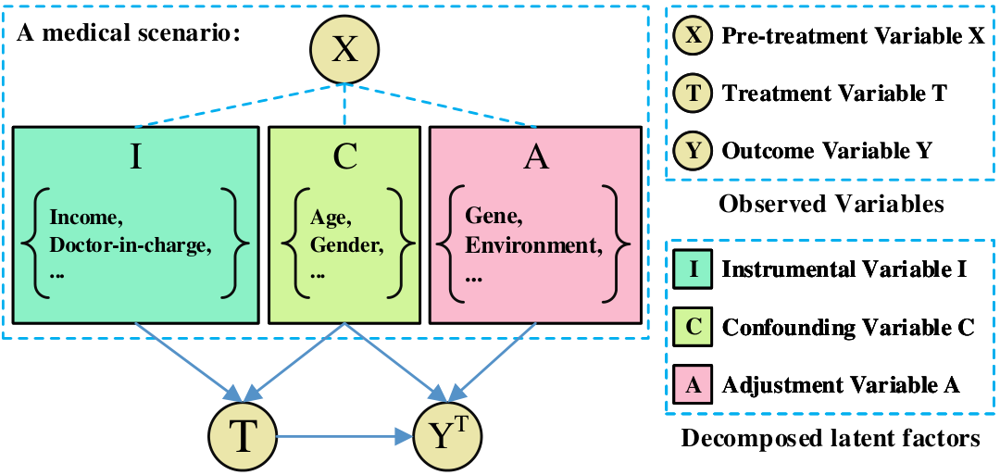
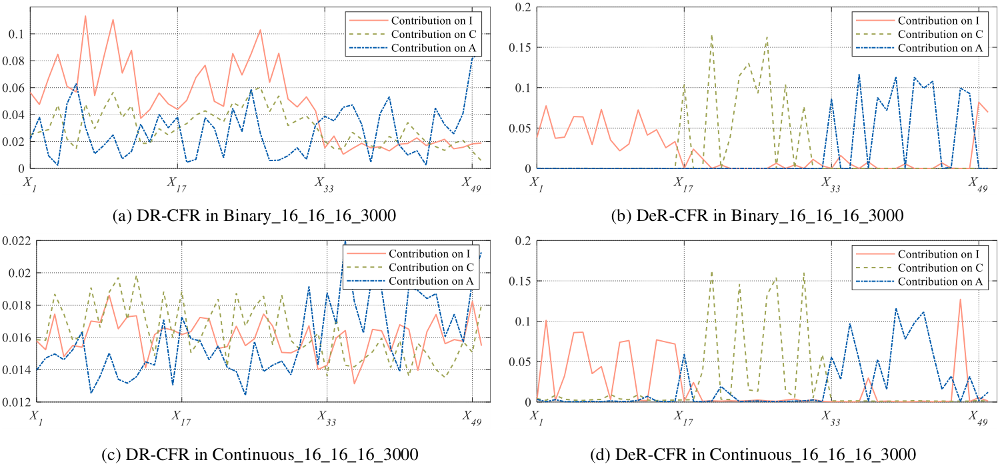
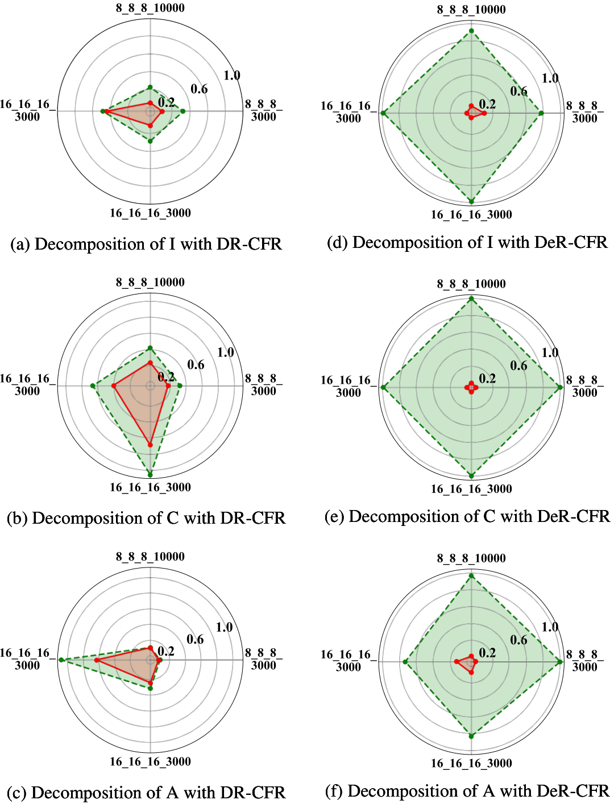
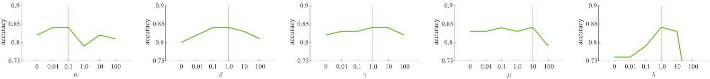

# DeR-CFR：历史干预日志里该平衡哪些变量

同样是开过 App 的用户，历史上收到券的人更常下单，可能是因为旧策略本来就偏向高意向用户。DeR-CFR 把发券前的特征送进三路表征，分别提取只影响分配的因素 $I$、同时影响分配和结果的混杂因素 $C$、只影响结果的调整因素 $A$。训练时学习样本权重对齐两组的 $C$，预测时用 $C,A$ 估计发券和不发券各自的转化概率。这个设计沿用反事实回归的双结果头，改变的是两组应当在哪些特征上可比，以及这些特征怎样从日志学出来。

本文采用 Anpeng Wu、Kun Kuang、Junkun Yuan、Bo Li、Runze Wu、Qiang Zhu、Yueting Zhuang、Fei Wu 的 *Learning Decomposed Representation for Counterfactual Inference*，arXiv 初版发布于 2020-06-12，采用 2021-10-12 修订的 **2006.07040v2**。对应 IEEE TKDE 条目的题名为 *Learning Decomposed Representations for Treatment Effect Estimation*。以下章节、图表及页码均据作者预印本。另一篇 DR-CFR 是 Hassanpour 与 Greiner 的前序工作，POUL 表中写作 DRCFR 的基线引用 Cheng 等的 MIM-DRCFR（SIGIR 2022），使用互信息最小化目标。 [采用版原文](https://arxiv.org/pdf/2006.07040v2) · [IEEE DOI](https://doi.org/10.1109/TKDE.2022.3150807) · [MIM-DRCFR](https://arxiv.org/abs/2206.01022v1)

## 两组的历史转化差从哪里来

固定一个决策单元，例如某个符合资格的用户本周首次到达领券入口前的请求。$T=1$ 表示系统指派固定面额券，$T=0$ 表示不指派。$Y$ 表示指派后 7 天内是否下单，$X$ 冻结在指派前。每条训练记录只含 $(x_i,t_i,y_i^{t_i})$。论文定义的个体处理效应为 $Y_i(1)-Y_i(0)$。在单个用户只有一个事实结果时，模型的两个概率头给出的是条件均值，差值可作为条件平均处理效应（CATE）的估计，前提是所保留的特征足以支持识别。若表征丢失效应异质性，差值只描述表征所区分的人群。 [原文 §3.1，PDF 第 3 页](https://arxiv.org/pdf/2006.07040v2#page=3)

假设有 100 个发券样本、100 个不发券样本，发券组有 80 个高意向用户，对照组只有 20 个。假定在这个教学例子中，高意向用户的转化概率从 40% 升到 45%，低意向从 10% 升到 15%。发券组事实均值为 $0.8\times0.45+0.2\times0.15=39\%$，对照组是 $0.2\times0.40+0.8\times0.10=16\%$，相差 23 个百分点。在两组都按高低意向各占一半计算时，差值变为 $30\%-25\%=5$ 个百分点。差额来自分配规则改变了组内人群构成。

经典结果回归按 $T$ 把样本路由到 $h^1$ 或 $h^0$，上线时对同一 $x$ 跑两个头再相减。若一类高意向用户几乎只出现在发券组，不发券头在那一段人群主要靠外推。经典 CFR 用一个共享编码器 $\Phi(X)$，在两个结果头的事实损失之外，加上处理组与对照组编码分布的差异，缩小跨组预测时的表征偏移。若共享层把「路由批次」和「购买意向」混在一起，压低全表征差异也会压低有用的结果预测信息。另一条路线先用 $X$ 估计分配概率 $e(X)=P(T=1\mid X)$，再用逆概率权重或匹配调整。若路由变量强烈决定分配，纳入倾向模型可能把概率推向 0 或 1，增大权重波动。有未测混杂时，某些结构下还会放大残余偏差。 [CFR 原论文](https://proceedings.mlr.press/v70/shalit17a.html) · [DeR-CFR §1–2](https://arxiv.org/pdf/2006.07040v2#page=2)

## 同一份发券前特征为什么进入三个网络

图 1 为作者原图，见采用版第 1 页。左图将处理前特征 $X$ 展开为三类。沿箭头读，$I$ 指向 $T$，$C$ 同时指向处理和结果，$A$ 指向结果，处理也指向结果。右侧图例区分观测变量与分解出的因素。PNG 由作者源码矢量图转换，保留原标签。 [固定原文图 1](https://arxiv.org/pdf/2006.07040v2#page=1)

沿用发券例子，旧策略依据近期活跃度定向发券，而活跃度也影响自然下单，因此它是 $C$ 的候选。若一个技术路由桶只改变券的指派，不改变页面体验，也不关联用户特征，那么它是 $I$ 的候选。若历史商品偏好影响自然购买，但未影响旧发券策略，并且与旧策略实际使用的变量无关联，它可以帮助理解 $A$。这三项是结合业务机制提出的假设。若路由桶同时改变页面延迟，或商品偏好与活跃度相关，角色就得重新判断。模型的输入仍是整条 $x_i$，三路并行编码，各自的角色来自训练目标。

**先让 $A$ 保留结果信号。** 式 (3) 用未重加权的发券组和对照组计算 $A(X)$ 的分布差异，本文选择 MMD。MMD 比较两个分布在给定核所定义的特征空间中的均值，线性核的直观特例就是比较原空间均值。只压低 MMD 时，输出常量也能得低值，因此还用辅助头 $g_A(A(x_i))$ 拟合事实 $y_i$。近期活跃度若能区分两组，会受到前一项抑制。商品偏好若在两组都分布相近且预测转化，会被后一项保留。两项目标合起来提供训练信号，有限数据、核选择与模型容量决定能分到什么程度。 [原文 §4.1，式 (3)，PDF 第 4 页](https://arxiv.org/pdf/2006.07040v2#page=4)

**再用权重改变 $C$ 的组间构成。** 式 (4) 比较发券、对照两个处理臂的加权 $C(X)$ 分布。固定编码器时，给发券组高意向的 80 人每人权重 $0.5/80$，低意向的 20 人每人 $0.5/20$。对照组反过来。两臂权重各和为 1，且各臂的高低意向累计权重都是 0.5。这个配权手算说明目标怎样改变分布，论文实际让 Adam 更新每条训练记录的 $\omega_i$，同时考虑加权事实误差、分布差异和正则。附录 A.2 给出两臂各自权重和偏离 1 的平方罚项。它是软约束。式 (4) 写作 $\{\omega_i C(x_i)\}$，正文称其为加权分布，未给出加权核实现及非负参数化，不能从该记号确认为逐向量缩放或核均值加权中的任一实现。 [§4.2，式 (4)](https://arxiv.org/pdf/2006.07040v2#page=4) · [附录 A，第 10 页](https://arxiv.org/pdf/2006.07040v2#page=10)

**最后在同一处理臂内检查 $I$。** 工具因素可以经 $I\to T\to Y$ 间接影响结果，因此跨发券与不发券两组直接抹掉 $I$ 和 $Y$ 的关联会抹掉有用的分配信号。给定 $T$ 又会打开碰撞路径 $I\to T\leftarrow C\to Y$。原文的做法是复用学到的权重，在 $T=0$ 内比较未转化和转化的 $I(X)$ 加权分布，并在 $T=1$ 内重复，再用 $g_I(I(x_i))$ 预测原始分配 $t_i$。在例子中，理想的技术路由桶仍应能预测是否发券，同时在同一券臂、且残余混杂已控制时，不再提供额外的转化信息。式 (5) 用两项组内距离加一个分配预测损失实现这个训练目标。若某个处理臂几乎没有转化，所需的组内分布比较就缺少数据。 [§3.2、§4.2，式 (5)](https://arxiv.org/pdf/2006.07040v2#page=4)

单有两臂边缘上的 $C$ 平衡，还不足以保证 $I\perp Y\mid T$。一个可复算反例是令 $I,C$ 独立且均为等概率二元变量，$Y=C$，令 $P(T=1\mid I,C)$ 在 $(0,0),(0,1),(1,0),(1,1)$ 上分别为 0.1、0.3、0.7、0.5。两类 $C$ 的处理率均为 0.4，且各格都有重叠，但在 $T=1$ 组内，$P(Y=1\mid I=0,T=1)=0.75$，$P(Y=1\mid I=1,T=1)=5/12$。$C$ 的边缘分布已平衡，组内 $I,C$ 仍相关。这个推导界定了原文命题 3 的使用边界，低经验 MMD 也无法验证无混杂。 [原文 §3.2 命题 1–3](https://arxiv.org/pdf/2006.07040v2#page=3)

## 一条样本怎样训练，上线怎样出分

如果三个编码器反复使用同一个输入字段，只看辅助预测难以区分是否真正分工。式 (6) 对每路将权重矩阵沿层相乘，得到 $m\times d$ 矩阵（$m$ 是输入维数，$d$ 是表征维数），对每个输入行沿输出维取均值得到 $\bar W_I,\bar W_C,\bar W_A\in\mathbb R^m$，罚三对贡献向量的内积之和，另约束各向量元素之和接近 1。直觉上，如果贡献非负且每对内积都为零，某字段就不能同时在两路有正贡献。原式没有给出这样的非负条件，忽略激活的权重积也只是代理。例子 $(1,1,-1)$ 与 $(1/2,0,1/2)$ 各自元素和为 1、内积为 0，仍共享第 1 和第 3 个坐标。所以这是减少输入复用的软训练信号。该参数正交与 POUL 用于效应估计的 Neyman 正交属于不同构造。 [§4.3，式 (6)](https://arxiv.org/pdf/2006.07040v2#page=5) · [POUL 的正交得分](../../知识库/问题/正交得分怎样约束逐点效应误差.md)

例子里的某位高意向用户收到了券且七天内下单。其 $(t_i,y_i)=(1,1)$ 给 $g_I$ 和 $g_A$ 各提供一个二元标签，样本在 $T=1,Y=1$ 的子组参与 $I$ 的加权比较；其 $C$ 进入发券臂的加权平衡，本条事实误差只更新券组结果头 $h^1(C(x_i),A(x_i))$ 及其共享路径。式 (7) 是 $\mathcal L_R=\sum_i\omega_i\,\ell(y_i,h^{t_i}(C(x_i),A(x_i)))$。没有这位用户在不发券时的标签，另一结果头 $h^0$ 由对照样本训练。

式 (10)–(11) 与附录算法 1 把联合目标分成两次更新。固定 $\omega$ 时更新三路编码器、辅助头和结果头，使用 $\mathcal L_R+\alpha\mathcal L_A+\beta\mathcal L_I+\mu\mathcal L_O+\lambda Reg$。固定网络时更新逐样本 $\omega$，使用 $\mathcal L_R+\gamma\mathcal L_{C_B}+\lambda Reg$。因此 $C$ 的距离项在权重这一步优化，$\mathcal L_I$ 中的权重在更新网络时当作已给定；不能把总目标中的每一项都对两组参数求梯度。附录 C、E 报告 ELU、全批、Adam 学习率 $10^{-3}$、最多 3000 次更新、早停和随机超参搜索。逐样本权重随样本数增加，多次分组距离估计也有训练成本。 [式 (7)–(11)，第 5 页](https://arxiv.org/pdf/2006.07040v2#page=5) · [算法 1 与超参，第 11 页](https://arxiv.org/pdf/2006.07040v2#page=11)

对新用户只运行 $C,A$ 和 $h^0,h^1$。继续使用教学数值，若两个头对某位高意向用户输出 0.40 和 0.45，分数为 $+0.05$，即预计每投放给 100 个相似用户多 5 人下单。$I$、辅助头和训练样本权重不参与这一步打分。该差值可用于比较潜在增量，单次营销决策还需给新增订单定价并考虑核销总成本。 [原文算法 1](https://arxiv.org/pdf/2006.07040v2#page=11) · [补贴预算接口](../../知识库/总览/营销补贴总图.md#从增量预估走向预算决策)

## 连续券额怎样用同一个回归头

§5.1 在学习表征时按处理、结果各自的中位数分组。预测阶段保留原始处理值，用 $\hat y=h(C(x),A(x),t)$ 建模响应。可以代入两个实际有覆盖的券额求差，但低于和高于中位数的两大组对齐，不能证明每个面额都有可比较的用户。§5.2 讨论用 CLUB 互信息代替部分分布距离，可用于连续结果；原文明确说该版本不能直接平衡连续处理的 $C$ 并分解 $I$。两种扩展应分开理解。 [§5，式 (12)–(16)](https://arxiv.org/pdf/2006.07040v2#page=5)

## 哪些实验支持分解，哪些只说明效应预测误差

表 1 在 IHDP（747 个单位、25 个处理前变量，移除一部分原随机处理样本后构造选择偏差，100 次结果实现）上报告样本外 PEHE $0.529\pm0.068$、ATE 绝对误差 $0.147\pm0.022$，同表最强基线 CFR-ISW 为 $0.715\pm0.102$ 和 $0.218\pm0.031$。这里的 PEHE 是预测效应与基准效应差的均方根，$\epsilon_{\mathrm{ATE}}$ 是平均效应的绝对误差。两者分别检验异质性误差与平均幅度。表 2 去掉 $A$ 的损失项后，样本外 PEHE 为 $0.858\pm0.133$，是该表最大退化。去掉 $I$ 损失、$C$ 平衡项或参数正交项，分别为 $0.560\pm0.071$、$0.565\pm0.075$、$0.542\pm0.053$。每次去掉的是整项，不能从中单独估计 $A$ 的分布平衡与辅助预测各贡献多少。 [表 1–2，第 7 页](https://arxiv.org/pdf/2006.07040v2#page=7) · [IHDP 数据，附录 D](https://arxiv.org/pdf/2006.07040v2#page=11)

Jobs 没有反事实真值，表 1 报告以预测效应 $>0$ 定义的策略风险和处理组平均效应误差（ATT）。DeR-CFR 样本外策略风险 $0.208\pm0.062$，低于 CFR-MMD 的 $0.222\pm0.019$，但其 ATT 误差 $0.093\pm0.032$ 高于 SITE 的 $0.074\pm0.028$。Twins-28 含作者植入的工具变量和模拟处理指派，样本外 PEHE $0.279\pm0.005$，DR-CFR 为 $0.280\pm0.005$。两数据各作 10 次实现，表内是均值与标准差，不能直接作为显著性区间。Twins 处理分配写到 38 维特征与 44 维系数，原文没有给出 $X_{AB}$ 的对齐方式。 [§6.2，第 6 页](https://arxiv.org/pdf/2006.07040v2#page=6) · [表 1](https://arxiv.org/pdf/2006.07040v2#page=7)

图 2 为作者原图，见采用版第 7 页。先按横轴找生成时已知的 $X_1$–$X_{16}$、$X_{17}$–$X_{32}$、$X_{33}$–$X_{48}$ 三段，再横向比较左列 DR-CFR 与右列 DeR-CFR。右列三条曲线的高值更集中在各自对应的区间，末端仍有噪声维度的非零贡献。纵轴是权重积贡献代理。PNG 从作者源码矢量图转换。 [固定原文图 2](https://arxiv.org/pdf/2006.07040v2#page=7)

图 3 为作者原图，见采用版第 8 页。每个顶点代表一组维度与样本量，绿线与红线分别是该因素的真实变量和其他变量的平均贡献。每一行固定一个因素，横向比较左右两种模型，右列多数顶点的两线间距更大。左、下两轴重复印作 16_16_16_3000，仅靠标签无法区分这两点的样本量。PNG 从作者源码矢量图转换。 [固定原文图 3](https://arxiv.org/pdf/2006.07040v2#page=8)

二元合成数据由相互独立的高斯输入生成，三类因素各 8 或 16 维、另有 2 个噪声变量，样本量 3000 或 10000，每设置 10 次重复。分配由 $I,C$ 生成，潜在结果由 $C,A$ 生成。在 Binary_16_16_16_3000 的样本外，DeR-CFR 的 PEHE 为 $0.485\pm0.006$，DR-CFR 为 $0.551\pm0.008$；ATE 绝对误差 $0.028\pm0.010$，与 CFR-WASS 的均值 0.028 持平。四个二元设定的样本外 PEHE 都最低。连续模拟设定 Continuous_16_16_16_3000 的样本外反事实结果 MSE 为 $0.028\pm0.004$，同表 CFR-MMD 为 $0.048\pm0.022$，DR-CFR 为 $0.106\pm0.032$。附录 B 对各单位使用 $i/n$ 替换事实剂量，并与已知响应函数比较；该指标衡量给定剂量下的反事实结果误差。 [表 3–4，第 8 页](https://arxiv.org/pdf/2006.07040v2#page=8) · [附录 B，第 10 页](https://arxiv.org/pdf/2006.07040v2#page=10)

图 4 为作者原图，见采用版第 9 页。在 Binary_16_16_16_3000 中，$\alpha,\lambda$ 的扫描曲线变化较明显，报告的是潜在结果预测精度。表 5 另用互信息上下界描述三路表征和 $T,Y$ 的关联。例如 DeR-CFR 的 $I$ 与 $T$ 为 0.1993–0.3874，与 $Y$ 为 0.0010–0.0823。这是模拟中的关联诊断，无法单独检验式 (5) 所需的加权条件独立，也不能从图 2–4 外推到未观测混杂的营销日志。表 5 的 DR-CFR $I$ 与 $Y$ 一格把两端印为 0.0158 与 0.0150，保留原值。 [表 5 与图 4](https://arxiv.org/pdf/2006.07040v2#page=9)

## 放进营销补贴的哪一段

DeR-CFR 对应**有历史非随机发券日志、且目标是一个定义明确的券动作相对对照的短期增量**。在数据准备阶段，应核对资格、指派、实际触达、领取、核销和转化分别发生在什么时间。以发券指派定义处理时，领取或核销是指派后的事件。用领券或核销的人重新组样本，会改写估计对象。对从不发券或必然发券的人群，重新加权无法生成缺失的另一臂结果。若关键意向或旧策略人工调整未留痕，数据也可能不满足无混杂。原文三项标准假设落实到发券时，尤其要保证券面额、时效及曝光定义一致，并检查跨用户的库存、预算或社交干扰。 [营销补贴问题页](../../知识库/问题/历史发券日志如何估计补贴增量.md)

与其从事实 AUC 判定模型有效，更直接的验证是在共同支持人群中预留一批用户，随机指派发券或不发券，固定券、对照和结果窗口，在同样的历史训练与测试协议下比较双头回归、已知倾向时的重加权、共享表征 CFR 和 DeR-CFR。看权重集中程度、各层组的处理覆盖和事实拟合，再用随机流量检验分桶真实增量与整体校准，最后评估固定预算下的净价值。组合动作如何复用信号看 POUL，怎样接上多券档和成本率决策看 TaQFormer。这里讨论的是采用条件及最小验证，论文没有营销券 RCT 或线上净收益，本仓库未运行作者模型。 [组合营销策略](../../知识库/问题/组合营销策略如何共享结构并估计因果增量.md) · [发券实验与预算](../../知识库/总览/营销补贴总图.md)

## 原文与中文译本

- [固定原文 PDF](https://arxiv.org/pdf/2006.07040v2) · [来源与哈希](来源.json) · [私有备份下载说明](../../文档/工具/中文PDF发布.md) · [公开范围盘点](../../译文/PDF目录.md)。
- 阅读覆盖采用版 11 页、附录 A–E 及算法 1，IEEE 条目只用于核实身份。比较 CFR 和 DR-CFR 使用机制位置及本篇对照表。未核实作者实现，也未做训练或回放。检索截至 2026-11-24。
- 中文译本翻译摘要、正文 §1–7、正文图表说明与描述性脚注，保留公式、表值、原图内文字、参考文献、附录和原权利声明。正式译本为 `.local/papers/SRC-DER-CFR/translation/DeR-CFR_中文.pdf`（9 页），同目录 `translated-sources/main.tex` 为可编辑主文件。arXiv 固定版使用非独占分发许可，公开全文译文许可未确认。
