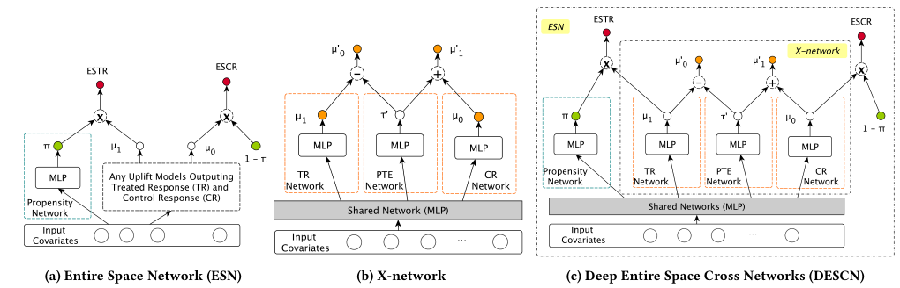

# DESCN 怎样在全空间学习发券响应

电商平台要从旧策略的发券日志预测下一位用户拿券后是否会下单。如果大部分券都发给近一个月未购物的人，处理组与对照组既有活跃度差异，也可能数量悬殊。TARNet 式双头先读同一份指派前特征，再由这条记录的实际指派决定哪个头接收下单标签。少数臂的头只能从较少的标签学习。在同一活跃度层内若几乎从未发券，该层的处理响应还缺少直接证据。DESCN 用联合事件和交叉重构，给这两个头增加训练信号。观测日志中的因果解释仍取决于一致性、给定处理前特征后的可交换性和重叠。 [原文 §1、§3.1](https://arxiv.org/pdf/2207.09920v3#page=3) · [发券问题与双头基线](../../知识库/问题/历史发券日志如何估计补贴增量.md)

## 一个发券标签怎样监督三个全空间输出

设某类用户拿券概率 $\pi(X)=0.2$，有券下单概率 $\mu_1(X)=0.15$，无券下单概率 $\mu_0(X)=0.10$。全空间网络（ESN）让共享特征同时进入倾向头和响应双头。两个乘积 $\pi\mu_1=0.03$、$(1-\pi)\mu_0=0.08$ 分别对应“被指派券且下单”和“未被指派券且下单”。如果日志中该用户被指派券并下单，三个监督标签依次为 $(1,1,0)$。发券后未下单为 $(1,0,0)$，未发券却下单为 $(0,0,1)$。两条乘积路径每条记录都有标签，其中异臂的零表示该联合事件未发生，无法读取用户的反事实结果。 [原文式 (3)–(5)](https://arxiv.org/pdf/2207.09920v3#page=4)

图 1，Zhong 等，arXiv 2207.09920v3 第 4 页裁图。左侧展示 ESN 的两个乘积和倾向输出。中间用伪效应把两臂 logit 连起来。右侧合并两条路径，彩色节点参与损失。 [作者原图](https://arxiv.org/pdf/2207.09920v3#page=4)

ESMM 将点击率乘以点击后转化率，用全曝光的点击并转化标签监督乘积。DESCN 借用同一概率乘法，但同步建模两个互斥指派下的联合响应。固定 $X=x$ 后，联合概率除以真实倾向，能还原各臂的条件均值。用样本估计两个函数后，这个等式不自动给出无偏或双重稳健的估计器。若发券概率缩小到接近零，全空间仍有大量“未发生发券且下单”标签，处理头从这些标签获得的直接梯度也受到乘数 $\pi$ 缩放。 [原文 §3.2、§5.2](https://arxiv.org/pdf/2207.09920v3#page=4) · [ESMM 精读](../SRC-ESMM/阅读笔记.md)

## 为什么发券后的下单能更新无券头

在刚才的例子中，两臂概率差为 0.05，logit 的差约为 0.46。设模型有共享编码 $h(X)$，响应头输出 $a_t=\operatorname{logit}(\mu_t)$，伪效应头输出 $d$。在已发券记录上，交叉处理路径的概率为 $\sigma(a_0+d)$，用观察到的下单训练。在未发券记录上，交叉对照路径为 $\sigma(a_1-d)$，也用该臂的下单训练。如果 $d=0.46$，前者以基准概率 0.10 加上 logit 偏移重构约 0.15，后者由处理概率 0.15 重构约 0.10。相同偏移施加在其他基线概率，得到的概率增量可以不同。发券样本可经交叉处理损失更新无券响应头，但监督的目标仍是事实下单。 [原文 §3.3](https://arxiv.org/pdf/2207.09920v3#page=5)

独立的 X-network 同时保留两个直接事实损失和两个交叉损失。完整 DESCN 用倾向及两个联合事件损失接替直接事实项，再加两个交叉项。参照作者公开实现，训练加减的是伪效应的 logit，论文式 (6) 的两处括号应按这一实现及式后文字理解。通用训练器可以容纳直接事实项，作者给出的 ACIC 和 Lazada DESCN 配置把这两个权重设为零。评估代码读取 $\sigma(a_1)-\sigma(a_0)$ 作为增量，伪效应头没有直接担任分数。 [原文式 (6)–(7)](https://arxiv.org/pdf/2207.09920v3#page=5) · [固定实现与出分](https://github.com/kailiang-zhong/DESCN/blob/80fd11e02d05af241eeaf67d701be599da528cb1/main.py#L190-L245) · [生产数据配置](https://github.com/kailiang-zhong/DESCN/blob/80fd11e02d05af241eeaf67d701be599da528cb1/conf4models/lzd_real_data/DESCN.txt#L20-L28)

X-learner 先独立拟合两臂结果，再用另一臂填补反事实、回归两份伪效应，最后做加权组合。DESCN 的伪效应与响应头由同一批事实标签联动反传。DragonNet 也会预测倾向，使用它构造 ATE 定向正则。DESCN 把倾向乘进两个联合事件预测，交叉重构也不等同于 ATE 影响函数。 [X-learner 精读](../SRC-META-LEARNERS/阅读笔记.md) · [DragonNet 精读](../SRC-DRAGONNET/阅读笔记.md)

## 有偏训练与随机测试各检验了什么

Lazada 生产数据的训练集约 417 万条，处理约 92 万、对照约 325 万。测试使用未受运营定向策略影响的随机试验，报告约 91 万条。在表 2 中，相对 CFR-MMD，DESCN 的归一化 AUUC 从 $0.0324\pm0.0029$ 到 $0.0340\pm0.0006$，随机测试集上的平均效应误差 $\epsilon_{ATT}$ 从 $0.0258\pm0.0015$ 到 $0.0039\pm0.0007$。后者用测试集事实组均值差作为参照，再和处理组上的平均预测增量比较。合成 Epilepsy 数据才有生成的效应真值，表 2 的根 PEHE 从 $0.1344\pm0.0027$ 降为 $0.1241\pm0.0009$。均值和标准误来自作者的五次实验。两套数据支持对应协议下的改善，也显示了为何排序、幅度和预算收益应分别检验。 [原文 §4、表 1–2](https://arxiv.org/pdf/2207.09920v3#page=5) · [补贴增量评估](../../知识库/问题/怎样验证补贴增量的排序幅度和策略价值.md)

表 3 的两条 CFR 基线标签和表 2 互换，无法据此为两个距离变体分别确认改善幅度。§5.3 给出 X-network 相对 TARNet 的 9.6% 和 10.0%，按表 2 的根 PEHE 和 AUUC 列复算约为 6.1% 和 4.9%。表 2 的 AUUC 改善列里的 4.9%恰好来自 DESCN 对 CFR-MMD 的 AUUC 比较，保留各处原值及比较对象。 [原文表 2–3、§5.3](https://arxiv.org/pdf/2207.09920v3#page=7)

采用 arXiv 2207.09920v3 九页作者稿，核对 KDD 2022 正式题录。精读正文 §1–6 及固定提交中的相关训练代码和两个 DESCN 配置。中文 PDF 翻译正文、摘要、图表说明和描述性脚注，保留图内文字、参考文献和权利声明。本地正式译文在 <code>.local/papers/SRC-DESCN/translation/中文.pdf</code>。 [固定原文](https://arxiv.org/pdf/2207.09920v3) · [正式 DOI](https://doi.org/10.1145/3534678.3539198) · [私有备份下载说明](../../文档/工具/中文PDF发布.md#登录下载)
