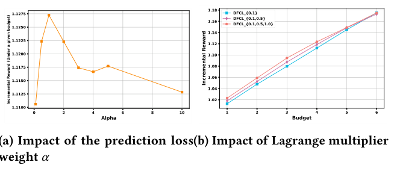
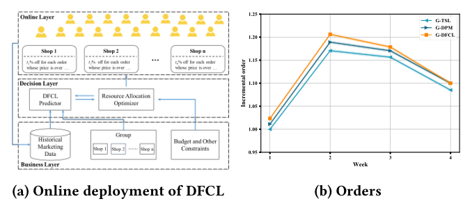

# DFCL 怎样用随机日志训练多券档分配

门店每天要从不打折、95 折、9 折等选一个动作，所有门店共用预算。先分别回归每档订单和支出，再求背包时，回归中一处小误差就可能让某档越过分配边界。标准 SPO+、LODL 或可行解排序可以用完整的训练成本向量给任何候选决策计价，门店日志却只有实际分配档的订单和成本。DFCL 把预算转到一组影子价格上，用随机数据给每个价格下的选择提供监督。 [arXiv v1 §3–5](https://arxiv.org/pdf/2407.13664v1#page=3)

## 固定价格后，一个门店只需要比较自己的各档

对门店 \(i\) 输入干预前特征，得到各档预测订单 \(\hat r_{ij}\) 与补贴成本 \(\hat c_{ij}\)。上线目标写作 \(\max_z\sum r_{ij}z_{ij}\)，每店选一档，且总成本不超 \(B\)。令教学门店各档预测为不补贴 \((8,0)\)、小档 \((12,2)\)、大档 \((14,6)\)，单位为订单和成本。价格 \(\lambda=1\) 时净值 \(8,10,8\)，选小档。价格下降到 0.25 后，净值 \(8,11.5,12.5\)，改选大档。这一步随门店独立计算，和 LBCF 的 DGB 共用按价格分解的结构。真实上线仍按全批预算选择价格并复核支出。价格网格是训练权重，原文由 \(B\) 换成 \(\lambda\) 积分时未给测度变换。对偶目标可能在区间平坦，固定预算并不保证唯一的最优 \(\lambda\)。 [v1 §3、§5.1 与定理 2](https://arxiv.org/pdf/2407.13664v1#page=5) · [预算分配与监督条件](../../知识库/问题/决策导向损失怎样训练预算分配的预测器.md) · [LBCF 的二分与整数边界](../SRC-LBCF/阅读笔记.md#同一价格下每人可以并行选档)

## 单条事实日志怎样给所有券档传递训练信号

预测损失按历史指派分臂，对每臂订单和成本的事实残差取均值，再等权汇总。假设该门店在随机训练中实际分到小档，观测订单 11、成本 2，预测为 12、2，回归项给小档订单头产生误差 1。其他券档没有这一门店的事实标签。原文通过随机组抽样推导组均值的总体对应，有限样本的事实风险与完整潜在结果风险有抽样误差。 [v1 §4.1 与附录 A](https://arxiv.org/pdf/2407.13664v1#page=4)

决策损失将净值 \(\hat r_{ij}-\lambda\hat c_{ij}\) 送入 softmax，得到软策略 \(\pi_\lambda(j\mid X_i)\)。实际动作 \(t_i\) 的日志贡献为
\[
-\frac{\pi_\lambda(t_i\mid X_i)}{P(T=t_i)}(r_{it_i}-\lambda c_{it_i}).
\]
当实验给小档概率 \(1/3\)、\(\lambda=1\) 时，小档净订单为 9，软概率 \(e^2/(e^2+2)\approx0.787\)，本行贡献约为 \(-21.25\)。软概率的分母读取所有券档，给其他档也传递竞选梯度。它们的总体效应靠同类型在不同随机臂中的事实结果识别。最大熵变体把净值先除以温度再作 softmax，温度低时更接近硬选择。固定温度且分数受限时，软目标的最优值未必达到硬决策损失，RCT 识别支持的是相应软策略的期望。不同门店指派概率不同时需使用对应的条件概率。 [v1 §5.2–5.3、定理 3 与附录 B](https://arxiv.org/pdf/2407.13664v1#page=6)

改进有限差分 IFD 留用硬选档。它计算刚好换档所需的预测扰动，仅重算该门店变动前后的日志匹配和收益，形成对预测的替代斜率，再与预测损失一起更新。沿用净值 \(8,10,8\)，若抬高大档的订单预测，至少需要跨过 2 的差距才改变选档。历史这行实际是小档，从匹配小档到不匹配大档，本行 EOM 贡献会变，其他实际动作的样本提供相应反方向的信号。附录 D 给出扰动截断与更新细节。 [v1 §5.4 与附录 D 算法 2](https://arxiv.org/pdf/2407.13664v1#page=12)

## 什么时候报告排序，什么时候报告分配效果

Zhou 等，v1 第 9 页图 2，从采用版 PDF 裁出。左图调回归损失权重，右图比较训练价格的组合，横轴预算为各组统一口径，纵轴是策略匹配后估出的订单。多价格训练覆盖更宽的预算场景。 [v1 §6.2、图 2](https://arxiv.org/pdf/2407.13664v1#page=9)

二元 Criteo 数据按观察窗口转化与访问代理比较 AUCC。多档营销数据用匹配策略动作的逆概率估计（EOM）分别计算人均订单和人均成本。表 3 的 DFCL-IFD 六档预算平均相对 TSM-SL 改善 2.85%，TSM-CF 为 −0.19%。EOM 与线上分配共用动作定义，需要在有支持的独立日志上比较同一实际成本。 [v1 §6.1–6.2、表 2–3](https://arxiv.org/pdf/2407.13664v1#page=9) · [冻结策略的效果评估](../../知识库/问题/怎样验证补贴增量的排序幅度和策略价值.md)

Zhou 等，v1 第 9 页图 3，从采用版 PDF 裁出。左侧先对门店预测并分配折扣，右侧显示相对第一周 TSM-SL 订单归一的轨迹。四周约 31 万门店每日随机分配到三种算法，DFCL 周订单平均相对 TSM-SL 提升 2.17%、相对 DPM 提升 0.85%。比较的是这场活动、这组门店和预算下的订单。 [v1 §6.3、图 3 与附录 E](https://arxiv.org/pdf/2407.13664v1#page=9)

## 版本与译本

Hao Zhou、Rongxiao Huang、Shaoming Li、Guibin Jiang、Jiaqi Zheng、Bing Cheng、Wei Lin。采用 KDD 2024 作者版 arXiv v1，复核正文和关键推导、评估附录，未运行模型。中文 PDF 共 10 页。摘要、正文 §1–7、正文图表说明与公式。图内文字、参考文献与附录保留原文。译本已逐页渲染核对，采用原文与译本均完成私有备份和认证下载校验。 [中文 PDF 私有下载说明](../../译文/PDF目录.md) · [固定原文](https://arxiv.org/pdf/2407.13664v1) · [KDD DOI](https://doi.org/10.1145/3637528.3672353)
