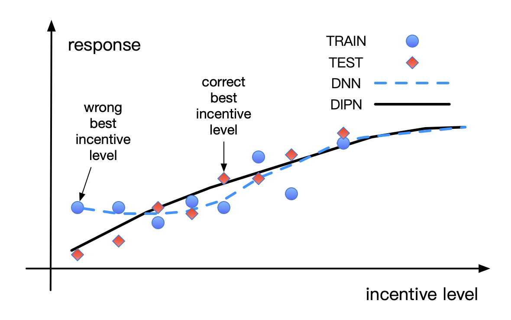
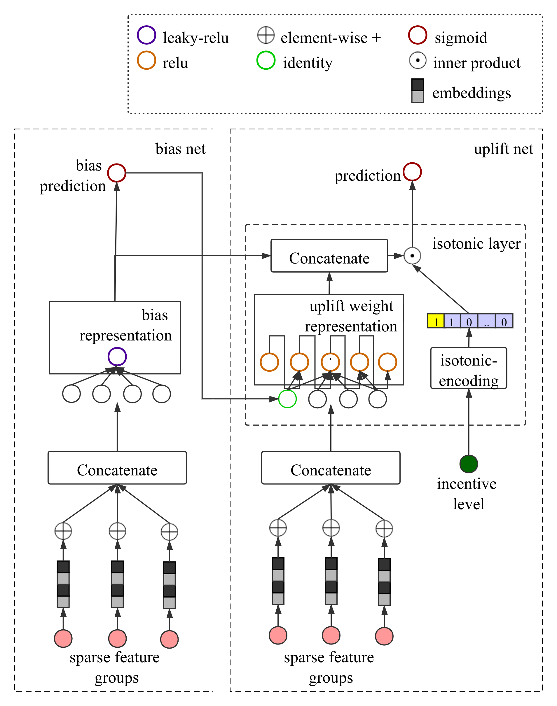
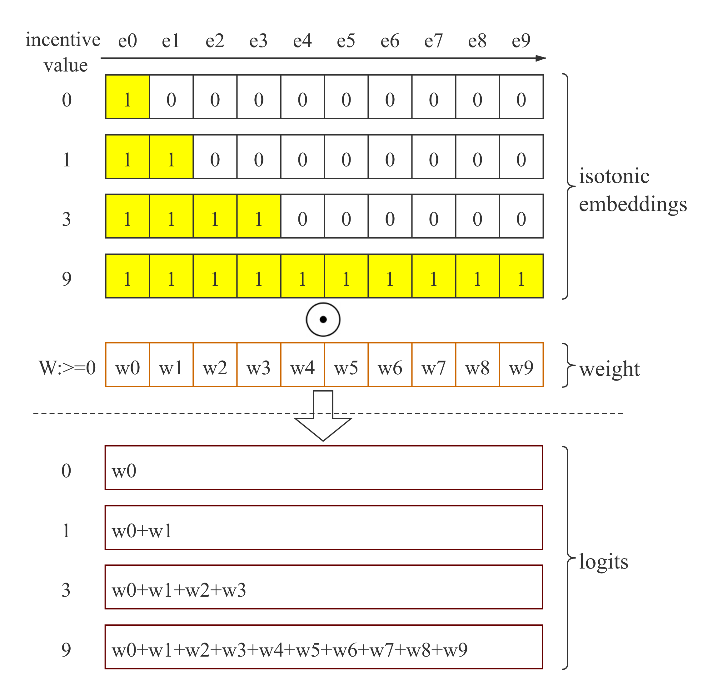

# DIPN 用单调响应曲线为每位用户选券档

同一名用户对 5 元、10 元和 15 元券只有一条事实反馈。把券额拼进普通网络，再枚举三个档位，可以得到三项核销概率。若 10 元档样本很少，模型可能把这一档估得比 15 元还高。预算分配专挑净值最大的档，一个局部高估就可能改变投放。DIPN 把券档顺序写进模型，在相同用券条件下让概率随券额单调不降，再由分配器比较预测概率和资源成本。 [Shen 等，arXiv v1 §1、§3–4](https://arxiv.org/pdf/2108.12100v1#page=2)

Shen 等，固定 v1 第 2 页图 2，从作者 LaTeX 原图提取。先比较各候选的响应估计，再看同一影子价格下净值最高点怎样移动。 [采用版图 2](https://arxiv.org/pdf/2108.12100v1#page=2)

## 最低档先定锚，提高一档就多加一个 logit 增量

设 5 元为最低档，三个档位相当于开启零项、一项和两项相邻增量，编码为 $(0,0),(1,0),(1,1)$。偏置网络读用户的处理前特征 $x$，给出最低档 logit $b(x)$。最低档实际为无券时，这个锚才表示自然响应。增量网络读取 $x$ 及偏置支路输出，产生每段的权重 $w_j(x)\ge0$，最后一层 ReLU 实现非负性。按当前券额的保序编码选中权重，将规定的增量累加到 $b(x)$，再用 sigmoid 输出 $\hat p(x,c)$。低档已开启的权重到高档仍开启，故 logit 和概率都单调不降。 [v1 §4.1、式 (10)–(13)](https://arxiv.org/pdf/2108.12100v1#page=5)

Shen 等，固定 v1 第 7 页图 5，从作者 LaTeX 原图提取。左边给最低档起点，右边产生各档权重，红色向量选择已经走过的档位。最后的求和及 sigmoid 见式 (13)。 [采用版图 5](https://arxiv.org/pdf/2108.12100v1#page=7)

Shen 等，固定 v1 第 7 页图 6，从作者 LaTeX 原图提取。从上到下读档位、保序向量、权重与所得 logit。 [采用版图 6](https://arxiv.org/pdf/2108.12100v1#page=7)

假设这个用户的 $b=-2$、两段权重均为 0.4。三个档的 logit 为 −2、−1.6、−1.2，概率约为 0.119、0.168、0.231。两段 logit 差相同，概率差约为 0.049、0.064。式 (14) 在相邻变化很小时给出 $\Delta p\approx p(1-p)w$，故入分配器的是概率或业务单位下的预测。单调性允许边际概率差上升。 [v1 §4.2、式 (14)](https://arxiv.org/pdf/2108.12100v1#page=6) · [与 TG-DIPricingNets 的销量读出对照](../SRC-TG-DIPN/阅读笔记.md)

## 事实核销监督训练，预算分配另用预测系数

先用最低档记录拟合偏置网络，再冻结它，用全部档位训练增量网络。若这位用户实际收了 10 元券且核销，事实交叉熵为 $-\log(0.168)$，经事实档已开启的路径和共享网络传播。平滑正则额外比较各相邻权重，包括未开启的档。它惩罚 $(w_{j+1}-w_j)^2/(w_{j+1}w_j)$，系数随训练衰减。ReLU 允许权重为零，式 (16) 未写分母下限或零值约定。原文建议对非随机日志用逆倾向得分加权，因果解释仍需可交换性和重叠。 [v1 §2.2、§4.3–4.4](https://arxiv.org/pdf/2108.12100v1#page=6) · [历史日志的识别条件](../../知识库/问题/历史发券日志如何估计补贴增量.md)

若暂按面额计成本、预算乘子为 0.01 次核销／元，三档净值约为 0.069、0.068、0.081，于是选 15 元。若预算收紧使乘子升至 0.013，三档净值约为 0.054、0.038、0.036，改选最低档。这个计算是给定乘子的逐人子问题。式 (2) 允许分数变量，文中对分数结果按概率采样，实际支出可波动。式 (5) 的 $z\in\{0,1\}$ 形成整数规划，尽管正文也称作 LP。在线新用户沿用前一时段的影子价格，依赖人群及成本分布短期稳定。 [v1 §3.1–3.2，式 (2)–(7)](https://arxiv.org/pdf/2108.12100v1#page=4) · [预算与曲线接口](../../知识库/问题/连续券额怎样估计并约束响应曲线.md#从响应读数得到可投放的券档)

## 预测曲线与线上活动的证据

作者用同一分配问题和预算比较普通 DNN、深度格点与 DIPN。表 4 实际促销数据中，DIPN 的 LogLoss 为 0.2189，DNN 为 0.2240，预测逆序率分别为 0 与 0.28。两者的预测未来响应均约 0.020，预测未来成本为 0.048 与 0.050。格点的 0 成本带“优化问题无法求解”脚注。表 3 合成维度按表头取 $(3,5,7)$，正文重复写了 $n_3$。 [v1 §5.1、表 2–4](https://arxiv.org/pdf/2108.12100v1#page=8)

三项花呗活动以普通 DNN 为对照，作者报告 DIPN 占 30% 流量。优先支付、新客礼和流失干预的相对成本分别变化 −6.05%、−8.58%、−9.42%，相对核销率变化分别为 +1.86%、+5.20%、+8.45%。表 5 中只有优先支付的核销率区间跨零（[−0.31%, 4.04%]）。这衡量了相应用券条件下整套策略的 A/B 表现，表格未隔离单调性、平滑和训练顺序各自的贡献。 [v1 §5.2、表 5](https://arxiv.org/pdf/2108.12100v1#page=9)

## 版本与译本

Yitao Shen、Yue Wang、Xingyu Lu、Feng Qi、Jia Yan、Yixiang Mu、Yao Yang、Yifan Peng、Jinjie Gu。采用 2021-08-27 的 arXiv v1，阅读摘要、正文 §1–6、图 1–6 和表 1–5。中文 PDF 翻译正文、图表说明和描述性脚注，图内文字及参考文献保留英文。未运行模型。 [固定原文](https://arxiv.org/pdf/2108.12100v1) · [版本与许可](https://arxiv.org/abs/2108.12100v1) · [中文 Markdown](../../译文/SRC-DIPN/中文译文.md) · [中文 PDF 访问](../../译文/PDF目录.md)
