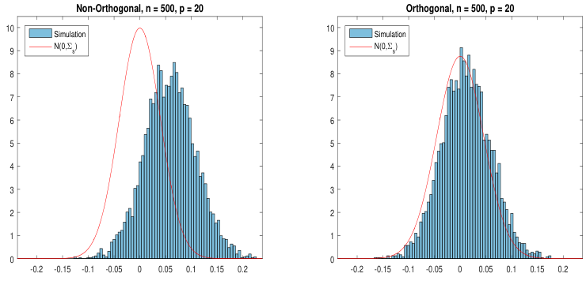
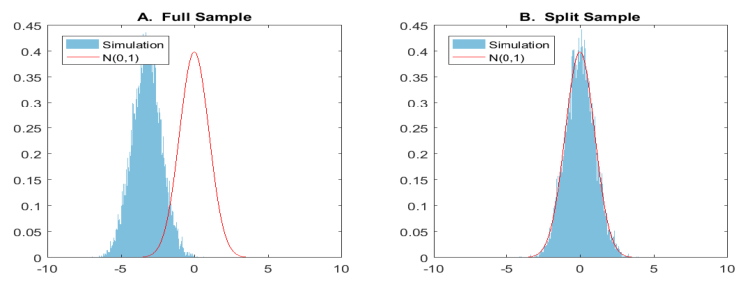

# DML 怎样从折外预测估计发券的平均效应

如果旧策略偏向自然下单率高的用户，直接回归订单对发券会带入这部分差异。即便先用随机森林估计基础响应，再把残差对发券回归，森林的正则化误差也会和旧策略分配相关。Chernozhukov 等用 Neyman 正交得分消除总体矩对辅助误差的一阶敏感性，再用交叉拟合控制同样本过拟合。目标是低维参数及其不确定性。 [固定 v7 §1、§3](https://arxiv.org/pdf/1608.00060v7#page=2)

## 先把结果和历史指派都居中

在部分线性模型 $Y=D\theta_0+g_0(X)+U$ 中，令 $m_0(X)=E[D\mid X]$、$\ell_0(X)=E[Y\mid X]$。如果把处理前特征分成高低意向两类，高意向用户的发券概率可为 0.75，平均下单率可为 0.35。对一个实际收到券且下单的人，模型用折外预测构造 $V=1-0.75=0.25$、$Y-\ell=1-0.35=0.65$。若把候选斜率设为 0.08，此人的得分为 $(0.65-0.08\times0.25)\times0.25=0.1575$。另一条未收到券且未下单的记录可给出负处理残差。估计器找的是全体样本得分的零点，即 $\sum V(Y-\hat\ell)/\sum V^2$，单条得分只是其中一项。 [原文式 (4.4)](https://arxiv.org/pdf/1608.00060v7#page=31) · [线性投影到条件均值](../../知识库/问题/残差化怎样估计营销干预效应.md#从线性投影到条件均值)

作者图 1，固定原文第 4 页。先看横轴上估计误差的中心，再对照红色渐近密度。两栏使用同一模拟，辅助参数用森林估计，右边换成正交得分后中心更接近零。原文示范的是 §1 的结构误差乘处理残差得分，§4.1 又给出了上面的双残差等价参数化。 [原文图 1、式 (1.5)、(4.3)–(4.4)](https://arxiv.org/pdf/1608.00060v7#page=4)

## 正交性与交叉拟合各处理哪部分误差

把 $\ell_0,m_0$ 换成带误差的 $\hat\ell,\hat m$，在真参数处展开总体矩。一阶期望项含 $E[V\mid X]=0$ 或 $E[U\mid X]=0$，抵消后仍有 $\delta_m\delta_\ell-\theta_0\delta_m^2$。所以理论还要求剩余乘积和平方项足够小，并需要处理残差方差远离零。§4.1 假设 4.1 分别给式 (4.3) 与式 (4.4) 两个速率条件。v7 脚注 8 更正出版版条件中的范数，明确有界的是辅助误差的 $L_\infty$ 范数。 [原文假设 4.1 与脚注 8](https://arxiv.org/pdf/1608.00060v7#page=32)

作者图 2，固定原文第 7 页。左边用参与辅助拟合的样本评分，构造出的过拟合项使误差整体偏左。右边分半做折外预测，再交换两半，偏移消失。一般的 $K$ 折做法是每一折都用其余折拟合辅助模型。DML1 每折单独求根再平均，DML2 汇总各折的得分后求一个根。置信区间还需得分方差和雅可比，不能直接用结果模型的预测误差。 [原文图 2、定义 3.1–3.2](https://arxiv.org/pdf/1608.00060v7#page=7) · [交叉拟合定义](https://arxiv.org/pdf/1608.00060v7#page=24)

## 从一个斜率切换到总体 ATE

固定斜率需要设定效应结构。若真实券效应因用户而异，部分线性残差回归对高处理方差的人群赋予更大权重。§5.1 对二元处理用交互回归 $g_t(x)$ 和倾向分数 $e(x)$ 构造 ATE 得分。逐条把 $g_1-g_0$ 加上按指派概率缩放的事实误差，最后对全体人平均。两种模型可以使用相似的机器学习组件，估计目标仍要由结构与得分选定。401(k) 示例考察纳入协变量后资格对资产的影响，并另用资格作工具变量估参与者的局部效应。工具变量估计依赖额外的排除限制等条件。 [原文式 (5.1)–(5.4)、§6.2](https://arxiv.org/pdf/1608.00060v7#page=35)

v7 脚注 8 明确把发表版假设 4.1 和 4.2 的辅助误差范数由 $L^q(P)$ 更正为 $L^\infty(P)$，另保留 $L^2(P)$ 收敛和误差乘积条件。表 3 的 lasso 参与效应标准误从两折的 [2192]、(3014) 增至五折的 [2259]、(3307)，是 §6.2 所称“五折均更低”的反例。表 4 的圆括号标准误小于方括号，和 §6.3 对分割调整方向的概括也有出入。不同分割、标准误选法与特定表格应一起读。 [原文脚注 8、表 3–4](https://arxiv.org/pdf/1608.00060v7#page=32)

采用 arXiv 1608.00060v7。条目标题为 *Treatment and Causal Parameters*，PDF 首页为 *Treatment and Structural Parameters*。精读聚焦 §1、§3.1、§4.1、§5.1 与 §6.2，并在译文中保留 §2 的各类得分及 §6 的全部实证。由于原期刊类与 Unicode 数学字体栈冲突，52 页中文译本用作者 LaTeX 内容重新排版。译文覆盖摘要、正文 §1–6、两幅图注、四张表及注释、描述性脚注与致谢，保留图内原文、参考文献和证明附录。本地正式译文位于 <code>.local/papers/SRC-DML/translation/中文.pdf</code>。 [固定原文](https://arxiv.org/pdf/1608.00060v7) · [期刊 DOI](https://doi.org/10.1111/ectj.12097) · [私有备份下载说明](../../文档/工具/中文PDF发布.md#登录下载)
