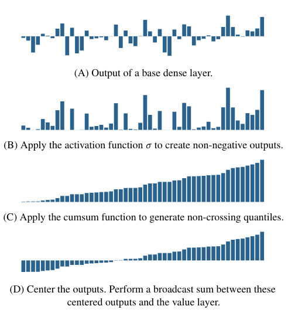
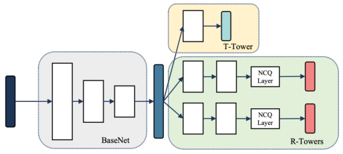
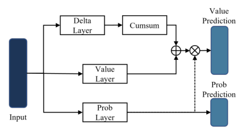

# DNet 怎样估计发券后金额的分布

某次补贴可能让平均 GMV 上升，也可能把收益更多地集中到少数大额订单。TARNet 式结果头对每个候选动作只输出一个均值，看不出低位数、小额订单和尾部大额订单分别有什么变化。给每臂独立拟合多个分位头，又可能出现 90% 分位预测比 50% 分位还小。DNet 用非负间距搭出每个动作的条件分位曲线，再用曲线均值和两端跨度参与预算分配。 [原文 §1、§4](https://researchonline.lse.ac.uk/id/eprint/122895/1/Distributional_Network_for_Distributional_Individualized.pdf#page=4)

## 先学分位间距，再平移整组分位数

假设某类用户在某一券档下的目标是 0.25、0.5、0.75 三个条件分位数。Delta Layer 输出三个实数，对每个输出做 $\sigma(c)=\mathrm{ELU}(c)+1$，得到正的间距。若间距为 $(1,2,4)$，累加得到 $(1,3,7)$，再减去平均值 $11/3$。Value Layer 给出标量位置 $v$。若 $v=8$，整体平移后的分位网格为 $(16/3,22/3,34/3)$，仍按 $2,4$ 的间距递增，网格均值恰为 8。对同一臂，首项在中心化时抵消，后续项控制相邻分位差。原文称任意 ELU 参数 $\alpha>0$ 都可保证正性，实际需要 $0<\alpha\le1$。常用的 $\alpha=1$ 在负半轴使 $\mathrm{ELU}(c)+1=e^c$。 [原文式 (1)–(2)](https://researchonline.lse.ac.uk/id/eprint/122895/1/Distributional_Network_for_Distributional_Individualized.pdf#page=5)

图 3，Wu 等，KDD 2023 正式版，LSE 存档 PDF 第 5 页裁图。四幅子图依次画出 Delta Layer 输出、正值化、累加和中心化。 [作者原图](https://researchonline.lse.ac.uk/id/eprint/122895/1/Distributional_Network_for_Distributional_Individualized.pdf#page=5)

## 一笔订单给哪个塔监督

共享 BaseNet 读取用户在指派前的特征。T-Tower 用事实指派做分类。每种券档有独立 R-Tower，用户实际得到哪一档，观测金额便监督哪一档的分位向量。例如上述中位预测约为 7.33，若实际为 12，分位损失会把中位向上推；0.75 分位对同样的低估误差权重更高。论文在式 (3) 前列出带分位权重的 pinball 和 Huber 变体，但式 (3) 印成各分位共用的对称 $\ell_\kappa$。按字面使用该式会令不同水平失去各自的监督目标。应把这视为印式与文字的冲突，具体训练损失仍需代码或勘误确认。 [原文 §4.2、式 (3)](https://researchonline.lse.ac.uk/id/eprint/122895/1/Distributional_Network_for_Distributional_Individualized.pdf#page=5)

图 4，Wu 等，KDD 2023 正式版，LSE 存档 PDF 第 5 页裁图。上方的倾向塔辅助学习共享表征。用于推理的是下方各动作的分位塔。 [作者原图](https://researchonline.lse.ac.uk/id/eprint/122895/1/Distributional_Network_for_Distributional_Individualized.pdf#page=5)

推理时对同一用户读取 $t$ 臂和对照臂的整组分位数。同水平相减得到条件分位处理效应 $Q_{\gamma}(Y(t)\mid X)-Q_{\gamma}(Y(0)\mid X)$。它比较两个条件边际分布中的位置。单人的金额差 $Y(t)-Y(0)$ 则需要两臂潜在结果的联合分布。随机分配仍只观察每人一个潜在结果，无法辨认两臂中的高低排序是否由同一批人贡献。论文用等距分位网格平均近似各臂条件均值，再相减产生 CATE。分位网格越有限，极端尾部对均值的贡献越需要实测校准。 [原文 §3、式 (4)–(5)](https://researchonline.lse.ac.uk/id/eprint/122895/1/Distributional_Network_for_Distributional_Individualized.pdf#page=6)

## 有序券档与零值分别改变哪里

Mono-DNet 只在各档的 Value Layer 上累积正的档间增量，所以同一用户的预测网格均值随档位不降。Delta Layer 仍可学习每档不同的分位间距，故不同档位的同水平分位仍可能相交。此处要区分同一档内由 NCQ 保证的分位次序，以及跨档位仅约束均值的位置。用有序档位约束金额或成本前，先看实验中每档是否真能按同一作用方向解释。 [原文式 (8)](https://researchonline.lse.ac.uk/id/eprint/122895/1/Distributional_Network_for_Distributional_Individualized.pdf#page=6) · [OFA 精读](../SRC-OFA/阅读笔记.md)

ZI-DNet 单独学习零结果概率 $p_0$，再用停止梯度的 $(1-p_0)$ 去缩放整组分位。零概率头只通过零分类损失更新。若 $p_0=0.75$，缩放一个 8 元的数值会得到 2 元。这可类比分解均值 $E[Y]=(1-p_0)E[Y\mid Y>0]$。要构造混合分布的分位数，$u\le p_0$ 时应直接取 0，$u>p_0$ 时应读取正值分布在 $(u-p_0)/(1-p_0)$ 水平的分位数。缩放原网格仍没有构造出零点的 75% 概率质量，原文关于原始响应塔为非零条件分位的解释需结合这一差异阅读。 [原文 §5](https://researchonline.lse.ac.uk/id/eprint/122895/1/Distributional_Network_for_Distributional_Individualized.pdf#page=7)

图 5，Wu 等，KDD 2023 正式版，LSE 存档 PDF 第 7 页裁图。概率头单独读取输入，输出进入对结果向量的乘法。 [作者原图](https://researchonline.lse.ac.uk/id/eprint/122895/1/Distributional_Network_for_Distributional_Individualized.pdf#page=7)

## 从分位预测到预算和线上评估

论文分别训练收益和成本模型。对每个用户与动作，取收益分位网格均值，在目标里减去高、低分位跨度的惩罚，成本使用自己的网格均值进入总预算。分位跨度是离散程度的代理量，与方差或总支出超额概率有区别。式 (6) 的预算左侧是成本总量，式 (7) 的展开使用人均单位。用总预算时应将该展开乘以用户数。 [原文式 (6)–(7)](https://researchonline.lse.ac.uk/id/eprint/122895/1/Distributional_Network_for_Distributional_Individualized.pdf#page=6)

半合成 IHDP 的表 1 报告根 PEHE 在测试集为 $0.56\pm0.03$，最优对照 CFR-Wass 为 $0.76$。ACIC 测试为 $2.34\pm0.15$，最优对照 CFR-MMD 为 $3.38$。文章说表 2 报告两个真实数据集与各基线的平均 AUUC，但存档正式版表 2 重复表 1。可以直接回查的变体比较在表 3 和表 4。五档随机广告奖励中，Mono-DNet 的四个非基线动作平均 AUUC 从 0.59 到 0.76。随机弹窗实验中，ZI-DNet 的平均 AUUC 从 1.16 到 1.26，但动作 $T=8$ 从 0.98 降为 0.96。论文另报告两周线上策略试验的广告主价值提升 2.8%、搜索次数提升超过 13%。这些指标分别检验有真值的均值效应、真实随机留出的排序及特定线上策略结果，未直接检验条件分位校准。 [原文表 1–4、§6.5](https://researchonline.lse.ac.uk/id/eprint/122895/1/Distributional_Network_for_Distributional_Individualized.pdf#page=9) · [增量评估](../../知识库/问题/怎样验证补贴增量的排序幅度和策略价值.md)

分位校准、零值与分配的通用例子见[补贴金额的分布](../../知识库/问题/补贴怎样改变消费金额的分布.md)。

采用 LSE 存档的 KDD 2023 正式论文，存档第 1 页为封面、第 2–11 页为原刊 5215–5224 页。精读 §1–7、式 (1)–(8)、图 1–9 及表 1–4。中文译本据原刊正文重排，翻译摘要、正文、图表说明和描述性脚注，保留图内文字、参考文献与原文权利声明。本地正式译文在 <code>.local/papers/SRC-DNET/translation/中文.pdf</code>。 [固定原文](https://researchonline.lse.ac.uk/id/eprint/122895/1/Distributional_Network_for_Distributional_Individualized.pdf) · [出版 DOI](https://doi.org/10.1145/3580305.3599809) · [私有备份下载说明](../../文档/工具/中文PDF发布.md#登录下载)
