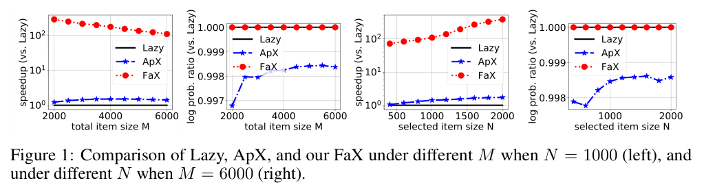
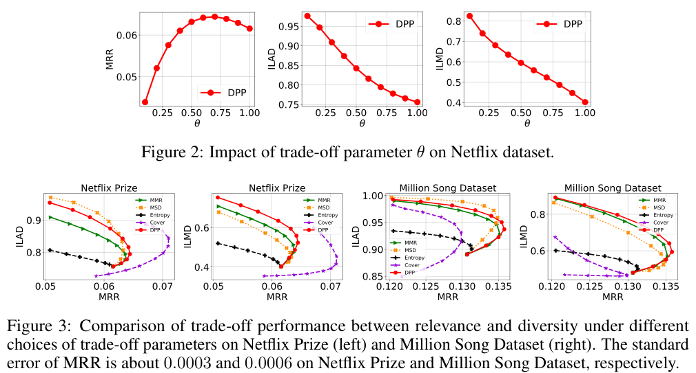
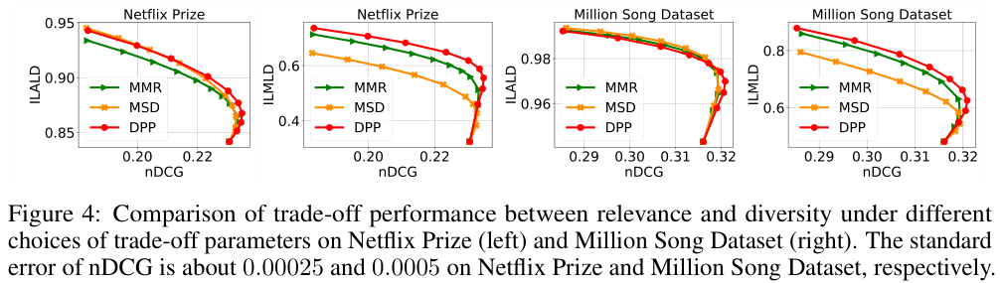

# DPP：把整张列表的几何体积变成可快速更新的选择目标

单个物品都很相关，不代表一张列表有用。八部相似电影可能挤掉用户同样愿意看的其他内容。本文把已有推荐器的分数和物品相似度组合成行列式点过程（DPP）的核，用集合的行列式同时衡量相关性与冗余，再加速逐项贪心选择。它改变的是**候选集合如何组成列表**，不是重训一个点击率模型。

Laming Chen、Guoxin Zhang、Hanning Zhou 的 *Fast Greedy MAP Inference for Determinantal Point Process to Improve Recommendation Diversity*，这里采用 [1709.05135v2](https://arxiv.org/pdf/1709.05135v2) 的 15 页预印本。v1 上传于2017年，v2为2018年修订；不把发现清单中的“2017/NIPS”标签直接当作此版本的出版信息。

## 高分候选占用了哪些方向

沿用 [MMR](../SRC-MMR/阅读笔记.md) 的三个短途候选，A 为河边步道、B 为同一河段另一条攻略、C 为郊外骑行。沿相关性 0.90、0.87、0.70 排序得到 A、B、C。MMR 会给 B 加上与 A 的相似罚分。若已经选中两个方向，候选还可能同时与二者各有一部分重合。DPP 通过投影到整个已选空间，直接衡量候选在这些方向之外剩了多少。以下用同组构造分数说明计算。

## 行列式为什么能表达整组冗余

设候选集合 $Z$ 有 $M$ 个物品，核 $L\in\mathbb R^{M\times M}$ 半正定，$L_Y$ 是按所选物品 $Y$ 取行列的主子矩阵。DPP 的集合概率满足：

$$
\mathcal P(Y)\propto\det(L_Y),\qquad \det(L_\emptyset)=1.
$$

这里是集合分布，不是下一物品的条件预测概率。无约束 MAP 寻找最高概率的任意大小集合，固定大小 $N$ 则在 $|Y|=N$ 内选择。两者目标域不同；本篇提出快速的**精确贪心实现**，不意味着求出了 NP-hard 问题的全局最优解。[§1–2，PDF 第1–3页](https://arxiv.org/pdf/1709.05135v2#page=2)。

若 $L=B^\top B$，行列式是对应向量张成体积的平方。令列向量 $B_i=r_if_i$，$r_i\ge0$ 为相关性分数，$f_i$ 是单位物品向量，则：

$$
L_{ij}=r_ir_jS_{ij},\quad S_{ij}=f_i^\top f_j,\qquad
\log\det(L_Y)=2\sum_{i\in Y}\log r_i+\log\det(S_Y).
$$

第一项鼓励高分，第二项鼓励向量独立。它不只是把成对距离求和：例如单位向量 $(1,0)$、$(0,1)$ 与 $(1,1)/\sqrt2$ 都不相同，但三个向量只在二维平面，三阶 Gram 行列式为零。这是依据公式的例子，说明“任意一对不完全重复”仍不保证整组有新方向。[§5、式(11)–(12)，PDF 第5页](https://arxiv.org/pdf/1709.05135v2#page=5)。

负内积也要小心。$f_i=-f_j$ 与 $f_i=f_j$ 都线性相关、体积为零，不能把负余弦直接当成 DPP 想鼓励的差异。本文对推荐采用 $S_{ij}=(1+f_i^\top f_j)/2\in[0,1]$；它等于扩展单位向量 $[1;f_i]/\sqrt2$ 的 Gram 内积，因而保持半正定。任意逐项裁剪相似度不具有这里给出的 PSD 保证。[§5，PDF 第6页](https://arxiv.org/pdf/1709.05135v2#page=6)。

## 权衡参数改变什么

作者进一步使用：

$$
F_\theta(Y)=\theta\sum_{i\in Y}r_i+(1-\theta)\log\det(S_Y),\qquad 0\le\theta\le1.
$$

这已从原来 $2\log r_i$ 的质量项改成线性 $r_i$，不是简单给原始核乘常数。对 $\theta<1$，令 $\alpha=\theta/[2(1-\theta)]$，核 $L'=\operatorname{Diag}(e^{\alpha r})S\operatorname{Diag}(e^{\alpha r})$ 的对数行列式乘 $1-\theta$ 得到 $F_\theta$。正比例缩放保留 MAP 与贪心的选择，却不表示归一化概率分布相同。$\theta=1$ 按纯相关性端点处理，不能代入上述分母。[§5、式(13)，PDF 第5–6页](https://arxiv.org/pdf/1709.05135v2#page=6)。

加入候选 $i$ 的增益是 $\theta r_i+(1-\theta)[\log\det(S_{Y\cup\{i\}})-\log\det(S_Y)]$。因此增大 $\theta$ 通常更重视相关性，但最好的离线相关性未必在纯高分端点：本篇 Netflix 的 MRR 在约0.7处达到峰值。这个取值依赖分数尺度、相似度与数据，不能当作通用默认值。[图2，PDF 第7页](https://arxiv.org/pdf/1709.05135v2#page=7)。

## 加速的核心是复用投影残差

贪心每轮选对数行列式增益最大的候选。假设当前 $L_Y=VV^\top$ 且行列式正，对每个候选维护行向量 $c_i$ 与标量 $d_i$：

$$
Vc_i^\top=L_{Y,i},\qquad d_i^2=L_{ii}-\|c_i\|_2^2,
\qquad \det(L_{Y\cup\{i\}})=\det(L_Y)d_i^2.
$$

所以只要选择最大 $\log d_i^2$。$d_i^2$ 可理解为该候选在已选空间之外的剩余贡献。选中 $j$ 后，对其余候选计算：

$$
e_i=\frac{L_{ji}-\langle c_j,c_i\rangle}{d_j},\qquad
c_i\leftarrow[c_i,e_i],\qquad d_i^2\leftarrow d_i^2-e_i^2.
$$

这些式子来自分块 Cholesky 分解，与每轮重算行列式的选择一致；省下的是重复求解，而非省略某个惩罚项。[§3、式(1)–(9)，PDF 第3–4页](https://arxiv.org/pdf/1709.05135v2#page=3)。

把短途候选实例化为 $r=(0.90,0.87,0.70)$ 和单位向量 $f_A=(1,0,0)$、$f_B=(0.95,\sqrt{1-0.95^2},0)$、$f_C=(0.20,0,\sqrt{1-0.20^2})$。三项已经是非负 Gram 相似度，直接使用这一教学核。初始 $c_i$ 为空，$d_i^2=L_{ii}=r_i^2$，所以先选 A。此时 $e_B=0.87\times0.95$、$e_C=0.70\times0.20$，B、C 的新残差平方分别约为 0.074 和 0.470。固定两项时取 A、C。

接下来 $\langle f_B,f_C\rangle=0.19$。若保留 A、C 的整个集合，$L_{CB}=r_Cr_B\times0.19$ 已由 A 的那一维投影解释，式中的 $L_{CB}-\langle c_C,c_B\rangle=0$，加入 C 不会再压低 B 的残差。若用 $w=2$ 窗口，选到 C 后只需比较 B 和 C。相同核下 B 的边际乘数恢复到 $0.87^2(1-0.19^2)\approx0.730$。因此候选只要错开窗口，就可重新获得接近其原质量分数的贡献。这里用固定长度来比较状态更新，所有数值是算例。

第 $k$ 轮每候选做长度 $k$ 的内积，单轮 $O(kM)$，选 $N$ 项共 $O(N^2M)$，额外状态 $O(NM)$；无基数约束最坏 $O(M^3)$。这些是**给定核后**的推断复杂度，不包括候选召回、物品表示计算及稠密核的构造/存储成本。已读 BPR 的打分器可以在概念上提供候选分数，但两篇没有验证这种组合，分数如何变成非负质量仍需另定义。[§3，PDF 第4页](https://arxiv.org/pdf/1709.05135v2#page=4)。

无约束时增益小于零，即最大 $d_j^2<1$ 时不宜继续添加；固定长度时则看 $N$，并以 $d_j^2<\varepsilon$ 防止除零。原文正文写 $|Y|>N$，伪代码先加入首项、在循环开头检查，存在检查时点和多选一项的歧义；译文原样保留并加注，本笔记不将其直接作为可执行实现。精确算术下低秩核最多选出 $\operatorname{rank}(L)$ 个正行列式物品，不能以任意补物品伪装仍在最大化相同目标。[算法1、附录B，PDF 第4、13–14页](https://arxiv.org/pdf/1709.05135v2#page=14)。

## 滑动窗口同时改变目标与成本

长列表未必要求距离很远的两项也不相似。本文只让新增物品与最近 $w-1$ 个已选物品比较，仍从全部未选候选中选择；忘掉的是远处物品的排斥贡献，不是允许重复选择同一物品。

加入新项后再移除最早项，可对 Cholesky 因子做秩一更新，并恢复相应候选残差。返回 $N\ge w$ 项的总成本为 $O(wNM)$。这不是全列表 $\log\det$ 的等价加速，而是局部窗口目标的贪心；窗口小会放松远处冗余限制。[§4、算法2、附录A，PDF 第4–5、12–13页](https://arxiv.org/pdf/1709.05135v2#page=5)。

## 公开数据的权衡曲线与毫秒耗时

所有推断对照采用向量化 Python，在2.2GHz Intel Core i7、16GB内存笔记本上运行。合成数据固定 $N=1000$ 改变 $M=2000$–6000，或固定 $M=6000$ 改变 $N=400$–2000，10次独立试验平均。作者报告 FaX 约为 Lazy 的100倍速度，且同为精确贪心；ApX 约3倍、损失约0.2%的对数行列式比值。这个“准确性”不指推荐命中率或全局最优率。[§6.1、图1，PDF 第6页](https://arxiv.org/pdf/1709.05135v2#page=6)。

Laming Chen 等，arXiv 1709.05135v2 图 1，PDF 第 6 页，作者原图。两组横轴各固定一个规模，纵轴一侧是相对 Lazy 的加速，另一侧是对数行列式比值。

短列表数据与协议为：

| 数据 | 处理后规模 | 监督与候选 |
|---|---|---|
| Netflix Prize | 436,674用户、11,551电影、56,406,404交互 | 保留评分≥4；用户至少10交互，物品至少100用户 |
| Million Song Dataset | 213,949用户、20,716歌曲、8,500,651交互 | 保留播放>1次；用户至少20歌曲，物品至少100用户 |

每用户随机留一测试，其余训练；历史每项的50个最相似项取并集，候选数中位数分别735和811，输出20项。这是候选集重排和随机留出，既非全库检索，也非严格按未来时间测试。指标 MRR 看测试项倒数排名，ILAD/ILMD 看列表平均/最小 $1-S_{ij}$；附录的 PW Recall 用训练流行度 $C(t)^{-0.5}$ 加权测试命中，更偏重长尾命中，不等于直接度量列表内部多样。[§6.2、附录C，PDF 第6–8、14页](https://arxiv.org/pdf/1709.05135v2#page=7)。

作者把 DPP 与 MMR、MSD、Entropy、Cover 的参数调成近似相同 MRR 范围后比较多样性。**Cover 在 Netflix 权衡更好，在 MSD 最差；DPP 并非所有数据都优于所有对照。** DPP 的平均/99%分位耗时为 Netflix 0.73/1.75ms、MSD 0.76/1.46ms；MMR/MSD 平均约0.2ms，更快。这里是该候选规模和机器上的推断耗时，不代表完整线上链路延迟。[图3、表1，PDF 第7页](https://arxiv.org/pdf/1709.05135v2#page=7)。

Laming Chen 等，arXiv 1709.05135v2 图 2–3，PDF 第 7 页，作者原图。图 2 先沿权重看 MRR 和距离指标，图 3 再看重叠的 MRR 区域内各方法的平均和最小距离。

长序列每用户随机留5个物品，输出100项、窗口10，对照 MMR/MSD 也只看最近9项。作者图4报告 DPP 的 nDCG 与局部多样性权衡更好。局部指标印刷式使用位置距离 $d_{ij}\le w$，与长度 $w$ 窗口最大距离 $w-1$ 有边界差异；保留该疑点，未核对代码，不能替作者补定实际实现。[§6.3、图4，PDF 第8页](https://arxiv.org/pdf/1709.05135v2#page=8)。

Laming Chen 等，arXiv 1709.05135v2 图 4，PDF 第 8 页，作者原图。横轴 nDCG 衡量相关性，纵轴分别是窗口内的平均和最小距离。

## 线上 A/B 支持的是具体系统里的两项观看指标

作者在电影推荐系统做四周 A/B：对照、DPP、MMR 各随机5%用户，显示8部电影，候选分数来自线上打分器，相似性来自每日训练的矩阵分解。相对纯相关性对照，DPP 的观看片目数提升1.33%、观看分钟数提升1.52%；MMR 分别0.84%、0.86%。这些都是各自对相同对照的作者报告，不能把 DPP 数字写成相对 MMR 的提升。[§6.2、表2，PDF 第8页](https://arxiv.org/pdf/1709.05135v2#page=8)。

原文没有在该表给出置信区间、显著性检验、用户数或参数选择细节，因而可记录有线上收益报告，不能补成已独立验证的因果结论，更不能推导收入或其他产品收益。本仓库未复现推断、模型或 A/B。

可复用的问题与方案比较见 [列表相关性与多样性权衡](../../知识库/问题/列表相关性与多样性权衡.md)。

## 原文与译文

采用 arXiv 1709.05135v2，重读正文 §1–7、附录 A–C，核对原有停止条件与局部距离定义。沿用 14 页中文 PDF 与既有排版验收，译文范围为正文叙述、图表标题和描述性脚注，附录、参考文献与图内英文保留。正式译文位于 `.local/papers/SRC-DPP/translation/DPP_中文翻译.pdf`，本地 PDF 可解析并可提取中文。采用原文与私有译本已分别重新认证下载并核对登记哈希。 [固定原文](https://arxiv.org/pdf/1709.05135v2) · [私有备份下载说明](../../文档/工具/中文PDF发布.md)。
