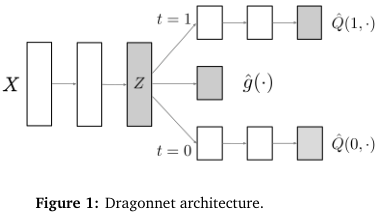

# DragonNet 怎样让结果模型服务于总体处理效应

DragonNet 面对同一份历史发券日志，除了拟合两臂下单结果，也让共享编码器预测谁更容易收到券。Claudia Shi、David M. Blei 与 Victor Veitch 在训练中额外加入针对总体 ATE 的正则，通过一个标量扰动结果预测，使目标估计方程的样本均值接近零。论文的评价核心是总体效应。把双头输出作为用户增量排序仍需另做验证。 [原文 §1–3](https://arxiv.org/pdf/1906.02120v2#page=1)

## 为什么加一个预测指派的头

作者原图 1，arXiv 1906.02120v2 第 3 页裁取。从左读 $X$ 到共享表示 $Z$。上、下两支分别拟合 $Q(1,X)$ 和 $Q(0,X)$，中间支输出 $\hat g(X)\approx P(T=1\mid X)$。例如高意向用户拿券后下单，同一条标签更新 $Q(1,X)$，指派标签更新倾向头，二者共同更新共享层。 [原文图 1、式 (2.2)](https://arxiv.org/pdf/1906.02120v2#page=3)

真倾向得分若充分保留指派信息，则可用于总体效应调整。单看结果误差，小样本网络可能把原本影响指派、但对结果预测贡献较弱的特征丢掉。加倾向头会给这些方向额外的梯度。均衡特征编码的 CFR 压低两臂表示分布差，而 DragonNet 要让表示能预测指派。两者针对不同的误差来源。真实倾向的充分性是识别结果，模型的交叉熵降低本身无法验证无未测混杂。 [原文定理 2.1 与 §2](https://arxiv.org/pdf/1906.02120v2#page=2) · [CFRNet](../SRC-CFRNET/阅读笔记.md)

## 同一个扰动为什么朝两臂相反方向修正

训练定义 $H(t,x)=t/g(x)-(1-t)/(1-g(x))$，用共享标量 $\epsilon$ 构造 $\widetilde Q(t,x)=Q(t,x)+\epsilon H(t,x)$。在原有的事实平方误差和指派交叉熵上加 $\beta$ 倍的 $(Y-\widetilde Q(T,X))^2$。假设某用户 $\hat g=0.8$，则 $H(1,x)=1.25$、$H(0,x)=-5$。若训练求得 $\epsilon=0.005$，两臂预测分别移动 $0.00625$ 与 $-0.025$，效应差增 $0.03125$。倾向极端时扰动会放大，论文在附录研究裁剪。 [原文式 (3.1)–(3.4)](https://arxiv.org/pdf/1906.02120v2#page=5) · [原文附录裁剪实验](https://arxiv.org/pdf/1906.02120v2#page=14)

在 $\epsilon$ 的一阶驻点，有 $\sum_i H_i[Y_i-\widetilde Q(T_i,X_i)]=0$。用 $\widetilde Q$ 的样本两臂均值差作 $\hat\psi$ 时，效应差中心化项也自动和为零，因此影响函数的样本平均为零。渐近效率仍依赖辅助估计收敛、重叠等条件。此处是联合训练的 ATE 定向，与事后在固定模型上用 A-IPTW 修正或 TMLE 仅做末端扰动不同。 [原文式 (3.5) 和 §3](https://arxiv.org/pdf/1906.02120v2#page=5)

## 平均改善与单数据集的差别

作者从 ACIC 2018 中筛除 DragonNet 留出集指派分类准确率超过 90% 的模拟数据集，保留 101 个。表 2 汇总这些数据集的 ATE 平均绝对误差，TARNet 为 1.45，DragonNet 为 0.55，DragonNet 加定向正则为 0.35。表 3 中，同时加入两种改动后，有 46% 的数据集相对 TARNet 改善，改善时幅度较大。Figure 2 还展示部分情况下 DragonNet 的事实结果损失更差，但绝对 ATE 误差更低。应用到营销需固定因果目标及实验设计，再用独立留出测排序与幅度。 [原文表 2–3 与图 2](https://arxiv.org/pdf/1906.02120v2#page=8) · [补贴增量验证](../../知识库/问题/怎样验证补贴增量的排序幅度和策略价值.md)

采用 arXiv 1906.02120v2，精读正文 §1–6，附录样本量与倾向裁剪实验。 [固定原文](https://arxiv.org/pdf/1906.02120v2)

中文正文译本共 11 页，本地正式文件为 `.local/papers/SRC-DRAGONNET/translation/中文.pdf`。原文与译本均可登录私有附件库下载。摘要、正文、图表说明及致谢已译。作者 LaTeX 副本保留附录、参考文献与图内文字。 [下载说明](../../文档/工具/中文PDF发布.md)
