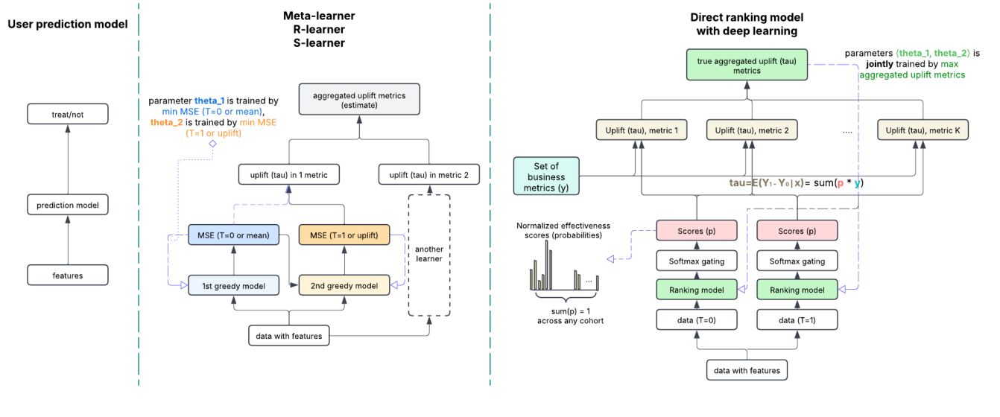
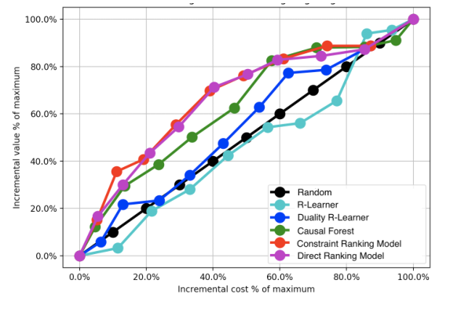
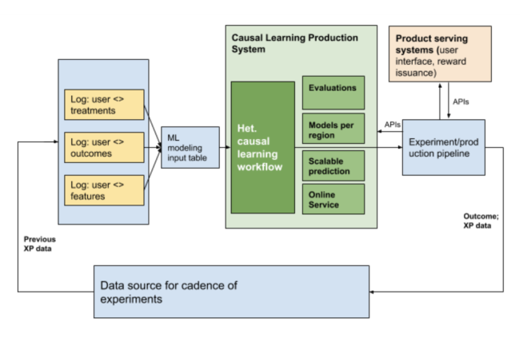

# DRM 和 CRM 怎样用一张名单的整体收益训练打分

分别预测留存与奖励成本，再在两个效应头之上选择用户，模型训练时每条样本只影响各自的回归误差。发奖励的决策却要考虑统一预算下一张名单的留存提升和增量成本。Du 等把可微的组内权重用于直接训练名单排序，随后为非均匀指派补充倾向函数。早期稿已给出 Direct Ranking 和 Constrained Ranking，本篇适合对照扩展后的权重和约束口径。 [arXiv v1 §2–3](https://arxiv.org/pdf/2507.05510v1#page=3) · [2020 年人群营销版本](../SRC-UBER-HCL/阅读笔记.md)

Du 等，v1 第 3 页图 1，从采用版原 PDF 裁出。右列处理臂和对照臂都用共享规则打分，softmax 在各臂内形成权重。同一个分数影响收益、成本等多个加权结果，顶端的聚合目标把误差一起传回打分器。 [v1 图 1、式 (3)–(6)](https://arxiv.org/pdf/2507.05510v1#page=3)

## 把收益和成本的差接到同一个可微排序

设 A、B 两种用户的干预效应分别为 \((8,4)\)、\((6,1)\)，括号为增量价值、成本。历史每行只有一种指派的事实奖励和成本。网络给每行一个 \(s_i=f(X_i)\)，训练时把同一臂的 \(\exp(s_i)\) 归一到总和 1。两臂各自加权事实价值与成本，再作差。若两个臂内 A、B 权重同为 0.25、0.75，教学批对应聚合价值 6.5、成本 1.75，ROI 为 3.71。若等权，则为 \(7/2.5=2.8\)。本版最大化聚合价值／成本并减正则。早期稿最小化其倒数，两个量均严格正时偏好顺序一致。对任意样本加权均值 \(m_a=\sum_{T_i=a}p_iY_i\)，有 \(\partial m_a/\partial s_i=p_i(Y_i-m_a)\)。比率的导数经两臂的价值和成本一起传回打分器。推理保留 \(f(X)\) 的顺序，没有单人的价值、成本效应输出可直接交给多券求解器。分母接近零时需单独判断比率是否仍有意义。 [v1 §3.1、式 (2)–(6)](https://arxiv.org/pdf/2507.05510v1#page=4)

## 随机概率不同，哪批人的结果进入目标

同一个打分规则可能跨地域使用。若 A 的实验发放概率为 0.8，B 为 0.2，直接在处理臂做 softmax 却会让 A 类型进入该臂的频率更高。式 (7) 用处理臂的 \(\hat e/e(X_i)\) 和对照臂的 \((1-\hat e)/(1-e(X_i))\) 修正既有 \(p_i\)，\(\hat e\) 是总体处理比例。对 A 来说，若总体比例为 0.5，其处理臂因子为 0.625，对照臂因子为 2.5。由此可将两臂汇总指向同一打分所定义的人群。有限批次里原式没有再次对这些修正权重作分母归一。识别仍依赖干预前变量、条件可交换性和重叠。作者在公开代理任务的倾向实验把目标换成价值减 \(\alpha\) 倍成本，两个方法采用的 \(\alpha\) 也不同。因此表 3 应按模型内部是否添加倾向来读。 [v1 式 (7)、§4.2、附录 B](https://arxiv.org/pdf/2507.05510v1#page=8)

CRM 在每批按预计名单的分位或预算选择阈值，再重算软筛选后的聚合目标。需要留意本版 §3.2 的两处口径。它印作 \(\mathrm{sigmoid}[-T(p_i-d^*)]\)，对正温度随 \(p_i\) 下降，和紧接着“保留阈值以上”的文字相反。早期稿式 (20) 用 \(\mathrm{sigmoid}[t(s_i-d)]\)，与文字意图一致。本版预算条目的字面说明按成本值排序，早期稿按效率分数排序后累积成本。复现本版要核对具体实现或勘误，推理端仍需运算硬预算。 [v1 §3.2](https://arxiv.org/pdf/2507.05510v1#page=4) · [早期稿式 (20)–(21)](https://arxiv.org/pdf/2004.09702v1#page=5)

## 营销与代理任务怎样对照

Du 等，v1 第 7 页图 3，从采用版原 PDF 裁出。沿同一冻结顺序移动截点，横轴累积成本、纵轴累积价值，在同一横坐标比较可期望的价值。营销 AUCC 为 Duality R-learner 0.544、DRM 0.664、CRM 0.678，与早期稿所报数字一致。本版 Covtype 是 DRM 0.907、CRM 0.770，早期稿则报告 Direct Ranking 0.840、Constrained Ranking 0.915。按各自版本与协议引用，勿合并成两组独立的生产验证。 [v1 §4.2、图 3、表 2](https://arxiv.org/pdf/2507.05510v1#page=7) · [早期稿表 2](https://arxiv.org/pdf/2004.09702v1#page=8)

Du 等，v1 第 8 页图 6。采用版的作者图文件与 2020 稿件图 5 字节相同，这里复用同一张图。随机探索和投放分开收集。线上给各模型选中的人群重新随机指派，以单点的增量价值／成本相对探索基线评估。原文未提供线上绝对成本和区间。 [v1 §4.2、式 (13)–(14)](https://arxiv.org/pdf/2507.05510v1#page=8) · [排序和策略价值的关系](../../知识库/问题/怎样验证补贴增量的排序幅度和策略价值.md)

## 版本与译本

Shuyang Du、Jennifer Y. Zhang、Will Y. Zou。采用 2025 年 arXiv v1，核对正文、Duality R-learner 和倾向函数附录，未运行模型。首页的 DOI 和会议信息为模板占位。中文 PDF 共 9 页。摘要、正文 §1–5、图表说明及公式。图内文字、参考文献及附录 A–D 保留原文。译本已逐页渲染核对，采用原文与译本均完成私有备份和认证下载校验。 [中文 PDF 私有下载说明](../../译文/PDF目录.md) · [固定原文](https://arxiv.org/pdf/2507.05510v1)
