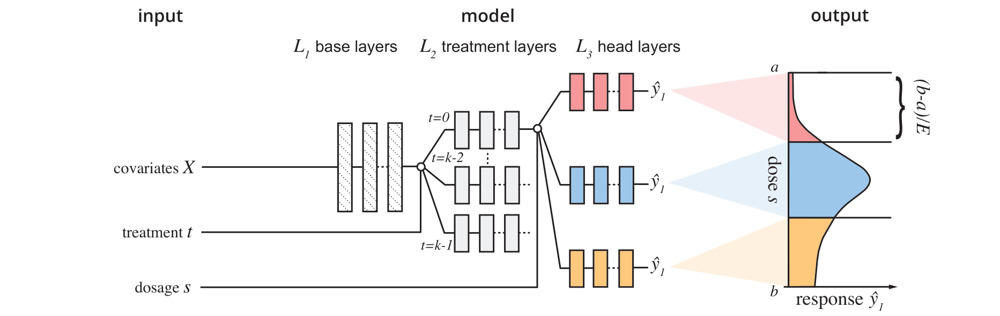
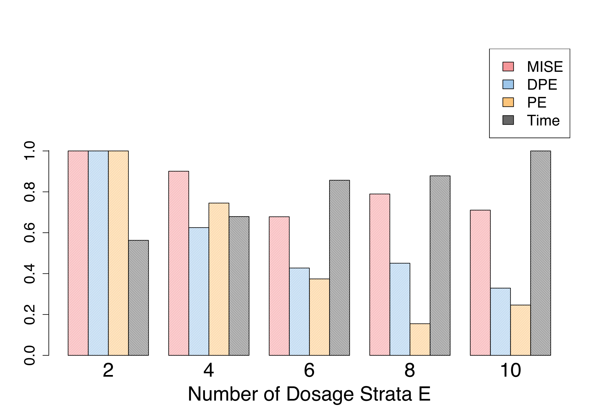

# DRNet 按处理和剂量区间学习响应曲线

降价和发券是不同干预，同一种券还可以有不同面额。若只让一个模型把处理类型、剂量和几十个用户特征一起输入，模型可能用用户特征解释大部分结果，在高维隐层弱化券档信息。TARNet 通过共享底层和分臂输出保留处理身份，但给每个处理头只拼一次连续剂量，仍可能让预测曲线对面额不够敏感。DRNet 在处理头下再分等宽剂量区间，并在各区间头的每层重新拼接剂量。实验还把恢复整条曲线与选对处理、选对剂量分开评价。 [v3 §2–3，图 1](https://arxiv.org/pdf/1902.00981v3#page=5) · [TARNet 双头和事实梯度](../SRC-CFRNET/阅读笔记.md)

## 固定一个用户，改变券档输入

例如面额区间是 2 到 20 元。用三段时可分为 2–8、8–14、14–20 元。某个用户实际被指派 11 元券，观察到其七日消费 36 元。协变量 $x$ 进入所有处理共享的底层；指派属于券而非直降，因此只沿券的中间处理层前进；11 元落在中段，只接中段的响应头。该头每一隐藏层接收上层激活和 11 元的剂量标量，输出对这行的消费预测，再用 36 元算事实损失。更新涉及底层、券处理层与券的中段头。用户的 6 元或 15 元结果没有标签，也没有梯度进入那两个头。 [v3 §3 模型结构、图 1](https://arxiv.org/pdf/1902.00981v3#page=5)

Schwab 等，固定 v3 第 5 页图 1。图中仅展开了处理 0 下面的三个区间头，其他处理仍有各自的区间头。最右侧各颜色对应各头读取的剂量范围。 [作者图 1](https://arxiv.org/pdf/1902.00981v3#page=5)

预测同一个用户在 6、11、15 元三个选择下会怎样，底层和券处理中间层可以复用，随后沿各自剂量头读出 $\hat\mu(t,s,x)$。头里仍有连续剂量，所以区间内能预测 11.1 元与 11 元的差，但两个头在分界处没有共同的端点约束。若模型给 7.99 元预测 34 元、8.01 元预测 38 元，很小的券价变化可能跨到一条尺度不同的局部曲线。判断这个跳变是否符合业务，需要看该处是否有真实资格或门槛变化。希望整条曲线连续时，可在连续的基上调节读出权重。希望跨有序档位共享时，可用 OFA 对同一套用户系数做基函数读出。 [v3 §3](https://arxiv.org/pdf/1902.00981v3#page=4) · [OFA 的有序档位函数](../../知识库/问题/组合营销策略如何共享结构并估计因果增量.md#有序券档怎样共享一条响应曲线)

原文设定要求处理前特征足以调整分派、处理间存在支持、样本互不干扰，并在训练和选模中利用相近协变量有相近响应的假设。连续化还要问目标人群在拟估剂量邻域有没有数据。历史只在高活跃组投放 15 元时，预测低活跃组 15 元响应主要依靠模型外推。附录 A 中 Wasserstein 正则在共同底层以第一处理作参照平衡其余处理组，匹配变体则把剂量加入匹配变量。二者分别调整表征或训练样本可比性，需检查实际支持域。 [v3 §3 假设](https://arxiv.org/pdf/1902.00981v3#page=3) · [附录 A](https://arxiv.org/pdf/1902.00981v3#page=12)

## 曲线距离、选档损失与选择哪一种券

MISE 把所有测试用户、所有处理的真实与拟合曲线的平方差沿剂量积分，然后平均。该积分本身未按各处理的区间长度归一化。DPE 找同一处理中的真实最优剂量 $s^*$ 和模型建议剂量 $\hat s^*$，回到真曲线算 $[y(s^*)-y(\hat s^*)]^2$。PE 进一步允许模型选错处理类型。它用真实最优的处理与剂量，减去模型选中处理和剂量在真曲线上的结果，再取平方和跨人平均。假设用户真曲线在 9 元券预测消费峰值为 40 元，而模型选 12 元券，后者真值为 37 元，则单项 DPE 为 9 元²。若模型改选直降、真值为 35 元，且所有候选中的真实最好仍为 40 元，单人 PE 是 25 元²。同一模型可以在很长区间内拟合准确，仍在峰值附近选错。 [v3 式 (1)–(7)，PDF 第 3–4 页](https://arxiv.org/pdf/1902.00981v3#page=3)

半合成基准使用已知生成过程计算这些量。真实投放日志无法查到每条用户曲线，因此论文在验证集用 NN-MISE 选模，以训练集中同处理、剂量和协变量接近的事实响应替代真曲线点。若相邻样本只有更高意愿人群，分档近邻误差依然可能偏向历史策略。作者固定代码的评价函数以 $2^6+1=65$ 个网格点作默认 Romberg 输入，正文指标段写 64 个采样点。代码中积分步长还写为 `1/65`，与含两端网格的近似间隔 `1/64` 不同。这里保留正文和固定代码各自口径，未确认论文表格使用哪一版运行参数。 [v3 式 (8)、§4 指标](https://arxiv.org/pdf/1902.00981v3#page=7) · [作者固定评价代码](https://github.com/d909b/drnet/blob/65b88567ea0ebc3c9551047aaf6507f6ce2633cc/drnet/models/exposure_metrics.py#L29)

## 分段增益和实验成本

News、MVICU、TCGA 使用真实特征与合成处理响应，随机按 63%／27%／10% 划分，表 2 给出五次重复的均值与标准差。以 News-2 为例，DRNet 的 $\sqrt{\mathrm{MISE}}$ 为 $8.0\pm0.1$，TARNet 为 $15.5\pm0.1$，只在剂量头第一层拼接剂量的 −Repeat 为 $9.0\pm0.1$。MVICU 上 −Repeat 为 31.0，而完整模型为 31.1，优势随数据而变。附录表 S3 中 News-8 的 GPS $\sqrt{\mathrm{PE}}$ 为 13.3，基础 DRNet 为 15.1。分段越多，单段头越细且样本越少，作者在 MVICU 比较中也观察到训练与评价耗时上升。预算策略还须为每个候选定义成本和全局约束，这几个指标所用的单人最优没有这层约束。 [v3 §4–5、表 2](https://arxiv.org/pdf/1902.00981v3#page=8) · [表 S3](https://arxiv.org/pdf/1902.00981v3#page=14)

Schwab 等，固定 v3 第 6 页图 2。MVICU 半合成基准，横轴为分段数 $E$，指标各自归一化；增加头数后，黑色耗时柱整体上升。 [作者图 2](https://arxiv.org/pdf/1902.00981v3#page=6)

[连续券额响应比较](../../知识库/问题/连续券额怎样估计并约束响应曲线.md)将本文和有序券档、单调约束放在同一条选档链路上。

## 版本与译本

Patrick Schwab、Lorenz Linhardt、Stefan Bauer、Joachim M. Buhmann、Walter Karlen。

采用 arXiv v3，核对摘要、正文 §1–6、式 (1)–(8)、全部图表和附录 A–D，并静态核对固定代码的评价函数。实验数据及作者环境未运行。译本由作者 LaTeX 副本编译，翻译摘要、正文、三幅图注、两张正文表及其说明、描述性脚注和致谢，保留参考文献、图内英文与三页英文附录。 [固定 PDF](https://arxiv.org/pdf/1902.00981v3) · [版本与许可](https://arxiv.org/abs/1902.00981v3) · [AAAI 题录](https://doi.org/10.1609/aaai.v34i04.6014) · [中文 PDF 访问](../../译文/PDF目录.md)

11 页译本已逐页目视，核对八个正文公式、两张正文表的数值和中文字体，并确认三页英文附录的提取文字与源文件一致。本机译本为 `.local/papers/SRC-DRNET/translation/中文.pdf`，可编辑工程入口为 `.local/papers/SRC-DRNET/translation/translated-sources/neurips_2019.tex`。 [私有备份下载说明](../../文档/工具/中文PDF发布.md#登录下载)
