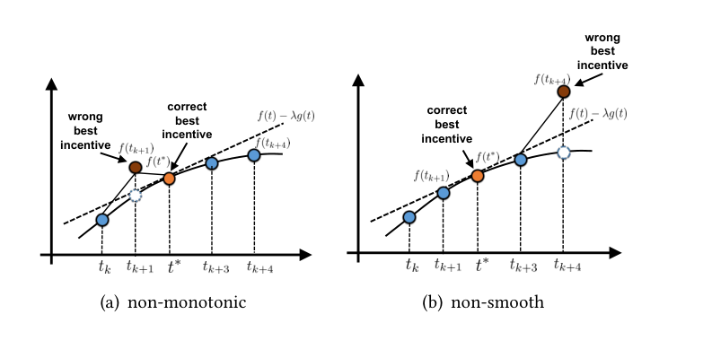
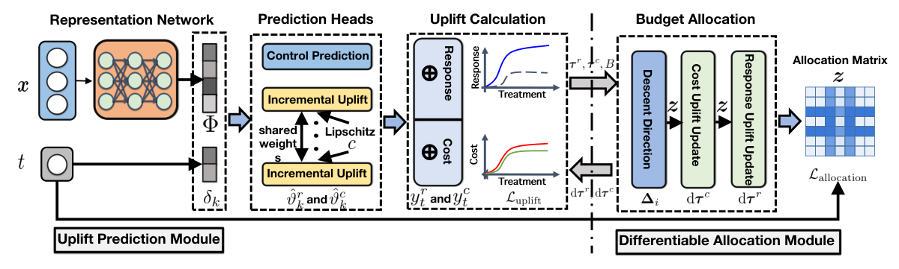
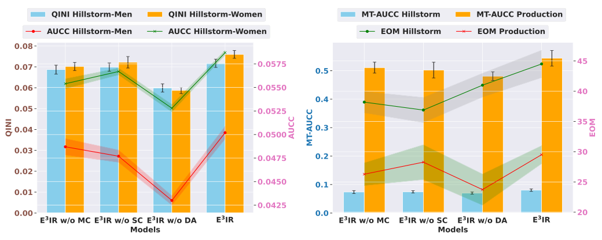
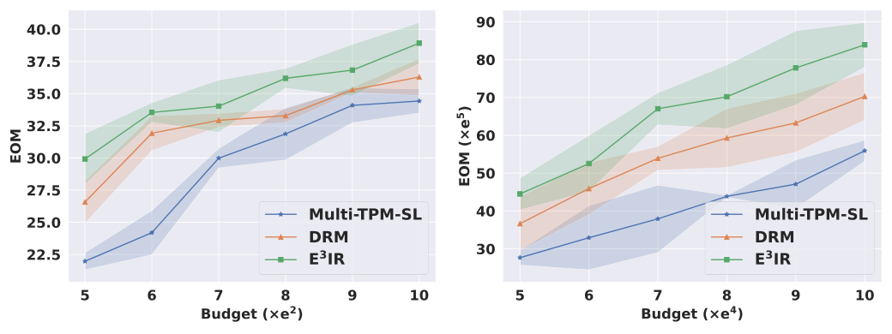

# E3IR 让预算分配信号回到增量预测

两阶段分配先预测每位用户在各券档相对不发的价值和成本，再把两张表固定下来，交给整数规划。若一档成本略越过预算，回归误差几乎未变，整批用户的分配却可能改变。E3IR 用有序动作学习相邻档的价值和成本增量，再尝试把整数选档的损失传回预测器。 [Sun 等，arXiv v2 §1–4](https://arxiv.org/pdf/2408.11623v2#page=2)

Sun 等，固定 v2 第 2 页图 1，从采用版 PDF 裁出双图。左边示意估计响应下降，右边示意局部尖峰，净值排序还需同时看成本曲线。 [采用版图 1](https://arxiv.org/pdf/2408.11623v2#page=2)

## 一条事实日志怎样监督相邻增量

设用户 A 可选不发、5 元或 10 元，历史实际收到 10 元，消费和补贴支出各有一个事实标签。用户特征先经过共享底层，处理嵌入把档位信息提供给预测头。响应路径和成本路径各自累加非负增量。若价值基线为 10，两段价值增量为 3、2，三个结果预测为 10、13、15，送入求解器的是对照差 0、3、5。成本两段若为 2、2，则提供 0、2、4。实际档的两项预测与两项标签计损失，梯度回到两段增量和基线路径。取平方保证非负，指数变换保证严格为正。 [v2 §4.1、式 (4)–(9)](https://arxiv.org/pdf/2408.11623v2#page=4)

Sun 等，固定 v2 第 5 页图 2，从采用版 LaTeX 原图渲染。上层把各档两个增量系数送到预算层，下层以标签训练响应和成本，并将分配信号送回。 [采用版图 2](https://arxiv.org/pdf/2408.11623v2#page=5)

各档的响应头共用参数，成本头同理。论文惩罚各层 Lipschitz 上界的代理，用于抑制预测头随嵌入变动而大幅变化。由此推到相邻头输出接近，还需要相邻嵌入接近。DIPN 直接惩罚相邻 logit 权重之差。E3IR 的两条累加路径分别服务价值与成本，其输出单位取决于标签。 [E3IR v2 §4.1.2](https://arxiv.org/pdf/2408.11623v2#page=4) · [DIPN 概率尺度](../SRC-DIPN/阅读笔记.md#最低档先定锚提高一档就多加一个-logit-增量)

## 整数解的邻点怎样给价值与成本不同的信号

保留 A 的预测，令 B 的三档价值增量为 $(0,4,6)$、成本增量为 $(0,2,7)$，总预算 4。按最大化价值增量、成本增量不超预算的业务表述，A、B 各选低档得 7，成本 4。A 高档、B 不发只得 5，成本也是 4。A 高档且 B 低档得 9、成本 6，超预算。教学例明确把不发当作可选档。采用版式 (2)–(3) 把目标写成 $-\min\sum\tau^r z$，最大化收益的等价实现是最小化负收益。正文另有把 $\tau^c$ 写成最大化项的句子，式 (3) 的索引从 1 开始，与 §3.1 的零档及“至多一个激励”未闭合。 [v2 §3、式 (1)–(3)](https://arxiv.org/pdf/2408.11623v2#page=3)

求解器返回 one-hot 档位。把损失梯度直接减到硬解上，通常得到分数。论文按梯度坐标绝对值拆成带权离散偏移，对邻点判定动作合法性与预算可行性。“A 高、B 不发”是可行邻点，价值代理比较它与当前解的目标差。“A 高、B 低”是合法但超预算的邻点，成本代理使用到预算超平面的距离。如果对响应偏差 $\tau^r\cdot(z'-z)$ 按式 (14) 原符号直接做梯度下降，会降低邻点相对当前解的收益。按最小化负收益解释才与说明的更新意图相容，具体实现待核。邻点代理按分解权重相加，产生回到预测器的替代梯度，预算 $B$ 固定。 [v2 §4.2、式 (10)–(14)](https://arxiv.org/pdf/2408.11623v2#page=6) · [预算反馈与相邻档比较](../../知识库/问题/组合营销策略如何共享结构并估计因果增量.md#预算分配的结果怎样回到预测器)

式 (19) 写的是事实动作 $t$ 与预测推荐 $z_i$ 的交叉熵。标签虽出现在样本元组内，损失右边未显式使用真实价值或成本，也未给出硬解进入交叉熵的概率、截断或松弛。按印刷式无法导出期望价值最优。式 (9) 定义带 Lipschitz 正则的增量损失，式 (20) 却写成 $\mathcal L_{\text{predict}}+\beta\mathcal L_{\text{allocation}}$。采用版无法确定最终实现是否另把正则并入。 [v2 §4.1.2、§4.2.4](https://arxiv.org/pdf/2408.11623v2#page=7)

## 离线排序和给定预算的策略表现

Hillstrom 用邮件后消费作响应、访问作成本。男装邮件与女装邮件没有天然的补贴面额顺序。Production 是两周随机试验，比较普通视频与三档锐化，用带宽作成本、播放时长作响应。作者以 500 和 50,000 为多处理预算，报告五随机种子。表 2 的 EOM 为 29.9221 和 44.5087，同表 Multi-TPM-SL 为 21.9767 和 27.6576。响应先经最小–最大归一化，Production 又除以 $e^4$。表 2 写 MT-AUUC，正文另称 MT-AUCC。表 1 男装数据的 AUCC 是 DRP 0.0545、E3IR 0.0502，女装 KENDALL 的 E3IR 原印为 0.67f54。 [v2 §5.1–5.4，表 1–2](https://arxiv.org/pdf/2408.11623v2#page=9)

Sun 等，固定 v2 第 8 页图 4，按原序渲染二元和多处理子图。比较同一数据同一指标的完整模型与逐项移除。 [采用版图 4](https://arxiv.org/pdf/2408.11623v2#page=8)

Sun 等，固定 v2 第 9 页图 6，按原序渲染作者子图。应在各子图的同一预算比较方法。Production 子图的 EOM 轴标成“×e5”，表 2 的说明是除以 $e^4$，采用版未说明图表数值怎样对齐。图 4–6 是作者评估协议下的离线证据，未报告部署 E3IR 的线上 A/B。 [采用版 §5.5–5.6](https://arxiv.org/pdf/2408.11623v2#page=9)

## 版本与译本

Zexu Sun、Hao Yang、Dugang Liu、Yunpeng Weng、Xing Tang、Xiuqiang He。采用 2024-08-24 的 arXiv v2，收录于 RecSys 2024。中文 PDF 翻译摘要、正文、图表说明、描述性脚注和致谢。采用版参考文献后无附录，源码隐去的附录保留于可编辑工程。未运行模型。 [固定原文](https://arxiv.org/pdf/2408.11623v2) · [RecSys DOI](https://doi.org/10.1145/3640457.3688147) · [中文 PDF 访问](../../译文/PDF目录.md)
