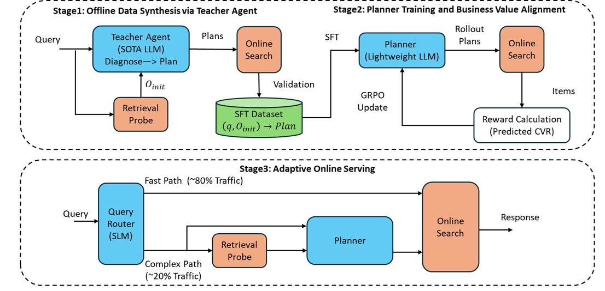

# EASP：用第一次召回诊断搜索计划

用户搜“搭配绿色衬衫的下装”，传统检索往往被“绿色衬衫”吸引，把大量衬衫送进候选。只读原词的改写模型可以推断用户想买下装，却看不到原系统已经召回什么。多轮 ReAct 能调用工具查看结果，再改写并检查，但逐轮搜索和生成增加了等待时间。EASP 将第一次轻量检索放到生成之前，让规划器根据已观察到的候选一步产出搜索动作。[原文 §1–2，第 1–2 页](https://arxiv.org/pdf/2603.15262v2#page=1)

*作者原图 1 · 先看上半图左侧如何把查询和探针快照交给教师，再看右侧如何用执行结果训练规划器。下半图的简单路径直连线上搜索，复杂路径先探测再规划。图来自 Mengxiang Chen、Zhouwei Zhai、Jin Li 的 arXiv:2603.15262v2 第 2 页，采用版 LaTeX 附图。*

## 用同一个查询区分三种检索状态

设 $q$ 为原查询，$\mathcal E$ 是目录库存与检索逻辑。探针输出 $\mathcal O_{\mathrm{init}}=\mathrm{Probe}(\mathcal E,q)$，保留核心召回和相关性匹配，省掉较昂贵的转化优化组件。在作者的实现中，这使探针相对完整链路的 tp99 低约 75%。规划器能看见的是返回结果构成的快照。例如观察到结果多是衬衫，就有依据怀疑核心购买实体漂移。仅凭零结果无法证明全库无货，因为词汇不匹配、索引缺口和召回截断也会产生零结果。[原文 §2.1–2.2，第 2–3 页](https://arxiv.org/pdf/2603.15262v2#page=2)

诊断和动作配对。结果相关且充分时保留原查询，例如“iPhone 17 Pro”。结果稀少时分辨噪声和库存空缺，前者做拼写、单位或填充词清理，后者停止细化。结果很多但精度差时，按实体漂移、粒度、否定约束或属性、场景错配具体化意图。在贯穿例子中，表 1 把以衬衫为主的快照判为实体漂移，生成“卡其裤”“牛仔裤”两个并行检索动作。这个例子说明了重新锚定购买实体，也显示新动作可能没显式保留“搭配绿色”的条件。保留原查询条件并评价整个候选池，比查每条改写是否通顺更贴近原任务。[原文表 1 及 §2.2.1–2.2.2，第 3 页](https://arxiv.org/pdf/2603.15262v2#page=3)

## 先学可执行示范，再优化执行结果

教师 DeepSeek-R1 读取同一 $(q,\mathcal O_{\mathrm{init}})$，以非零温度采样多条规划轨迹。线上搜索环境执行每条计划，成功的三元组进入 SFT 集。轻量学生 Qwen3-4B 用示范计划的下一 Token 作标签，从原查询及快照预测规划输出；损失沿学生的词表投影和骨干更新参数，检索后端作为执行环境。论文未披露成功过滤的完整判定与计划序列化细节。图 1 中教师和验证步骤都在构造训练数据一侧。[原文 §2.2–2.3，第 2–3 页](https://arxiv.org/pdf/2603.15262v2#page=3)

随后学生对同一上下文采样一组计划，每条计划实际调用搜索引擎得到前 $K$ 件商品 $\mathcal D_P$。式 (3) 将各候选的线上预测 CVR 按原查询的相关性阈值门控后平均：

$$
R(P)=\frac1K\sum_{d\in\mathcal D_P}
\mathbb I[\phi_{\mathrm{rel}}(q,d)\ge\tau]\phi_{\mathrm{cvr}}(q,d).
$$

假设两个计划各召回两件商品。计划 A 召回高转化但不相关的衬衫（预测 CVR 为 0.30）和相关卡其裤（0.08），奖励 $(0+0.08)/2=0.04$。计划 B 召回合格卡其裤（0.08）和牛仔裤（0.06），奖励 $(0.08+0.06)/2=0.07$。不合格商品仍占 $K$ 的位置。GRPO 基于同组计划的相对奖励更新学生生成行为，生产相关性与 CVR 模型给出分数，不经搜索结果对它们反传。奖励是经过相关性门控的**预测**转化，实际订单和 GMV 由线上流量实验检验。式中的 $\tau$ 表示相关性阈值，教师采样段落同一符号表示温度。[原文式 (3)，第 3 页](https://arxiv.org/pdf/2603.15262v2#page=3)

线上先由 Qwen3-0.6B 判断复杂度。简单查询直进搜索，复杂查询才执行探针、学生规划、后端执行，教师不在在线决策路径内。快照提供了一次响应中检索环境的局部反馈。部署还需观察查询漏路由、探针覆盖及供给刷新，这些参数并未由论文披露。可继续阅读[复杂查询怎样生成可执行的检索请求](../../知识库/问题/复杂查询怎样生成可执行的检索请求.md)。

## 用购买命中和相关商品数看方案差异

作者从京东历史日志抽取 1 万条复杂查询评估。REL@30 是前 30 个候选里的相关商品数。HR@30 是最终购买品是否在候选里，真值可来自跨渠道或同会话的后续改写，需要核心商品和品牌一致。表 2 中，盲改写器与 EASP 同为 Qwen3-4B、SFT+GRPO，REL@30 从 20.7 到 23.3，HR@30 从 28.6% 到 31.0%。移去 RL 得到 23.0 和 29.5%。基于 DeepSeek-R1 的多轮 ReAct 有最高的 REL@30（24.1），HR@30 为 30.2%，耗时为秒级。ReAct 同时更换了模型和执行方式，不能把差异完全归给是否多轮。原文称 24.1 对 23.3 的差距为 0.8 个百分点，按指标定义应读作平均计数差 0.8 件。[原文 §3.1–3.2、表 2，第 4 页](https://arxiv.org/pdf/2603.15262v2#page=4)

京东 AI-Search 两周 A/B 中，论文称 EASP 接入 10% 真实流量。整体口径 UCVR 增加 0.89%，GMV 增加 0.57%（均 $p<0.05$），实际触发复杂路径的请求中两者分别增加 4.10% 和 2.59%。触发组与整体的流量口径不同。约 80% 的简单查询走快路。引言用流量构成解释规划器端到端 p75 低于 20 ms、p99 低于 700 ms，§3.3 将它们分别表述为快路径 p75 和复杂查询 p99。保留这两处表述，原文没有提供统一延迟分布、并发参数或所含生产检索阶段的完整拆分。[原文 §1、§3.3，第 1、4 页](https://arxiv.org/pdf/2603.15262v2#page=4)

## 采用版与中文 PDF

采用 arXiv:2603.15262v2（2026-04-29），5 页。正式书目为 SIGIR 2026 第 4518–4522 页。中文工作译本由作者 LaTeX 重排为单栏，覆盖摘要、§1–4、公式和图表说明、报告人简介，图内文字及参考文献保留原文。8 页 PDF 逐页渲染检查，原文和中文 PDF 已完成私有备份与认证下载。可编辑工程及本地译文位于 `.local/papers/SRC-EASP/translation/`。[固定原文](https://arxiv.org/pdf/2603.15262v2) · [正式书目](https://doi.org/10.1145/3805712.3808459) · [私有 PDF 访问说明](../../文档/工具/中文PDF发布.md)
