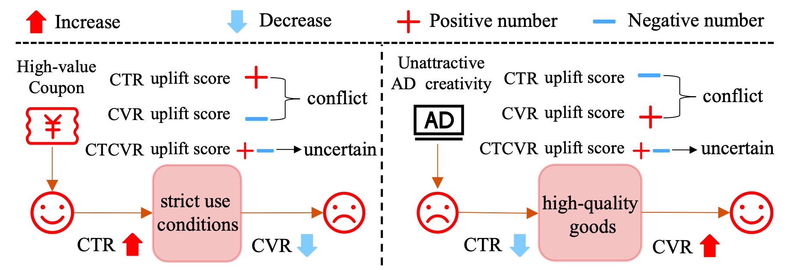
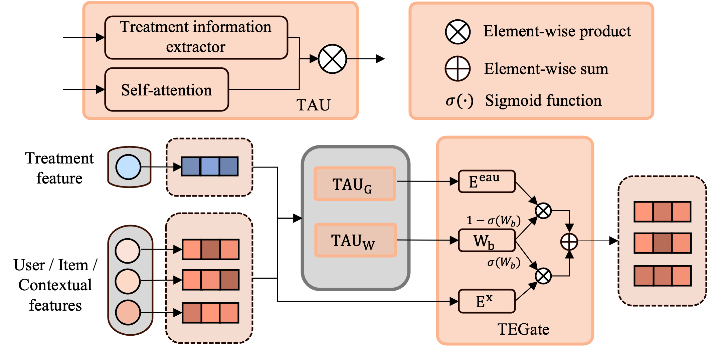
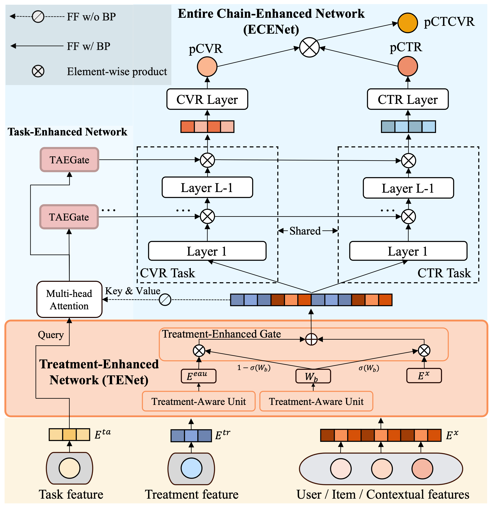

# ECUP：优惠怎样沿曝光、点击与转化改变订单

发一张面额醒目的券，更多人会打开页面，但严格的使用门槛可能使点击后转化率下降。用点击样本上的转化率差来选券，会漏掉新带进来的订单。ECUP 沿用 ESMM 在全曝光空间学习点击与联合转化的概率分解，让同一个模型接收处理档位，分别预测每档下的两种响应，再与不发券比较。处理先改写输入字段，任务再改写共享塔中的隐状态。 [固定 v1 §1–4](https://arxiv.org/pdf/2402.03379v1#page=2) · [ESMM 的全空间监督](../SRC-ESMM/阅读笔记.md#从概率分解到两个子网络)

## 点击率与点击后转化率可以同向作用，也可以抵消

为同类用户比较不发券与发券。若不发时 CTR 为 20%、点击后 CVR 为 30%，每百次曝光期望发生 6 次转化。发券后 CTR 为 30%、点击后 CVR 为 24%，每百次曝光期望转化 7.2 次。点击后 CVR 降 6 个百分点，全曝光的 CTCVR 却升 1.2 个百分点。令两臂的点击概率为 $c_0,c_1$，点击后转化概率为 $v_0,v_1$，链路末端的增量是 $c_1v_1-c_0v_0$，展开可写为 $(c_1-c_0)v_0+c_1(v_1-v_0)$，此例对应 +3 和 −1.8 个百分点。曝光人群相同，处理后的点击人群可以变化，后一项没有固定点击人群中直接作用的含义。 [v1 §2.1、§3，式 (1)–(2)、图 2–3](https://arxiv.org/pdf/2402.03379v1#page=2) · [点击后条件概率与联合响应](../../知识库/问题/点击后转化率估计.md)

Huang 等，固定 v1 图 2。原图的两个例子展示优惠改变点击与购买倾向的方向可以不同，最终转化增量取决于二者的相对幅度。 [原图](https://arxiv.org/pdf/2402.03379v1#page=2)

## 同一条曝光如何进入两个概率头

输入是曝光前的用户、商品及上下文字段和实际券档。TENet 先在基础字段间做自注意力，再用券档嵌入通过 MLP 给出的向量逐维调节交叉后的字段。两套处理感知单元分别产出处理表示 $E^{TAU}$ 与门分数 $W_b$。一维原始行为特征若为 0.8，处理表示为 0.2，原表示权重为 0.25，那么该维输出 $0.25\times0.8+0.75\times0.2=0.35$。换回不发券时，两个量都会重算。最后把融合结果与券档嵌入拼接。 [v1 §2.2、§4.2，式 (3)–(4)、(9)–(16)](https://arxiv.org/pdf/2402.03379v1#page=5)

Huang 等，固定 v1 图 5。两条 TAU 路径分别服务门和表示，TEGate 用逐维权重混合初始嵌入与处理感知嵌入。 [原图](https://arxiv.org/pdf/2402.03379v1#page=5)

点击与转化任务各用任务嵌入当查询，注意力读取 TENet 给出的字段，读取支路对被检索的处理表示停梯度。注意力产出的上下文，经 TAEGate 映射到 $[0,\gamma]$，逐层按元素缩放末层之前的隐藏激活。两任务共用末层之前的网络参数，但每个任务的输入激活可以经不同系数缩放，最后由不同 sigmoid 头输出 $c_t(x)$ 与 $v_t(x)$。TENet 的逐维融合也经主干直接接收预测梯度。 [v1 §4.1，式 (5)–(8)、图 4](https://arxiv.org/pdf/2402.03379v1#page=4)

Huang 等，固定 v1 图 4。从下向上依次读取券档、任务与曝光特征，最上层点击和点击后转化概率相乘，得到全曝光联合预测。图中的阻断只作用在任务注意力读取支路。 [原图](https://arxiv.org/pdf/2402.03379v1#page=4)

若这条记录领到券、点开却未下单，其点击标签为 1，联合标签为 0，损失同时拉高 $c_t$ 并压低乘积 $c_tv_t$。若没有点击，两个标签均为 0，联合项仍通过乘积提供梯度，CVR 头的梯度经 $c_t$ 缩放，没有一项直接以未点击作为 CVR 负标签。推理把同一 $x$ 分别和发券及不发券一起输入，得到 $c_1-c_0$ 和 $c_1v_1-c_0v_0$；训练的每条日志只在实际档位接受监督。ECUP 和 DESCN 都使用全样本的联合事件，ECUP 将点击作为转化的行为前驱，DESCN 从处理指派和结果的联合概率约束处理臂响应。MTMT 按任务路由专家，对多个目标允许独立结果头；ECUP 用概率乘积明确连接前后级。 [v1 §4.1.2，式 (8)](https://arxiv.org/pdf/2402.03379v1#page=4) · [DESCN](../SRC-DESCN/阅读笔记.md) · [MTMT](../SRC-MTMT/阅读笔记.md)

## 随机分配支持全曝光比较，点击后人群随处理变化

MT-LIFT 来自美团外卖券，两个月约 554 万样本，最后一周作为测试。作者说明随机分配，固定 README 把处理编号列为 0–4，列出 99 个特征与点击、转化两个标签。图 6 的 $T$ 与 $X$ 独立是该数据采集设计。应用到观测投放日志时，输入券档并不能建立可交换性，还要核对处理前特征、重叠、处理资格与归因窗口。对点击条件的比较还需注意随机分配之后的人群选择。 [v1 §5.1.1，图 6、表 1](https://arxiv.org/pdf/2402.03379v1#page=6) · [固定 MT-LIFT README](https://github.com/MTDJDSP/MT-LIFT/blob/379b315dc0fcd7e9dedece720477f38823cc4fdc/README.md)

Huang 等，固定 v1 图 6。券档和曝光前特征均可影响点击与转化，点击本身位于处理之后。 [原图](https://arxiv.org/pdf/2402.03379v1#page=6)

表 3 在 MT-LIFT 上报告 CTCVR AUUC/QINI 为 0.813/0.291。点击子集的 CVR QINI 为 0.187，低于 EFIN 的 0.267。表 4 在 MT-LIFT 移除 ECENet 后 CTCVR AUUC 为 0.743；该变体同时改变拟合空间和任务先验，差值覆盖整组机制。两周线上试验以点击样本 CVR T-learner 加神经网络为基线，作者报告 ROI、GMV、订单量相对变化为 +7.4%、+5.3%、+5.1%。这些数值对应那次投放策略与基线。 [v1 §5.1–5.4，表 3–5](https://arxiv.org/pdf/2402.03379v1#page=7)

## 版本与中文译本

截至 2026-11-26，核对固定 v1 正文 §1–7、式 (1)–(16)、图 1–6、表 1–5 和固定数据 README，未下载数据或运行模型。采用版 v1 页面标示 CC BY 4.0。arXiv v2 仅保留撤回公告，作者称将进一步修订。独立会议 DOI 仍可查，Crossref 记录中未见撤回更新关联，ACM PDF 请求返回 403。本文证据均定位至可取得的 v1。7 页中文 PDF 由作者 LaTeX 副本编译，正文、图表说明与描述性脚注已译，参考文献和图内文字保留原文。最终 PDF 已逐页目视。 [固定 PDF](https://arxiv.org/pdf/2402.03379v1) · [v1 许可与题录](https://arxiv.org/abs/2402.03379v1) · [v2 公告](https://arxiv.org/abs/2402.03379v2) · [会议题录](https://doi.org/10.1145/3589335.3648320) · [中文 PDF 访问](../../译文/PDF目录.md)

本机译本位于 `.local/papers/SRC-ECUP/translation/中文.pdf`，可编辑工程入口为 `.local/papers/SRC-ECUP/translation/translated-sources/main.tex`。 [私有备份下载说明](../../文档/工具/中文PDF发布.md#登录下载)
