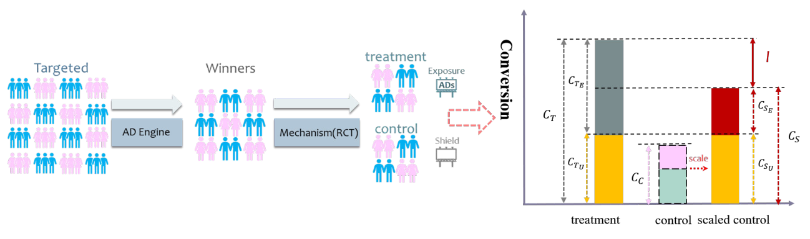
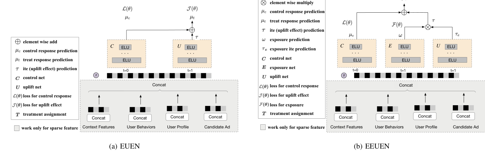
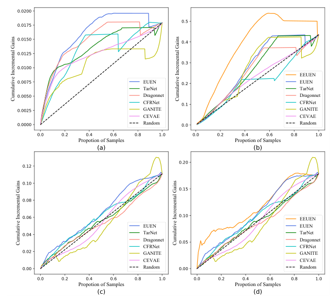

# EEUEN 怎样分开指派增量与实际曝光增量

广告随机分流决定是否允许展示，频控、超时和渲染失败仍会令一部分处理组没有看到广告。EEUEN 将随机指派的效应写成「实际曝光概率 × 本会曝光用户的曝光效应」，为两个量分别出分。这与营销补贴的通知已指派但未送达很相似。若直接拿已送达者与全部随机对照比较，两组可能因网络环境、入口和用户行为而不同。采用 Wenwei Ke 等的作者仓库匿名稿，会议题名和署名由 ICDM 2021 条目核实。 [作者仓库固定原稿](https://github.com/aifor/eeuen/blob/d85f24a2df32f8cfb974864046aa203461ee9e4b/Uplift_Modeling_for_Online_Advertising.pdf) · [会议 DOI](https://doi.org/10.1109/ICDM51629.2021.00138)

## 随机的是允许展示，实际曝光还有一道门

图 1 为作者原图，裁取自固定稿第 3 页。左侧先选出赢得展示机会的广告，再在随机对照中屏蔽一部分；右侧按样本量把对照转化缩放到处理臂。作者把对照臂划分为若放行会曝光与不会曝光两部分，这个分组在对照日志中通常不能直接观测。 [固定原稿第 3–4 页](https://raw.githubusercontent.com/aifor/eeuen/d85f24a2df32f8cfb974864046aa203461ee9e4b/Uplift_Modeling_for_Online_Advertising.pdf#page=3)

设 $T$ 为是否随机允许展示，$E(1),E(0)$ 分别为两种指派下是否会实际曝光。当对照始终被屏蔽时，$E(0)=0$。若未曝光者的结果不因指派本身而改变，且随机化使两组在给定 $X$ 时的潜在人群构成可比，则

$$
\tau_{\rm assign}(x)=\omega(x)\tau_e(x),\qquad \omega(x)=P(E(1)=1\mid X=x).
$$

$\tau_e(x)$ 描述在本会曝光的人群中，放行相对于屏蔽造成的差异。如果 1000 名处理臂用户中有 200 名看到广告，处理臂有 80 次访问，同规模对照有 70 次访问，则组间差为 1 个百分点。满足前述条件时，这 10 次新增访问由本会曝光的约 200 人贡献，估计为 5 个百分点。若放行本身改变页面布局或挤掉另一个广告，即使最终曝光失败也可能改变结果。此时未曝光效应不会自动抵消。曝光概率太低时，把很小的组间差除以曝光率会放大噪声。 [原稿 §III-B](https://raw.githubusercontent.com/aifor/eeuen/d85f24a2df32f8cfb974864046aa203461ee9e4b/Uplift_Modeling_for_Online_Advertising.pdf#page=4)

## 一条未实际曝光的处理样本怎样训练模型

图 2 为作者原图，裁自固定稿第 5 页。比较左图与右图。EUEN 的处理预测是 $\mu_c+\tau$，EEUEN 多一个中间曝光头，将处理预测改成 $\mu_c+\omega\tau_e$。上下文、用户行为、画像和候选广告为三路子网的共同输入。 [原稿图 2](https://raw.githubusercontent.com/aifor/eeuen/d85f24a2df32f8cfb974864046aa203461ee9e4b/Uplift_Modeling_for_Online_Advertising.pdf#page=5)

假设该用户分到处理臂、渲染失败且后来访问商品，即 $(t,e,y)=(1,0,1)$。该记录给曝光头提供 $e=0$ 的二元交叉熵监督，同时以 $y=1$ 监督处理臂混合结果。公式使用模型估计的 $\omega(x)$，因此训练时不会把 $e=0$ 硬乘到增量头上。对照样本用实际结果监督 $\mu_c$，不把屏蔽后的零曝光当作处理臂曝光头的负例。

作者稿 §IV 写作处理事实损失更新全部子网。固定公开代码中，处理视图使用 `stop_gradient(c_logit)+e_prob*u_tau`，因此处理的事实误差不会通过该加项更新对照网。实际推理分别导出 `uplift_score`、`multi_uplift_score` 和 `e_prob`，对应 $\tau_e$、$\omega\tau_e$ 与 $\omega$ 的接口。代码变量称 `logit`，处理组的相加与 MSE 直接作用于连续输出，不能直接假定对照分支或增量已经做概率校准。 [原稿 §IV-C](https://raw.githubusercontent.com/aifor/eeuen/d85f24a2df32f8cfb974864046aa203461ee9e4b/Uplift_Modeling_for_Online_Advertising.pdf#page=5) · [作者代码第 143 行起](https://github.com/aifor/eeuen/blob/d85f24a2df32f8cfb974864046aa203461ee9e4b/helper/models.py#L143)

如果上一节的同类用户有 $\omega=0.2,\tau_e=0.05$，放行分数为 0.01。另一个群体若 $\omega=0.8,\tau_e=0.02$，放行分数为 0.016。选择允许展示的受众时，后者的分数更高。若在已知可以展示的情形选择广告，前者在曝光效应口径下更高。评估、排序与实际指派应使用同一个口径。 [原稿 §III–IV](https://raw.githubusercontent.com/aifor/eeuen/d85f24a2df32f8cfb974864046aa203461ee9e4b/Uplift_Modeling_for_Online_Advertising.pdf#page=4)

## 曝光校正的曲线怎样看

图 3 为作者原图，裁取自固定稿第 7 页。左列按处理与对照的结果差计算 AUUC，右列在每个累计位置再除以处理组实际曝光比例，计算 AUUCE。二者分别扣除各自的随机曲线面积得 QINI 和 QINI$_E$。若顶部样本没有曝光记录，校正的分母为零。论文用等规模分桶近似积分，仍需核查曝光数及校正波动。 [原稿 §V-B、图 3](https://raw.githubusercontent.com/aifor/eeuen/d85f24a2df32f8cfb974864046aa203461ee9e4b/Uplift_Modeling_for_Online_Advertising.pdf#page=6)

表 III 以访问为目标，EEUEN 对两套数据的 QINI$_E$ 分别为 $939\times10^{-4}$ 与 $132\times10^{-4}$，TARNet 为 $423\times10^{-4}$ 与 $83\times10^{-4}$。表 I 给出处理臂曝光率 4.13% 与 65.37%。前一数据的曝光效果分桶 $R^2$ 只有 0.017，后一数据为 0.981。后一数据的 EUEN 为 0.989。这说明作者报告的排序优势与幅度拟合可以同时呈现不同结果。表 II–IV 的平均值与标准差按原表保留，曝光曲线的结果不能直接替代实际补贴净收益评估。 [原稿表 I–VI](https://raw.githubusercontent.com/aifor/eeuen/d85f24a2df32f8cfb974864046aa203461ee9e4b/Uplift_Modeling_for_Online_Advertising.pdf#page=8)

CanniUplift 也在处理后的行为上做分解，把核销与未核销的 GMV 路径都保留在处理预测内。EEUEN 为识别曝光效应额外要求未曝光者没有指派效应。用它研究券业务时，可以从屏蔽组满足条件时本可送达的可观测规则入手。若用户没核销券时仍可能因看到优惠而购买，不能把核销直接当成 EEUEN 中的单向曝光门。 [CanniUplift 核销分解](../SRC-CANNIUPLIFT/阅读笔记.md#核销标签怎样参与训练和上线) · [实验与曝光口径](../../知识库/问题/线上实验怎样复用流量并识别真实增量.md#触发与曝光应该从两组都能复算)

## 原文与中文译本

- 阅读采用作者固定匿名稿 10 页，覆盖摘要、正文 §I–VI、图 1–5、表 I–VI，另静态核对作者公开代码的两类分数与对照梯度。IEEE 条目只用于核实出版身份，未取得会议终版。检索截至 2026-11-25，未训练模型。 [来源与哈希](来源.json)
- 中文译本根据作者稿 PDF 转写并重排，译出摘要、正文、说明脚注、图表标题和表头，保留公式、数值、图内文字及 28 条参考文献。正式译本为 `.local/papers/SRC-EEUEN/translation/EEUEN_中文.pdf`，译后主文件为同目录 `translated-sources/main.tex`。 [私有备份下载说明](../../文档/工具/中文PDF发布.md)
