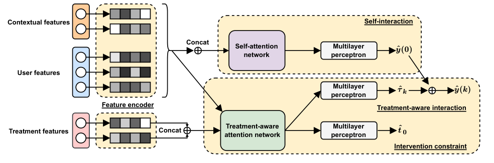
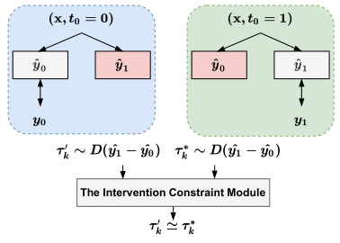

# EFIN 怎样让不同券档读取不同的用户特征

在信用卡还款营销里，两张券可能分别是无门槛小额券和有账单门槛的大额券。按券档各训练一个 T-learner，能给同一用户输出两套预测，代价是两档不能借用彼此的相近面额或门槛信息。把券档作为 S-learner 的一个类别特征，则要靠共享模型自己学出券如何改变各项特征的作用。EFIN 分开估计自然还款和各候选券的增量，用券的描述特征引导模型重新汇总用户特征。 [原文 §1、§3–4](https://arxiv.org/pdf/2306.00315v1#page=4)

## 同一位用户的输入为什么走两条路

设用户当前账单 1500 元，距离还款日还有 2 天。无门槛 3 元券和满 1000 元减 10 元券都可以作为候选。编码器把账单金额和还款时间转成用户或上下文字段的向量，也把每张待评券的 ID、面额、门槛等转成处理描述。论文对连续字段使用仿射变换，对离散字段使用嵌入表。这样两张大额券即使 ID 不同，也可以在门槛和面额上共享变换参数。 [原文式 (3)](https://arxiv.org/pdf/2306.00315v1#page=4)

图 2，Liu 等，arXiv 2306.00315v1 第 5 页裁图。上路的自然响应模型通过 self-attention 混合账单、还款习惯和当前场景，再将各字段输出拼接给 MLP。训练标签来自无券用户的实际还款。下路接收同一组用户字段和一张候选券的描述，输出该券的增量，并与自然响应相加形成事实处理响应。 [作者原图与式 (11)–(12)](https://arxiv.org/pdf/2306.00315v1#page=5)

设用户第 $j$ 个字段的编码是 $e^x_j$，候选券的整体编码为 $e^t$。处理感知注意力按 $s_j=w^\top\operatorname{ReLU}(W_1e^t+W_2e^x_j+b)$ 算分，再在用户字段上归一化得到 $\alpha_j=\operatorname{softmax}_j(s_j)$。用 $\sum_j\alpha_je^x_j$ 预测增量 $\hat\tau_k(x)$。例如，大额券可能使模型更重视账单金额，小额券可能使模型更重视还款日远近。这个例子说明同一人的字段权重可随券变化，实际注意力权重取决于训练得到的参数。对于已发大额券的训练记录，模型把 $\hat\tau_{\mathrm{大额}}$ 加到自然响应上，以实际还款为监督。没有该用户的小额券或无券潜在结果标签。推理时对每张候选券重算交互，直接使用 $\hat\tau_k$ 排序。 [原文式 (7)–(12)、§4.2.5](https://arxiv.org/pdf/2306.00315v1#page=5)

## 反转组标签能约束什么

历史策略可能把大额券主要发给高账单用户，交互表示于是容易携带原运营分组信号。论文用交互表示 $\mathbf e^{xt}$ 通过线性分类头得 $\hat t_0$，用反转标签 $\overline t_0$ 计算损失。二元时是 $1-t_0$，多臂时对原组的 0–1 掩码逐项取反。作者将此解释为对两组增量分布的干预约束。 [原文 §4.2.4、式 (13)–(14)](https://arxiv.org/pdf/2306.00315v1#page=5)

图 3，Liu 等，arXiv 2306.00315v1 第 5 页裁图。图的下半部分画出作者想达到的分布相近目标。 [作者原图](https://arxiv.org/pdf/2306.00315v1#page=5)

按印出的式 (2)、(13)–(14)，分类头和表征都在最小化同一反标签损失。在标准二元交叉熵下，如果分类头自由拟合，预测反标签和预测原标签可以通过同时反转分类头的权重与偏置互相转换。仅凭这个目标无法推导出表征与指派独立。论文也未给出单独的对抗优化步骤或梯度反转。若历史券档按处理效应修饰变量定向，有效的异质性本来也可能造成组间真实增量不同。可交换性、重叠和增量幅度验证仍需由实际数据设计支持。 [原文式 (2)、(13)–(14)](https://arxiv.org/pdf/2306.00315v1#page=5) · [历史发券的识别与比较](../../知识库/问题/历史发券日志如何估计补贴增量.md)

## 论文怎样区分排序与线上收益

表 3 的两套公开数据只有二元处理。CRITEO-UPLIFT 上 EFIN 的 QINI 为 0.1285，GANITE 为 0.1170，而 WAU 为 0.0122，低于 DESCN 的 0.0131。EC-LIFT 上 EFIN 的 QINI 为 0.0468，DragonNet 为 0.0459。QINI 是调参主指标。表 4 的还款日志按每臂对照计算再平均，EFIN 的平均 QINI 为 0.0172，T-learner 为 0.0158，平均 AUUC 则低于 S-learner（0.0085 对 0.0094）。表 5 中，移除干预约束后 QINI 从 0.1285 降至 0.1172。移除处理感知交互后 QINI 下降，但 LIFT@30 从 0.0468 升到 0.0484，与正文“移除任一模块都会下降”的概括有一个例外。 [原文表 3–5](https://arxiv.org/pdf/2306.00315v1#page=7)

论文报告在腾讯金融科技信用卡还款场景做了一个月线上 A/B，基线是各券档使用 XGBoost 的多头 T-learner。作者报告 EFIN 策略相对基线 ROI 提升 10%、MAU 提升 8%。文中未给绝对 ROI 和区间。该比较对应整套资源约束下的投放策略，不能从中推算任一券档的单用户真实增量。离散券的描述共享也不能单独证明对训练未覆盖面额的外推效果。 [原文 §5.4、表 6](https://arxiv.org/pdf/2306.00315v1#page=8) · [补贴增量评估](../../知识库/问题/怎样验证补贴增量的排序幅度和策略价值.md)

采用 arXiv 2306.00315v1 九页作者稿并核对 KDD 2023 正式题录，范围为正文 §1–6。中文译本按作者源码翻译摘要、正文、图表说明、脚注和致谢，保留图内文字、参考文献与权利声明。本地正式译文在 <code>.local/papers/SRC-EFIN/translation/中文.pdf</code>。 [固定原文](https://arxiv.org/pdf/2306.00315v1) · [正式 DOI](https://doi.org/10.1145/3580305.3599820) · [私有备份下载说明](../../文档/工具/中文PDF发布.md#登录下载)
