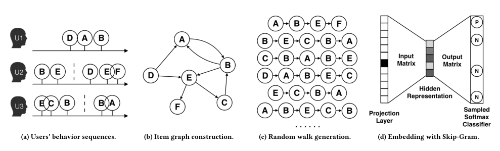
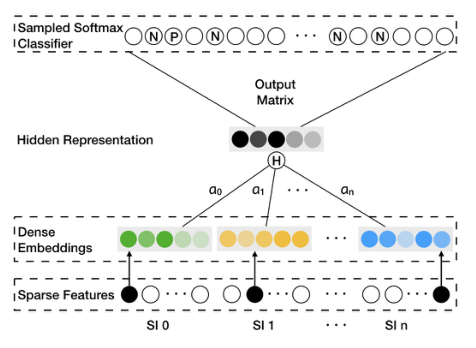
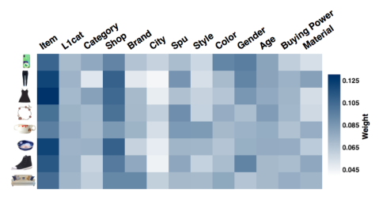
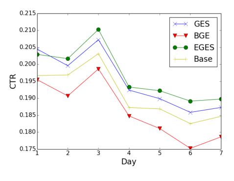
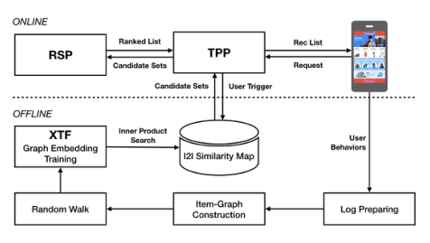

# EGES 把会话变成图，再让物品学习使用哪些属性

直接按单次购物篮统计共现，只会让同集合物品形成一阶关系。淘宝的图方法先根据会话内相邻点击建立有向转移，再用随机游走生成新的上下文。物品 ID、店铺、类目等连续向量共同进入中心表示，让冷物品也能借共享属性接近有行为的物品。

作者原图 2，Wang 等，arXiv 1803.02349v2，PDF 第 4 页。按 (a) 到 (d) 读会话、加权图、随机游走以及窗口内节点预测。

## 会话边与游走上下文

教学日志的一个会话为 A 耳机→B 耳机套，另一会话为 B→C 降噪耳机。经过原文的异常行为和时间间隔过滤后，分别加两条边。边权 $M_{ij}$ 是由 $i$ 到 $j$ 的相邻转移次数。若 B 的出边指向 C 两次、指向网球拍 D 一次，从 B 抽到 C 的概率为 $2/3$。从 A 走出 A、B、C，若训练窗口覆盖两跳，C 会成为 A 的正上下文。这个样本由游走产生，和观测到 A 后直接点击 C 有不同含义。构图的历史截止时间、窗口和出度决定可学到何种高阶联系。[原文 §2.2–2.3，式 (2)，PDF 第 3–4 页](https://arxiv.org/pdf/1803.02349v2#page=4)。

## 属性权重和两套读出

作者原图 3，同版 PDF 第 5 页。SI 0 为物品本身。左侧 GES 等权平均，右侧 EGES 为物品学习每类属性的权重。

设 $W_{s,v}$ 是物品 $v$ 的第 $s$ 类字段值的向量，同店物品读取同一店铺行。$\alpha_{s,v}$ 是物品与字段类型的权重 logit。EGES 用

$$
\pi_{s,v}=\operatorname{softmax}_s(\alpha_{s,v}),\qquad
H_v=\sum_s\pi_{s,v}W_{s,v}
$$

形成待导出的中心表示，以独立上下文表 $Z_u$ 打分 $H_v^\top Z_u$。游走邻词的标签为 1，抽到的目录节点标签为 0。给 A 的物品、类目两项设权重 0.25、0.75，向量为 $(1,0),(0,1)$，则 $H_A=(0.25,0.75)$。若正上下文 C 的 $Z_C=(0,1)$，正例 logit 为 0.75。损失对 logit 梯度为 $\sigma(0.75)-1$，同时更新 $Z_C$ 与中心表的两项。权重梯度还乘 $\pi_{s,v}Z_C^\top(W_{s,v}-H_v)$，因此此更新会继续增加类目的权重。服务可为已训练的物品索引 $H_v$。冷物品在行为图里没有自身转移。§3.3.2 用可用侧信息嵌入的等权平均作冷启动向量。例如 A 的新款若只有类目向量 $(0,1)$ 和店铺向量 $(1,0)$，其查询向量是 $(0.5,0.5)$。这一步无需估计新物品专属权重。[原文 §2.4–2.5、§3.3.2，式 (6)–(11)，PDF 第 4–7 页](https://arxiv.org/pdf/1803.02349v2#page=5)。

作者原图 6，同版 PDF 第 7 页。逐行比较不同商品在各列的颜色深浅，权重描述该模型如何组合输入向量，无法直接当成某类属性的业务因果贡献。

原文 §2.3 的 BGE 式 (5) 写为最小化两项对数似然之和。按正样本 $g=1$ 增大 $H_v^'Z_u$ 的目标，应最大化这两项，或在最小化时取负号。§2.5 的 EGES 式 (8) 写的是带负号的二元交叉熵。[固定版 §2.3、§2.5](https://arxiv.org/pdf/1803.02349v2#page=4)。

## 离线链路预测和淘宝首页的点击结果

随机去除图边后的链路预测 AUC 中，Taobao 的 BGE、GES、EGES 依次为 0.8797、0.9704、0.9746，Amazon 的对应结果为 0.9327、0.9575、0.9700。测试负对由无边物品对随机抽取。这个任务验证区分留出边与随机无边对的能力，未来会话的候选覆盖还需按时间独立检验。[§3.1，表 2，PDF 第 6 页](https://arxiv.org/pdf/1803.02349v2#page=6)。

作者原图 4，同版 PDF 第 6 页。比较七日随时间变化的曲线，原文只提供图中的线上结果与实验语境。

作者原图 8，同版 PDF 第 8 页。离线图和游走更新物品嵌入与相邻推荐，在线服务读取该结果为用户已有行为选候选。对共同物品关系的比较见[物品相似性](../../知识库/问题/物品相似性怎样由交互日志学出.md)。

采用 [arXiv 1803.02349v2](https://arxiv.org/abs/1803.02349v2)，阅读 §1–7、关键公式、算法和图表。

中文学习译本 6 页。摘要、正文 §1–7、图表说明及伪代码注释译为中文，参考文献及原图内文字保留英文。基于作者 LaTeX 编译。本地附件为 `.local/papers/SRC-EGES/translation/EGES.中文.pdf`。采用版原文与译文均已认证下载并核对完整 SHA-256。见 [PDF 备份说明](../../文档/工具/中文PDF发布.md)。
