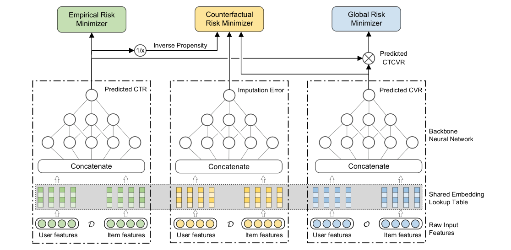

# ESCM² 怎样用点击倾向校正 CVR 风险

[ESMM](../SRC-ESMM/阅读笔记.md) 用两条全曝光监督预测点击与点击且转化。后者是两个概率的乘积，低点击区域通过乘积收到的 CVR 信号有限。ESCM² 保留两条路径，再把点击样本上的 CVR 损失按点击倾向校正。采用 Hao Wang 等人的 arXiv 2204.05125v2，论文讨论了逆倾向加权和双重稳健两个版本。

## 同一条曝光怎样进入三项监督

*Hao Wang 等，本文图 4，采用版 PDF 第 6 页。由采用版裁取图区。*

设曝光特征为 $x$，点击标签为 $o$，点击后转化标签为 $r$，CTR、CVR 预测分别为 $\hat q(x),\hat v(x)$。全曝光的 CTR 交叉熵读 $o$，全曝光的 CTCVR 交叉熵读联合事件 $or$ 与乘积 $\hat q\hat v$。设 $d$ 为点击后预测损失，IPS 给 CVR 的第三项输入 $od/\hat q$。假设一次点击曝光的 $\hat q=0.2,d=0.4$，则该项贡献 2，再除以总曝光数。未点击样本无该条直接损失。对给定 $x$，若真实点击倾向为 0.2 且条件下点击与潜在转化损失可交换，重复曝光平均贡献恢复到 $0.4$。反事实解释还要明确一致性、正倾向和可交换性，依赖点击后的损失可被这些曝光代表。数值为教学构造。[§4.1–4.2，式 (15)–(22)](https://arxiv.org/pdf/2204.05125v2#page=4)。

DR 再学损失预测 $\hat d(x)$，给全曝光计算 $\hat d+o(d-\hat d)/\hat q$。例如 $\hat d=0.3$，已点击样本贡献 $0.3+5(0.4-0.3)=0.8$，没点仍有 $0.3$ 的插补。论文另以加权平方误差监督插补塔。双重稳健属于风险估计项，在可识别条件下倾向或插补正确即可恢复期望，实际有估计误差与有限样本。极小倾向放大方差，附录举截断下界 0.1 的设置，截断改变估计量，需权衡偏差与稳定性。[§4.1、附录，PDF 第 5、10 页](https://arxiv.org/pdf/2204.05125v2#page=5)。

## 停止哪条梯度由损失的职责决定

附录明确截断 $\mathcal L_{\rm CVR}$ 经倾向分母传向 CTR 估计的梯度。否则对 $d/\hat q$ 求 CTR 路径的导数会产生 $-d/\hat q^2$，优化器可以通过提高倾向来降低该项。CTR 仍接全空间点击损失，也经 CTCVR 乘积接收梯度，共享嵌入也仍有各路径的更新。预测时直接读 CVR 塔，联合目标读乘积。DFM 校正的是点击后标签的观察年龄，ESCM² 的风险权重校正的是点击选择。[附录实施步骤，PDF 第 10 页](https://arxiv.org/pdf/2204.05125v2#page=10)。

## 定理 1 的独立假设决定了高估结论的范围

定理 1 的证明将 $\mathbb E[\hat C/\hat O]$ 分解为 $\mathbb E[\hat C]\mathbb E[1/\hat O]$。这一步需要 $\hat C$ 与 $\hat O$ 独立，而 ESMM 的前向约束是 $\hat C=\hat O\hat R$，结构并不保证独立。取等量两组曝光，真实点击概率为 $0.8,0.2$、点击后转化概率为 $0.4,0.1$。点击空间转化均值 $0.34$ 大于全曝光按组平均 $0.25$。如两个塔正好学到这组真实概率，联合预测为 $0.32,0.02$ 且都逐组准确，CVR 的全曝光平均偏差为零。这个例子满足两个全空间监督的理想拟合和点击群高转化假设，说明还需证明假设而不能推出普遍严格高估。定理 2 的文字又把准确 CTR 写成等于点击指示，证明实际代入的是条件概率。这里按证明的倾向定义解释 IPS。[§3.1、§4.1，定理 1–3](https://arxiv.org/pdf/2204.05125v2#page=3)。

§5 的观测 CVR 评估、经构造的反事实数据与工业在线试验分别提供排序、设定内因果识别和系统对照证据。全曝光反事实标签不能直接从普通点击日志验证。横向比较见[点击后转化风险](../../知识库/问题/点击后转化率估计.md)。

## 原文与阅读材料

采用[固定 v2 PDF](https://arxiv.org/pdf/2204.05125v2)，10 页，核对正文、附录和上游 LaTeX。中文正文 PDF 待交付。
